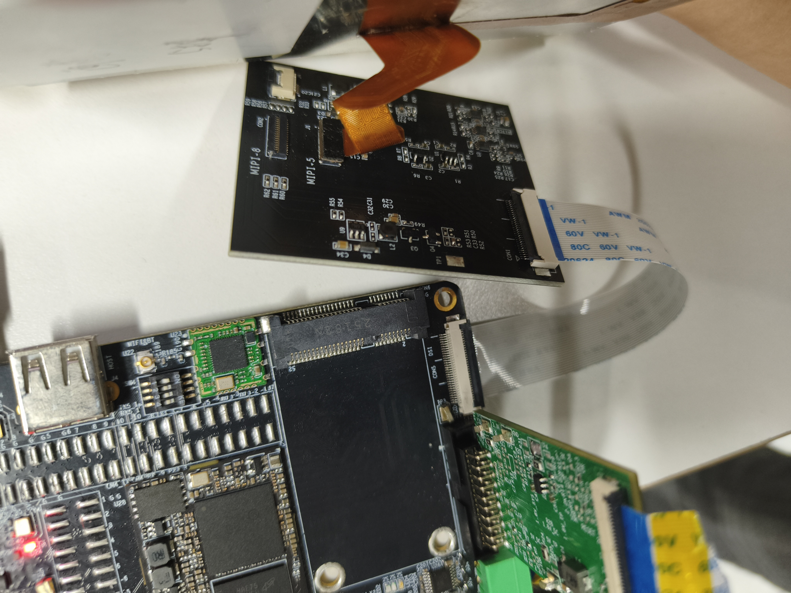
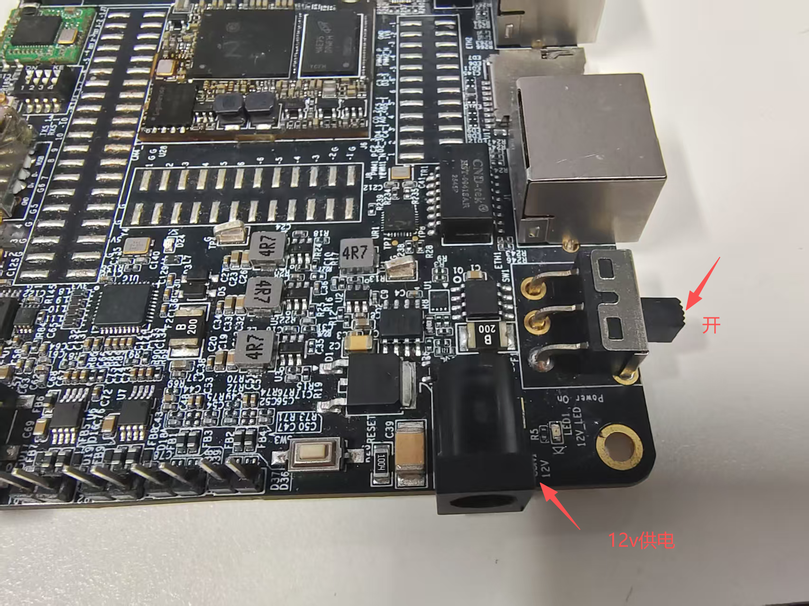
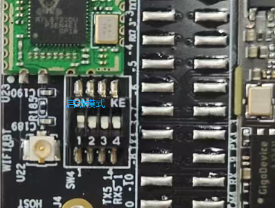
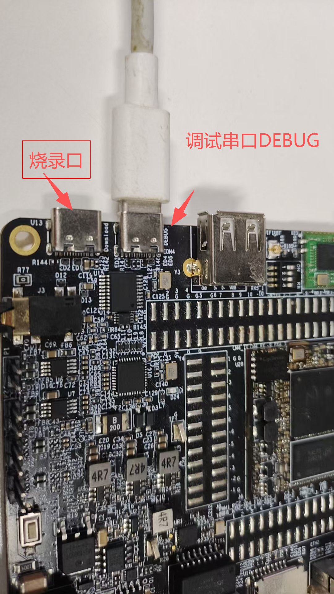
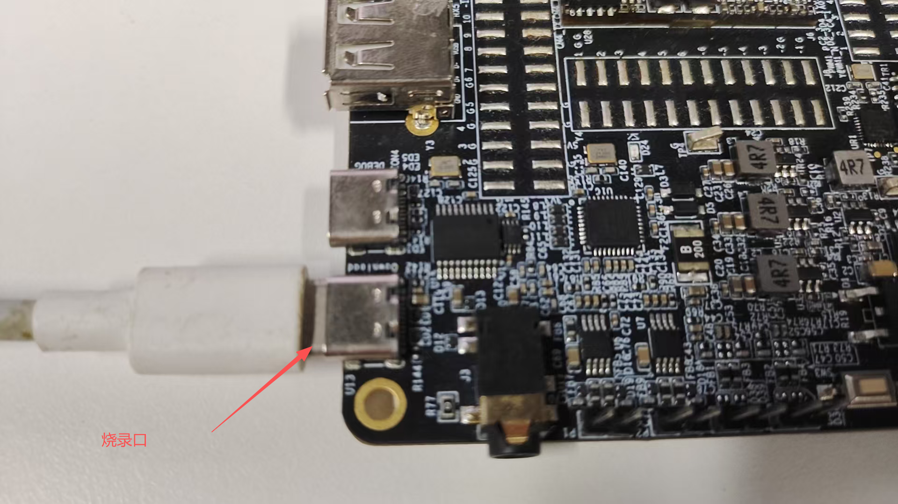
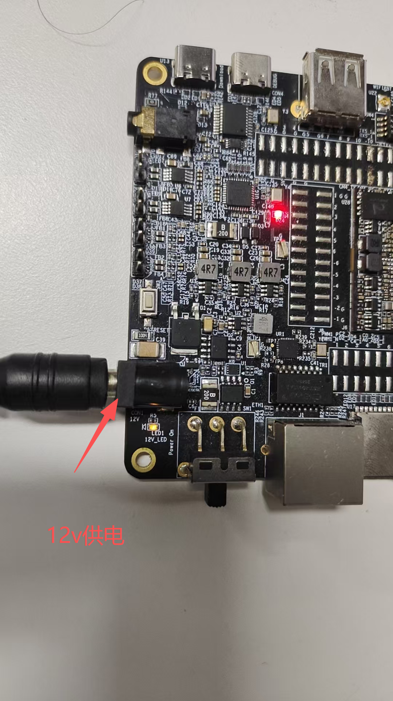

.. raw:: html

   

Boot Manual
===========

Development Board Connection
----------------------------

Preparation
-----------

.. raw:: html

   

+----------------------+---------------+
| Check and check      |               |
| Development Board    |               |
| accessories          |               |
+======================+===============+
| Development Board    | 1             |
+----------------------+---------------+
| TYPEC data cable     | 1             |
+----------------------+---------------+
| TTL Serial Port      | 1             |
| Module               |               |
+----------------------+---------------+
| DuBan Line           | Several       |
+----------------------+---------------+
| Network cable        | 1 piece       |
+----------------------+---------------+
| Power supply         | One 12V power |
|                      | supply        |
+----------------------+---------------+

Screen connection precautions
~~~~~~~~~~~~~~~~~~~~~~~~~~~~~

Check the power switch.
~~~~~~~~~~~~~~~~~~~~~~~

Serial Port Parameter Settings
~~~~~~~~~~~~~~~~~~~~~~~~~~~~~~

.. raw:: html

   

+--------+--------+--------+--------+
| Baud   | Data   | Stop   | Parity |
| rate   | bit    | bit    |        |
+========+========+========+========+
| 115200 | 8bit   | 1bit   | none   |
+--------+--------+--------+--------+

Dialing settings and TTL serial port module
~~~~~~~~~~~~~~~~~~~~~~~~~~~~~~~~~~~~~~~~~~~

To initiate dial-up mode:

TTL serial port module connection method
~~~~~~~~~~~~~~~~~~~~~~~~~~~~~~~~~~~~~~~~

Identification: DEBUG

Connect the computer to the Development Board using the TYPEC data cable

Connection of download lines
~~~~~~~~~~~~~~~~~~~~~~~~~~~~

Connection of the power cord
~~~~~~~~~~~~~~~~~~~~~~~~~~~~

Start Development Board
-----------------------

Power up Development Board
~~~~~~~~~~~~~~~~~~~~~~~~~~

Dialing Settings
^^^^^^^^^^^^^^^^

To initiate dial-up mode:

Development Board Startup Information Interpretation
----------------------------------------------------

U-Boot Information
~~~~~~~~~~~~~~~~~~

.. code-block:: text

   PL 3e3be49
   D-7f
   CPU=1000MHz
   HEAP: [0xa0018340~0xa0018440]
   SHM: [0xa0013840~0xa0018340]
   HW Reset
   RECORD: tc at 0xa0013900
   SPI 54M
   [SPINAND] RFC use command 0x6b
   [SPINAND] dummy clock 0x8
   [SPINAND] Program with command 0x32.
   [SPINAND] Random with command 0x34.
   [FLASH] BDMA mode.
   Loading Environment from SPIFlash...
   OK
   BGA2 NTC8G DDR4 3200
   miu pll: 432MHz
   DRAM Size: 1024MB
   ddr ott finish
   HEAP: [0x23d00000~0x23e00000]
   SHM: [0x22440000~0x23d00000 0x7dbd3840]
   IMG_LOAD@ devs:0xa img:CUST bak:0 ofs:0x0 sz:0x580 dst:0x23d00000
   IMG_LOAD@ devs:0xa img:CUST bak:0 ofs:0x0 sz:0x7c20 dst:0x22400000
   IMG_VERIFY@ type:1
   DECOMP@0 from 0x22400000 to 0x22400000
   Flashing D-Cache and Disabling MMU
   OS_JUMP@ method:1 entry_pointer:0x22400000
   
   IPL_CUST 3e3be49
   D-7f
   HEAP: [0x23d00000~0x23e00000]
   RECORD: moving tc from 0x224400c0 to 0x263ff000
   SPI 54M
   IMG_LOAD@ devs:0xa img:RISCVFW bak:0 ofs:0x0 sz:0x580 dst:0x23d00000
   IMG_LOAD@ devs:0xa img:RISCVFW bak:0 ofs:0x0 sz:0x62d90 dst:0x267fffc0
   IMG_VERIFY@ type:16
   DECOMP@0 from 0x26800000 to 0x26800000
   IMG_LOAD@ devs:0xa img:TFA bak:0 ofs:0x0 sz:0x580 dst:0x23d00580
   IMG_LOAD@ devs:0xa img:TFA bak:0 ofs:0x0 sz:0xe11e dst:0x263fffc0
   IMG_VERIFY@ type:2
   DECOMP@0 from 0x26400000 to 0x26400000
   IMG_LOAD@ devs:0xa img:UBOOT bak:0 ofs:0x0 sz:0x580 dst:0x23d00b00
   IMG_LOAD@ devs:0xa img:UBOOT bak:0 ofs:0x0 sz:0x6a420 dst:0x22444a80
   IMG_VERIFY@ type:4
   DECOMP@2 from 0x22444ac0 to 0x23e00000
   Flashing D-Cache
   OS_JUMP@ method:2 entry_pointer:0x23e00000
   
   
   U-Boot 2021.10 (Nov 03 2026 - 12:08:13 +0000)

Kernel Info
~~~~~~~~~~~

Development Board Login
-----------------------

Serial Login
~~~~~~~~~~~~

Network cable ssh login
~~~~~~~~~~~~~~~~~~~~~~~

.. code-block:: shell

   ssh root @ 192.168.128.113 (based on the IP obtained from the board)
   #Need to plug in and get an IP address
   /customer/ssh/etc# ifconfig eth1 down
   fconfig eth0 up
   udhcpc -i eth0 -s /etc/init.d/udhcpc.script
   ping baidu/customer/ssh/etc# ifconfig eth0 up3[emac_phy_link_adjust] EMAC Link Down
   /customer/ssh/etc# udhcpc -i eth0 -s /etc/init.d/udhcpc.script
   udhcpc (v1.20.2) started
   Setting IP address 0.0.0.0 on eth0
   Sending discover...
   [emac_phy_link_adjust] EMAC Link Up
   Sending discover...
   Sendingselectfor192.168.128.140...
   Lease of 192.168.128.140 obtained, lease time 300
   Setting IP address 192.168.128.140 on eth0
   Deleting routers
   route: SIOCDELRT: No such process
   Adding router 192.168.128.1
   Recreating /customer/resolv.conf
   Adding DNS server 192.168.128.1
   mount: mounting /customer/resolv.conf on /etc/resolv.conf failed: No such file or directory
   /customer/ssh/etc# ping baidu.com -c 3
   PING baidu.com (124.237.177.164): 56 data bytes
   64 bytes from 124.237.177.164: seq=0 ttl=53 time=36.546 ms
   64 bytes from 124.237.177.164: seq=1 ttl=53 time=36.160 ms
   64 bytes from 124.237.177.164: seq=2 ttl=53 time=36.075 ms
   
   --- baidu.com ping statistics ---
   3 packets transmitted, 3 packets received, 0% packet loss
   
   
   Connecting to 192.168.128.140:22...
   Connection established.
   To escape to local shell, press 'Ctrl+Alt+]'.
   #The username is root, there is no password, just hit enter to log in, as follows
   WARNING! The remote SSH server rejected X11 forwarding request.
   Could not chdir to home directory /home/root: No such file or directory
   /#
   /#
   /#
   /#
   # ls
   bin       config    customer  dev       etc       home      lib       lib64     linuxrc   misc      mnt       proc      run       sbin      sys       tmp       usr       va