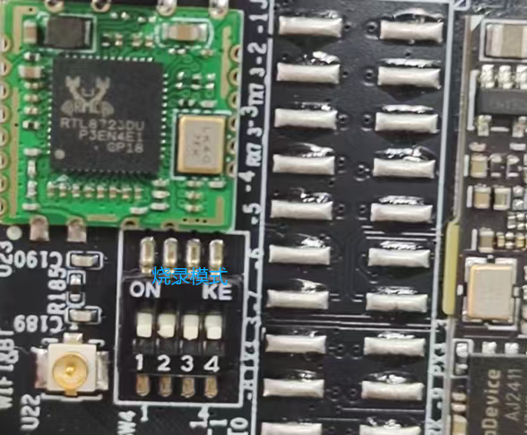
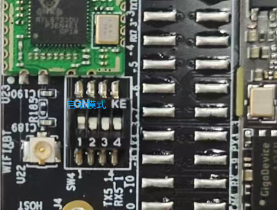
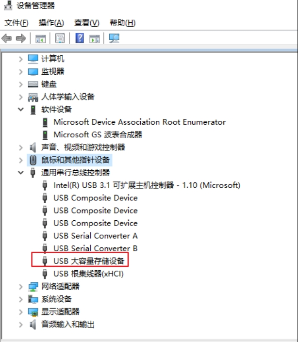
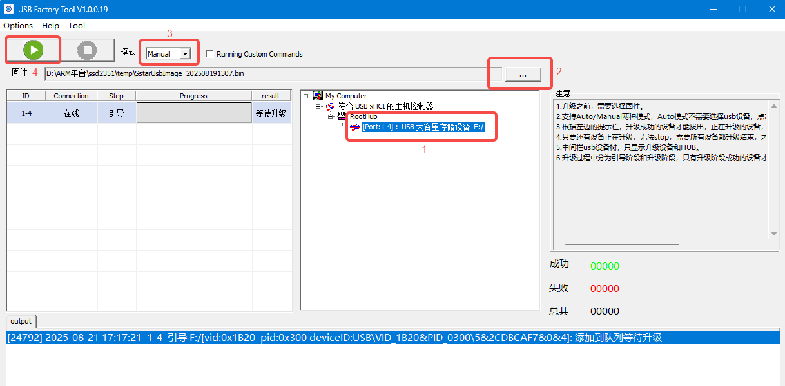

.. raw:: html

   

Firmware Update
===============

Burner: UsbFactoryTool_1.0.0.19.tar.gz
--------------------------------------

Programming Guide
~~~~~~~~~~~~~~~~~

usb interface download
^^^^^^^^^^^^^^^^^^^^^^

Burning Mode Dial Settings:

Burner: UsbFactoryTool_1.0.0.19.tar.gz

Image file: SstarUsbImage_202503050415.bin

Unpacking burning tool
^^^^^^^^^^^^^^^^^^^^^^

Right click to extract to the current directory, my computer is 64bit, so select the tool USB_Factory_Tool_64_1.0.0.19.exe

Downloads
^^^^^^^^^

Connecting the power supply and the USB line, the computer detected "USB mass storage device"

Double-click the burn tool, USB_Factory_Tool_64_1.0.0.19.exe, as follows:

#. Detected devices can be seen

#. Select Burned Firmware

#. Click the green button to start burning

#. When the progress is 100%, click the red Stop button to end

