.. raw:: html

   

Hardware Development Guide
==========================

I. BOOT
-------

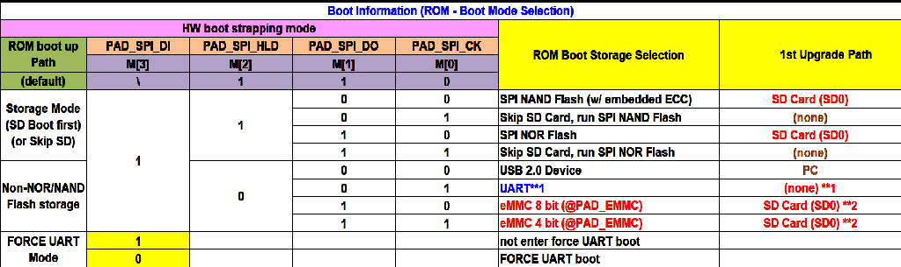

The BOOT of SSD2355 supports SD Card, NAND Flash, NOR FLASH, EMMC 8bit or 4bit startup, and supports USB or Uart download burning. Configure via SPI [3: 0].

<g id="Bold">Precautions:</g>

#. Note that the pull-up level corresponds to the SPI power domain VDDP3318_4, and the lower drawing design VDDP3318_4 is 3.3V, so take 3.3V pull-up.

#. In the design of the following figure, the original states of M [0] to M [3] are 0111 respectively.

#. When the corresponding startup mode fails, it will switch to USB download burning mode.

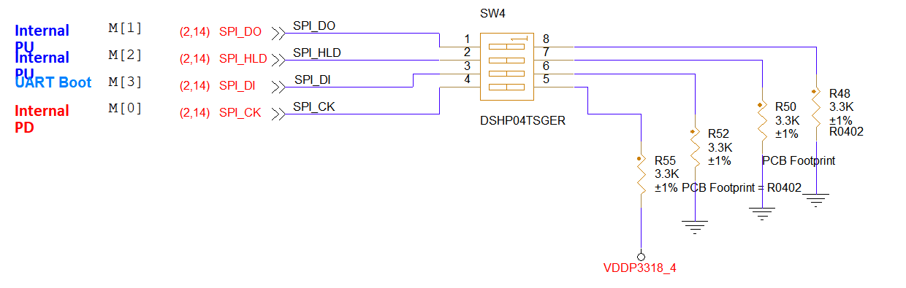

II. Reset circuit
-----------------

The reset of SSD2355 is controlled by an external button, and the low level is effective.

<g id="Bold">Precautions:</g>

#. The pin needs to increase the 2.2uF capacitance to eliminate the jitter on the reset signal, enhance the anti-disturbance energy, and prevent the system from abnormal reset caused by mis-triggering.

#. The pull-up level of the PM_RESET should be consistent with the power domain level of the IO pin

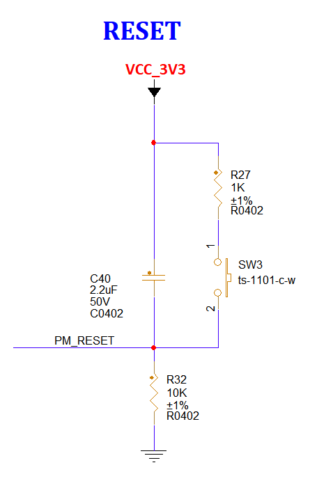

III. Power Domain Selection
---------------------------

The voltage selection in the power supply domain of SSD2355 is selected by the resistance in the following figure, where NC means no welding.

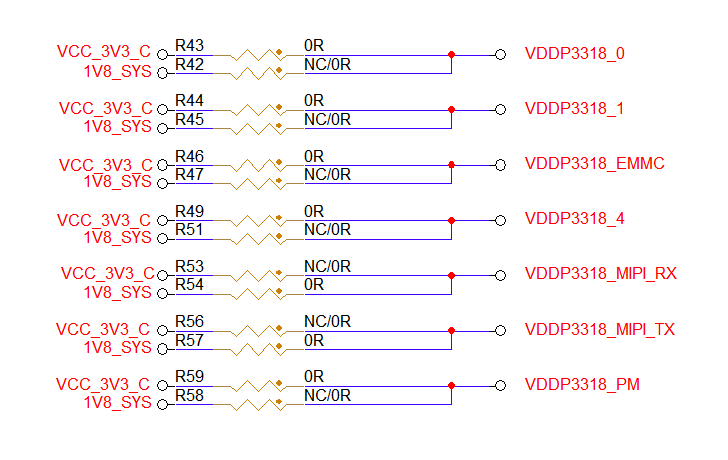

<g id="Bold">Precautions:</g>

The voltage value of the selected power domain will directly affect the voltage value of the pin corresponding to the power domain used, so strictly use the pull-up resistance of the pin, and make the pull-up resistance of the pin correspond to the voltage value of its power domain.

IV. Power supply method
-----------------------

Supply 12V through the DC power outlet, then supply power by selecting the VCC_5V0_Y from the 12V power supply or provide USB1_5V through the USB interface of Download.

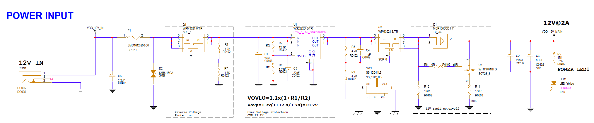

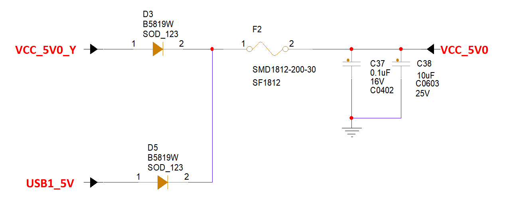

<g id="Bold">Precautions:</g>

#. In the 12V input circuit, it is necessary to do switches, indicator lights, anti-reverse irrigation, overvoltage protection and overcurrent protection at the same time.

#. The 5V selection circuit needs to be equipped with an anti-reverse irrigation diode.

V. USB
------

SSD2355 comes with two USB2.0 and its support supports Host / Device switching function, where USB P0 is used for download burning, USB P1 defaults to USB Host.

Download
^^^^^^^^

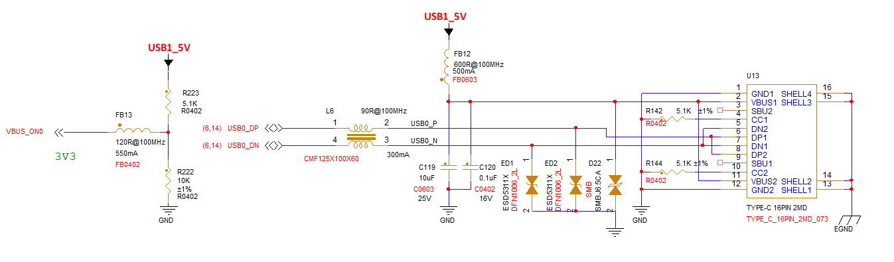

<g id="Bold">Precautions:</g>

#. USB2.0 supports Host / Device switching function, the software can detect the corresponding event and perform Host / Device switching.

#. Master boot failed, default is USB Device Mode. At this time, USB P0 can be blank Flash Firmware.

#. USB does not have anti-reverse irrigation function, and it is recommended to reserve measures to prevent reverse irrigation current in scenarios where the usb device needs to be always powered.

DEBUG
^^^^^

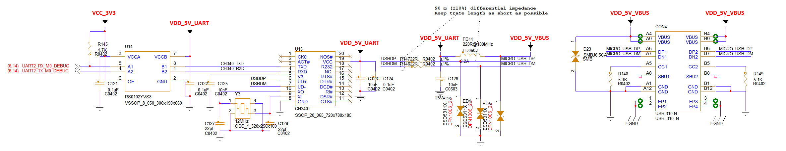

<g id="Bold">Precautions:</g>

#. PM_UART1_TX fixed for use as CPU debug and PM51_UART_TX fixed for use as PM51 debug

#. In order to facilitate debugging, the circuit shown above was designed, which turned into a common USB interface for the uart serial port.

#. Be sure to prevent ESD near the usb port.

#. Pay attention to add 4.7K pull-up resistor to uart.

#. Only CPU debug is used here If you need to use PM51 debug, you can also refer to this circuit

HOST
^^^^

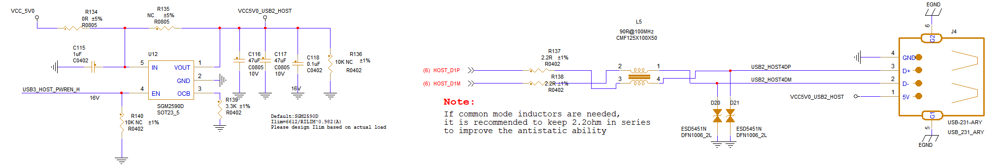

<g id="Bold">Precautions:</g>

#. USB P1 port is defaulted to USB Host, and it also supports configuration into Device mode if needed.

#. The USB flash drive interface needs to be left with current limiting IC, GPIO control, for a poor USB flash drive, SOC is required to reset the USB flash drive.

USB HUB
^^^^^^^

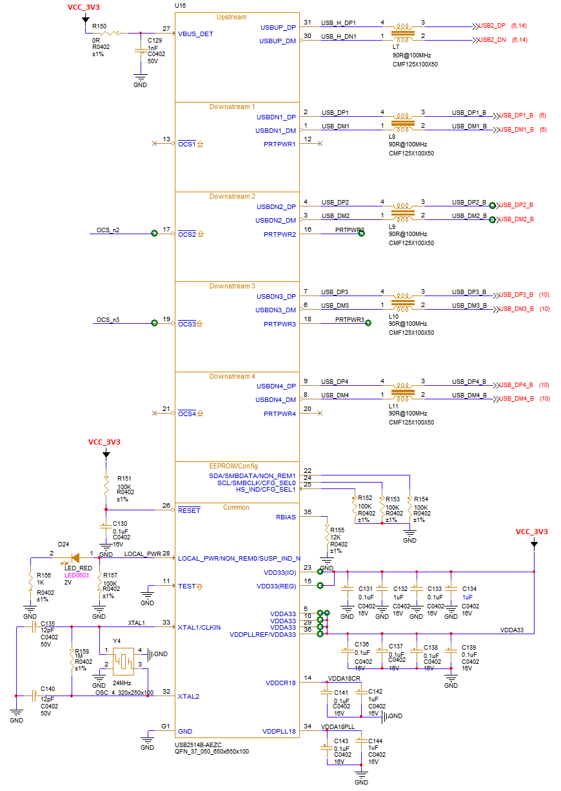

<g id="Bold">Precautions:</g>

#. The hardware pin configuration is valid only when CFG_SEL [1: 0] is set to 00 or 10.

#. It is best to keep the hardware configuration consistent with the above figure, so that an expansion of the four USB ports can be achieved.

#. Among them, the crystal oscillator frequency is selected as 24MHz, and the frequency stability is kept below or equal to 350ppm.

VI. AUDIO
---------

SSD2355 has 3 channels AMIC one channel DMIC and a pair of audio DAC left and right channel outputs. AMIC is divided into MIC0, MIC1, MIC2. Correspondingly, the left channel, the right channel, and the two channels were respectively acquired.

MIC
^^^

<g id="Bold">Precautions:</g>

#. Note the use for identification, if used for Line in, follow: R1-6.2K, R2-6.2K, R3-NC, C1-1.5nF. Follow if used for analog microphones: R1-0R, R2-NC, R3-2K, C1-NC.

#. The MIC0 and MIC2 signals used here are connected to the MIC seat, corresponding to the left channel and the two channels, respectively.

#. In general, it is best to protect the MIC seat with ESD.

#. It is best to separate the AGND from the GND and connect it with a 0R resistor.

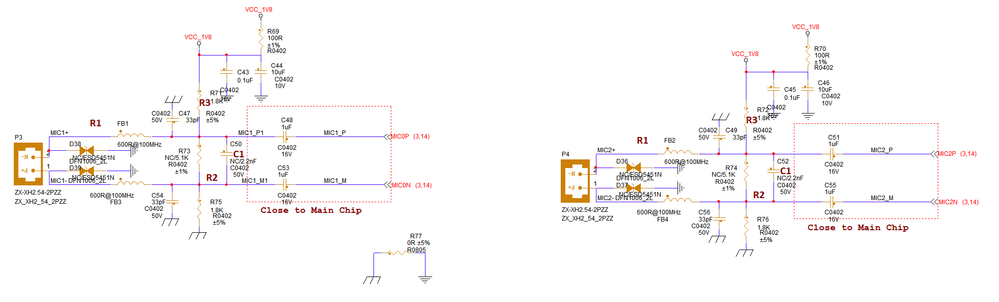

EARPHONE
^^^^^^^^

<g id="Bold">Precautions:</g>

#. It should be noted that the detection GPIO should normally be at a high level and at a low level once the headset is inserted.

#. The MIC1 used here corresponds to the right channel and can play two-channel sounds at the same time.

#. In general, it is best to protect the headset holder with ESD.

#. It is best to separate the AGND from the GND and connect it with a 0R resistor.

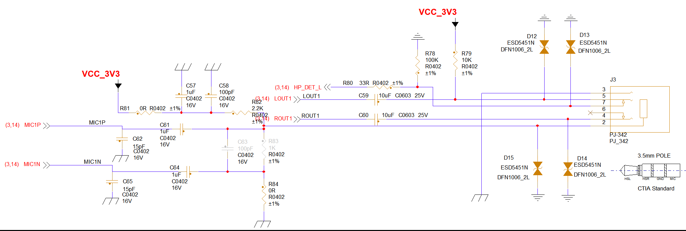

SPEAKER
^^^^^^^

<g id="Bold">Precautions:</g>

#. When connecting the audio amplifier chip, if you want to avoid the POP sound when the audio is turned on, you need a GPIO port to control the amplifier chip start time, and the amplifier is usually turned off by default.

#. Lineout comes out of the main control, it is recommended to connect the 1nF capacitor to the ground first to filter out the high-frequency noise generated by SDM DAC.

#. The following figure shows the single-ended input connection method. If differential input is required, modify it yourself.

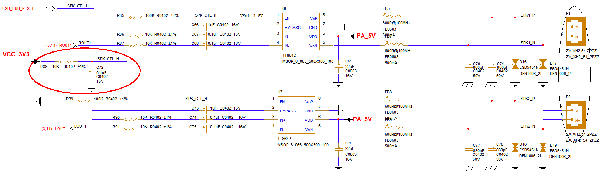

VII. ETH
--------

SSD2355 provides two paths to support 100 megabit Ethernet.

<g id="Bold">Precautions:</g>

#. YT8522C chip RBIAS pin needs to connect a 2.49 K resistor to GND (please refer to the chip manual for details)

#. MDIO pin is connected to a 1.5~5.1K pull-up resistor

#. RMII0 /1 can support 1.8V or 3.3V level, and the IO level of the chip should match it.

#. ESD protective device is required for RJ seat.

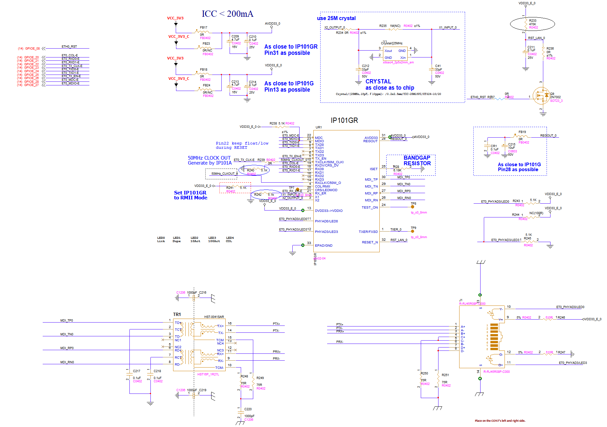

VIII. MIPI_TX
-------------

SSD2355 provides a MIPI_TX that can support 4Lane all the way.

<g id="Bold">Precautions:</g>

#. The TX line sequence designed in the following figure is only a lead function line template, which leads to a variety of signals to prepare adequately for the adapter board of the corresponding screen.

#. Pay attention to the IO level when designing the adapter board.

#. It is best to add a certain filter capacitance to the power supply part.

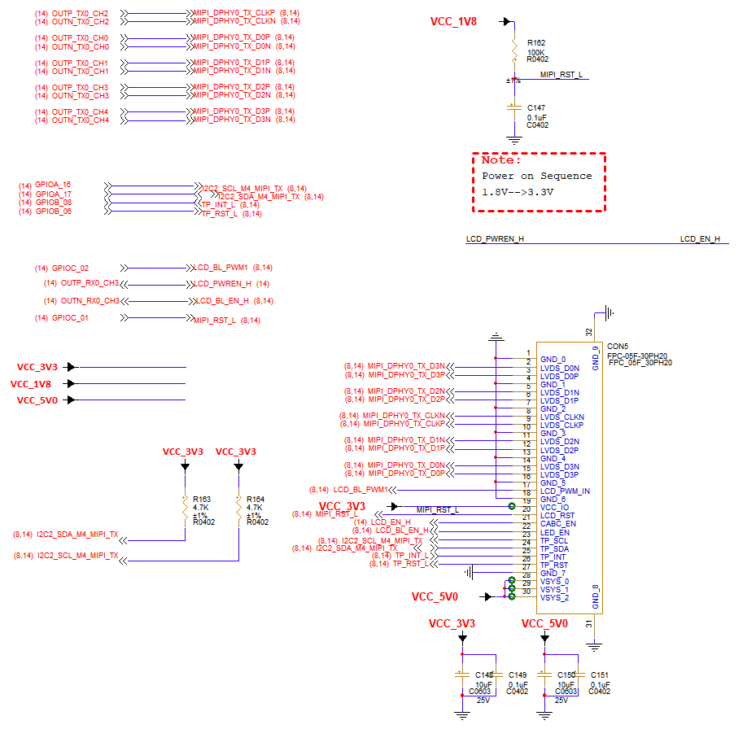

IX. MIPI_RX
-----------

SSD2355 provides MIPI_RX that can connect two 1lane and MIPI_RX that can connect one 2lane.

<g id="Bold">Precautions:</g>

Consistent with MIPI_TX above

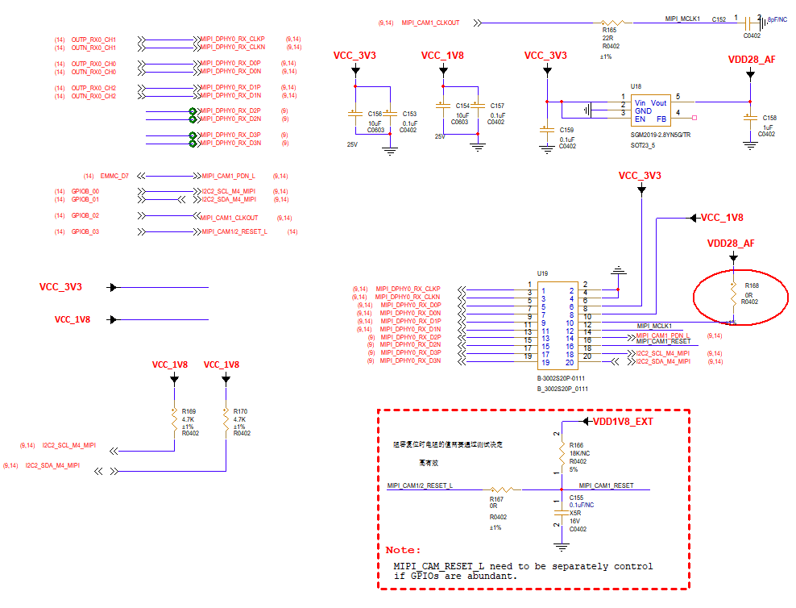

X. 4G
-----

The 4G module can be used with one USB and one GPIO controlling the Reset.

<g id="Bold">Precautions:</g>

#. How much current and stable voltage is required for the 4G module, and it is necessary to add independent DCDC module to supply power.

#. The SIM card holder needs to be equipped with a ESD protective device, and the ESD should be placed as close as possible to the card holder.

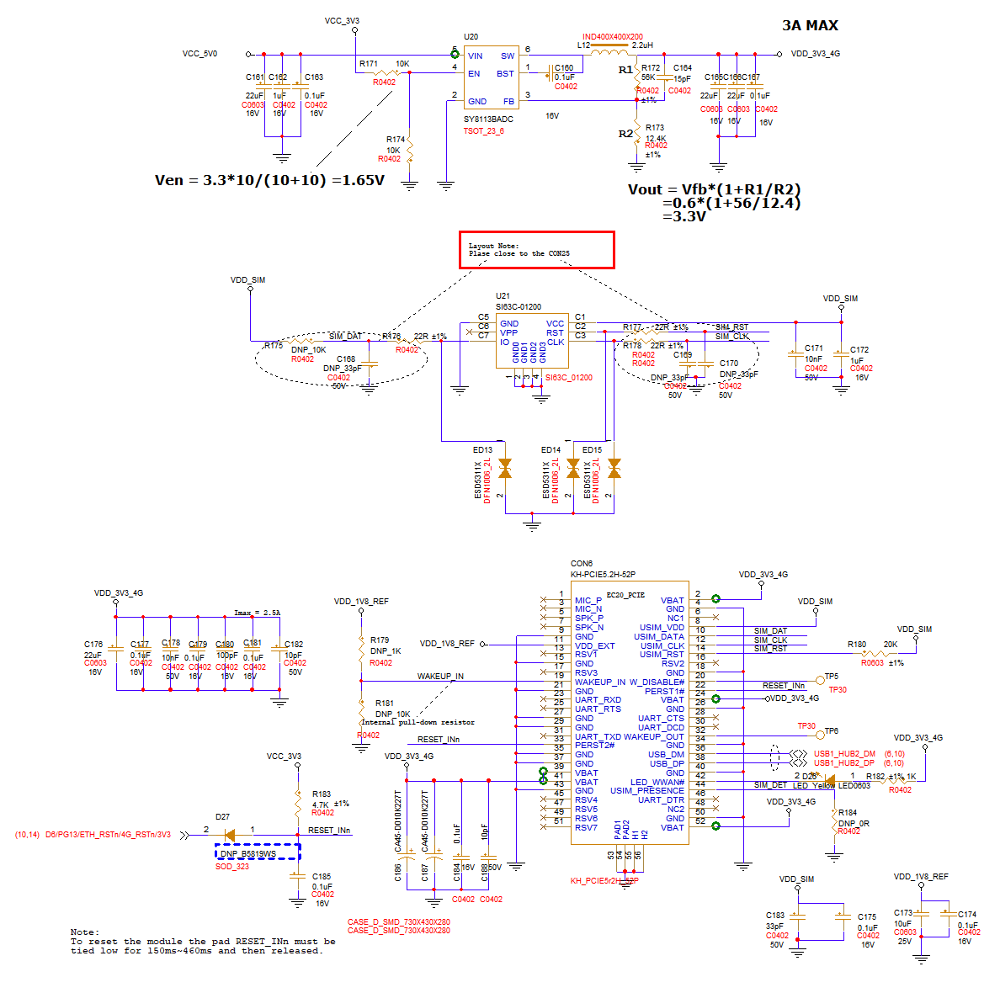

XI. WIFI /BT
------------

Use one USB to use this Wi-Fi / BT module.

<g id="Bold">Precautions:</g>

#. Remember to use the filter capacitor for filtering in the power section.

#. Remember to build a π-shaped circuit in the antenna section.

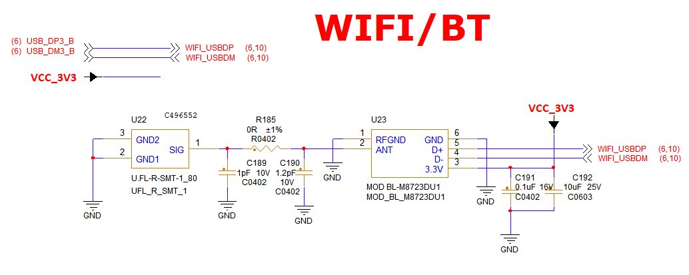

XII. SD
-------

SSD2355 provides one way SDIO.

<g id="Bold">Precautions:</g>

#. The TF card holder should be fully protected by ESD, and ESD should be placed as close as possible to the card holder.

#. Note that the level selection of the TF card IO power supply should be consistent with the power supply domain level of SDIO.

#. The design of the TF card holder can be considered to be connected to SDIO WIFI.

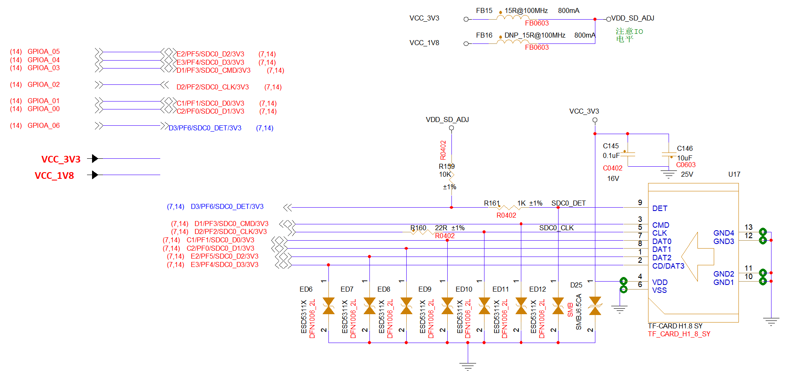

XIII. 485 /232
--------------

SSD2355 provides 8 channels UART, take 4 of them to do

<g id="Bold">Precautions:</g>

#. The pull-up resistor of UART needs to pay attention to matching the corresponding power domain level.

#. Be sure to perform ESD protection near these interfaces.

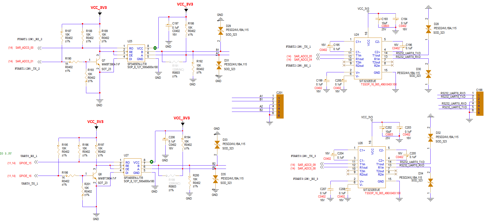

XIV. UART /I2C
--------------

SSD2355 provides 6-way I2C and 8-way UART.

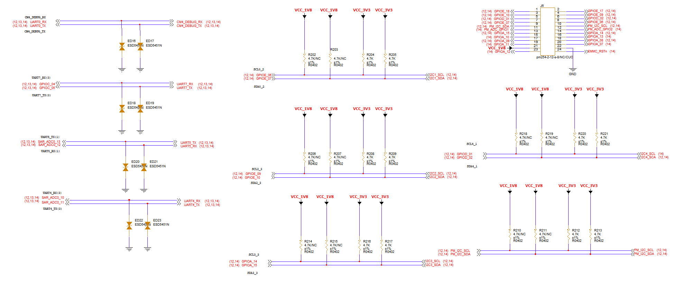

<g id="Bold">Precautions:</g>

#. The pull-up resistor of UART needs to pay attention to matching the corresponding power domain level and be sure to perform ESD protection treatment near these interfaces.

#. The pull-up resistance of I2C needs to be matched.