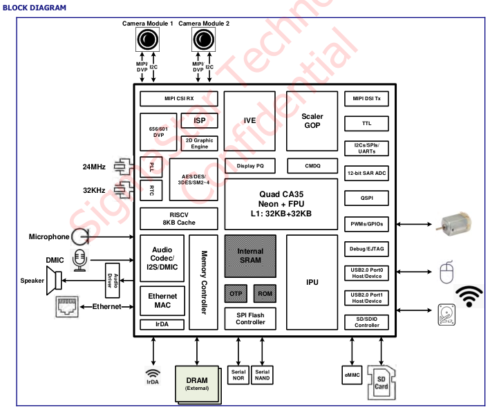

.. raw:: html

   

Platform Introduction
=====================

Product Overview
----------------

Sigmasstar SSD2355 is a highly integrated AIoT system-level chip (SoC) launched by China's SigmaStar, specifically designed for personal mobile devices, battery-powered devices, and various AIoT scenarios. The chip integrates a 64-bit quad-core processor, a professional-grade ISP image signal processor, and a high-performance AI acceleration engine. It is equipped with a complete high-speed peripheral interface, which can easily connect to various peripherals, and can output a complete software and hardware solution with high performance, high image quality, and low cost. Relying on a programmable neural network engine, it efficiently promotes the application of various intelligent algorithms on the end side.

Target Applications
-------------------

#. Smart home: smart home central control, AI camera, smart doorbell and other devices, relying on IVE, IPU hardware units to achieve humanoid detection, face recognition, intelligent alarm and home automation control.

#. Industrial vision: industrial sensors, code scanners, small PLC and other equipment, with the help of ISP and IVE to complete image filtering and matrix operation, accurately identify the target object and drive the robotic arm to perform actions.

#. Battery equipment: portable medical equipment, handheld payment terminals, walkie-talkies and other products, low-power architecture with low-leakage RTC mode, greatly extending the life of the device.

#. Consumer electronics: smart network cameras, education tablets, advertising players, etc., support dual-camera input and multi-channel screen output to meet the needs of human-computer interaction and multi-terminal display.

#. Security monitoring: The main control chip of the network camera and video analysis box supports 30fps stable video acquisition, and the hardware encryption engine ensures the security of the transmission of video stream data throughout the process.

#. Edge computing: Edge computing node carrier, complete sensor data analysis and AI inference operations locally in the device, reduce cloud dependence, and achieve rapid business response.

Main characteristics
--------------------

#. High-performance processor: quad-core Cortex- A35, main frequency 1.5GHz; independent L1 cache + shared 256KB L2 cache, integrated Neon /FPU; core is divided into independent power domain, fine control power consumption.

#. Strong AI computing power and multi-core heterogeneous: 1TOPS NPU hardware acceleration, supporting multi-precision computing; compatible with mainstream AI framework and Transformer model, special optimization of many classic visual models; equipped with RISC-V coprocessor, taking into account real-time control and low-power scheduling.

#. Professional image processing: security grade ISP, supporting up to 21m @ 30fps camera input; multi-channel camera interface, built-in noise reduction, WDR, 3A and other image enhancement algorithms, excellent image quality.

#. Hardware video engine: IVE hardware realizes image processing such as filtering and matrix operation; IPU can complete intelligent video analysis such as face detection, motion detection, and target tracking.

#. Multi-channel display output: MIPI DSI up to 2560 × 1600 @ 60fps, TTL /RGB up to 1280 × 800 @ 60fps, suitable for multi-size screens, support for multi-screen applications.

#. Interface Resources rich: dual 100 Gigabit Ethernet, dual USB2.0; eMMC /SDIO/SPI Flash multiple storage; multi-channel UART /I2C/SPI/PWM、多通道高精度 ADC, strong peripheral scalability.

#. Integrated audio subsystem: multi-channel digital/analog microphone input, DAC output, SNR > 95.2dB; I2S /TDM、SPDIF audio interface is complete.

#. Complete security solution: The hardware encryption engine supports national encryption + international mainstream encryption algorithms; secure boot, TrustZone trusted environment, built-in OTP secure storage key.

#. Low-power design: Built-in RTC low-leakage standby mode, multi-independent power domain, multi-wake source, suitable for battery-type portable devices.

Processor Block Diagram
-----------------------

Processor Features
------------------

.. raw:: html

   

+----------+----------+--------------------------------------------------------------------------+
| SPECIFIC |          |                                                                          |
| ATIONS   |          |                                                                          |
+==========+==========+==========================================================================+
| 1        | CPU      | Quad-core ARM Cortex- A35 64-bit processor                               |
+----------+----------+--------------------------------------------------------------------------+
| 2        |          | Frequency up to 1.5GHz                                                   |
+----------+----------+--------------------------------------------------------------------------+
| 3        |          | Integrated 576MHz RISC-V coprocessor                                     |
+----------+----------+--------------------------------------------------------------------------+
| 4        | NPU      | AI processing unit with integrated 1TOPS computing power                 |
+----------+----------+--------------------------------------------------------------------------+
| 5        |          | Pure hardware accelerator with support for 4/8/16-bit programmable       |
|          |          | precision                                                                |
+----------+----------+--------------------------------------------------------------------------+
| 6        |          | Efficiently support Transformer networks and mainstream AI frameworks    |
+----------+----------+--------------------------------------------------------------------------+
| 7        | Multimed | Smart Video Engine (IVE) supports hardware-accelerated video analysis    |
|          | ia       |                                                                          |
+----------+----------+--------------------------------------------------------------------------+
| 8        | Display  | Support MIPI DSI TX 4-lane up to 2560x1600 @ 60fps                       |
+----------+----------+--------------------------------------------------------------------------+
| 9        |          | Support TTL / parallel RGB interface up to 1280x800 @ 60fps              |
+----------+----------+--------------------------------------------------------------------------+
| 10       |          | Supports 8/16-bit I8080 interfaces                                       |
+----------+----------+--------------------------------------------------------------------------+
| 11       | Video    | Built-in ISP, support 12M / 21M @ 30fps camera                           |
|          | input    |                                                                          |
+----------+----------+--------------------------------------------------------------------------+
| 12       |          | Support MIPI CSI (2 data lanes) with parallel interface                  |
+----------+----------+--------------------------------------------------------------------------+
| 13       |          | Support dual camera (1 data lane) input                                  |
+----------+----------+--------------------------------------------------------------------------+
| 14       | High-spe | Integrated dual USB 2.0, dual Ethernet, SD / eMMC and multiple           |
|          | ed       | SPI/I2C/UART interfaces to meet various peripheral expansion needs.      |
|          | interfac |                                                                          |
|          | e        |                                                                          |
+----------+----------+--------------------------------------------------------------------------+