.. raw:: html

   

Product Introduction
====================

Core Board Introduction
-----------------------

Hardware Resources
~~~~~~~~~~~~~~~~~~

SSD2355 Core Board adopts a high-density integrated layout and integrates SSD2355 main control processor, power management unit, storage circuit and other key hardware circuits on a single board. The structure is compact and compact, which is suitable for the rapid hardware development of various miniaturized AIoT devices.

Core Board Internal Integration:

#. SSD2355 processor (CPU + NPU + ISP + RISC-V coprocessor)

#. DDR Memory

#. eMMC 5.0 /SDIO/SPI Flash Storage Circuit

#. PMIC Complete Power Management Circuit

#. High precision RTC clock circuit

#. Hardware BOOT Boot Configuration Circuit

#. Hardware encryption with OTP secure storage unit

#. Complete audio signal processing circuitry

Core Board Specifications
-------------------------

.. raw:: html

   

+------------+----------+-------------------------------------+
| Core Board |          |                                     |
| Specificat |          |                                     |
| ions       |          |                                     |
+============+==========+=====================================+
| 1          | Model    | MYZR-SSD2351-EK199                  |
+------------+----------+-------------------------------------+
| 2          | Dimensio | 28mm × 32mm                         |
|            | ns       |                                     |
+------------+----------+-------------------------------------+
| 3          | PCB      | 8th Floor Tier 2 Blind Burying and  |
|            |          | Submerging Process                  |
+------------+----------+-------------------------------------+
| 4          | Memory   | 128MB/256MB/512MB/1GB DDR3/4        |
+------------+----------+-------------------------------------+
| 5          | Save     | 128MB/256MB/512MB NOR FLASH         |
+------------+----------+-------------------------------------+
| 6          | Starting | SPI NOR / NAND、SD、eMMC、USB、UART |
|            | mode     |                                     |
+------------+----------+-------------------------------------+

Core Board Positive and negative diagram
~~~~~~~~~~~~~~~~~~~~~~~~~~~~~~~~~~~~~~~~

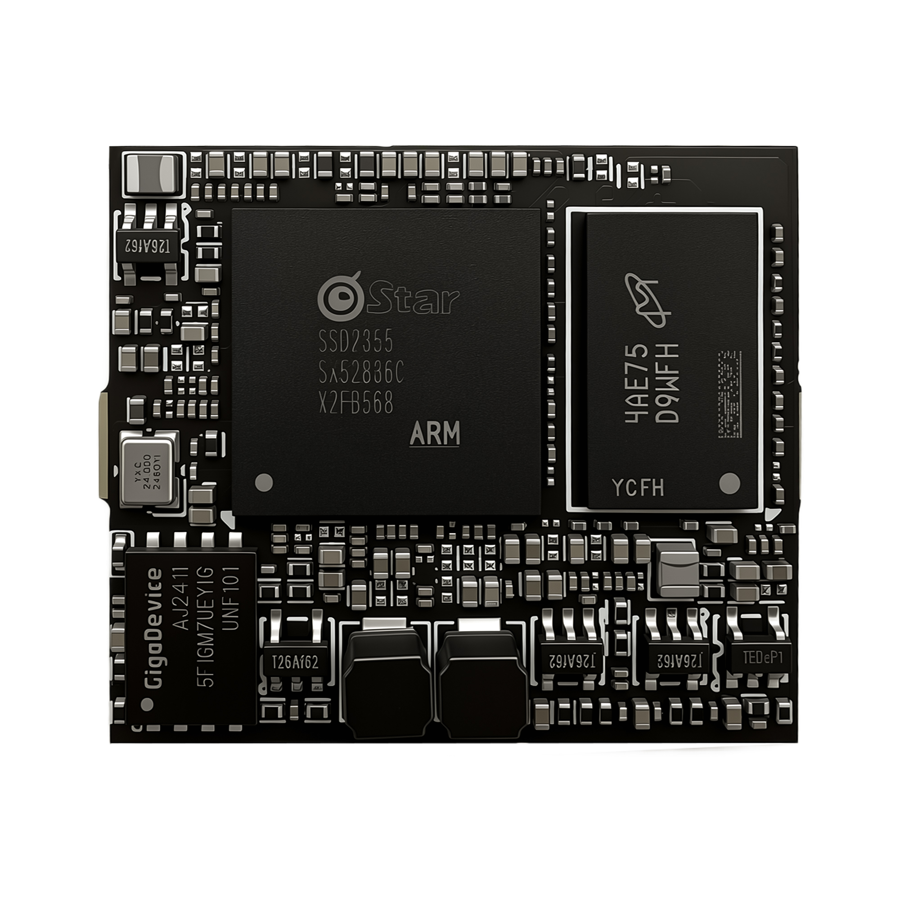

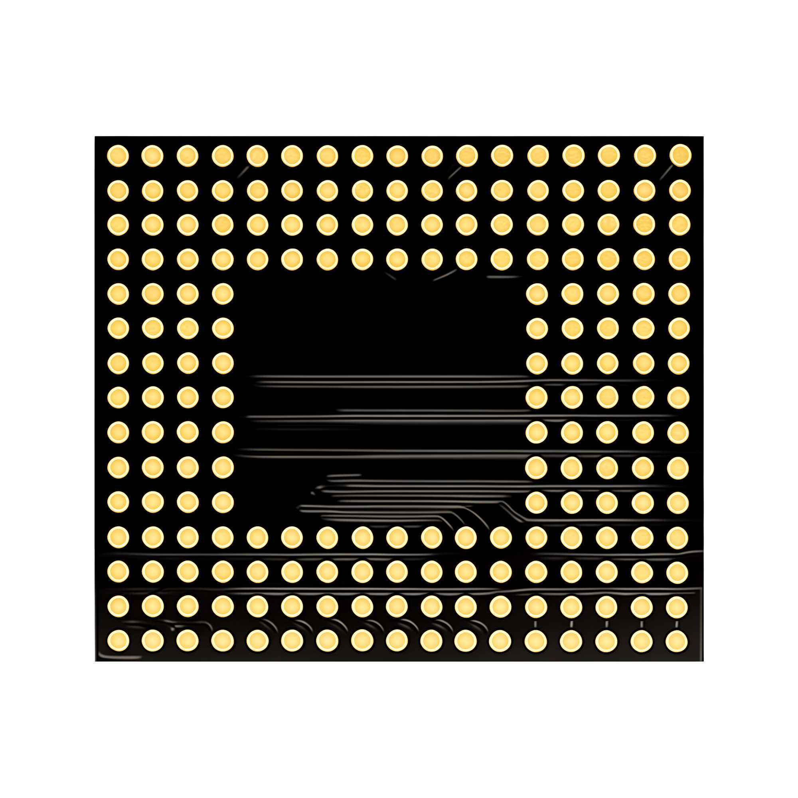

Core Board Dimensions
~~~~~~~~~~~~~~~~~~~~~

Core Board Dimensions Mechanical Drawing 28mm × 32mm

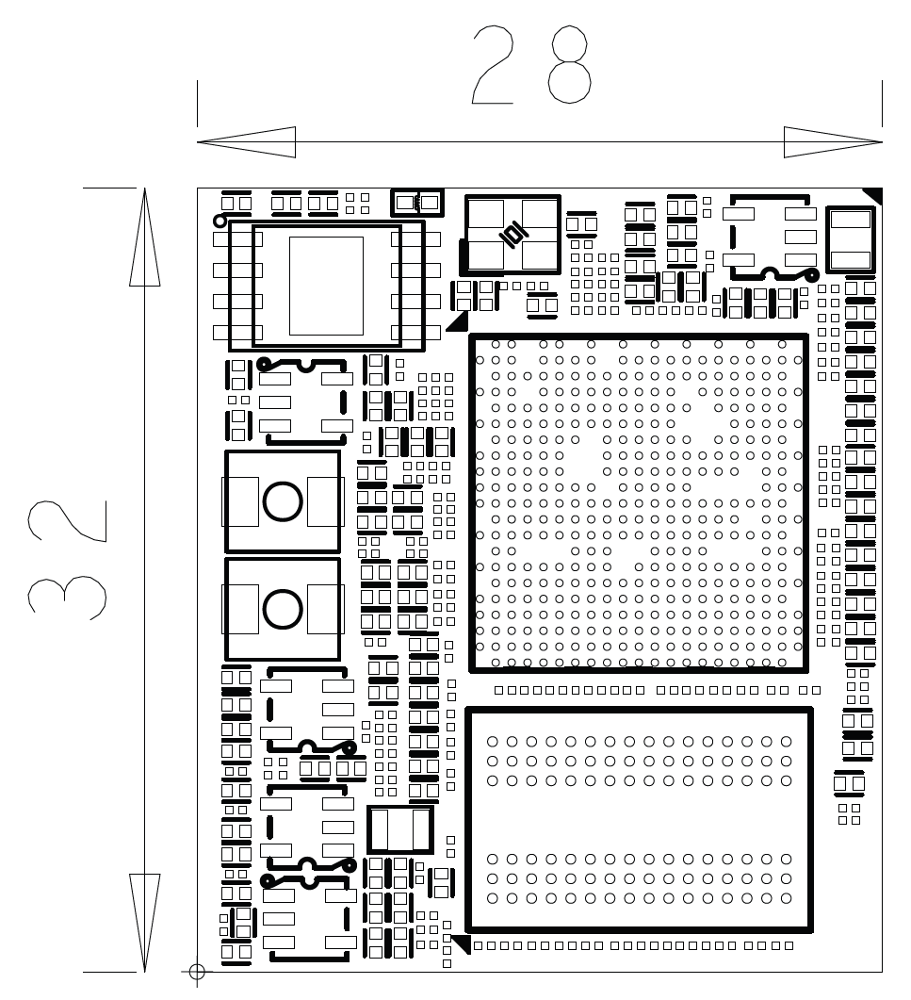

Naming conventions and optional configurations
~~~~~~~~~~~~~~~~~~~~~~~~~~~~~~~~~~~~~~~~~~~~~~

.. raw:: html

   

+--------------------+----------------------------------------------+-------------+--------------+--------------+
| Model Core Board   | Naming Rules                                 |             |              |              |
+====================+==============================================+=============+==============+==============+
| MYZR-SSD2355-LB199 | MYZR                                         | SSD2355     | LB/EK        | 199          |
+--------------------+----------------------------------------------+-------------+--------------+--------------+
|                    | Mingyuan Wisdom                              | MPU main    | Package      | Core Board   |
|                    |                                              | control     |              | Pin Count    |
|                    |                                              | model       |              |              |
+--------------------+----------------------------------------------+-------------+--------------+--------------+
|                    |                                              |             | LB【LGA】    |              |
+--------------------+----------------------------------------------+-------------+--------------+--------------+
|                    |                                              |             | EK【         |              |
|                    |                                              |             | Development  |              |
|                    |                                              |             | Board 】     |              |
+--------------------+----------------------------------------------+-------------+--------------+--------------+
|                    | Optional Configuration                       |             |              |              |
+--------------------+----------------------------------------------+-------------+--------------+--------------+
|                    | Memory: 128MB /256MB/512MB/1GB DDR3 /4       |             |              |              |
+--------------------+----------------------------------------------+-------------+--------------+--------------+
|                    | Storage: 128MB /256MB/512MB NOR FLASH        |             |              |              |
+--------------------+----------------------------------------------+-------------+--------------+--------------+
|                    | Example: Core Board Model:                   |             |              |              |
|                    | MYZR-SSD2355-LB199-128M-128M Development     |             |              |              |
|                    | Board Model: MYZR-SSD2355-EK199-128M-128M    |             |              |              |
+--------------------+----------------------------------------------+-------------+--------------+--------------+

Power supply mode
~~~~~~~~~~~~~~~~~

.. raw:: html

   

+----------+-----------------+------+------+------+------+----------------------------------------------+
| Function | Pin Label       | <g   |      |      |      | Descriptions                                 |
|          |                 | id=" |      |      |      |                                              |
|          |                 | Bold |      |      |      |                                              |
|          |                 | ">Sp |      |      |      |                                              |
|          |                 | ecif |      |      |      |                                              |
|          |                 | icat |      |      |      |                                              |
|          |                 | ion: |      |      |      |                                              |
|          |                 | </g> |      |      |      |                                              |
+==========+=================+======+======+======+======+==============================================+
|          |                 | Min. | Typi | Max  | Modu |                                              |
|          |                 |      | cal  |      | le   |                                              |
+----------+-----------------+------+------+------+------+----------------------------------------------+
| Power    | E12,E13,F12,F13 | -    | 3.3  | -    | V    | In the public profile, there is no absolute  |
| supply   |                 |      |      |      | /伏  | maximum rated input voltage or recommended   |
|          |                 |      |      |      |      | operating voltage range of the SSD2355 chip  |
|          |                 |      |      |      |      | itself                                       |
+----------+-----------------+------+------+------+------+----------------------------------------------+

Working Environment
~~~~~~~~~~~~~~~~~~~

.. raw:: html

   

+--------+------+------+------+------+-----------------------+
| Specs  | <g   |      |      |      | Descriptions          |
|        | id=" |      |      |      |                       |
|        | Bold |      |      |      |                       |
|        | ">Sp |      |      |      |                       |
|        | ecif |      |      |      |                       |
|        | icat |      |      |      |                       |
|        | ion: |      |      |      |                       |
|        | </g> |      |      |      |                       |
+========+======+======+======+======+=======================+
|        | Min. | Typi | Max  | Modu |                       |
|        |      | cal  |      | le   |                       |
+--------+------+------+------+------+-----------------------+
| Commer | 0℃   | 25   | 80℃  | ℃    | Measured 0 to 80°C    |
| cial   |      |      |      |      | operating normally    |
| Grade  |      |      |      |      |                       |
+--------+------+------+------+------+-----------------------+

Activate Configuration
~~~~~~~~~~~~~~~~~~~~~~

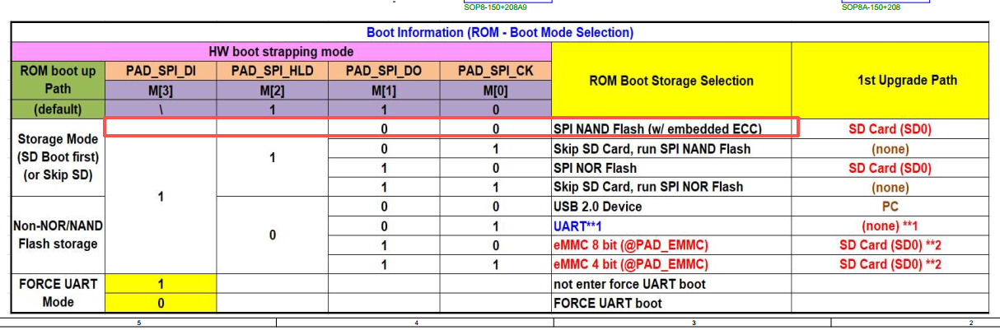

Whether fast start and fast start time are supported
~~~~~~~~~~~~~~~~~~~~~~~~~~~~~~~~~~~~~~~~~~~~~~~~~~~~

.. raw:: html

   

+---------+----------+------+
| Project | Support  | Time |
+=========+==========+======+
| SSD2355 | Support  | 3s   |
+---------+----------+------+

Core Board patch / Installation Diagram
~~~~~~~~~~~~~~~~~~~~~~~~~~~~

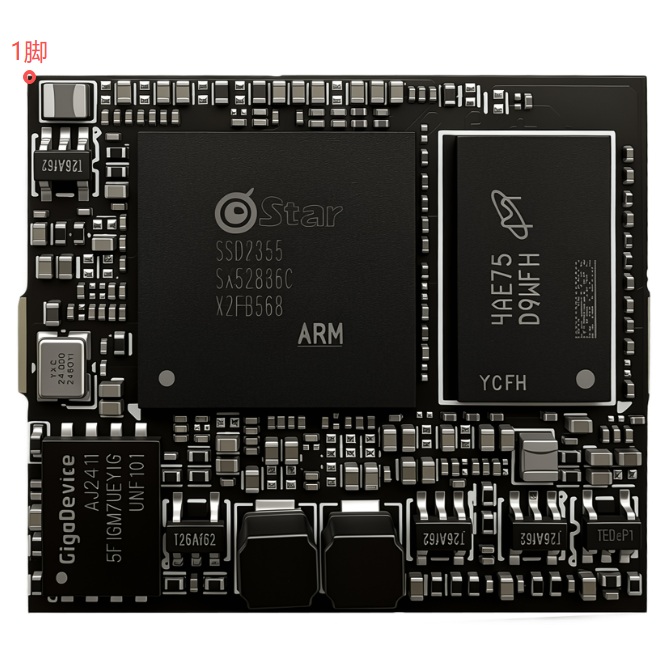

SSD2355 patch 1 pin schematic

Signal Definition
-----------------

Core Board Pin Definition

.. raw:: html

   

+---------+--------------------+-------------------------------+----------------------+
| Pin NO. | Pin Name           | Description                   | Pin Voltage          |
+=========+====================+===============================+======================+
| A1      | 1V8\_SYS           | 1.8V output                   | 1.8V                 |
+---------+--------------------+-------------------------------+----------------------+
| A2      | GPIOC\_00          | Generic GPIO                  | Same as              |
|         |                    |                               | VDDP3318\_MIPI\_TX   |
+---------+--------------------+-------------------------------+----------------------+
| A3      | GPIOC\_05          | Generic GPIO                  | Same as              |
|         |                    |                               | VDDP3318\_MIPI\_TX   |
+---------+--------------------+-------------------------------+----------------------+
| A4      | SAR\_ADC0\_00      | Analog-to-digital converter   | Same as VDDP3318\_1  |
+---------+--------------------+-------------------------------+----------------------+
| A5      | SAR\_ADC0\_05      | Analog-to-digital converter   | Same as VDDP3318\_1  |
+---------+--------------------+-------------------------------+----------------------+
| A6      | SAR\_ADC0\_08      | Analog-to-digital converter   | Same as VDDP3318\_1  |
+---------+--------------------+-------------------------------+----------------------+
| A7      | SAR\_ADC0\_11      | Analog-to-digital converter   | Same as VDDP3318\_1  |
+---------+--------------------+-------------------------------+----------------------+
| A8      | SAR\_ADC0\_13      | Analog-to-digital converter   | Same as VDDP3318\_1  |
+---------+--------------------+-------------------------------+----------------------+
| A9      | PM\_UART1\_TX      | Fixed debug issue serial port | Same as VDDP3318\_PM |
+---------+--------------------+-------------------------------+----------------------+
| A10     | UART0\_RX          | Receive Serial 0              | Same as VDDP3318\_4  |
+---------+--------------------+-------------------------------+----------------------+
| A11     | PM\_SAR\_GPIO1     | GPIO                          | 1.8V                 |
+---------+--------------------+-------------------------------+----------------------+
| A12     | VDDP3318\_4        | Power domain voltage          | Same as VDDP3318\_4  |
|         |                    | configuration input port      |                      |
+---------+--------------------+-------------------------------+----------------------+
| A13     | RTC\_IO1           | Low-power wake-up pins        | 3.3V                 |
+---------+--------------------+-------------------------------+----------------------+
| A14     | SPI\_HLD           | SPI Control Pin               | Same as VDDP3318\_4  |
+---------+--------------------+-------------------------------+----------------------+
| A15     | SPI\_DO            | SPI Master Input Pins         | Same as VDDP3318\_4  |
+---------+--------------------+-------------------------------+----------------------+
| B1      | GPIOC\_02          | Generic GPIO                  | Same as              |
|         |                    |                               | VDDP3318\_MIPI\_TX   |
+---------+--------------------+-------------------------------+----------------------+
| B2      | GPIOC\_01          | Generic GPIO                  | Same as              |
|         |                    |                               | VDDP3318\_MIPI\_TX   |
+---------+--------------------+-------------------------------+----------------------+
| B3      | GPIOC\_04          | Generic GPIO                  | Same as              |
|         |                    |                               | VDDP3318\_MIPI\_TX   |
+---------+--------------------+-------------------------------+----------------------+
| B4      | SAR\_ADC0\_01      | Analog-to-digital converter   | Same as VDDP3318\_1  |
+---------+--------------------+-------------------------------+----------------------+
| B5      | SAR\_ADC0\_04      | Analog-to-digital converter   | Same as VDDP3318\_1  |
+---------+--------------------+-------------------------------+----------------------+
| B6      | SAR\_ADC0\_09      | Analog-to-digital converter   | Same as VDDP3318\_1  |
+---------+--------------------+-------------------------------+----------------------+
| B7      | SAR\_ADC0\_10      | Analog-to-digital converter   | Same as VDDP3318\_1  |
+---------+--------------------+-------------------------------+----------------------+
| B8      | SAR\_ADC0\_12      | Analog-to-digital converter   | Same as VDDP3318\_1  |
+---------+--------------------+-------------------------------+----------------------+
| B9      | PM\_UART1\_RX      | Fixed debug receiving serial  | Same as VDDP3318\_PM |
|         |                    | port                          |                      |
+---------+--------------------+-------------------------------+----------------------+
| B10     | UART0\_TX          | Outgoing Serial 0             | Same as VDDP3318\_4  |
+---------+--------------------+-------------------------------+----------------------+
| B11     | PM\_SAR\_GPIO3     | GPIO                          | 1.8V                 |
+---------+--------------------+-------------------------------+----------------------+
| B12     | RTC\_IO5           | Power control output          | 3.3V                 |
+---------+--------------------+-------------------------------+----------------------+
| B13     | RTC\_IO4           | Power control output          | 3.3V                 |
+---------+--------------------+-------------------------------+----------------------+
| B14     | SPI\_CK            | SPI Clock                     | Same as VDDP3318\_4  |
+---------+--------------------+-------------------------------+----------------------+
| B15     | SPI\_WPZ           | SPI Write Protection          | Same as VDDP3318\_4  |
+---------+--------------------+-------------------------------+----------------------+
| C1      | OUTP\_TX0\_CH4     | Differential output           | Same as              |
|         |                    |                               | VDDP3318\_MIPI\_TX   |
+---------+--------------------+-------------------------------+----------------------+
| C2      | OUTN\_TX0\_CH4     | Differential output           | Same as              |
|         |                    |                               | VDDP3318\_MIPI\_TX   |
+---------+--------------------+-------------------------------+----------------------+
| C3      | GPIOC\_03          | Generic GPIO                  | Same as              |
|         |                    |                               | VDDP3318\_MIPI\_TX   |
+---------+--------------------+-------------------------------+----------------------+
| C4      | GPIOC\_07          | Generic GPIO                  | Same as              |
|         |                    |                               | VDDP3318\_MIPI\_TX   |
+---------+--------------------+-------------------------------+----------------------+
| C5      | GPIOC\_08          | Generic GPIO                  | Same as              |
|         |                    |                               | VDDP3318\_MIPI\_TX   |
+---------+--------------------+-------------------------------+----------------------+
| C6      | SAR\_ADC0\_03      | Analog-to-digital converter   | Same as VDDP3318\_1  |
+---------+--------------------+-------------------------------+----------------------+
| C7      | SAR\_ADC0\_07      | Analog-to-digital converter   | Same as VDDP3318\_1  |
+---------+--------------------+-------------------------------+----------------------+
| C8      | PM\_PWM1\_OUT      | PWM Output                    | Same as VDDP3318\_4  |
+---------+--------------------+-------------------------------+----------------------+
| C9      | SAR\_ADC0\_14      | Analog-to-digital converter   | Same as VDDP3318\_1  |
+---------+--------------------+-------------------------------+----------------------+
| C10     | PM\_ADC\_GPIO6     | Analog-to-digital converter   | Same as VDDP3318\_PM |
+---------+--------------------+-------------------------------+----------------------+
| C11     | PM\_SAR\_GPIO4     | Generic GPIO                  | 1.8V                 |
+---------+--------------------+-------------------------------+----------------------+
| C12     | PM\_RESET          | Reset                         | 3.3V                 |
+---------+--------------------+-------------------------------+----------------------+
| C13     | RTC\_IO3           | Wake-up input pin located in  | 3.3V                 |
|         |                    | RTC power domain              |                      |
+---------+--------------------+-------------------------------+----------------------+
| C14     | SPI\_DI            | SPI Master Output Pins        | Same as VDDP3318\_4  |
+---------+--------------------+-------------------------------+----------------------+
| C15     | SPI\_CZ            | Chip selection signal of SPI  | Same as VDDP3318\_4  |
|         |                    | master control                |                      |
+---------+--------------------+-------------------------------+----------------------+
| D1      | OUTP\_TX0\_CH3     | Differential output           | Same as              |
|         |                    |                               | VDDP3318\_MIPI\_TX   |
+---------+--------------------+-------------------------------+----------------------+
| D2      | OUTN\_TX0\_CH3     | Differential output           | Same as              |
|         |                    |                               | VDDP3318\_MIPI\_TX   |
+---------+--------------------+-------------------------------+----------------------+
| D3      | GPIOC\_06          | Generic GPIO                  | Same as              |
|         |                    |                               | VDDP3318\_MIPI\_TX   |
+---------+--------------------+-------------------------------+----------------------+
| D4      | SAR\_ADC0\_02      | Analog-to-digital converter   | Same as VDDP3318\_1  |
+---------+--------------------+-------------------------------+----------------------+
| D5      | SAR\_ADC0\_06      | Analog-to-digital converter   | Same as VDDP3318\_1  |
+---------+--------------------+-------------------------------+----------------------+
| D6      | PM\_PWM0\_OUT      | Power domain voltage          | Same as VDDP3318\_4  |
|         |                    | configuration input port      |                      |
+---------+--------------------+-------------------------------+----------------------+
| D7      | PM\_ADC\_GPIO3     | Analog-to-digital converter   | Same as VDDP3318\_PM |
+---------+--------------------+-------------------------------+----------------------+
| D8      | PM\_ADC00\_IN      | Analog-to-digital converter   | Same as VDDP3318\_PM |
+---------+--------------------+-------------------------------+----------------------+
| D9      | PM\_ADC\_GPIO7     | Analog-to-digital converter   | Same as VDDP3318\_PM |
+---------+--------------------+-------------------------------+----------------------+
| D10     | PM\_SAR\_GPIO0     | Generic GPIO                  | 1.8V                 |
+---------+--------------------+-------------------------------+----------------------+
| D11     | PM\_SAR\_GPIO2     | Generic GPIO                  | 1.8V                 |
+---------+--------------------+-------------------------------+----------------------+
| D12     | PM\_GPIO5          | Generic GPIO                  | 1.8V                 |
+---------+--------------------+-------------------------------+----------------------+
| D13     | PM\_ADC\_GPIO0     | General GPIO / ADC            | Same as VDDP3318\_PM |
+---------+--------------------+-------------------------------+----------------------+
| D14     | AUD\_LINE\_OUT\_L  | Headset left channel          | 1.8V                 |
+---------+--------------------+-------------------------------+----------------------+
| D15     | AUD\_LINE\_OUT\_R  | Headset Right Channel         | 1.8V                 |
+---------+--------------------+-------------------------------+----------------------+
| E1      | OUTP\_TX0\_CH1     | Differential output           | Same as              |
|         |                    |                               | VDDP3318\_MIPI\_TX   |
+---------+--------------------+-------------------------------+----------------------+
| E2      | OUTN\_TX0\_CH1     | Differential output           | Same as              |
|         |                    |                               | VDDP3318\_MIPI\_TX   |
+---------+--------------------+-------------------------------+----------------------+
| E3      | VDDP3318\_1        | Power domain voltage          | Same as VDDP3318\_1  |
|         |                    | configuration input port      |                      |
+---------+--------------------+-------------------------------+----------------------+
| E4      | VDDP3318\_PM       | Power domain voltage          | Same as VDDP3318\_PM |
|         |                    | configuration input port      |                      |
+---------+--------------------+-------------------------------+----------------------+
| E12     | 3V3\_SYS           | 3V3 Power Input               | 3.3V                 |
+---------+--------------------+-------------------------------+----------------------+
| E13     | 3V3\_SYS           | 3V3 Power Input               | 3.3V                 |
+---------+--------------------+-------------------------------+----------------------+
| E14     | MIC\_P1            | Differential Microphone -     | DIFFERENTIAL         |
+---------+--------------------+-------------------------------+----------------------+
| E15     | MIC\_M1            | Differential Microphone +     | DIFFERENTIAL         |
+---------+--------------------+-------------------------------+----------------------+
| F1      | OUTP\_TX0\_CH2     | Differential output           | Same as              |
|         |                    |                               | VDDP3318\_MIPI\_TX   |
+---------+--------------------+-------------------------------+----------------------+
| F2      | OUTN\_TX0\_CH2     | Differential output           | Same as              |
|         |                    |                               | VDDP3318\_MIPI\_TX   |
+---------+--------------------+-------------------------------+----------------------+
| F3      | GPIOE\_00          | Generic GPIO                  | Same as VDDP3318\_0  |
+---------+--------------------+-------------------------------+----------------------+
| F4      | GPIOB\_03          | Generic GPIO                  | Same as              |
|         |                    |                               | VDDP3318\_MIPI\_TX   |
+---------+--------------------+-------------------------------+----------------------+
| F12     | 3V3\_SYS           | 3V3 Power Input               | 3.3V                 |
+---------+--------------------+-------------------------------+----------------------+
| F13     | 3V3\_SYS           | 3V3 Power Input               | 3.3V                 |
+---------+--------------------+-------------------------------+----------------------+
| F14     | MIC\_M0            | Differential Microphone -     | DIFFERENTIAL         |
+---------+--------------------+-------------------------------+----------------------+
| F15     | MIC\_P0            | Differential Microphone +     | DIFFERENTIAL         |
+---------+--------------------+-------------------------------+----------------------+
| G1      | OUTN\_TX0\_CH0     | Differential output           | Same as              |
|         |                    |                               | VDDP3318\_MIPI\_TX   |
+---------+--------------------+-------------------------------+----------------------+
| G2      | OUTP\_TX0\_CH0     | Differential output           | Same as              |
|         |                    |                               | VDDP3318\_MIPI\_TX   |
+---------+--------------------+-------------------------------+----------------------+
| G3      | GPIOB\_07          | Generic GPIO                  | Same as              |
|         |                    |                               | VDDP3318\_MIPI\_RX   |
+---------+--------------------+-------------------------------+----------------------+
| G4      | VDDP3318\_MIPI\_TX | Power domain voltage          | Same as              |
|         |                    | configuration input port      | VDDP3318\_MIPI\_TX   |
+---------+--------------------+-------------------------------+----------------------+
| G12     | GPIOA\_18          | Generic GPIO                  | Same as              |
|         |                    |                               | VDDP3318\_EMMC       |
+---------+--------------------+-------------------------------+----------------------+
| G13     | GPIOE\_01          | Generic GPIO                  | Same as VDDP3318\_0  |
+---------+--------------------+-------------------------------+----------------------+
| G14     | MIC\_M2            | Differential Microphone -     | DIFFERENTIAL         |
+---------+--------------------+-------------------------------+----------------------+
| G15     | MIC\_P2            | Differential Microphone +     | DIFFERENTIAL         |
+---------+--------------------+-------------------------------+----------------------+
| H1      | OUTN\_RX0\_CH3     | Differential Input            | Same as              |
|         |                    |                               | VDDP3318\_MIPI\_RX   |
+---------+--------------------+-------------------------------+----------------------+
| H2      | OUTP\_RX0\_CH3     | Differential Input            | Same as              |
|         |                    |                               | VDDP3318\_MIPI\_RX   |
+---------+--------------------+-------------------------------+----------------------+
| H3      | GPIOB\_08          | Generic GPIO                  | Same as              |
|         |                    |                               | VDDP3318\_MIPI\_RX   |
+---------+--------------------+-------------------------------+----------------------+
| H4      | VDDP3318\_MIPI\_RX | Power domain voltage          | Same as              |
|         |                    | configuration input port      | VDDP3318\_MIPI\_RX   |
+---------+--------------------+-------------------------------+----------------------+
| H12     | GPIOE\_02          | Generic GPIO                  | Same as VDDP3318\_0  |
+---------+--------------------+-------------------------------+----------------------+
| H13     | GPIOE\_03          | Generic GPIO                  | Same as VDDP3318\_0  |
+---------+--------------------+-------------------------------+----------------------+
| H14     | GPIOD\_04          | Generic GPIO                  | Same as VDDP3318\_4  |
+---------+--------------------+-------------------------------+----------------------+
| H15     | GPIOD\_05          | Generic GPIO                  | Same as VDDP3318\_4  |
+---------+--------------------+-------------------------------+----------------------+
| J1      | OUTP\_RX0\_CH1     | Differential Input            | Same as              |
|         |                    |                               | VDDP3318\_MIPI\_RX   |
+---------+--------------------+-------------------------------+----------------------+
| J2      | OUTN\_RX0\_CH1     | Differential Input            | Same as              |
|         |                    |                               | VDDP3318\_MIPI\_RX   |
+---------+--------------------+-------------------------------+----------------------+
| J3      | GPIOB\_06          | Generic GPIO                  | Same as              |
|         |                    |                               | VDDP3318\_MIPI\_RX   |
+---------+--------------------+-------------------------------+----------------------+
| J4      | VDDP3318\_EMMC     | Power domain voltage          | Same as              |
|         |                    | configuration input port      | VDDP3318\_EMMC       |
+---------+--------------------+-------------------------------+----------------------+
| J12     | GPIOE\_05          | Generic GPIO                  | Same as VDDP3318\_0  |
+---------+--------------------+-------------------------------+----------------------+
| J13     | GPIOE\_04          | Generic GPIO                  | Same as VDDP3318\_0  |
+---------+--------------------+-------------------------------+----------------------+
| J14     | GPIOD\_03          | Generic GPIO                  | Same as VDDP3318\_4  |
+---------+--------------------+-------------------------------+----------------------+
| J15     | GPIOD\_00          | Generic GPIO                  | Same as VDDP3318\_4  |
+---------+--------------------+-------------------------------+----------------------+
| K1      | OUTN\_RX0\_CH2     | Differential Input            | Same as              |
|         |                    |                               | VDDP3318\_MIPI\_RX   |
+---------+--------------------+-------------------------------+----------------------+
| K2      | OUTP\_RX0\_CH2     | Differential Input            | Same as              |
|         |                    |                               | VDDP3318\_MIPI\_RX   |
+---------+--------------------+-------------------------------+----------------------+
| K3      | GPIOB\_04          | Generic GPIO                  | Same as              |
|         |                    |                               | VDDP3318\_MIPI\_RX   |
+---------+--------------------+-------------------------------+----------------------+
| K4      | GPIOB\_02          | Generic GPIO                  | Same as              |
|         |                    |                               | VDDP3318\_MIPI\_RX   |
+---------+--------------------+-------------------------------+----------------------+
| K12     | GND                | Earthing                      | 0V                   |
+---------+--------------------+-------------------------------+----------------------+
| K13     | GND                | Earthing                      | 0V                   |
+---------+--------------------+-------------------------------+----------------------+
| K14     | ADC\_PWM\_OUT00    | PWM Output                    | Same as VDDP3318\_4  |
+---------+--------------------+-------------------------------+----------------------+
| K15     | ADC\_PWM\_OUT01    | PWM Output                    | Same as VDDP3318\_4  |
+---------+--------------------+-------------------------------+----------------------+
| L1      | OUTP\_RX0\_CH0     | Differential Input            | Same as              |
|         |                    |                               | VDDP3318\_MIPI\_RX   |
+---------+--------------------+-------------------------------+----------------------+
| L2      | OUTN\_RX0\_CH0     | Differential Input            | Same as              |
|         |                    |                               | VDDP3318\_MIPI\_RX   |
+---------+--------------------+-------------------------------+----------------------+
| L3      | GPIOB\_01          | Generic GPIO                  | Same as              |
|         |                    |                               | VDDP3318\_MIPI\_RX   |
+---------+--------------------+-------------------------------+----------------------+
| L4      | GPIOA\_19          | Generic GPIO                  | Same as              |
|         |                    |                               | VDDP3318\_EMMC       |
+---------+--------------------+-------------------------------+----------------------+
| L12     | GND                | Earthing                      | 0V                   |
+---------+--------------------+-------------------------------+----------------------+
| L13     | GND                | Earthing                      | 0V                   |
+---------+--------------------+-------------------------------+----------------------+
| L14     | DM\_USB2\_P1       | USB2.0-                       | DIFFERENTIAL         |
+---------+--------------------+-------------------------------+----------------------+
| L15     | DP\_USB2\_P1       | USB2.0+                       | DIFFERENTIAL         |
+---------+--------------------+-------------------------------+----------------------+
| M1      | EMMC\_D2           | EMMC data cable               | Same as              |
|         |                    |                               | VDDP3318\_EMMC       |
+---------+--------------------+-------------------------------+----------------------+
| M2      | EMMC\_D7           | EMMC data cable               | Same as              |
|         |                    |                               | VDDP3318\_EMMC       |
+---------+--------------------+-------------------------------+----------------------+
| M3      | GPIOB\_00          | Generic GPIO                  | Same as              |
|         |                    |                               | VDDP3318\_MIPI\_RX   |
+---------+--------------------+-------------------------------+----------------------+
| M4      | GPIOB\_05          | Generic GPIO                  | Same as              |
|         |                    |                               | VDDP3318\_MIPI\_RX   |
+---------+--------------------+-------------------------------+----------------------+
| M12     | VDDP3318\_0        | Power domain voltage          | Same as VDDP3318\_0  |
|         |                    | configuration input port      |                      |
+---------+--------------------+-------------------------------+----------------------+
| M13     | PM\_GPIO4          | Generic GPIO                  | 1.8V                 |
+---------+--------------------+-------------------------------+----------------------+
| M14     | DP\_USB2\_P0       | Fixed burning USB -           | DIFFERENTIAL         |
+---------+--------------------+-------------------------------+----------------------+
| M15     | DM\_USB2\_P0       | Fixed burning USB +           | DIFFERENTIAL         |
+---------+--------------------+-------------------------------+----------------------+
| N1      | EMMC\_D1           | EMMC data cable               | Same as              |
|         |                    |                               | VDDP3318\_EMMC       |
+---------+--------------------+-------------------------------+----------------------+
| N2      | EMMC\_D6           | EMMC data cable               | Same as              |
|         |                    |                               | VDDP3318\_EMMC       |
+---------+--------------------+-------------------------------+----------------------+
| N3      | GND                | Earthing                      | 0V                   |
+---------+--------------------+-------------------------------+----------------------+
| N4      | GND                | Earthing                      | 0V                   |
+---------+--------------------+-------------------------------+----------------------+
| N5      | GND                | Earthing                      | 0V                   |
+---------+--------------------+-------------------------------+----------------------+
| N6      | GND                | Earthing                      | 0V                   |
+---------+--------------------+-------------------------------+----------------------+
| N7      | GND                | Earthing                      | 0V                   |
+---------+--------------------+-------------------------------+----------------------+
| N8      | GND                | Earthing                      | 0V                   |
+---------+--------------------+-------------------------------+----------------------+
| N9      | GND                | Earthing                      | 0V                   |
+---------+--------------------+-------------------------------+----------------------+
| N10     | GND                | Earthing                      | 0V                   |
+---------+--------------------+-------------------------------+----------------------+
| N11     | GND                | Earthing                      | 0V                   |
+---------+--------------------+-------------------------------+----------------------+
| N12     | Non\_PM\_EN        | Power Enabled                 | 3.3V                 |
+---------+--------------------+-------------------------------+----------------------+
| N13     | GPIOE\_19          | Generic GPIO                  | Same as VDDP3318\_0  |
+---------+--------------------+-------------------------------+----------------------+
| N14     | GPIOE\_13          | Generic GPIO                  | Same as VDDP3318\_0  |
+---------+--------------------+-------------------------------+----------------------+
| N15     | GPIOE\_14          | Generic GPIO                  | Same as VDDP3318\_0  |
+---------+--------------------+-------------------------------+----------------------+
| P1      | EMMC\_D4           | EMMC data cable               | Same as              |
|         |                    |                               | VDDP3318\_EMMC       |
+---------+--------------------+-------------------------------+----------------------+
| P2      | EMMC\_D0           | EMMC data cable               | Same as              |
|         |                    |                               | VDDP3318\_EMMC       |
+---------+--------------------+-------------------------------+----------------------+
| P3      | GPIOA\_06          | Generic GPIO                  | Same as              |
|         |                    |                               | VDDP3318\_EMMC       |
+---------+--------------------+-------------------------------+----------------------+
| P4      | GPIOA\_04          | Generic GPIO                  | Same as              |
|         |                    |                               | VDDP3318\_EMMC       |
+---------+--------------------+-------------------------------+----------------------+
| P5      | GPIOA\_12          | Generic GPIO                  | Same as              |
|         |                    |                               | VDDP3318\_EMMC       |
+---------+--------------------+-------------------------------+----------------------+
| P6      | GPIOA\_13          | Generic GPIO                  | Same as              |
|         |                    |                               | VDDP3318\_EMMC       |
+---------+--------------------+-------------------------------+----------------------+
| P7      | GPIOA\_16          | Generic GPIO                  | Same as              |
|         |                    |                               | VDDP3318\_EMMC       |
+---------+--------------------+-------------------------------+----------------------+
| P8      | PM\_I2C\_SDA       | I2C data cable                | Same as VDDP3318\_PM |
+---------+--------------------+-------------------------------+----------------------+
| P9      | GPIOD\_02          | Generic GPIO                  | Same as VDDP3318\_4  |
+---------+--------------------+-------------------------------+----------------------+
| P10     | GPIOE\_10          | Generic GPIO                  | Same as VDDP3318\_0  |
+---------+--------------------+-------------------------------+----------------------+
| P11     | GND                | Earthing                      | 0V                   |
+---------+--------------------+-------------------------------+----------------------+
| P12     | GND                | Earthing                      | 0V                   |
+---------+--------------------+-------------------------------+----------------------+
| P13     | GPIOE\_12          | Generic GPIO                  | Same as VDDP3318\_0  |
+---------+--------------------+-------------------------------+----------------------+
| P14     | GPIOE\_18          | Generic GPIO                  | Same as VDDP3318\_0  |
+---------+--------------------+-------------------------------+----------------------+
| P15     | GPIOE\_16          | Generic GPIO                  | Same as VDDP3318\_0  |
+---------+--------------------+-------------------------------+----------------------+
| R1      | EMMC\_D5           | EMMC data cable               | Same as              |
|         |                    |                               | VDDP3318\_EMMC       |
+---------+--------------------+-------------------------------+----------------------+
| R2      | EMMC\_D3           | EMMC data cable               | Same as              |
|         |                    |                               | VDDP3318\_EMMC       |
+---------+--------------------+-------------------------------+----------------------+
| R3      | GPIOA\_05          | Generic GPIO                  | Same as              |
|         |                    |                               | VDDP3318\_EMMC       |
+---------+--------------------+-------------------------------+----------------------+
| R4      | GPIOA\_02          | Generic GPIO                  | Same as              |
|         |                    |                               | VDDP3318\_EMMC       |
+---------+--------------------+-------------------------------+----------------------+
| R5      | GPIOA\_09          | Generic GPIO                  | Same as              |
|         |                    |                               | VDDP3318\_EMMC       |
+---------+--------------------+-------------------------------+----------------------+
| R6      | GPIOA\_10          | Generic GPIO                  | Same as              |
|         |                    |                               | VDDP3318\_EMMC       |
+---------+--------------------+-------------------------------+----------------------+
| R7      | GPIOA\_17          | Generic GPIO                  | Same as              |
|         |                    |                               | VDDP3318\_EMMC       |
+---------+--------------------+-------------------------------+----------------------+
| R8      | PM\_I2C\_SCL       | I2C Clock Line                | Same as VDDP3318\_PM |
+---------+--------------------+-------------------------------+----------------------+
| R9      | GPIOD\_01          | Generic GPIO                  | Same as VDDP3318\_4  |
+---------+--------------------+-------------------------------+----------------------+
| R10     | GPIOE\_09          | Generic GPIO                  | Same as VDDP3318\_0  |
+---------+--------------------+-------------------------------+----------------------+
| R11     | GND                | Earthing                      | 0V                   |
+---------+--------------------+-------------------------------+----------------------+
| R12     | VDD\_DRAM\_EN      | RAM Power Enabled             | Same as VDDP3318\_PM |
+---------+--------------------+-------------------------------+----------------------+
| R13     | GPIOE\_11          | Generic GPIO                  | Same as VDDP3318\_0  |
+---------+--------------------+-------------------------------+----------------------+
| R14     | GPIOE\_17          | Generic GPIO                  | Same as VDDP3318\_0  |
+---------+--------------------+-------------------------------+----------------------+
| R15     | GPIOE\_15          | Generic GPIO                  | Same as VDDP3318\_0  |
+---------+--------------------+-------------------------------+----------------------+
| T1      | EMMC\_DS           | EMMC Chip Selection           | Same as              |
|         |                    |                               | VDDP3318\_EMMC       |
+---------+--------------------+-------------------------------+----------------------+
| T2      | EMMC\_RSTn         | EMMC Reset                    | Same as              |
|         |                    |                               | VDDP3318\_EMMC       |
+---------+--------------------+-------------------------------+----------------------+
| T3      | GPIOA\_03          | Generic GPIO                  | Same as              |
|         |                    |                               | VDDP3318\_EMMC       |
+---------+--------------------+-------------------------------+----------------------+
| T4      | GPIOA\_00          | Generic GPIO                  | Same as              |
|         |                    |                               | VDDP3318\_EMMC       |
+---------+--------------------+-------------------------------+----------------------+
| T5      | GPIOA\_07          | Generic GPIO                  | Same as              |
|         |                    |                               | VDDP3318\_EMMC       |
+---------+--------------------+-------------------------------+----------------------+
| T6      | GPIOA\_08          | Generic GPIO                  | Same as              |
|         |                    |                               | VDDP3318\_EMMC       |
+---------+--------------------+-------------------------------+----------------------+
| T7      | GPIOA\_14          | Generic GPIO                  | Same as              |
|         |                    |                               | VDDP3318\_EMMC       |
+---------+--------------------+-------------------------------+----------------------+
| T8      | PM\_ADC\_GPIO1     | Generic GPIO                  | Same as VDDP3318\_PM |
+---------+--------------------+-------------------------------+----------------------+
| T9      | GPIOE\_07          | Generic GPIO                  | Same as VDDP3318\_0  |
+---------+--------------------+-------------------------------+----------------------+
| T10     | GND                | Earthing                      | 0V                   |
+---------+--------------------+-------------------------------+----------------------+
| T11     | GPIOE\_26          | Generic GPIO                  | Same as VDDP3318\_0  |
+---------+--------------------+-------------------------------+----------------------+
| T12     | GPIOE\_20          | Generic GPIO                  | Same as VDDP3318\_0  |
+---------+--------------------+-------------------------------+----------------------+
| T13     | GPIOE\_25          | Generic GPIO                  | Same as VDDP3318\_0  |
+---------+--------------------+-------------------------------+----------------------+
| T14     | GPIOE\_23          | Generic GPIO                  | Same as VDDP3318\_0  |
+---------+--------------------+-------------------------------+----------------------+
| T15     | GPIOE\_24          | Generic GPIO                  | Same as VDDP3318\_0  |
+---------+--------------------+-------------------------------+----------------------+
| U1      | EMMC\_CLK          | EMMC Clock                    | Same as              |
|         |                    |                               | VDDP3318\_EMMC       |
+---------+--------------------+-------------------------------+----------------------+
| U2      | EMMC\_CMD          | EMMC command                  | Same as              |
|         |                    |                               | VDDP3318\_EMMC       |
+---------+--------------------+-------------------------------+----------------------+
| U3      | GPIOA\_01          | Generic GPIO                  | Same as              |
|         |                    |                               | VDDP3318\_EMMC       |
+---------+--------------------+-------------------------------+----------------------+
| U4      | GND                | Earthing                      | 0V                   |
+---------+--------------------+-------------------------------+----------------------+
| U5      | GND                | Earthing                      | 0V                   |
+---------+--------------------+-------------------------------+----------------------+
| U6      | GPIOA\_11          | Generic GPIO                  | Same as              |
|         |                    |                               | VDDP3318\_EMMC       |
+---------+--------------------+-------------------------------+----------------------+
| U7      | GPIOA\_15          | Generic GPIO                  | Same as              |
|         |                    |                               | VDDP3318\_EMMC       |
+---------+--------------------+-------------------------------+----------------------+
| U8      | PM\_ADC\_GPIO2     | Generic GPIO                  | Same as VDDP3318\_PM |
+---------+--------------------+-------------------------------+----------------------+
| U9      | GPIOE\_06          | Generic GPIO                  | Same as VDDP3318\_0  |
+---------+--------------------+-------------------------------+----------------------+
| U10     | GND                | Earthing                      | 0V                   |
+---------+--------------------+-------------------------------+----------------------+
| U11     | GPIOE\_08          | Generic GPIO                  | Same as VDDP3318\_0  |
+---------+--------------------+-------------------------------+----------------------+
| U12     | GPIOE\_28          | Generic GPIO                  | Same as VDDP3318\_0  |
+---------+--------------------+-------------------------------+----------------------+
| U13     | GPIOE\_27          | Generic GPIO                  | Same as VDDP3318\_0  |
+---------+--------------------+-------------------------------+----------------------+
| U14     | GPIOE\_21          | Generic GPIO                  | Same as VDDP3318\_0  |
+---------+--------------------+-------------------------------+----------------------+
| U15     | GPIOE\_22          | Generic GPIO                  | Same as VDDP3318\_0  |
+---------+--------------------+-------------------------------+----------------------+

Remarks
~~~~~~~

#. The processor parameters listed in this manual are derived from the SSD2351 chip hardware specifications.

#. Actual function and performance are subject to the final mass production product and software version.

#. Specifications subject to change without notice

Interface Resources
-------------------

Note: The parameters in the table are the hardware design or the theoretical value of CPU

.. raw:: html

   

+--------------+-----------+------------------+--------------------------------------------+
| Interface    |           | Maximum          | Description                                |
| Specificatio |           | Configurable     |                                            |
| ns           |           | Interfaces       |                                            |
+==============+===========+==================+============================================+
| Communicatio | Ethemet   | 2                | 2-way 10/100Mbps Ethernet MAC (RMII)       |
| n interface  |           |                  |                                            |
+--------------+-----------+------------------+--------------------------------------------+
|              | USB2.0    | 2                | 2-way USB 2.0, each can be configured in   |
|              |           |                  | Host or Device mode                        |
+--------------+-----------+------------------+--------------------------------------------+
|              | UART      | 11               | 7-way universal UART + 4-way FUART         |
+--------------+-----------+------------------+--------------------------------------------+
|              | SPI       | 4                | 2-way main /slave mode SPI + 2-way main    |
|              |           |                  | mode only SPI                              |
+--------------+-----------+------------------+--------------------------------------------+
|              | 12C       | 6                | Supports 6-way I2C interface               |
+--------------+-----------+------------------+--------------------------------------------+
|              | PWM       | 20               | 20 channels PWM output                     |
+--------------+-----------+------------------+--------------------------------------------+
|              | PWM IN    | 8                | Supports 8-way PWM input capture           |
+--------------+-----------+------------------+--------------------------------------------+
|              | ADC       | 3 specifications | 1. 10-bit SAR ADC, up to 5 channels        |
+--------------+-----------+------------------+--------------------------------------------+
|              |           |                  | 2. 12-bit SAR ADC (1.5Msps), up to 22      |
|              |           |                  | channels                                   |
+--------------+-----------+------------------+--------------------------------------------+
|              |           |                  | 3. 12-bit SAR ADC (5Msps), up to 2         |
|              |           |                  | channels                                   |
+--------------+-----------+------------------+--------------------------------------------+
|              | I2S       | 3                | 3 sets of I2S interfaces                   |
+--------------+-----------+------------------+--------------------------------------------+
|              | QSPI      | 1                | Support one-way QSPI interface             |
+--------------+-----------+------------------+--------------------------------------------+
|              | IrDA      | 4                | Supports 4 infrared data interfaces        |
+--------------+-----------+------------------+--------------------------------------------+
|              | Keypad    | 1                | Supports 7x7 keyboard matrix               |
+--------------+-----------+------------------+--------------------------------------------+
| External     | SDIO      | 1                | 1-way SDIO interface                       |
| storage      |           |                  |                                            |
| interface    |           |                  |                                            |
+--------------+-----------+------------------+--------------------------------------------+
|              | eMMC      | 1                | Support for eMMC 5.0                       |
+--------------+-----------+------------------+--------------------------------------------+
| Multimedia   | CSI\_MIPI | 2                | Support 2-way CSI\_MIPI interface (1lane)  |
+--------------+-----------+------------------+--------------------------------------------+
|              |           |                  | It can also be connected all the way to 2  |
|              |           |                  | lane.                                      |
+--------------+-----------+------------------+--------------------------------------------+
|              | DSI\_MIPI | 1                | Support 1 channel MIPI DSI TX interface (4 |
|              |           |                  | data lanes)                                |
+--------------+-----------+------------------+--------------------------------------------+
|              | RGB       | 1                | Support 1 channel TTL / parallel RGB       |
|              |           |                  | output interface                           |
+--------------+-----------+------------------+--------------------------------------------+
| Software     | Linux     | Linux6.1.111     |                                            |
| version      |           |                  |                                            |
+--------------+-----------+------------------+--------------------------------------------+

Development Board Introduction
------------------------------

Development Board Interface Diagram
~~~~~~~~~~~~~~~~~~~~~~~~~~~~~~~~~~~

Mingyuan MYZR-SSD2355-EK199 development platform adopts stamp hole Core Board + Baseboard structure, 199 in the name refers to Core Board pin number non-CPU suffix, Development Board main interface is shown in the following figure:

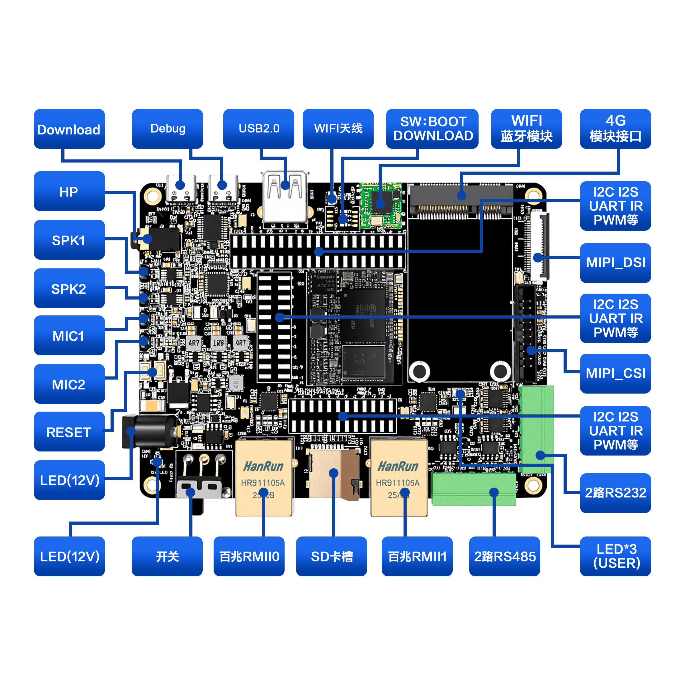

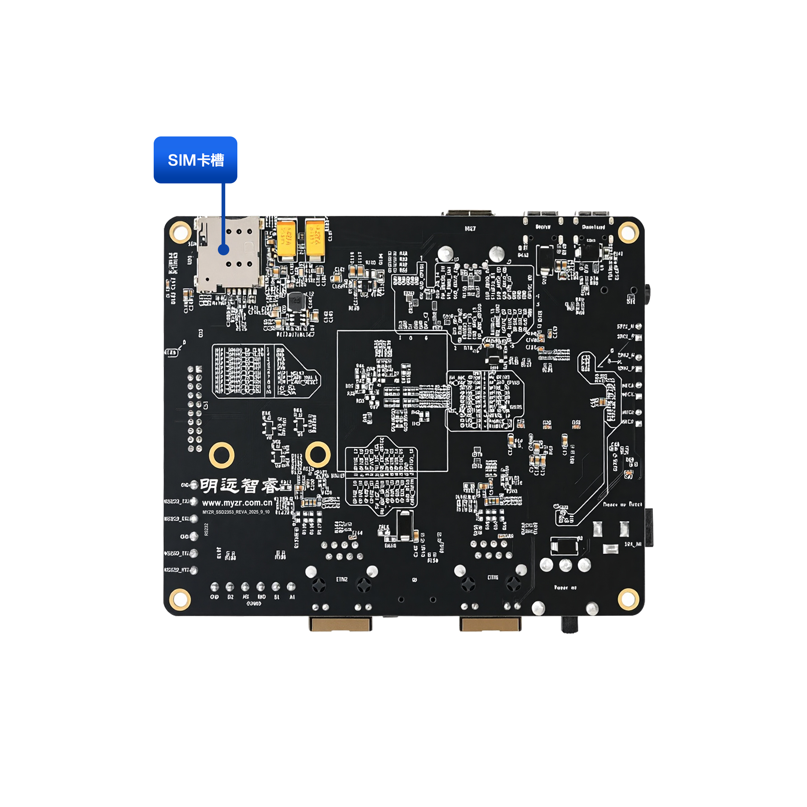

Development Board Basic Parameters
~~~~~~~~~~~~~~~~~~~~~~~~~~~~~~~~~~

.. raw:: html

   

+------+------------+--------------------+
| No.  | Project    | <g                 |
|      |            | id="Bold">Specific |
|      |            | ation:</g>         |
+======+============+====================+
| 1    | Model      | MYZR-SSD2355-EK199 |
+------+------------+--------------------+
| 2    | PCB size   | 120MMX90MM         |
+------+------------+--------------------+
| 3    | PCB layers | quadlayers         |
+------+------------+--------------------+
| 4    | PCB        | 1.6m'm             |
|      | thickness  |                    |
+------+------------+--------------------+
| 5    | PCB Color  | BLACK              |
+------+------------+--------------------+
| 6    | Core Board | LGA                |
|      | Interface  |                    |
+------+------------+--------------------+

Development Board standard and optional accessories
~~~~~~~~~~~~~~~~~~~~~~~~~~~~~~~~~~~~~~~~~~~~~~~~~~~

.. raw:: html

   

+--------------------+---------------------------------+----------------+
| Model              | Development Board Standard      |                |
+====================+=================================+================+
| MYZR-SSD2355-EK199 | TYPE-C Download Line            | TTL to USB     |
|                    |                                 | Module x1      |
+--------------------+---------------------------------+----------------+
|                    | 12V power supply                | Ethernet Cable |
+--------------------+---------------------------------+----------------+
|                    | Giveaway                        |                |
+--------------------+---------------------------------+----------------+
|                    | Optional                        |                |
+--------------------+---------------------------------+----------------+
|                    | Capacitive touch screen (5 inch |                |
|                    | MIPI 800 * 480)                 |                |
+--------------------+---------------------------------+----------------+

Development Board is used in conjunction with MYZR-SSD2355-EK199 Core Board to integrate all common interfaces required for development and debugging, so as to facilitate users' system development and functional verification.

Development Board Resources
~~~~~~~~~~~~~~~~~~~~~~~~~~~

.. raw:: html

   

+------+-----------+--------------+----------------+----------+
| No.  | Interface | Function     | Connection     | Silkscre |
|      |           |              | type           | en       |
+======+===========+==============+================+==========+
| U13  | UISB2.0   | Download     | TPYE-C         | DOWNLOAD |
|      |           | Upgrade      |                |          |
+------+-----------+--------------+----------------+----------+
| CON4 | UART      | Commissionin | TPYE-C         | DEBUG    |
|      |           | g            |                |          |
+------+-----------+--------------+----------------+----------+
| J4   | USB2.0    | USB          | TPYE-AX2       | HOST     |
|      |           | Communicatio |                |          |
|      |           | n            |                |          |
+------+-----------+--------------+----------------+----------+
| SW   | GPIO      | Follow-up    | Dial switch    | SW4      |
|      |           | Mode         |                |          |
+------+-----------+--------------+----------------+----------+
| U23  | USB2.0    | Wi-Fi / BT   | Module         | /        |
|      |           | Communication|                |          |
+------+-----------+--------------+----------------+----------+
| CON6 | PCIE      | /            | PCIE           | /        |
+------+-----------+--------------+----------------+----------+
| CON5 | MIPI-DSI  | Display      | FPC seat       | DSI      |
+------+-----------+--------------+----------------+----------+
| U19  | MIPIO-CSI | Camera       | Jane Bull Seat | CSI      |
+------+-----------+--------------+----------------+----------+
| C198 | RS232     | RS232        | 6pin Phoenix   | RS232    |
|      |           | Communicatio | Terminal       |          |
|      |           | n            |                |          |
+------+-----------+--------------+----------------+----------+
| C201 | RS485     | RS485        | 6pin Phoenix   | RS485    |
|      |           | Communicatio | Terminal       |          |
|      |           | n            |                |          |
+------+-----------+--------------+----------------+----------+
| CON2 | ETH1      | Ethernet     | RJ45 seat      | ETH1     |
+------+-----------+--------------+----------------+----------+
| CON3 | ETH2      | Ethernet     | RJ45 seat      | ETH2     |
+------+-----------+--------------+----------------+----------+
| U17  | SD0       | SD External  | SD card holder | SD       |
|      |           | Storage      |                |          |
+------+-----------+--------------+----------------+----------+
| SW1  | /         | Control      | Slide switch   | SW1      |
|      |           | current      |                |          |
|      |           | switch       |                |          |
+------+-----------+--------------+----------------+----------+
| CON1 | /         | Locomotive   | Train head     | POWER ON |
|      |           | power supply | connector      |          |
|      |           | port         |                |          |
+------+-----------+--------------+----------------+----------+
| P3   | MIC1      | MIC1         | Differential   | P3       |
|      |           |              | base           |          |
+------+-----------+--------------+----------------+----------+
| P4   | MIC2      | MIC2         | Differential   | P4       |
|      |           |              | base           |          |
+------+-----------+--------------+----------------+----------+
| P1   | SPK1      | SPK1         | Differential   | P1       |
|      |           |              | base           |          |
+------+-----------+--------------+----------------+----------+
| P2   | SPK2      | SPK2         | Differential   | P2       |
|      |           |              | base           |          |
+------+-----------+--------------+----------------+----------+
| J3   | AUDIO     | AUDIO        | Audio          | HP       |
|      |           |              | Connectors     |          |
+------+-----------+--------------+----------------+----------+

Development Board Circuit Design Instructions for Each Module
-------------------------------------------------------------

Power Circuit:

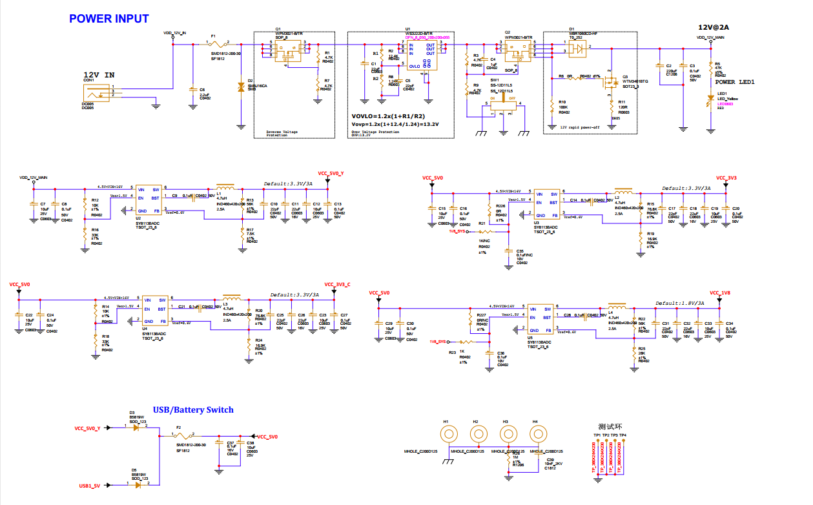

Reset Dials and Indicators:

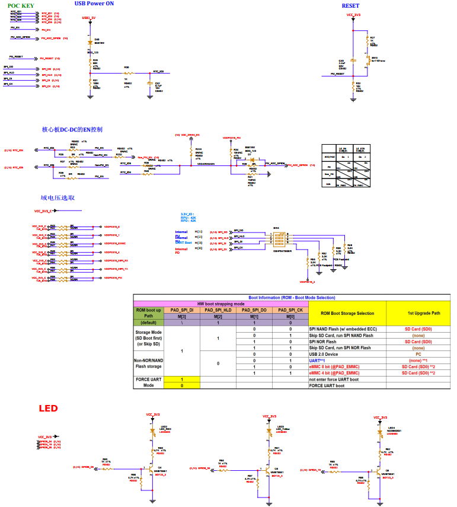

MIC, SPEAKER and = EARPHONE:

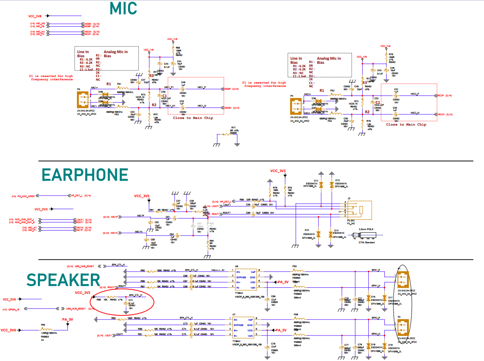

Ethernet

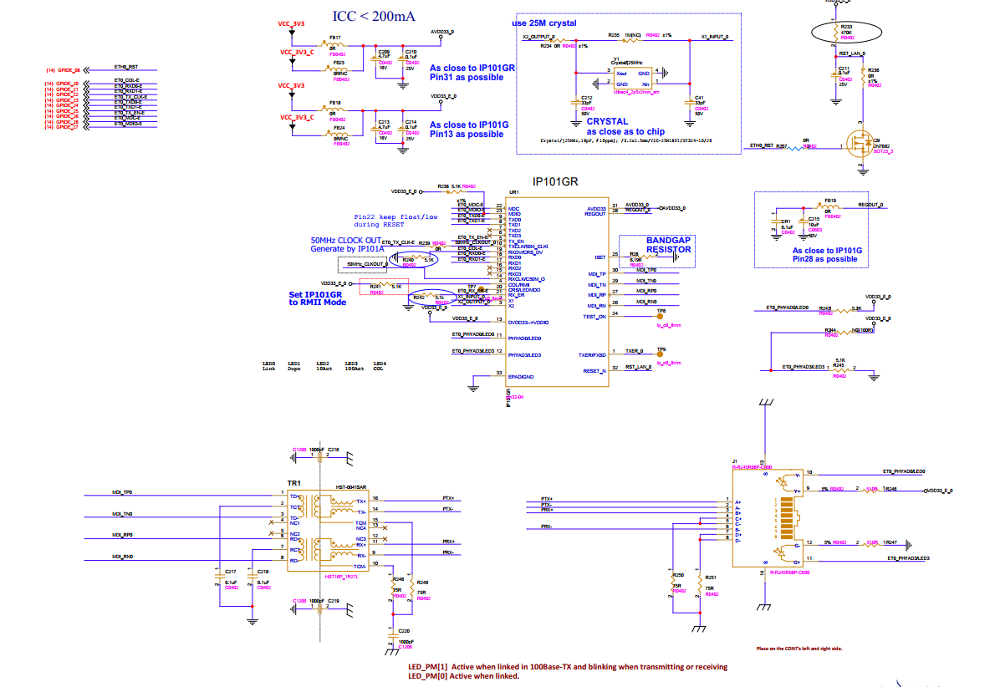

USB-OTG/HOST/HUB:

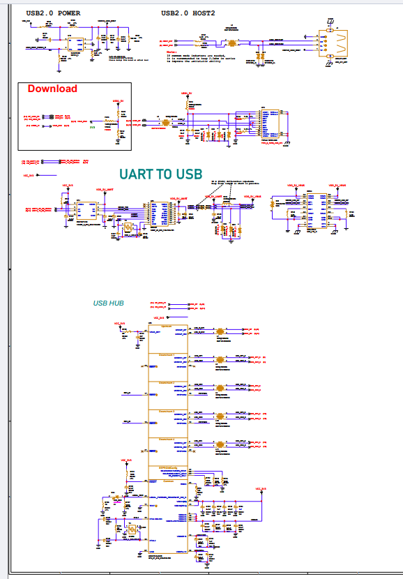

MIcroSD:

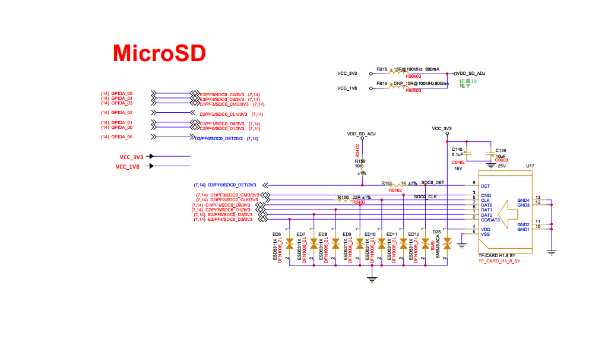

MIPI-DSI:

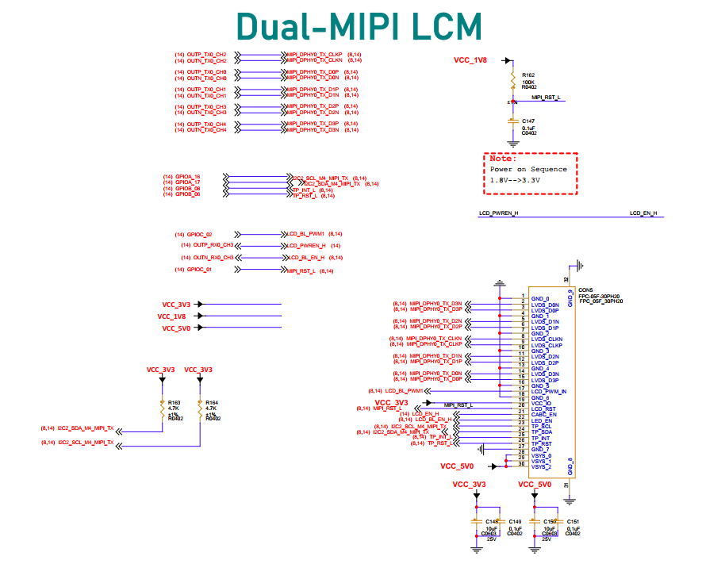

MIPI-CSI:

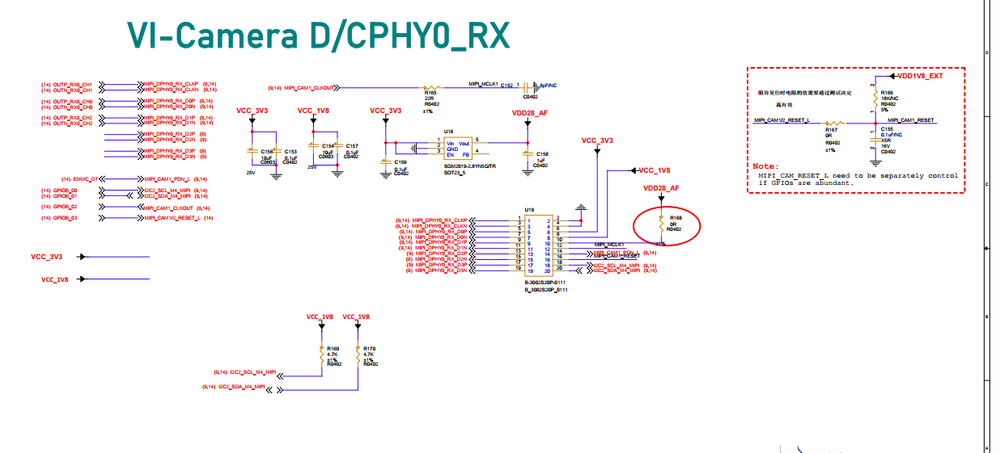

PCIE/WIFI/BT:

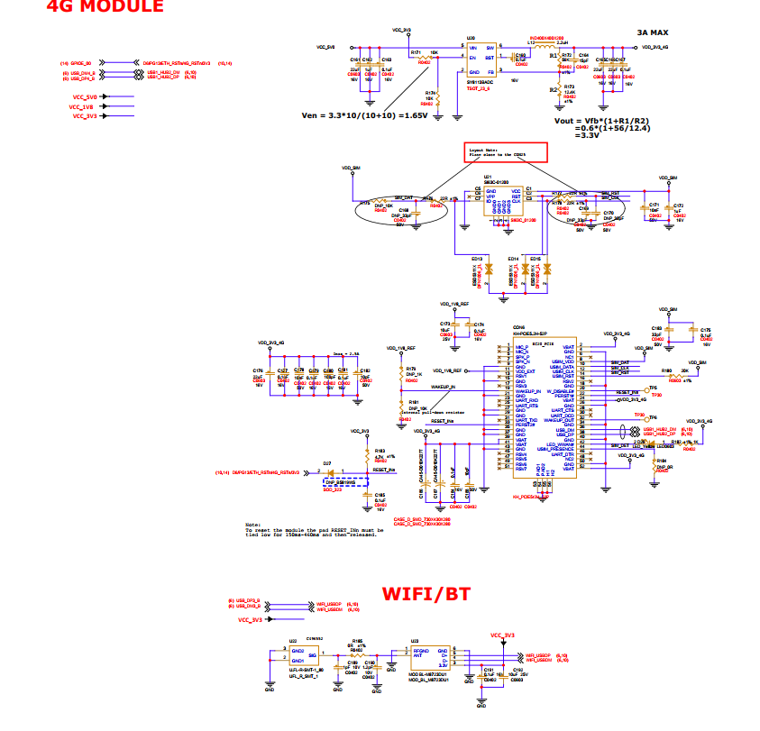

RS485/RS232:

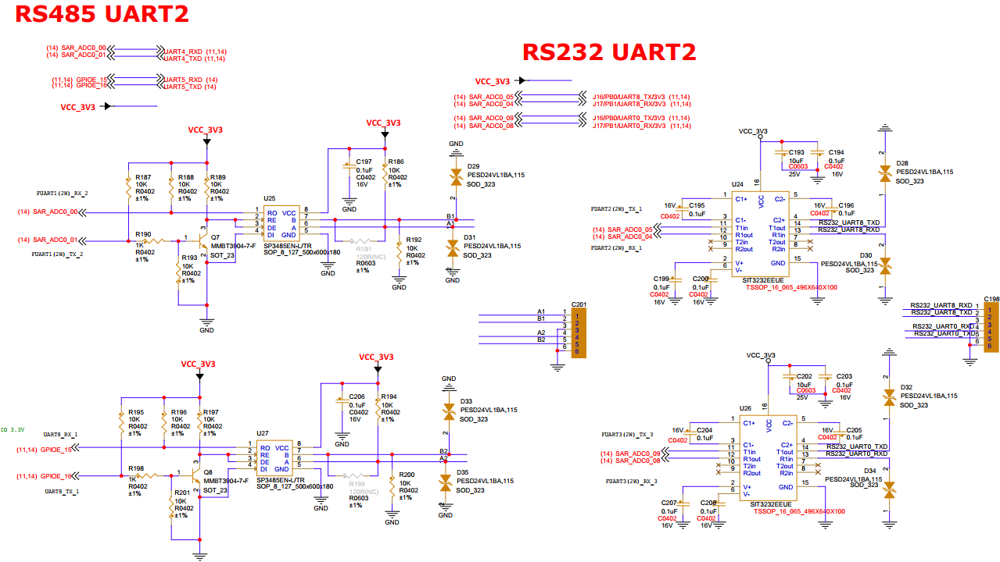
