.. raw:: html

   

产品介绍
========

核心板介绍
----------

硬件资源
~~~~~~~~

SSD2355 核心板采用高密度集成布局，将 SSD2355 主控处理器、电源管理单元、存储电路等关键硬件电路集成在单块板卡上，结构精简紧凑，适配各类小型化 AIoT 设备快速硬件开发。

核心板内部集成：

#. SSD2355 处理器（CPU+NPU+ISP+RISC-V 协处理器）

#. DDR 内存

#. eMMC 5.0/SDIO/SPI Flash 存储电路

#. PMIC 完整电源管理电路

#. 高精度 RTC 时钟电路

#. 硬件 BOOT 启动配置电路

#. 硬件加密与 OTP 安全存储单元

#. 完整音频信号处理电路

核心板规格
----------

.. raw:: html

   

+------------+----------+-------------------------------------+
| 核心板规格                                                  |
+============+==========+=====================================+
| 1          | 型号     | MYZR-SSD2351-EK199                  |
+------------+----------+-------------------------------------+
| 2          | 尺寸     | 28mm × 32mm                         |
+------------+----------+-------------------------------------+
| 3          | PCB      | 8层2阶盲埋沉金工艺                  |
+------------+----------+-------------------------------------+
| 4          | 内存     | 128MB/256MB/512MB/1GB DDR3/4        |
+------------+----------+-------------------------------------+
| 5          | 存储     | 128MB/256MB/512MB NOR FLASH         |
+------------+----------+-------------------------------------+
| 6          | 启动方式 | SPI NOR / NAND、SD、eMMC、USB、UART |
+------------+----------+-------------------------------------+

**核心板正反图**

.. raw:: html

    

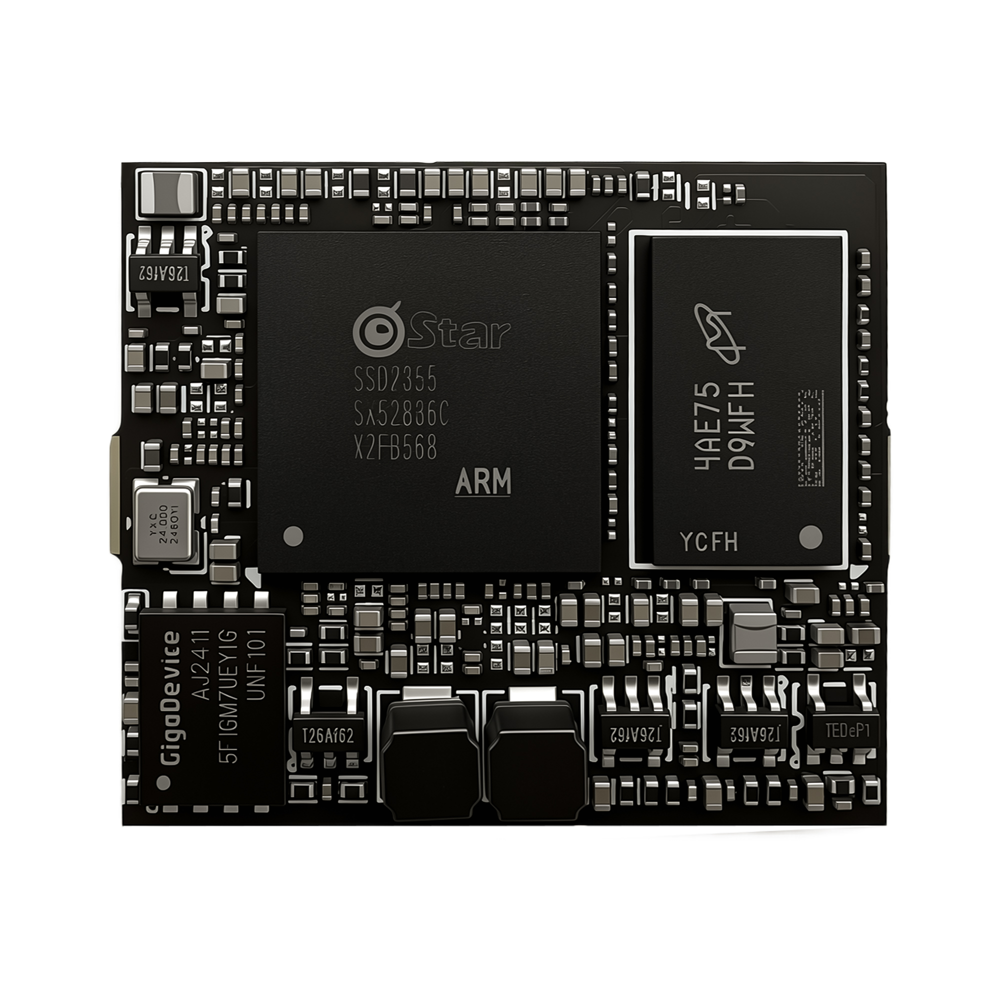

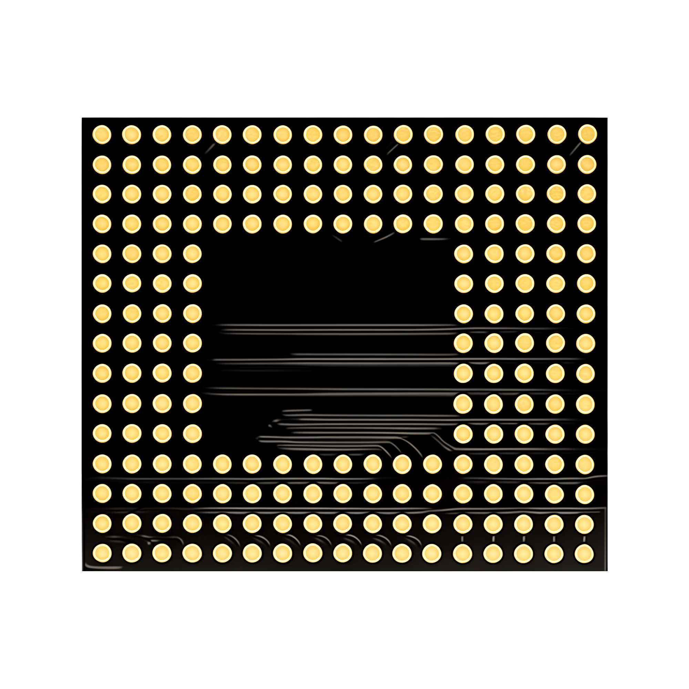

.. raw:: html

 

核心板尺寸图
~~~~~~~~~~~~

核心板尺寸机械图【28mm × 32mm】

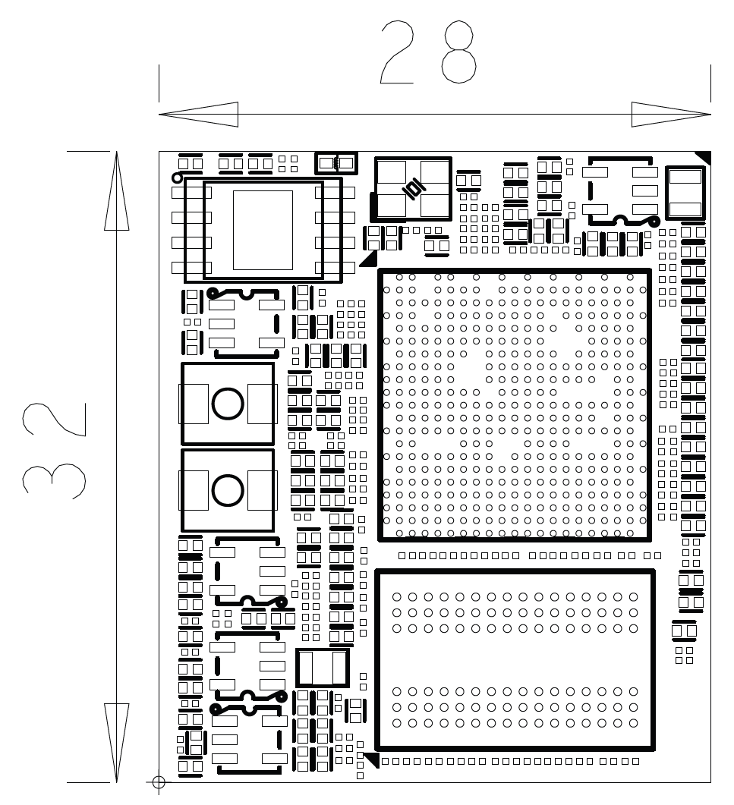

命名规则及可选配置
~~~~~~~~~~~~~~~~~~

.. raw:: html

   

+--------------------+----------------------------------------------+-------------+--------------+--------------+
| 核心板型号         |命名规则                                                                                  |
+====================+==============================================+=============+==============+==============+
| MYZR-SSD2355-LB199 | MYZR                                         | SSD2355     | LB/EK        | 199          |
+                    +----------------------------------------------+-------------+--------------+--------------+
|                    | 明远智睿                                     | MPU主控型号 | 封装         | 核心板引脚数 |
+                    +----------------------------------------------+-------------+--------------+--------------+
|                    |                                              |             | LB【LGA】    |              |
+                    +----------------------------------------------+-------------+--------------+--------------+
|                    |                                              |             | EK【开发板】 |              |
+                    +----------------------------------------------+-------------+--------------+--------------+
|                    |**可选配置**                                                                              |
+                    +----------------------------------------------+-------------+--------------+--------------+
|                    | 内存：128MB/256MB/512MB/1GB DDR3/4                                                       |
+                    +----------------------------------------------+-------------+--------------+--------------+
|                    | 存储：128MB/256MB/512MB NOR FLASH                                                        |
+                    +------------------------------------------------------------------------------------------+
|                    | 例：核心板型号：MYZR-SSD2355-LB199-128M-128M                                             |
|                    |   **开发板型号：MYZR-SSD2355-EK199-128M-128M**                                           |
+--------------------+------------------------------------------------------------------------------------------+

供电模式
~~~~~~~~

.. raw:: html

   

+----------+-----------------+------+------+------+------+----------------------------------------------+
| 功能     | 引脚标号        | 规格                      | 说明                                         |
+==========+=================+======+======+======+======+==============================================+
|          |                 | 最小 | 典型 | 最大 | 单位 |                                              |
+----------+-----------------+------+------+------+------+----------------------------------------------+
| 电源供电 | E12,E13,F12,F13 | -    | 3.3  | -    | V/伏 | 公开资料里，没有 SSD2355 芯片本身的绝对最大  |
|          |                 |      |      |      |      | 额定输入电压或推荐工作电压范围               |
+----------+-----------------+------+------+------+------+----------------------------------------------+

工作环境
~~~~~~~~

.. raw:: html

   

+--------+------+------+------+------+-----------------------+
| 参数   | 规格                      | 说明                  |
+========+======+======+======+======+=======================+
|        | 最小 | 典型 | 最大 | 单位 |                       |
+--------+------+------+------+------+-----------------------+
| 商业级 | 0℃   | 25   | 80℃  | ℃    | 实测 0 至 80℃运行正常 |
+--------+------+------+------+------+-----------------------+

启动配置
~~~~~~~~

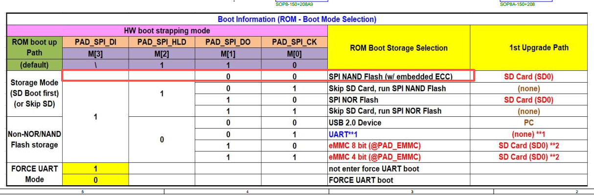

是否支持快启动及快启时间
~~~~~~~~~~~~~~~~~~~~~~~~

.. raw:: html

   

+---------+----------+------+
| 项目    | 支持情况 | 时间 |
+=========+==========+======+
| SSD2355 | 支持     | 3s   |
+---------+----------+------+

核心板贴片/安装示意图
~~~~~~~~~~~~~~~~~~~~~

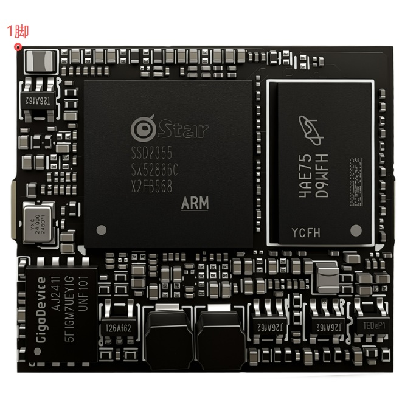

SSD2355贴片1脚示意图

信号定义
--------

核心板引脚定义

.. raw:: html

   

+---------+--------------------+-------------------------------+----------------------+
| Pin NO. | Pin Name           | 功能描述                      | 管脚电压             |
+=========+====================+===============================+======================+
| A1      | 1V8\_SYS           | 1.8V输出                      | 1.8V                 |
+---------+--------------------+-------------------------------+----------------------+
| A2      | GPIOC\_00          | 通用GPIO                      | 同VDDP3318\_MIPI\_TX |
+---------+--------------------+-------------------------------+----------------------+
| A3      | GPIOC\_05          | 通用GPIO                      | 同VDDP3318\_MIPI\_TX |
+---------+--------------------+-------------------------------+----------------------+
| A4      | SAR\_ADC0\_00      | 模数转换器                    | 同VDDP3318\_1        |
+---------+--------------------+-------------------------------+----------------------+
| A5      | SAR\_ADC0\_05      | 模数转换器                    | 同VDDP3318\_1        |
+---------+--------------------+-------------------------------+----------------------+
| A6      | SAR\_ADC0\_08      | 模数转换器                    | 同VDDP3318\_1        |
+---------+--------------------+-------------------------------+----------------------+
| A7      | SAR\_ADC0\_11      | 模数转换器                    | 同VDDP3318\_1        |
+---------+--------------------+-------------------------------+----------------------+
| A8      | SAR\_ADC0\_13      | 模数转换器                    | 同VDDP3318\_1        |
+---------+--------------------+-------------------------------+----------------------+
| A9      | PM\_UART1\_TX      | 固定调试发出串口              | 同VDDP3318\_PM       |
+---------+--------------------+-------------------------------+----------------------+
| A10     | UART0\_RX          | 接收串口0                     | 同VDDP3318\_4        |
+---------+--------------------+-------------------------------+----------------------+
| A11     | PM\_SAR\_GPIO1     | GPIO                          | 1.8V                 |
+---------+--------------------+-------------------------------+----------------------+
| A12     | VDDP3318\_4        | 电源域电压配置输入口          | 同VDDP3318\_4        |
+---------+--------------------+-------------------------------+----------------------+
| A13     | RTC\_IO1           | 低功耗唤醒引脚                | 3.3V                 |
+---------+--------------------+-------------------------------+----------------------+
| A14     | SPI\_HLD           | SPI控制引脚                   | 同VDDP3318\_4        |
+---------+--------------------+-------------------------------+----------------------+
| A15     | SPI\_DO            | SPI主设备输入引脚             | 同VDDP3318\_4        |
+---------+--------------------+-------------------------------+----------------------+
| B1      | GPIOC\_02          | 通用GPIO                      | 同VDDP3318\_MIPI\_TX |
+---------+--------------------+-------------------------------+----------------------+
| B2      | GPIOC\_01          | 通用GPIO                      | 同VDDP3318\_MIPI\_TX |
+---------+--------------------+-------------------------------+----------------------+
| B3      | GPIOC\_04          | 通用GPIO                      | 同VDDP3318\_MIPI\_TX |
+---------+--------------------+-------------------------------+----------------------+
| B4      | SAR\_ADC0\_01      | 模数转换器                    | 同VDDP3318\_1        |
+---------+--------------------+-------------------------------+----------------------+
| B5      | SAR\_ADC0\_04      | 模数转换器                    | 同VDDP3318\_1        |
+---------+--------------------+-------------------------------+----------------------+
| B6      | SAR\_ADC0\_09      | 模数转换器                    | 同VDDP3318\_1        |
+---------+--------------------+-------------------------------+----------------------+
| B7      | SAR\_ADC0\_10      | 模数转换器                    | 同VDDP3318\_1        |
+---------+--------------------+-------------------------------+----------------------+
| B8      | SAR\_ADC0\_12      | 模数转换器                    | 同VDDP3318\_1        |
+---------+--------------------+-------------------------------+----------------------+
| B9      | PM\_UART1\_RX      | 固定调试接收串口              | 同VDDP3318\_PM       |
+---------+--------------------+-------------------------------+----------------------+
| B10     | UART0\_TX          | 发出串口0                     | 同VDDP3318\_4        |
+---------+--------------------+-------------------------------+----------------------+
| B11     | PM\_SAR\_GPIO3     | GPIO                          | 1.8V                 |
+---------+--------------------+-------------------------------+----------------------+
| B12     | RTC\_IO5           | 电源控制输出                  | 3.3V                 |
+---------+--------------------+-------------------------------+----------------------+
| B13     | RTC\_IO4           | 电源控制输出                  | 3.3V                 |
+---------+--------------------+-------------------------------+----------------------+
| B14     | SPI\_CK            | SPI时钟                       | 同VDDP3318\_4        |
+---------+--------------------+-------------------------------+----------------------+
| B15     | SPI\_WPZ           | SPI写保护                     | 同VDDP3318\_4        |
+---------+--------------------+-------------------------------+----------------------+
| C1      | OUTP\_TX0\_CH4     | 差分输出                      | 同VDDP3318\_MIPI\_TX |
+---------+--------------------+-------------------------------+----------------------+
| C2      | OUTN\_TX0\_CH4     | 差分输出                      | 同VDDP3318\_MIPI\_TX |
+---------+--------------------+-------------------------------+----------------------+
| C3      | GPIOC\_03          | 通用GPIO                      | 同VDDP3318\_MIPI\_TX |
+---------+--------------------+-------------------------------+----------------------+
| C4      | GPIOC\_07          | 通用GPIO                      | 同VDDP3318\_MIPI\_TX |
+---------+--------------------+-------------------------------+----------------------+
| C5      | GPIOC\_08          | 通用GPIO                      | 同VDDP3318\_MIPI\_TX |
+---------+--------------------+-------------------------------+----------------------+
| C6      | SAR\_ADC0\_03      | 模数转换器                    | 同VDDP3318\_1        |
+---------+--------------------+-------------------------------+----------------------+
| C7      | SAR\_ADC0\_07      | 模数转换器                    | 同VDDP3318\_1        |
+---------+--------------------+-------------------------------+----------------------+
| C8      | PM\_PWM1\_OUT      | PWM输出                       | 同VDDP3318\_4        |
+---------+--------------------+-------------------------------+----------------------+
| C9      | SAR\_ADC0\_14      | 模数转换器                    | 同VDDP3318\_1        |
+---------+--------------------+-------------------------------+----------------------+
| C10     | PM\_ADC\_GPIO6     | 模数转换器                    | 同VDDP3318\_PM       |
+---------+--------------------+-------------------------------+----------------------+
| C11     | PM\_SAR\_GPIO4     | 通用GPIO                      | 1.8V                 |
+---------+--------------------+-------------------------------+----------------------+
| C12     | PM\_RESET          | 复位                          | 3.3V                 |
+---------+--------------------+-------------------------------+----------------------+
| C13     | RTC\_IO3           | 位于 RTC 电源域的唤醒输入引脚 | 3.3V                 |
+---------+--------------------+-------------------------------+----------------------+
| C14     | SPI\_DI            | SPI主设备输出引脚             | 同VDDP3318\_4        |
+---------+--------------------+-------------------------------+----------------------+
| C15     | SPI\_CZ            | SPI 主控的片选信号            | 同VDDP3318\_4        |
+---------+--------------------+-------------------------------+----------------------+
| D1      | OUTP\_TX0\_CH3     | 差分输出                      | 同VDDP3318\_MIPI\_TX |
+---------+--------------------+-------------------------------+----------------------+
| D2      | OUTN\_TX0\_CH3     | 差分输出                      | 同VDDP3318\_MIPI\_TX |
+---------+--------------------+-------------------------------+----------------------+
| D3      | GPIOC\_06          | 通用GPIO                      | 同VDDP3318\_MIPI\_TX |
+---------+--------------------+-------------------------------+----------------------+
| D4      | SAR\_ADC0\_02      | 模数转换器                    | 同VDDP3318\_1        |
+---------+--------------------+-------------------------------+----------------------+
| D5      | SAR\_ADC0\_06      | 模数转换器                    | 同VDDP3318\_1        |
+---------+--------------------+-------------------------------+----------------------+
| D6      | PM\_PWM0\_OUT      | 电源域电压配置输入口          | 同VDDP3318\_4        |
+---------+--------------------+-------------------------------+----------------------+
| D7      | PM\_ADC\_GPIO3     | 模数转换器                    | 同VDDP3318\_PM       |
+---------+--------------------+-------------------------------+----------------------+
| D8      | PM\_ADC00\_IN      | 模数转换器                    | 同VDDP3318\_PM       |
+---------+--------------------+-------------------------------+----------------------+
| D9      | PM\_ADC\_GPIO7     | 模数转换器                    | 同VDDP3318\_PM       |
+---------+--------------------+-------------------------------+----------------------+
| D10     | PM\_SAR\_GPIO0     | 通用GPIO                      | 1.8V                 |
+---------+--------------------+-------------------------------+----------------------+
| D11     | PM\_SAR\_GPIO2     | 通用GPIO                      | 1.8V                 |
+---------+--------------------+-------------------------------+----------------------+
| D12     | PM\_GPIO5          | 通用GPIO                      | 1.8V                 |
+---------+--------------------+-------------------------------+----------------------+
| D13     | PM\_ADC\_GPIO0     | 通用GPIO/模数转换器           | 同VDDP3318\_PM       |
+---------+--------------------+-------------------------------+----------------------+
| D14     | AUD\_LINE\_OUT\_L  | 耳机左声道                    | 1.8V                 |
+---------+--------------------+-------------------------------+----------------------+
| D15     | AUD\_LINE\_OUT\_R  | 耳机右声道                    | 1.8V                 |
+---------+--------------------+-------------------------------+----------------------+
| E1      | OUTP\_TX0\_CH1     | 差分输出                      | 同VDDP3318\_MIPI\_TX |
+---------+--------------------+-------------------------------+----------------------+
| E2      | OUTN\_TX0\_CH1     | 差分输出                      | 同VDDP3318\_MIPI\_TX |
+---------+--------------------+-------------------------------+----------------------+
| E3      | VDDP3318\_1        | 电源域电压配置输入口          | 同VDDP3318\_1        |
+---------+--------------------+-------------------------------+----------------------+
| E4      | VDDP3318\_PM       | 电源域电压配置输入口          | 同VDDP3318\_PM       |
+---------+--------------------+-------------------------------+----------------------+
| E12     | 3V3\_SYS           | 3V3电源输入                   | 3.3V                 |
+---------+--------------------+-------------------------------+----------------------+
| E13     | 3V3\_SYS           | 3V3电源输入                   | 3.3V                 |
+---------+--------------------+-------------------------------+----------------------+
| E14     | MIC\_P1            | 差分麦克风-                   | 差分                 |
+---------+--------------------+-------------------------------+----------------------+
| E15     | MIC\_M1            | 差分麦克风+                   | 差分                 |
+---------+--------------------+-------------------------------+----------------------+
| F1      | OUTP\_TX0\_CH2     | 差分输出                      | 同VDDP3318\_MIPI\_TX |
+---------+--------------------+-------------------------------+----------------------+
| F2      | OUTN\_TX0\_CH2     | 差分输出                      | 同VDDP3318\_MIPI\_TX |
+---------+--------------------+-------------------------------+----------------------+
| F3      | GPIOE\_00          | 通用GPIO                      | 同VDDP3318\_0        |
+---------+--------------------+-------------------------------+----------------------+
| F4      | GPIOB\_03          | 通用GPIO                      | 同VDDP3318\_MIPI\_TX |
+---------+--------------------+-------------------------------+----------------------+
| F12     | 3V3\_SYS           | 3V3电源输入                   | 3.3V                 |
+---------+--------------------+-------------------------------+----------------------+
| F13     | 3V3\_SYS           | 3V3电源输入                   | 3.3V                 |
+---------+--------------------+-------------------------------+----------------------+
| F14     | MIC\_M0            | 差分麦克风-                   | 差分                 |
+---------+--------------------+-------------------------------+----------------------+
| F15     | MIC\_P0            | 差分麦克风+                   | 差分                 |
+---------+--------------------+-------------------------------+----------------------+
| G1      | OUTN\_TX0\_CH0     | 差分输出                      | 同VDDP3318\_MIPI\_TX |
+---------+--------------------+-------------------------------+----------------------+
| G2      | OUTP\_TX0\_CH0     | 差分输出                      | 同VDDP3318\_MIPI\_TX |
+---------+--------------------+-------------------------------+----------------------+
| G3      | GPIOB\_07          | 通用GPIO                      | 同VDDP3318\_MIPI\_RX |
+---------+--------------------+-------------------------------+----------------------+
| G4      | VDDP3318\_MIPI\_TX | 电源域电压配置输入口          | 同VDDP3318\_MIPI\_TX |
+---------+--------------------+-------------------------------+----------------------+
| G12     | GPIOA\_18          | 通用GPIO                      | 同VDDP3318\_EMMC     |
+---------+--------------------+-------------------------------+----------------------+
| G13     | GPIOE\_01          | 通用GPIO                      | 同VDDP3318\_0        |
+---------+--------------------+-------------------------------+----------------------+
| G14     | MIC\_M2            | 差分麦克风-                   | 差分                 |
+---------+--------------------+-------------------------------+----------------------+
| G15     | MIC\_P2            | 差分麦克风+                   | 差分                 |
+---------+--------------------+-------------------------------+----------------------+
| H1      | OUTN\_RX0\_CH3     | 差分输入                      | 同VDDP3318\_MIPI\_RX |
+---------+--------------------+-------------------------------+----------------------+
| H2      | OUTP\_RX0\_CH3     | 差分输入                      | 同VDDP3318\_MIPI\_RX |
+---------+--------------------+-------------------------------+----------------------+
| H3      | GPIOB\_08          | 通用GPIO                      | 同VDDP3318\_MIPI\_RX |
+---------+--------------------+-------------------------------+----------------------+
| H4      | VDDP3318\_MIPI\_RX | 电源域电压配置输入口          | 同VDDP3318\_MIPI\_RX |
+---------+--------------------+-------------------------------+----------------------+
| H12     | GPIOE\_02          | 通用GPIO                      | 同VDDP3318\_0        |
+---------+--------------------+-------------------------------+----------------------+
| H13     | GPIOE\_03          | 通用GPIO                      | 同VDDP3318\_0        |
+---------+--------------------+-------------------------------+----------------------+
| H14     | GPIOD\_04          | 通用GPIO                      | 同VDDP3318\_4        |
+---------+--------------------+-------------------------------+----------------------+
| H15     | GPIOD\_05          | 通用GPIO                      | 同VDDP3318\_4        |
+---------+--------------------+-------------------------------+----------------------+
| J1      | OUTP\_RX0\_CH1     | 差分输入                      | 同VDDP3318\_MIPI\_RX |
+---------+--------------------+-------------------------------+----------------------+
| J2      | OUTN\_RX0\_CH1     | 差分输入                      | 同VDDP3318\_MIPI\_RX |
+---------+--------------------+-------------------------------+----------------------+
| J3      | GPIOB\_06          | 通用GPIO                      | 同VDDP3318\_MIPI\_RX |
+---------+--------------------+-------------------------------+----------------------+
| J4      | VDDP3318\_EMMC     | 电源域电压配置输入口          | 同VDDP3318\_EMMC     |
+---------+--------------------+-------------------------------+----------------------+
| J12     | GPIOE\_05          | 通用GPIO                      | 同VDDP3318\_0        |
+---------+--------------------+-------------------------------+----------------------+
| J13     | GPIOE\_04          | 通用GPIO                      | 同VDDP3318\_0        |
+---------+--------------------+-------------------------------+----------------------+
| J14     | GPIOD\_03          | 通用GPIO                      | 同VDDP3318\_4        |
+---------+--------------------+-------------------------------+----------------------+
| J15     | GPIOD\_00          | 通用GPIO                      | 同VDDP3318\_4        |
+---------+--------------------+-------------------------------+----------------------+
| K1      | OUTN\_RX0\_CH2     | 差分输入                      | 同VDDP3318\_MIPI\_RX |
+---------+--------------------+-------------------------------+----------------------+
| K2      | OUTP\_RX0\_CH2     | 差分输入                      | 同VDDP3318\_MIPI\_RX |
+---------+--------------------+-------------------------------+----------------------+
| K3      | GPIOB\_04          | 通用GPIO                      | 同VDDP3318\_MIPI\_RX |
+---------+--------------------+-------------------------------+----------------------+
| K4      | GPIOB\_02          | 通用GPIO                      | 同VDDP3318\_MIPI\_RX |
+---------+--------------------+-------------------------------+----------------------+
| K12     | GND                | 接地                          | 0V                   |
+---------+--------------------+-------------------------------+----------------------+
| K13     | GND                | 接地                          | 0V                   |
+---------+--------------------+-------------------------------+----------------------+
| K14     | ADC\_PWM\_OUT00    | PWM输出                       | 同VDDP3318\_4        |
+---------+--------------------+-------------------------------+----------------------+
| K15     | ADC\_PWM\_OUT01    | PWM输出                       | 同VDDP3318\_4        |
+---------+--------------------+-------------------------------+----------------------+
| L1      | OUTP\_RX0\_CH0     | 差分输入                      | 同VDDP3318\_MIPI\_RX |
+---------+--------------------+-------------------------------+----------------------+
| L2      | OUTN\_RX0\_CH0     | 差分输入                      | 同VDDP3318\_MIPI\_RX |
+---------+--------------------+-------------------------------+----------------------+
| L3      | GPIOB\_01          | 通用GPIO                      | 同VDDP3318\_MIPI\_RX |
+---------+--------------------+-------------------------------+----------------------+
| L4      | GPIOA\_19          | 通用GPIO                      | 同VDDP3318\_EMMC     |
+---------+--------------------+-------------------------------+----------------------+
| L12     | GND                | 接地                          | 0V                   |
+---------+--------------------+-------------------------------+----------------------+
| L13     | GND                | 接地                          | 0V                   |
+---------+--------------------+-------------------------------+----------------------+
| L14     | DM\_USB2\_P1       | USB2.0-                       | 差分                 |
+---------+--------------------+-------------------------------+----------------------+
| L15     | DP\_USB2\_P1       | USB2.0+                       | 差分                 |
+---------+--------------------+-------------------------------+----------------------+
| M1      | EMMC\_D2           | EMMC数据线                    | 同VDDP3318\_EMMC     |
+---------+--------------------+-------------------------------+----------------------+
| M2      | EMMC\_D7           | EMMC数据线                    | 同VDDP3318\_EMMC     |
+---------+--------------------+-------------------------------+----------------------+
| M3      | GPIOB\_00          | 通用GPIO                      | 同VDDP3318\_MIPI\_RX |
+---------+--------------------+-------------------------------+----------------------+
| M4      | GPIOB\_05          | 通用GPIO                      | 同VDDP3318\_MIPI\_RX |
+---------+--------------------+-------------------------------+----------------------+
| M12     | VDDP3318\_0        | 电源域电压配置输入口          | 同VDDP3318\_0        |
+---------+--------------------+-------------------------------+----------------------+
| M13     | PM\_GPIO4          | 通用GPIO                      | 1.8V                 |
+---------+--------------------+-------------------------------+----------------------+
| M14     | DP\_USB2\_P0       | 固定烧录USB-                  | 差分                 |
+---------+--------------------+-------------------------------+----------------------+
| M15     | DM\_USB2\_P0       | 固定烧录USB+                  | 差分                 |
+---------+--------------------+-------------------------------+----------------------+
| N1      | EMMC\_D1           | EMMC数据线                    | 同VDDP3318\_EMMC     |
+---------+--------------------+-------------------------------+----------------------+
| N2      | EMMC\_D6           | EMMC数据线                    | 同VDDP3318\_EMMC     |
+---------+--------------------+-------------------------------+----------------------+
| N3      | GND                | 接地                          | 0V                   |
+---------+--------------------+-------------------------------+----------------------+
| N4      | GND                | 接地                          | 0V                   |
+---------+--------------------+-------------------------------+----------------------+
| N5      | GND                | 接地                          | 0V                   |
+---------+--------------------+-------------------------------+----------------------+
| N6      | GND                | 接地                          | 0V                   |
+---------+--------------------+-------------------------------+----------------------+
| N7      | GND                | 接地                          | 0V                   |
+---------+--------------------+-------------------------------+----------------------+
| N8      | GND                | 接地                          | 0V                   |
+---------+--------------------+-------------------------------+----------------------+
| N9      | GND                | 接地                          | 0V                   |
+---------+--------------------+-------------------------------+----------------------+
| N10     | GND                | 接地                          | 0V                   |
+---------+--------------------+-------------------------------+----------------------+
| N11     | GND                | 接地                          | 0V                   |
+---------+--------------------+-------------------------------+----------------------+
| N12     | Non\_PM\_EN        | 电源使能                      | 3.3V                 |
+---------+--------------------+-------------------------------+----------------------+
| N13     | GPIOE\_19          | 通用GPIO                      | 同VDDP3318\_0        |
+---------+--------------------+-------------------------------+----------------------+
| N14     | GPIOE\_13          | 通用GPIO                      | 同VDDP3318\_0        |
+---------+--------------------+-------------------------------+----------------------+
| N15     | GPIOE\_14          | 通用GPIO                      | 同VDDP3318\_0        |
+---------+--------------------+-------------------------------+----------------------+
| P1      | EMMC\_D4           | EMMC数据线                    | 同VDDP3318\_EMMC     |
+---------+--------------------+-------------------------------+----------------------+
| P2      | EMMC\_D0           | EMMC数据线                    | 同VDDP3318\_EMMC     |
+---------+--------------------+-------------------------------+----------------------+
| P3      | GPIOA\_06          | 通用GPIO                      | 同VDDP3318\_EMMC     |
+---------+--------------------+-------------------------------+----------------------+
| P4      | GPIOA\_04          | 通用GPIO                      | 同VDDP3318\_EMMC     |
+---------+--------------------+-------------------------------+----------------------+
| P5      | GPIOA\_12          | 通用GPIO                      | 同VDDP3318\_EMMC     |
+---------+--------------------+-------------------------------+----------------------+
| P6      | GPIOA\_13          | 通用GPIO                      | 同VDDP3318\_EMMC     |
+---------+--------------------+-------------------------------+----------------------+
| P7      | GPIOA\_16          | 通用GPIO                      | 同VDDP3318\_EMMC     |
+---------+--------------------+-------------------------------+----------------------+
| P8      | PM\_I2C\_SDA       | I2C数据线                     | 同VDDP3318\_PM       |
+---------+--------------------+-------------------------------+----------------------+
| P9      | GPIOD\_02          | 通用GPIO                      | 同VDDP3318\_4        |
+---------+--------------------+-------------------------------+----------------------+
| P10     | GPIOE\_10          | 通用GPIO                      | 同VDDP3318\_0        |
+---------+--------------------+-------------------------------+----------------------+
| P11     | GND                | 接地                          | 0V                   |
+---------+--------------------+-------------------------------+----------------------+
| P12     | GND                | 接地                          | 0V                   |
+---------+--------------------+-------------------------------+----------------------+
| P13     | GPIOE\_12          | 通用GPIO                      | 同VDDP3318\_0        |
+---------+--------------------+-------------------------------+----------------------+
| P14     | GPIOE\_18          | 通用GPIO                      | 同VDDP3318\_0        |
+---------+--------------------+-------------------------------+----------------------+
| P15     | GPIOE\_16          | 通用GPIO                      | 同VDDP3318\_0        |
+---------+--------------------+-------------------------------+----------------------+
| R1      | EMMC\_D5           | EMMC数据线                    | 同VDDP3318\_EMMC     |
+---------+--------------------+-------------------------------+----------------------+
| R2      | EMMC\_D3           | EMMC数据线                    | 同VDDP3318\_EMMC     |
+---------+--------------------+-------------------------------+----------------------+
| R3      | GPIOA\_05          | 通用GPIO                      | 同VDDP3318\_EMMC     |
+---------+--------------------+-------------------------------+----------------------+
| R4      | GPIOA\_02          | 通用GPIO                      | 同VDDP3318\_EMMC     |
+---------+--------------------+-------------------------------+----------------------+
| R5      | GPIOA\_09          | 通用GPIO                      | 同VDDP3318\_EMMC     |
+---------+--------------------+-------------------------------+----------------------+
| R6      | GPIOA\_10          | 通用GPIO                      | 同VDDP3318\_EMMC     |
+---------+--------------------+-------------------------------+----------------------+
| R7      | GPIOA\_17          | 通用GPIO                      | 同VDDP3318\_EMMC     |
+---------+--------------------+-------------------------------+----------------------+
| R8      | PM\_I2C\_SCL       | I2C时钟线                     | 同VDDP3318\_PM       |
+---------+--------------------+-------------------------------+----------------------+
| R9      | GPIOD\_01          | 通用GPIO                      | 同VDDP3318\_4        |
+---------+--------------------+-------------------------------+----------------------+
| R10     | GPIOE\_09          | 通用GPIO                      | 同VDDP3318\_0        |
+---------+--------------------+-------------------------------+----------------------+
| R11     | GND                | 接地                          | 0V                   |
+---------+--------------------+-------------------------------+----------------------+
| R12     | VDD\_DRAM\_EN      | RAM电源使能                   | 同VDDP3318\_PM       |
+---------+--------------------+-------------------------------+----------------------+
| R13     | GPIOE\_11          | 通用GPIO                      | 同VDDP3318\_0        |
+---------+--------------------+-------------------------------+----------------------+
| R14     | GPIOE\_17          | 通用GPIO                      | 同VDDP3318\_0        |
+---------+--------------------+-------------------------------+----------------------+
| R15     | GPIOE\_15          | 通用GPIO                      | 同VDDP3318\_0        |
+---------+--------------------+-------------------------------+----------------------+
| T1      | EMMC\_DS           | EMMC片选                      | 同VDDP3318\_EMMC     |
+---------+--------------------+-------------------------------+----------------------+
| T2      | EMMC\_RSTn         | EMMC复位                      | 同VDDP3318\_EMMC     |
+---------+--------------------+-------------------------------+----------------------+
| T3      | GPIOA\_03          | 通用GPIO                      | 同VDDP3318\_EMMC     |
+---------+--------------------+-------------------------------+----------------------+
| T4      | GPIOA\_00          | 通用GPIO                      | 同VDDP3318\_EMMC     |
+---------+--------------------+-------------------------------+----------------------+
| T5      | GPIOA\_07          | 通用GPIO                      | 同VDDP3318\_EMMC     |
+---------+--------------------+-------------------------------+----------------------+
| T6      | GPIOA\_08          | 通用GPIO                      | 同VDDP3318\_EMMC     |
+---------+--------------------+-------------------------------+----------------------+
| T7      | GPIOA\_14          | 通用GPIO                      | 同VDDP3318\_EMMC     |
+---------+--------------------+-------------------------------+----------------------+
| T8      | PM\_ADC\_GPIO1     | 通用GPIO                      | 同VDDP3318\_PM       |
+---------+--------------------+-------------------------------+----------------------+
| T9      | GPIOE\_07          | 通用GPIO                      | 同VDDP3318\_0        |
+---------+--------------------+-------------------------------+----------------------+
| T10     | GND                | 接地                          | 0V                   |
+---------+--------------------+-------------------------------+----------------------+
| T11     | GPIOE\_26          | 通用GPIO                      | 同VDDP3318\_0        |
+---------+--------------------+-------------------------------+----------------------+
| T12     | GPIOE\_20          | 通用GPIO                      | 同VDDP3318\_0        |
+---------+--------------------+-------------------------------+----------------------+
| T13     | GPIOE\_25          | 通用GPIO                      | 同VDDP3318\_0        |
+---------+--------------------+-------------------------------+----------------------+
| T14     | GPIOE\_23          | 通用GPIO                      | 同VDDP3318\_0        |
+---------+--------------------+-------------------------------+----------------------+
| T15     | GPIOE\_24          | 通用GPIO                      | 同VDDP3318\_0        |
+---------+--------------------+-------------------------------+----------------------+
| U1      | EMMC\_CLK          | EMMC时钟                      | 同VDDP3318\_EMMC     |
+---------+--------------------+-------------------------------+----------------------+
| U2      | EMMC\_CMD          | EMMC命令                      | 同VDDP3318\_EMMC     |
+---------+--------------------+-------------------------------+----------------------+
| U3      | GPIOA\_01          | 通用GPIO                      | 同VDDP3318\_EMMC     |
+---------+--------------------+-------------------------------+----------------------+
| U4      | GND                | 接地                          | 0V                   |
+---------+--------------------+-------------------------------+----------------------+
| U5      | GND                | 接地                          | 0V                   |
+---------+--------------------+-------------------------------+----------------------+
| U6      | GPIOA\_11          | 通用GPIO                      | 同VDDP3318\_EMMC     |
+---------+--------------------+-------------------------------+----------------------+
| U7      | GPIOA\_15          | 通用GPIO                      | 同VDDP3318\_EMMC     |
+---------+--------------------+-------------------------------+----------------------+
| U8      | PM\_ADC\_GPIO2     | 通用GPIO                      | 同VDDP3318\_PM       |
+---------+--------------------+-------------------------------+----------------------+
| U9      | GPIOE\_06          | 通用GPIO                      | 同VDDP3318\_0        |
+---------+--------------------+-------------------------------+----------------------+
| U10     | GND                | 接地                          | 0V                   |
+---------+--------------------+-------------------------------+----------------------+
| U11     | GPIOE\_08          | 通用GPIO                      | 同VDDP3318\_0        |
+---------+--------------------+-------------------------------+----------------------+
| U12     | GPIOE\_28          | 通用GPIO                      | 同VDDP3318\_0        |
+---------+--------------------+-------------------------------+----------------------+
| U13     | GPIOE\_27          | 通用GPIO                      | 同VDDP3318\_0        |
+---------+--------------------+-------------------------------+----------------------+
| U14     | GPIOE\_21          | 通用GPIO                      | 同VDDP3318\_0        |
+---------+--------------------+-------------------------------+----------------------+
| U15     | GPIOE\_22          | 通用GPIO                      | 同VDDP3318\_0        |
+---------+--------------------+-------------------------------+----------------------+

备注
~~~~

#. 本手册中所列处理器参数来源于SSD2351芯片硬件规格。

#. 实际功能及性能以最终量产产品和软件版本为准。

#. 产品规格如有变更，恕不另行通知。

接口资源
--------

注：表中参数为硬件设计或 CPU 理论值

.. raw:: html

   

+--------------+-----------+------------------+--------------------------------------------+
| 接口规格     |           | 最大可配置接口数 | 描述                                       |
+==============+===========+==================+============================================+
| 通迅接口     | Ethemet   | 2                | 2路10/100Mbps以太网MAC (RMII)              |
+--------------+-----------+------------------+--------------------------------------------+
|              | USB2.0    | 2                | 2路USB 2.0，每路均可配置为Host或Device模式 |
+--------------+-----------+------------------+--------------------------------------------+
|              | UART      | 11               | 7路通用UART + 4路FUART                     |
+--------------+-----------+------------------+--------------------------------------------+
|              | SPI       | 4                | 2路主/从模式SPI + 2路仅主模式SPI           |
+--------------+-----------+------------------+--------------------------------------------+
|              | 12C       | 6                | 支持6路I2C接口                             |
+--------------+-----------+------------------+--------------------------------------------+
|              | PWM       | 20               | 20路PWM输出                                |
+--------------+-----------+------------------+--------------------------------------------+
|              | PWM IN    | 8                | 支持8路PWM输入捕获                         |
+--------------+-----------+------------------+--------------------------------------------+
|              | ADC       | 3种规格          | 1. 10位 SAR ADC，最多5通道                 |
+--------------+-----------+------------------+--------------------------------------------+
|              |           |                  | 2. 12位 SAR ADC (1.5Msps)，最多22通道      |
+--------------+-----------+------------------+--------------------------------------------+
|              |           |                  | 3. 12位 SAR ADC (5Msps)，最多2通道         |
+--------------+-----------+------------------+--------------------------------------------+
|              | I2S       | 3                | 3组I2S接口                                 |
+--------------+-----------+------------------+--------------------------------------------+
|              | QSPI      | 1                | 支持一路QSPI接口                           |
+--------------+-----------+------------------+--------------------------------------------+
|              | IrDA      | 4                | 支持4个红外数据接口                        |
+--------------+-----------+------------------+--------------------------------------------+
|              | Keypad    | 1                | 支持7x7键盘矩阵                            |
+--------------+-----------+------------------+--------------------------------------------+
| 外部存储接口 | SDIO      | 1                | 1路SDIO接口                                |
+--------------+-----------+------------------+--------------------------------------------+
|              | eMMC      | 1                | 支持eMMC 5.0                               |
+--------------+-----------+------------------+--------------------------------------------+
| 多媒体       | CSI\_MIPI | 2                | 支持2路CSI\_MIPI接口（1lane）              |
+--------------+-----------+------------------+--------------------------------------------+
|              |           |                  | 也可以一路2 lane接法                       |
+--------------+-----------+------------------+--------------------------------------------+
|              | DSI\_MIPI | 1                | 支持1路MIPI DSI TX接口 (4 data lanes)      |
+--------------+-----------+------------------+--------------------------------------------+
|              | RGB       | 1                | 支持1路TTL/并行RGB输出接口                 |
+--------------+-----------+------------------+--------------------------------------------+
| 软件版本     | Linux     | Linux6.1.111     |                                            |
+--------------+-----------+------------------+--------------------------------------------+

开发板介绍
----------

开发板接口图
~~~~~~~~~~~~

明远智睿MYZR-SSD2355-EK199开发平台采用邮票孔核心板+底板结构，名字中的199指核心板管脚数非CPU后缀，开发板主要接口如下图所示：

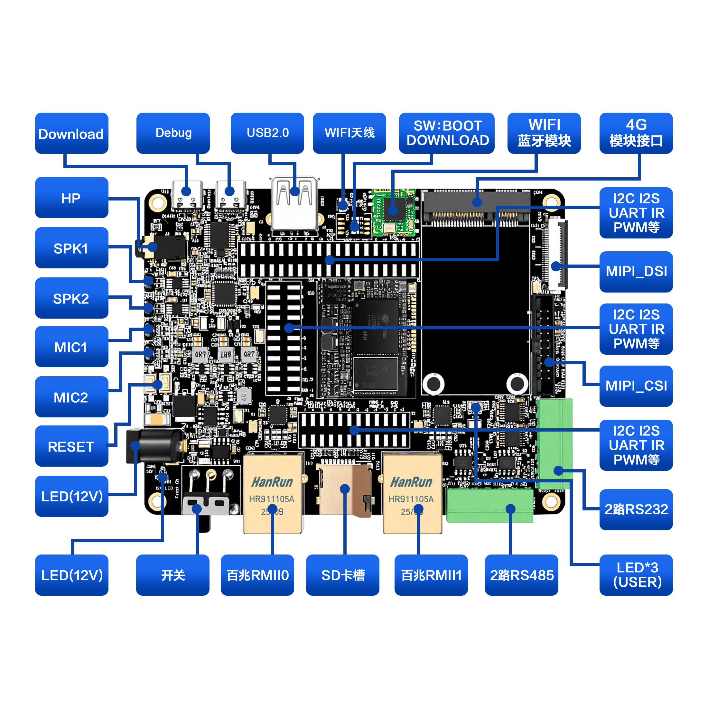

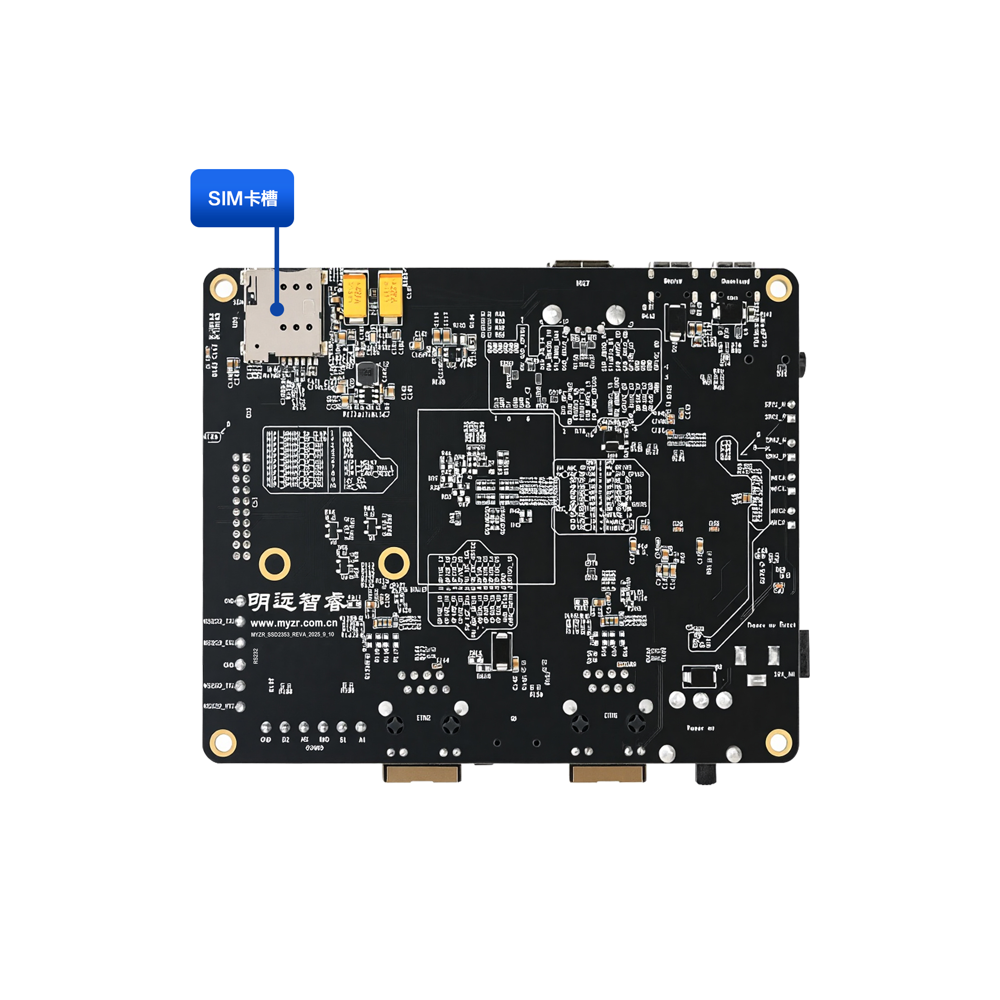

开发板基础参数
~~~~~~~~~~~~~~

.. raw:: html

   

+------+------------+--------------------+
| 序号 | 项目       | 规格               |
+======+============+====================+
| 1    | 型号       | MYZR-SSD2355-EK199 |
+------+------------+--------------------+
| 2    | PCB尺寸    | 120MMX90MM         |
+------+------------+--------------------+
| 3    | PCB层数    | 四层               |
+------+------------+--------------------+
| 4    | PCB厚度    | 1.6m'm             |
+------+------------+--------------------+
| 5    | PCB颜色    | 黑色               |
+------+------------+--------------------+
| 6    | 核心板接口 | LGA                |
+------+------------+--------------------+

开发板标配及可选配件
~~~~~~~~~~~~~~~~~~~~

.. raw:: html

   

+--------------------+---------------------------------+----------------+
| 型号               | 开发板标配                                       |
+====================+=================================+================+
| MYZR-SSD2355-EK199 | TYPE-C下载线                    | TTL转USB模块x1 |
+                    +---------------------------------+----------------+
|                    | 12V电源                         | 以太网线       |
+                    +---------------------------------+----------------+
|                    | 赠品                            |                |
+                    +---------------------------------+----------------+
|                    | 选           配                 |                |
+                    +---------------------------------+----------------+
|                    | 电容触摸屏幕（5寸MIPI 800*480） |                |
+--------------------+---------------------------------+----------------+

开发板搭配MYZR-SSD2355-EK199核心板使用，集成开发调试所需的全部常用接口，方便用户进行系统开发与功能验证。

开发板资源
~~~~~~~~~~

.. raw:: html

   

+------+-----------+--------------+----------------+----------+
| 序号 | 接口      | 功能         | 接口形式       | 丝印     |
+======+===========+==============+================+==========+
| U13  | UISB2.0   | 下载升级     | TPYE-C         | DOWNLOAD |
+------+-----------+--------------+----------------+----------+
| CON4 | UART      | 调试         | TPYE-C         | DEBUG    |
+------+-----------+--------------+----------------+----------+
| J4   | USB2.0    | USB通信      | TPYE-AX2       | HOST     |
+------+-----------+--------------+----------------+----------+
| SW   | GPIO      | 跟换模式     | 拨码开关       | SW4      |
+------+-----------+--------------+----------------+----------+
| U23  | USB2.0    | WIFI/BT通信  | 模块           |  /       |
+------+-----------+--------------+----------------+----------+
| CON6 | PCIE      |  /           | PCIE           |  /       |
+------+-----------+--------------+----------------+----------+
| CON5 | MIPI-DSI  | 显示屏       | FPC座子        | DSI      |
+------+-----------+--------------+----------------+----------+
| U19  | MIPIO-CSI | 摄像头       | 简牛座子       | CSI      |
+------+-----------+--------------+----------------+----------+
| C198 | RS232     | RS232通信    | 6pin的凤凰端子 | RS232    |
+------+-----------+--------------+----------------+----------+
| C201 | RS485     | RS485通信    | 6pin的凤凰端子 | RS485    |
+------+-----------+--------------+----------------+----------+
| CON2 | ETH1      | 以太网       | RJ45座子       | ETH1     |
+------+-----------+--------------+----------------+----------+
| CON3 | ETH2      | 以太网       | RJ45座子       | ETH2     |
+------+-----------+--------------+----------------+----------+
| U17  | SD0       | SD外接存储   | SD卡座         | SD       |
+------+-----------+--------------+----------------+----------+
| SW1  | /         | 控制电流开关 | 滑动开关       | SW1      |
+------+-----------+--------------+----------------+----------+
| CON1 | /         | 火车头供电口 | 火车头接头     | POWER ON |
+------+-----------+--------------+----------------+----------+
| P3   | MIC1      | MIC1         | 差分线座       | P3       |
+------+-----------+--------------+----------------+----------+
| P4   | MIC2      | MIC2         | 差分线座       | P4       |
+------+-----------+--------------+----------------+----------+
| P1   | SPK1      | SPK1         | 差分线座       | P1       |
+------+-----------+--------------+----------------+----------+
| P2   | SPK2      | SPK2         | 差分线座       | P2       |
+------+-----------+--------------+----------------+----------+
| J3   | AUDIO     | AUDIO        | 音频连接器     | HP       |
+------+-----------+--------------+----------------+----------+

开发板各模块电路设计说明
------------------------

电源电路：

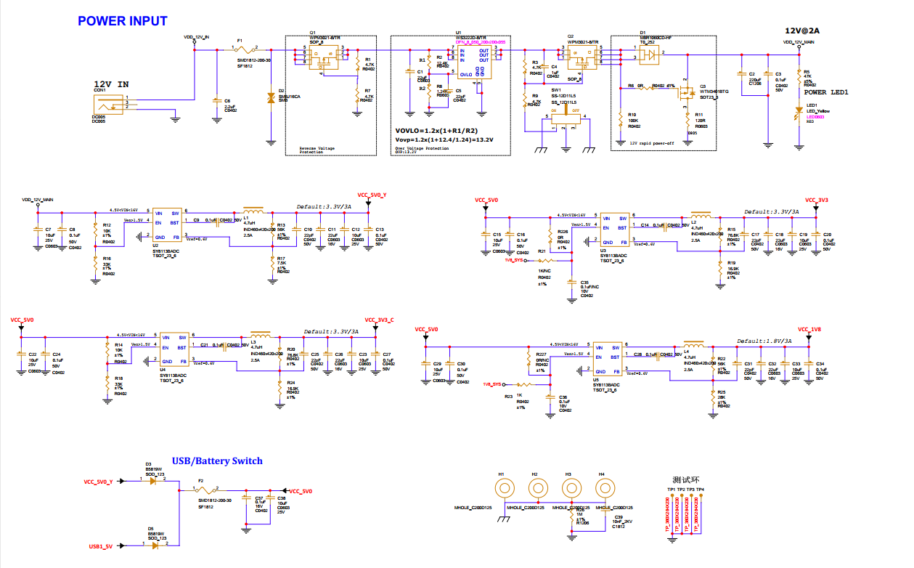

复位拨码和指示灯：

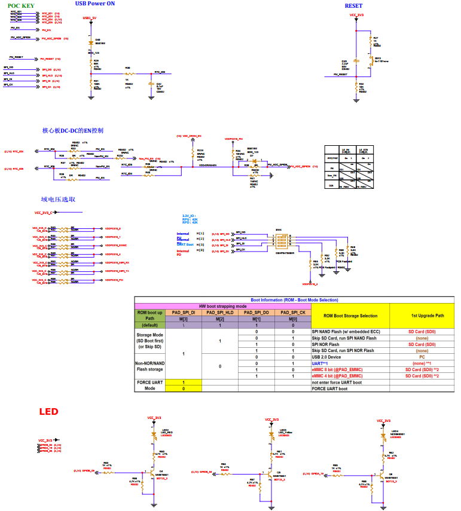

MIC,SPEAKER和=EARPHONE:

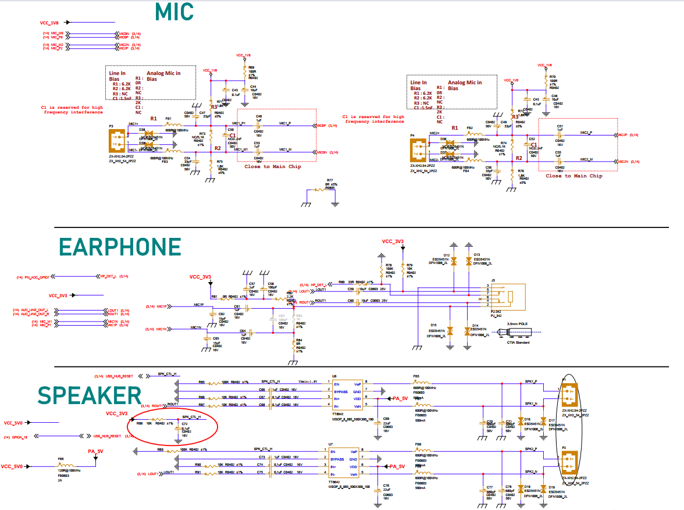

以太网:

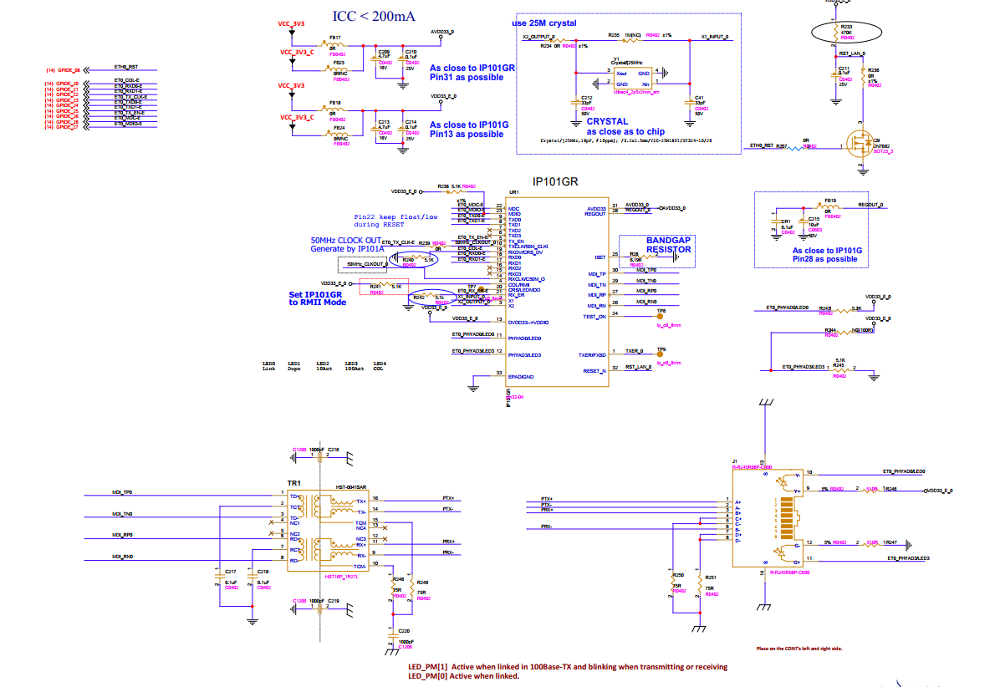

USB-OTG/HOST/HUB:

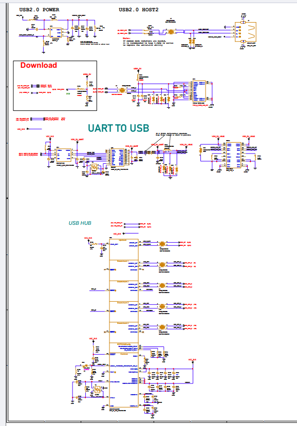

MIcroSD:

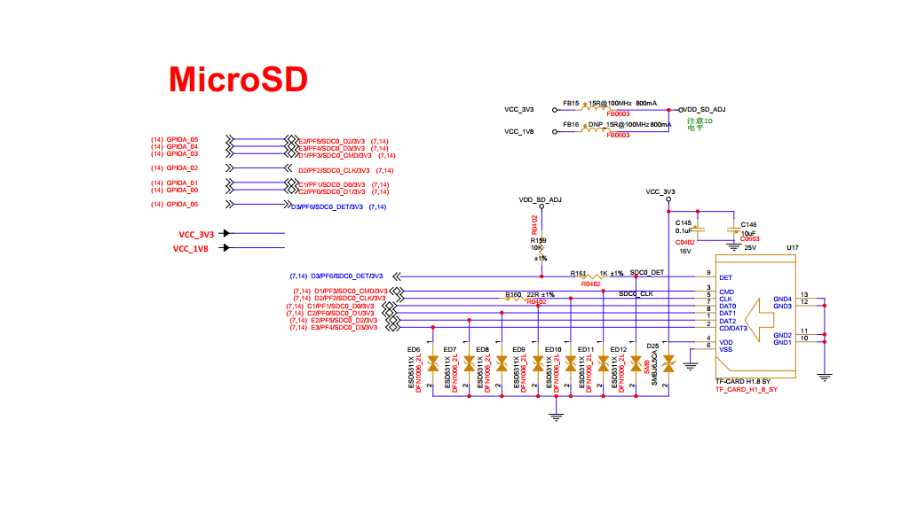

MIPI-DSI:

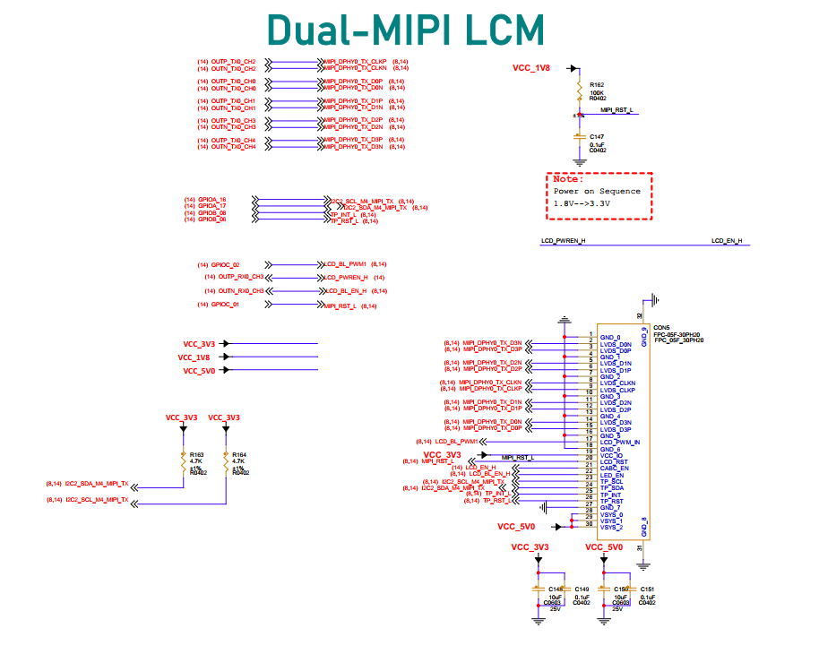

MIPI-CSI:

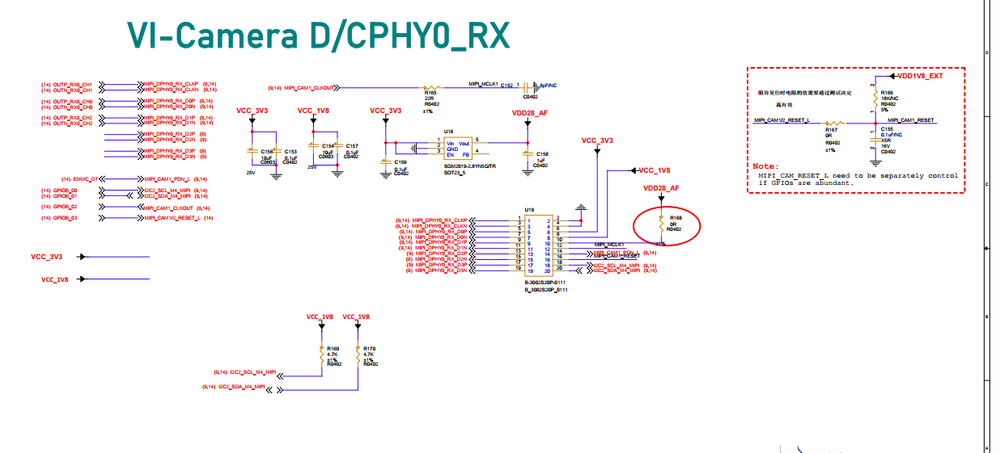

PCIE/WIFI/BT:

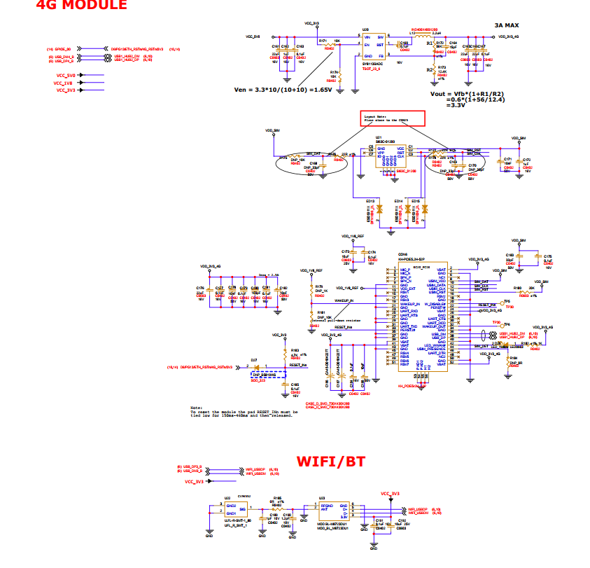

RS485/RS232:

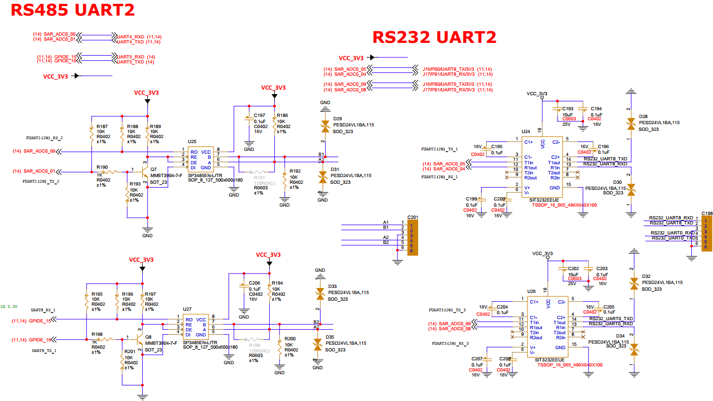
