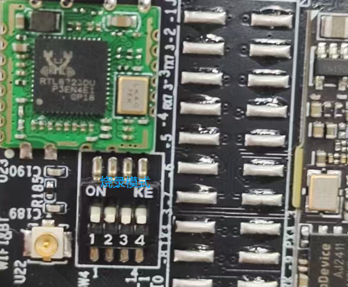
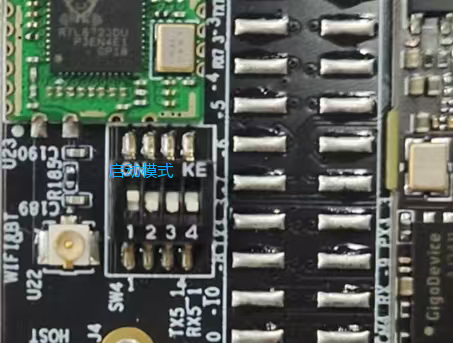
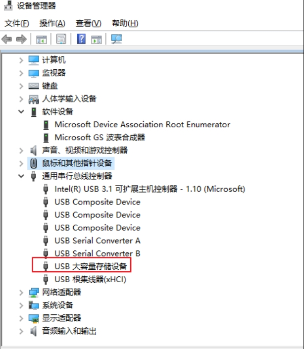
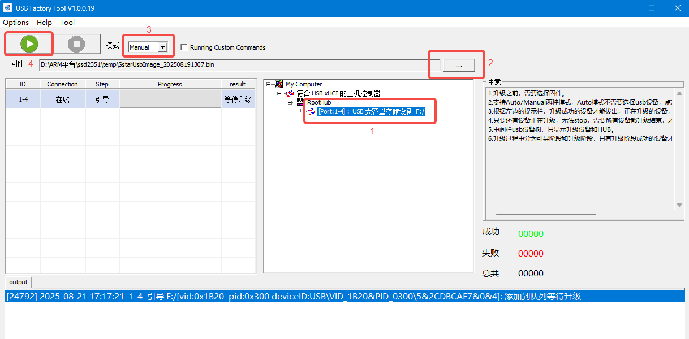

.. raw:: html

   

刷新固件
========

烧写工具：UsbFactoryTool_1.0.0.19.tar.gz
----------------------------------------

烧录手册
~~~~~~~~

usb接口下载
^^^^^^^^^^^

烧写模式拨码设置：

烧写工具：UsbFactoryTool_1.0.0.19.tar.gz

镜像文件：SstarUsbImage_202503050415.bin

解压烧写工具
^^^^^^^^^^^^

右击解压到当前目录，我的电脑是64bit，所以选择工具USB_Factory_Tool_64_1.0.0.19.exe

下载
^^^^

接上电源和USB线，电脑检测到”USB大容量存储设备”

双击烧录工具，USB_Factory_Tool_64_1.0.0.19.exe，如下：

#. 可以看到检测到的设备

#. 选择烧写的固件

#. 点击绿色按键开始烧写

#. 当进度100%时，点击红色停止按键结束

