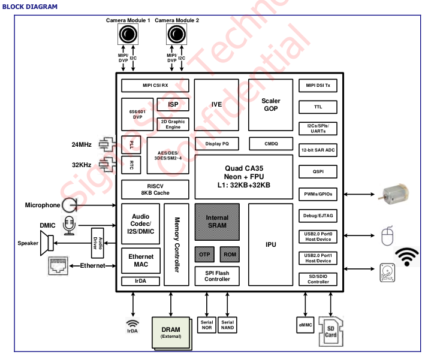

.. raw:: html

   

平台介绍
========

产品简介
--------

Sigmasstar SSD2355 是由中国星宸科技（SigmaStar）推出的高度集成 AIoT 系统级芯片（SoC），专为个人移动设备、电池供电设备及各类 AIoT 场景量身打造。芯片集成 64 位四核处理器、专业级 ISP 图像信号处理器与高性能 AI 加速引擎，搭载齐全高速外设接口，可便捷外接各类外设，能够输出高性能、高画质、低成本的完整软硬件解决方案，依托可编程神经网络引擎，高效助推端侧各类智能算法应用落地。

目标应用
--------

#. 智能家居：智能家居中控、AI 摄像头、智能门铃等设备，依托 IVE、IPU 硬件单元实现人形检测、人脸识别，达成设备智能告警与家居自动化控制。

#. 工业视觉：工业传感器、扫码器、小型 PLC 等设备，凭借 ISP 与 IVE 完成图像滤波、矩阵运算，精准识别目标物体并驱动机械臂执行动作。

#. 电池设备：便携式医疗设备、手持支付终端、对讲机等产品，低功耗架构搭配低泄漏 RTC 模式，大幅延长设备续航时长。

#. 消费电子：智能网络摄像机、教育平板、广告播放器等，支持双路摄像头输入与多路画面输出，满足人机交互与多终端显示需求。

#. 安防监控：网络摄像机、视频分析盒主控芯片，支持 30fps 稳定视频采集，硬件加密引擎全程保障传输视频流数据安全。

#. 边缘计算：边缘计算节点载体，在设备本地完成传感器数据解析与 AI 推理运算，降低云端依赖，实现业务快速响应。

主要特点
--------

#. 高性能处理器：四核 Cortex-A35，主频 1.5GHz；独立 L1 缓存 + 共享 256KB L2 缓存，集成 Neon/FPU；核心分独立电源域，精细化控功耗。

#. AI 算力强劲、多核异构：1TOPS NPU 硬件加速，支持多精度运算；兼容主流 AI 框架与 Transformer 模型，多款经典视觉模型专项优化；搭载 RISC-V 协处理器，兼顾实时控制与低功耗调度。

#. 专业影像处理：安防级 ISP，最高支持 21M@30fps 摄像输入；多路摄像接口齐备，内置降噪、WDR、3A 等图像增强算法，成像画质优异。

#. 硬件视频引擎：IVE 硬件实现滤波、矩阵运算等图像处理；IPU 可完成人脸检测、移动侦测、目标跟踪等智能视频分析。

#. 多通路显示输出：MIPI DSI 最高 2560×1600@60fps，TTL/RGB 最高 1280×800@60fps，适配多尺寸屏幕、支持多屏应用。

#. 接口资源丰富：双百兆以太网、双 USB2.0；eMMC/SDIO/SPI Flash 多种存储；多路 UART/I2C/SPI/PWM、多通道高精度 ADC，外设扩展性强。

#. 集成音频子系统：多路数字 / 模拟麦输入、DAC 输出，SNR＞95.2dB；I2S/TDM、SPDIF 音频接口齐全。

#. 完整安全方案：硬件加密引擎支持国密 + 国际主流加密算法；安全启动、TrustZone 可信环境，内置 OTP 安全存储密钥。

#. 低功耗设计：内置 RTC 低泄漏待机模式，多独立电源域、多唤醒源，适配电池类便携设备。

处理器框图
----------

处理器特性
----------

.. raw:: html

   

+----------+----------+--------------------------------------------------------------------------+
| 详细参数 |          |                                                                          |
+==========+==========+==========================================================================+
| 1        | CPU      | 四核ARM Cortex-A35 64位处理器                                            |
+----------+          +--------------------------------------------------------------------------+
| 2        |          | 主频最高1.5GHz                                                           |
+----------+          +--------------------------------------------------------------------------+
| 3        |          | 集成576MHz RISC-V协处理器                                                |
+----------+----------+--------------------------------------------------------------------------+
| 4        | NPU      | 集成1TOPS算力的AI处理单元                                                |
+----------+          +--------------------------------------------------------------------------+
| 5        |          | 纯硬件加速器，支持4/8/16位可编程精度                                     |
+----------+          +--------------------------------------------------------------------------+
| 6        |          | 高效支持Transformer网络及主流AI框架                                      |
+----------+----------+--------------------------------------------------------------------------+
| 7        | 多媒体   | 智能视频引擎（IVE）支持硬件加速视频分析                                  |
+----------+----------+--------------------------------------------------------------------------+
| 8        | 显示     | 支持MIPI DSI TX 4-lane，最高2560x1600@60fps                              |
+----------+          +--------------------------------------------------------------------------+
| 9        |          | 支持TTL/并行RGB接口，最高1280x800@60fps                                  |
+----------+          +--------------------------------------------------------------------------+
| 10       |          | 支持8/16-bit I8080接口                                                   |
+----------+----------+--------------------------------------------------------------------------+
| 11       | 视频输入 | 内置ISP，支持12M/21M@30fps摄像头                                         |
+----------+          +--------------------------------------------------------------------------+
| 12       |          | 支持MIPI CSI（2 data lanes）与并行接口                                   |
+----------+          +--------------------------------------------------------------------------+
| 13       |          | 支持双摄像头（1 data lane）输入                                          |
+----------+----------+--------------------------------------------------------------------------+
| 14       | 高速接口 | 集成双USB 2.0、双以太网、SD/eMMC及多组SPI/I2C/UART等接口，满足各类外设扩 |
|          |          | 展需求。                                                                 |
+----------+----------+--------------------------------------------------------------------------+
