.. raw:: html

   

硬件开发指导
============

一、BOOT
--------

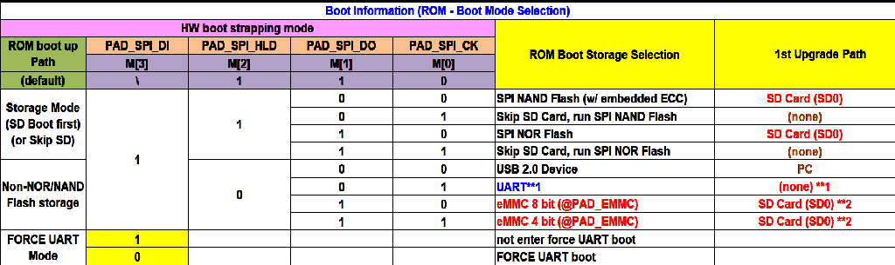

SSD2355的BOOT如上图所示，分别支持SD Card、NAND Flash、NOR FLASH、EMMC 8bit或4bit启动，同时支持USB或者Uart下载烧录。通过SPI[3:0]进行配置。

注意事项：

#. 注意上拉电平与SPI电源域VDDP3318_4对应上，下图设计VDDP3318_4为3.3V，因此采取3.3V上拉。

#. 下图设计中M[0]到M[3]原状态分别是0111.

#. 当对应的启动方式失败后，会转为USB下载烧录模式。

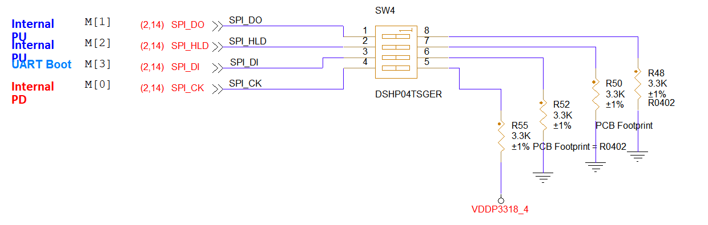

二、复位电路
------------

SSD2355的复位由外部按钮控制，低电平有效。

注意事项：

#. 管脚需要增加2.2uF电容，⽤来消除复位信号上的抖动，增强抗⼲扰能⼒，防⽌误触发导致的系统 异常复位

#. PM_RESET的上拉电平应与该IO脚的电源域电平保持一致

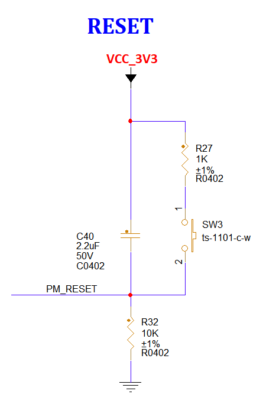

三、电源域选取
--------------

SSD2355的电源域的电压选取由下图中的电阻进行选取，其中NC表示不进行焊接。

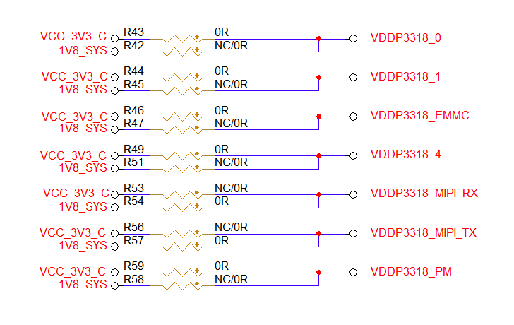

注意事项：

所选择的电源域电压值大小会直接影响到所使用的其电源域对应的引脚的电压值，所以严谨使用引脚上拉电阻，应使该引脚的上拉电阻对应上其电源域的电压值。

四、供电方式
------------

通过DC电源插座供给12V，随后通过选择12V供电转出的VCC_5V0_Y来供电或是通过Download的USB接口提供USB1_5V。

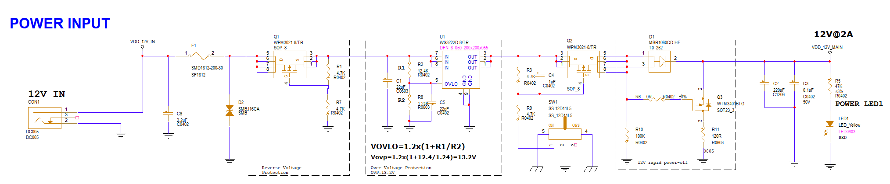

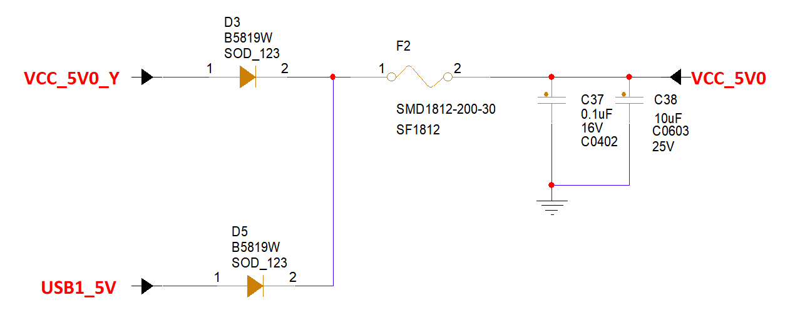

注意事项：

#. 12V输入电路中同时需要做开关，指示灯，防倒灌，过压保护和过流保护等。

#. 5V选取电路需要加防倒灌的二极管。

五、USB
-------

SSD2355自带两个USB2.0并且其支持支持Host/Device切换功能，其中USB P0用作于下载烧录,USB P1默认做USB Host。

Download
^^^^^^^^

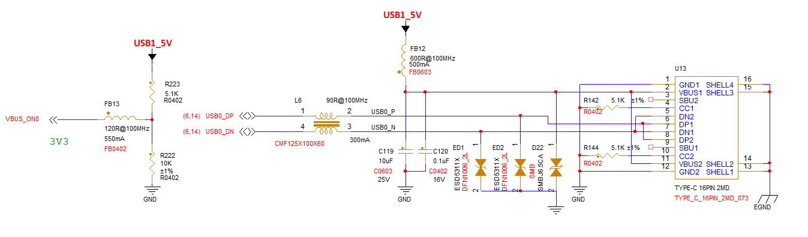

注意事项：

#. USB2.0支持Host/Device切换功能，软件可以检测对应事件，进行Host/Device的切换。

#. 主控boot失败，默认是USB Device Mode。此时USB P0 可以空片烧录固件。

#. USB没有防倒灌功能，遇到需要usb设备一直有电的场景建议预留防止倒灌电流的措施。

DEBUG
^^^^^

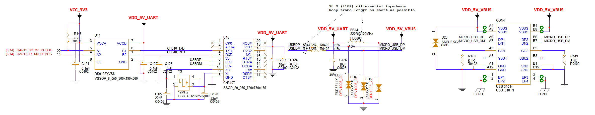

注意事项：

#. PM_UART1_TX固定用做CPU debug使用而PM51_UART_TX固定用做PM51 debug使用

#. 为了方便调试设计了上图电路，其为uart串口转为常见的usb接口。

#. 务必在靠近usb口防止ESD。

#. 注意给uart加4.7K上拉电阻。

#. 此处只使用了CPU debug如果需要使用PM51 debug也可以参照该电路

HOST
^^^^

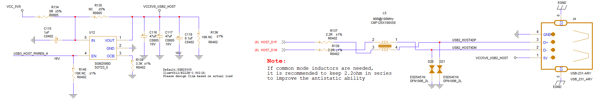

注意事项：

#. USB P1口默认做USB Host，需要的话也支持配置成Device模式。

#. U盘接口需要留限流IC，GPIO控制，针对比较差的U盘，需要SOC去复位U盘。

USB HUB
^^^^^^^

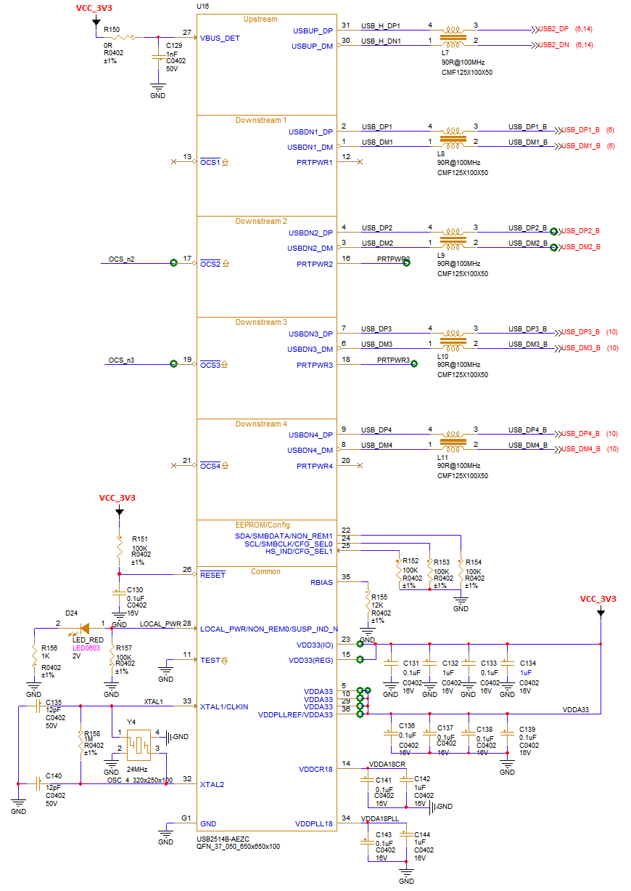

注意事项：

#. 只有当 CFG_SEL[1:0] 设置为00或10时，硬件引脚配置才有效。

#. 硬件配置最好和上图保持一致，可以实现一扩四USB口。

#. 其中注意晶振频率选取为24MHz，频率稳定度保持低于或等于350ppm。

六、AUDIO
---------

SSD2355有3路AMIC一路DMIC以及一对音频DAC左右通道输出。其中AMIC分为MIC0,MIC1,MIC2.分别对应采集左声道，右声道，双声道。

MIC
^^^

注意事项：

#. 注意甄别用处，如果用于Line in则需要遵循：R1-6.2K,R2-6.2K,R3-NC,C1-1.5nF。如果用于模拟麦克风则需要遵循：R1-0R,R2-NC,R3-2K,C1-NC。

#. 这里使用的MIC0与MIC2信号接的MIC座子，分别对应左声道与双声道。

#. 一般情况下，最好给MIC座子做好ESD防护。

#. 最好将分开AGND与GND并且用0R电阻相连。

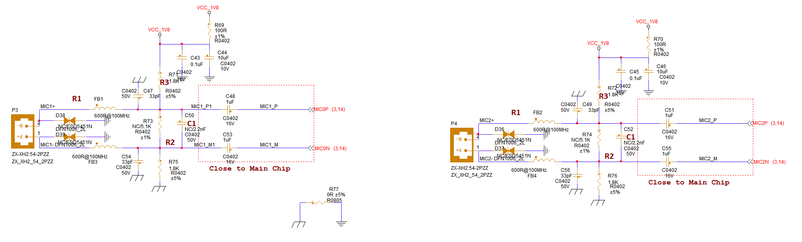

EARPHONE
^^^^^^^^

注意事项：

#. 需要注意检测GPIO平常应该处于高电平，一旦耳机插入则处于低电平。

#. 这里使用的MIC1对应的是右声道，同时可以播放双声道声音。

#. 一般情况下，最好给耳机座子做好ESD防护。

#. 最好将分开AGND与GND并且用0R电阻相连。

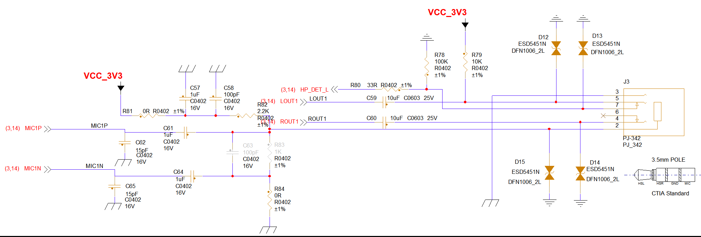

SPEAKER
^^^^^^^

注意事项：

#. 接音频功放芯片时，如果想避免音频开启时的POP声，需要一个GPIO口去控制功放芯片开启时间，平常默认关闭功放。

#. Lineout出来主控，建议先接1nF电容到地，滤除SDM DAC产生的高频噪声。

#. 下图接法为单端输入接法，如果需要差分输入则自行修改。

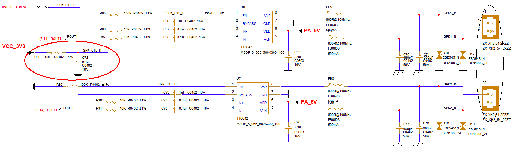

七、ETH
-------

SSD2355提供了两路可以支持百兆的以太网。

注意事项：

#. YT8522C芯片RBIAS引脚需接个2.49K电阻到GND（具体请参考芯片手册）

#. MDIO引脚接一个1.5~5.1K上拉电阻

#. RMII0/1 可支持 1.8V 或 3.3V 电平 ，芯片的IO电平要与之匹配。

#. RJ座子需加ESD防护器件。

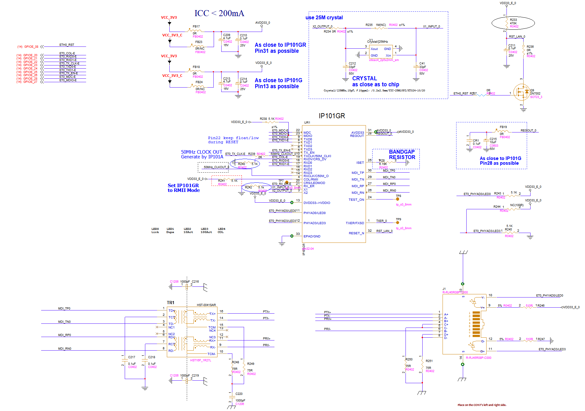

八、MIPI_TX
-----------

SSD2355提供了一路可以支持4Lane的MIPI_TX。

注意事项：

#. 下图设计的TX线序仅为引功能线模板，引出多种信号为做对应屏幕的转接板做足准备。

#. 设计转接板时注意IO电平。

#. 电源部分最好加上一定滤波电容。

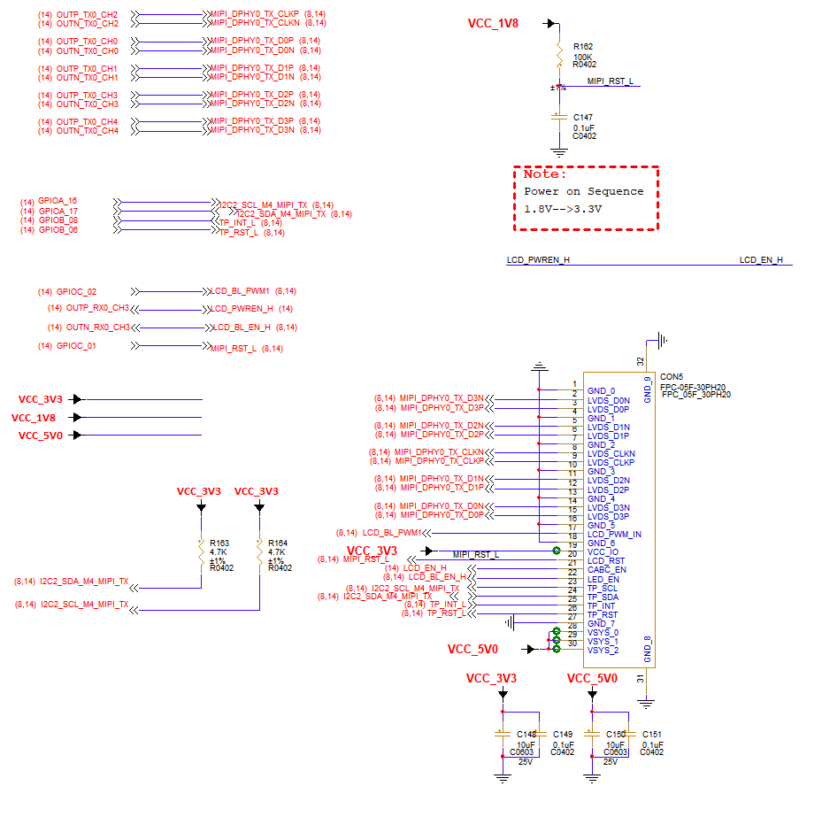

九、MIPI_RX
-----------

SSD2355提供了可以接两个1lane的MIPI_RX与一个2lane的MIPI_RX。

注意事项：

同上MIPI_TX一致

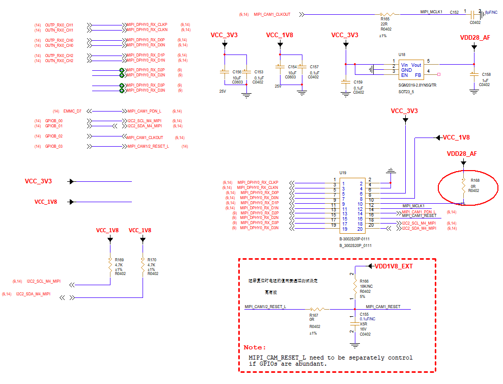

十、4G
------

使用一路USB与一个控制Reset的GPIO就可以使用该4G模块。

注意事项：

#. 4G模块需要多大电流以及稳定的电压，需要加独立的DCDC模块供电。

#. SIM卡座子需加ESD防护器件，并且ESD应尽量靠近卡座放置。

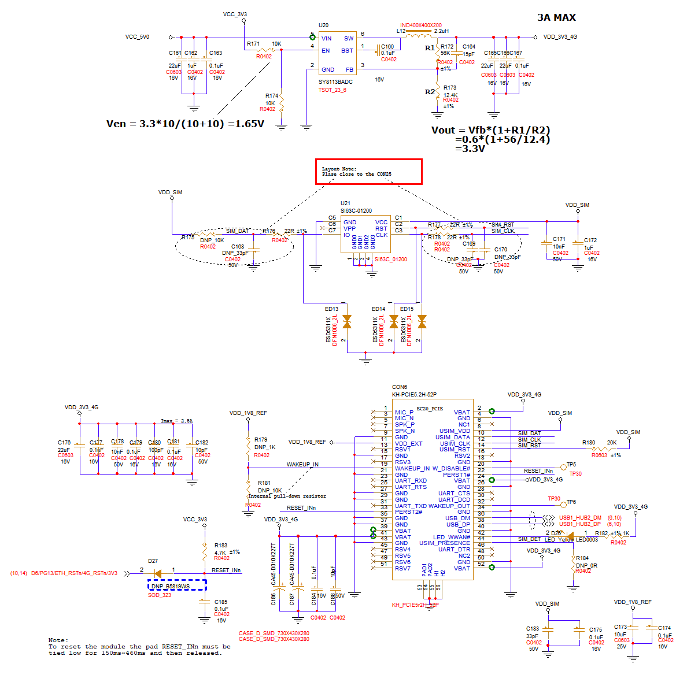

十一、WIFI/BT
-------------

使用一路USB即可使用该WIFI/BT模块。

注意事项：

#. 电源部分记得使用滤波电容进行滤波。

#. 天线部分记得搭建π形电路。

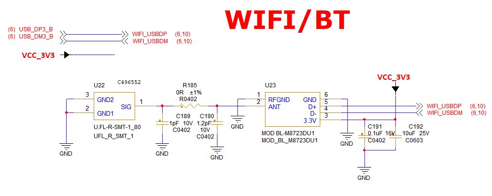

十二、SD
--------

SSD2355提供了一路SDIO。

注意事项：

#. TF卡座应该充分做好ESD防护措施，并且ESD应尽量靠近卡座放置。

#. 注意TF卡IO电源的电平选取应和SDIO的电源域电平一致。

#. TF卡座的设计可以考虑接SDIO WIFI。

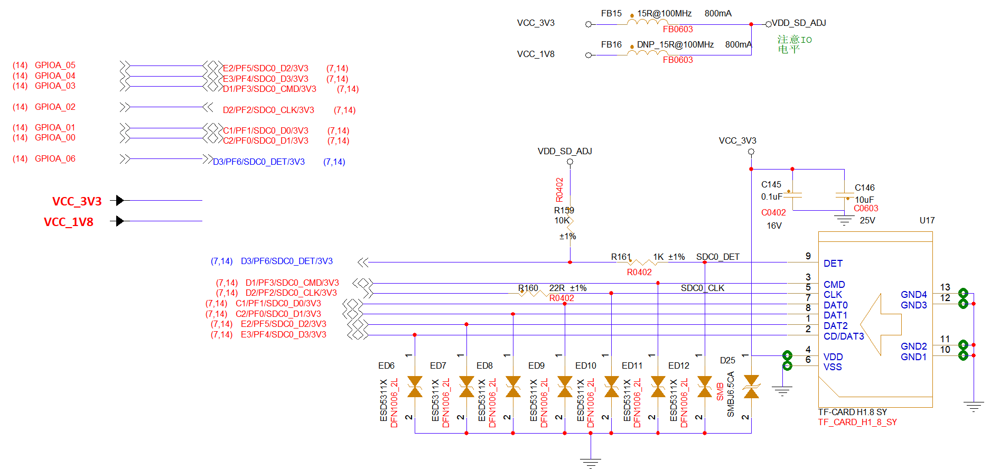

十三、485/232
-------------

SSD2355提供了8路UART，取其中四路做

注意事项：

#. UART的上拉电阻需要注意匹配相对应的电源域电平。

#. 一定要在这些接口附近进行ESD防护处理。

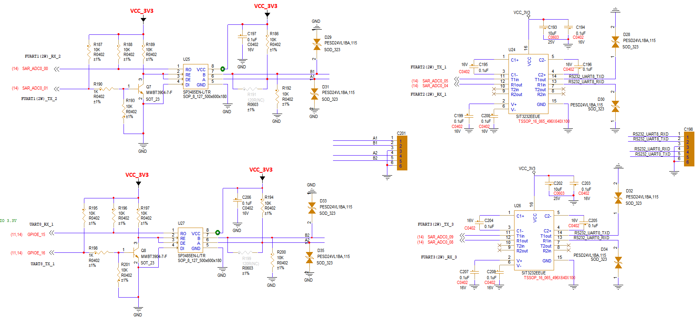

十四、UART/I2C
--------------

SSD2355提供了6路I2C和8路UART。

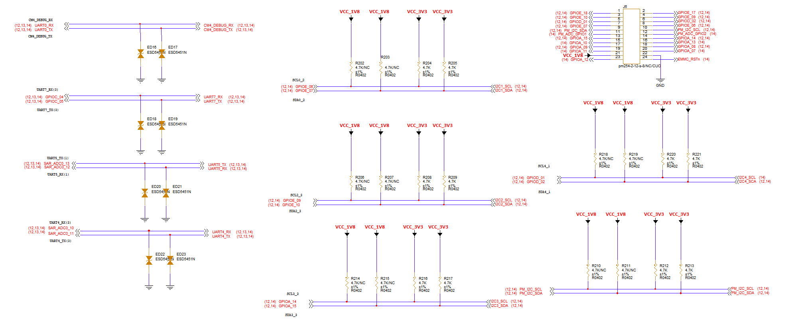

注意事项：

#. UART的上拉电阻需要注意匹配相对应的电源域电平以及一定要在这些接口附近进行ESD防护处理。

#. I2C的上拉电阻需要注意匹配。
