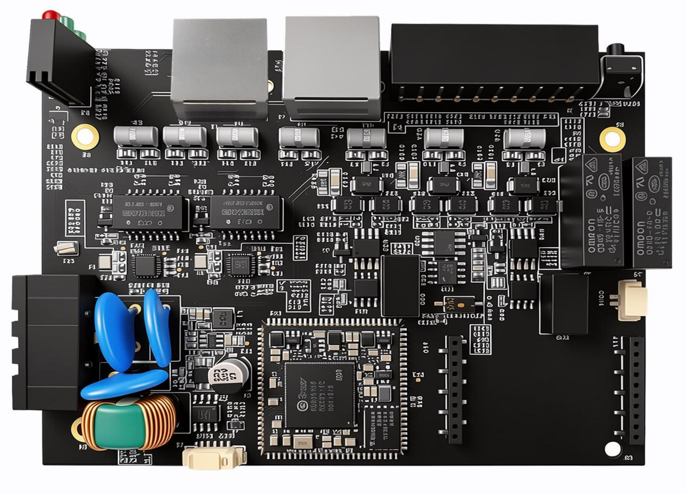
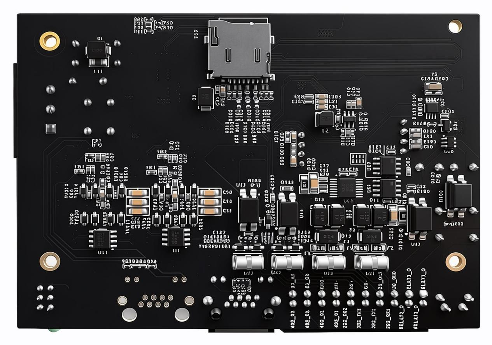
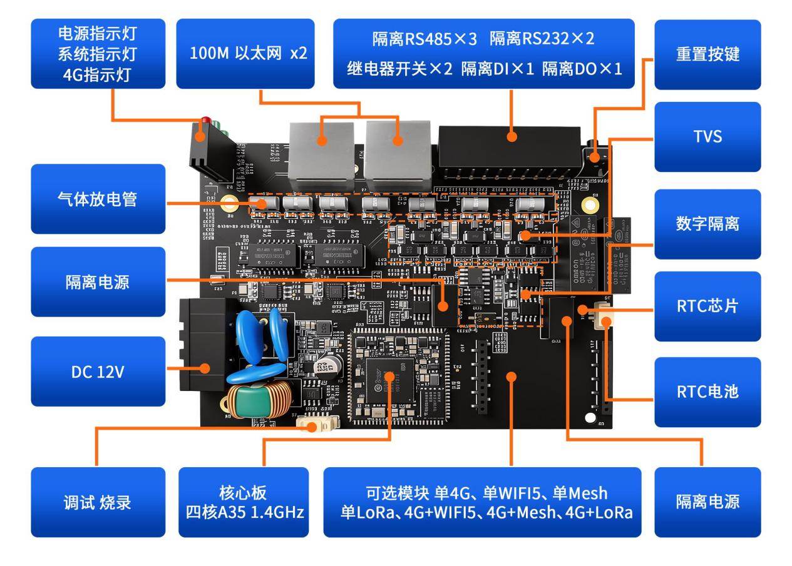
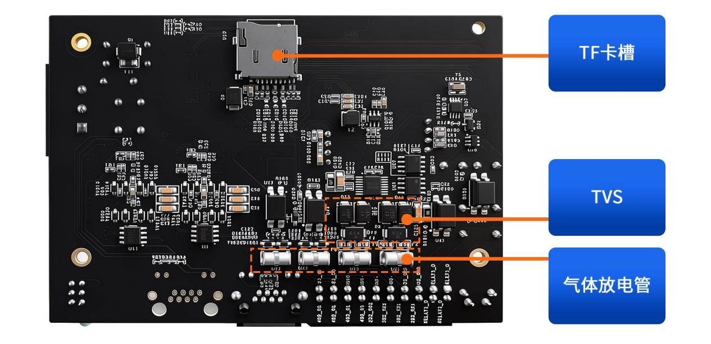

.. raw:: html

   

产品介绍
========

PI板介绍
--------

硬件资源
~~~~~~~~

恩智浦i.MX9系列应用处理器建立在经市场验证的i.MX6和i.MX8系列产品的基础上，汇集了性能更高的应用内核、独立的类MCU实时域、Energy Flex架构、先进的由EdgeLock(®)安全区域加持的信息安全和专用多传感数据处理引擎(图形、图像、显示、音频和语音)。i.MX9系列是EdgeVerse(™)边缘计算平台的一部分，该系列的很多产品集成了硬件神经处理单元，可加速边缘的机器学习应用。

核心计算资源
^^^^^^^^^^^^

#. 应用处理器 (Main CPU) : 1-2x Arm Cortex-A55，主频最高 1.7GHz，基于 Armv8-A 架构，支持 DynamIQ 技术。

#. 实时协处理器 (Low Power Domain) : 1x Arm Cortex-M33，主频 250MHz，用于实时控制，无需外置 MCU。

#. AI/ML 加速 (Flex Domain) : Arm Ethos-U65 microNPU，专用于神经网络推理加速。

#. 缓存与内存 : A55核心：32 kB I-cache、32 kB D-cache、64 kB L2 Cache、256 kB L3 Cache (带ECC)。M33核心：16 kB+16 kB Code+Sys Cache、256 kB TCM/OCRAM (带ECC)。

内存与存储资源
^^^^^^^^^^^^^^

#. 外部 DRAM : x16 LPDDR4/LPDDR4X，速率高达 3.7GT/s，支持 Inline ECC。

#. 启动存储 : 支持 Octal SPI（兼容 SPI NOR/NAND Flash），带 Inline Crypto 功能。

#. 扩展存储 : 3x SD 3.0 / SDIO 3.0 / eMMC 5.1 接口。

#. 片上内存 (OCRAM) : 640 kB OCRAM，带 ECC 保护。

连接与 I/O 资源
^^^^^^^^^^^^^^^

#. 高速网络 : 2x 千兆以太网（支持 AVB、IEEE 1588、EEE），其中 1 个支持 TSN。

#. USB : 2x USB 2.0 Type-C，内置 PHY。

#. 工业总线 : 2x CAN FD、8x UART/USART、8x I2C、8x SPI、2x I3C。

#. 模拟与扩展 : 1x 4通道 12位 ADC、2x 32引脚 FlexIO 接口（可配置为摄像头、总线或串行 I/O）

多媒体与显示资源
^^^^^^^^^^^^^^^^

#. 显示接口 : 1x 1080p60 MIPI-DSI（4-lane，1.5Gbps/lane）、1x 720p60 LVDS（4-lane）、24位并行 RGB。

#. 摄像头接口 : 1x 1080p60 MIPI-CSI（2-lane，1.5Gbps/lane）、8位并行 YUV/RGB。

#. 图形处理 : 硬件组合器（Compositor），支持混合、合成、缩放及色彩空间转换。

#. 音频接口 : 7x I2S TDM（32位 @ 768KHz）、SPDIF Tx/Rx、8通道 PDM 麦克风输入、MQS（中等质量声音输出）

PI板正反图
~~~~~~~~~~

PI板接口图
~~~~~~~~~~

