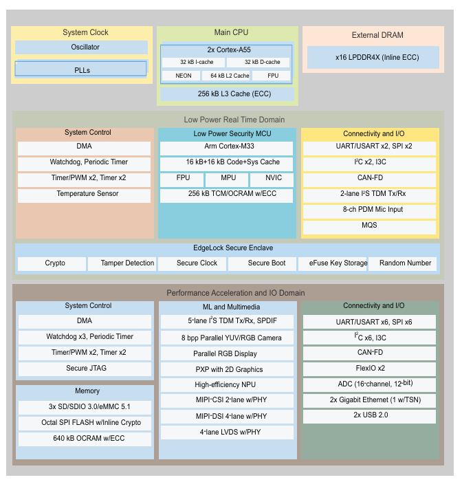

.. raw:: html

   

平台介绍
========

产品简介
--------

i.MX 93应用处理器通过集成的EdgeLock®安全区域提供高效的机器学习(ML)加速和高级信息安全，以支持高能效的边缘计算。

i.MX 93应用处理器是i.MX系列中首个集成了可扩展的Arm Cortex-A55内核的产品，有助于提高Linux®边缘应用及Arm Ethos™-U65 microNPU的性能与能效，助力开发人员打造功能更强大、更具成本效益、更节能的ML应用。

i.MX 93处理器采用恩智浦创新的Energy Flex架构，可优化工业、物联网和汽车设备的性能与能效。SoC针对汽车、工业和消费电子物联网细分市场提供丰富的外设。

作为EdgeVerse™智能边缘解决方案的一部分，i.MX 93系列提供消费电子、工业、扩展工业和车规级认证的产品，并由恩智浦产品长期供货计划提供支持。

目标应用
--------

1. 智慧城市
~~~~~~~~~~~

• i.MX9处理器能够预测、自动化、保护和简化楼宇、能源、交通、制造和公共安全系统，助力打造更绿色、更安全、更宜居的城市。

2. 智能家居
~~~~~~~~~~~

• 智能住宅通过设计实现安全、舒适和节能。可扩展的i.MX 9处理器解决方案使家庭能够联网、充满乐趣、方便快捷。

• 语音助手、智能网关、安防摄像头。

3. 智能楼宇
~~~~~~~~~~~

• i.MX9应用处理器更进一步，通过广泛的集成处理和加速创新，打造更具边缘感知能力、能效更高、更安全的系统。

4. 智能工厂
~~~~~~~~~~~

• i.MX 9处理器集成了多个处理引擎和工业通信协议，可用于工厂自动化、机器视觉和系统管理，实现边缘到云端迁移。

5. 消费电子
~~~~~~~~~~~

• 电子书阅读器、便携式医疗设备。

主要特点
--------

1.高性能异构计算
~~~~~~~~~~~~~~~~

•双核Arm Cortex-A55（主频可达1.7GHz）：支持Linux等复杂操作系统。

•单核Arm Cortex-M33（实时协处理器）：用于低功耗实时任务，如传感器数据处理。

•NPU（神经网络处理单元）：2.5 TOPS算力，专为机器学习（ML）和AI推理优化，支持TensorFlow Lite、PyTorch等框架。

2.高效能设计
~~~~~~~~~~~~

• i.MX9系列应用处理器内置了高精度功率控制功能，以优化能效，帮助客户减少碳足迹或延长电池使用寿命。

• 采用更先进的制程工艺（如16nm FinFET），功耗比前代（i.MX 8M Nano）降低50%。

• 支持动态电压/频率调整（DVFS）和多级电源管理模式。

3.边缘感知
~~~~~~~~~~

• 提供高效的机器学习加速，以支持嵌入式系统的新一代用例，改善隐私保护、延迟和带宽。

4.信息安全
~~~~~~~~~~

• i.MX9通过EdgeLock安全区域提高了信息安全，集成了先进的架构，可提供卓越的威胁保护，支持最新的加密协议。

• 硬件加密引擎（AES、SHA、RSA、ECC）。

• 安全启动（Secure Boot）、信任根（Root of Trust）和防篡改保护。

• 符合工业安全标准（如ISO 21434）。

5.丰富的外设接口
~~~~~~~~~~~~~~~~

•显示：支持MIPI DSI和LVDS，最高1080p@60fps。

•摄像头：双MIPI CSI接口，支持图像信号处理（ISP）。

•通信：

• 千兆以太网（支持TSN时间敏感网络）。

• Wi-Fi 6/蓝牙5.2（需外接模块）。

• CAN-FD、USB 2.0/3.0、UART、SPI、I2C等工业接口。

处理器框图
----------

处理器特性
----------

.. raw:: html

   

+------+-----------+--------------------------------------------------------------------------+
|      | 详细参数  |                                                                          |
+======+===========+==========================================================================+
| 1    | 应用处理  | Arm Cortex-A55 : 1-2个核心，主频最高1.7GHz，用于运行Linux等富操作系统。  |
+------+-----------+--------------------------------------------------------------------------+
| 2    | 实时控制  | Arm Cortex-M33 : 1个核心，主频最高250MHz，用于实时任务，可独立运行。     |
+------+-----------+--------------------------------------------------------------------------+
| 3    | AI/ML加速 | Arm Ethos-U65 microNPU : 专用神经网络处理器，算力约0.5 TOPS，用于高效边  |
|      |           | 缘推理。                                                                 |
+------+-----------+--------------------------------------------------------------------------+
| 4    | 内存      | LPDDR4/LPDDR4X : 支持高达3.7GT/s速率，带内联ECC，容量可达2GB。           |
+------+-----------+--------------------------------------------------------------------------+
| 5    | 存储      | eMMC 5.1 / SD 3.0 / SPI NOR/NAND : 支持多种闪存接口，用于系统启动和数据  |
|      |           | 存储。                                                                   |
+------+-----------+--------------------------------------------------------------------------+
| 6    | 显示      | MIPI-DSI, LVDS, 并行RGB : 支持1080p60 MIPI-DSI、720p60 LVDS等显示接口。  |
+------+-----------+--------------------------------------------------------------------------+
| 7    | 摄像头    | MIPI-CSI, 并行YUV/RGB : 支持1080p60 MIPI-CSI摄像头输入，适用于视觉应用。 |
+------+-----------+--------------------------------------------------------------------------+
| 8    | 连接      | 2x千兆以太网, 2x USB 2.0, 2x CAN FD : 其中1个以太网口支持TSN，适合工业实 |
|      |           | 时通信。                                                                 |
+------+-----------+--------------------------------------------------------------------------+
| 9    | 音频      | I2S/TDM, PDM, SPDIF : 支持多通道音频接口和8通道PDM麦克风输入。           |
+------+-----------+--------------------------------------------------------------------------+
| 10   | 安全      | EdgeLock® 安全区域 : 预配置的自主安全子系统，提供信任根、安全启动等。    |
+------+-----------+--------------------------------------------------------------------------+
| 11   | 封装      | FCCSP : 提供11x11mm、9x9mm、14x14mm等多种小尺寸封装。                    |
+------+-----------+--------------------------------------------------------------------------+
| 12   | 工作温度  | 工业级/车规级 : 工业级可达 -40°C 至 125°C                                |
+------+-----------+--------------------------------------------------------------------------+
