.. raw:: html

   

硬件开发指导
============

开发板原理图设计说明
--------------------

Debug电路
---------

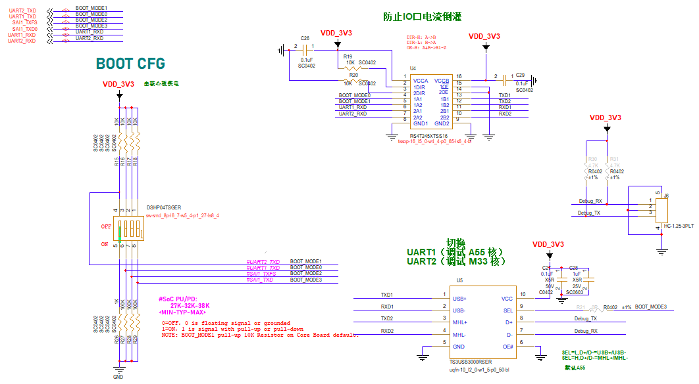

电源输入电路
------------

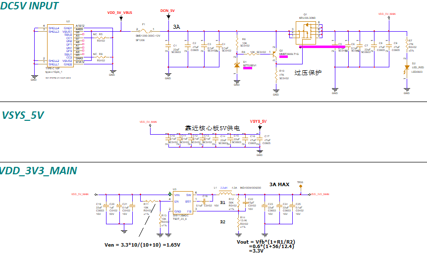

USB—HUB电路
-----------

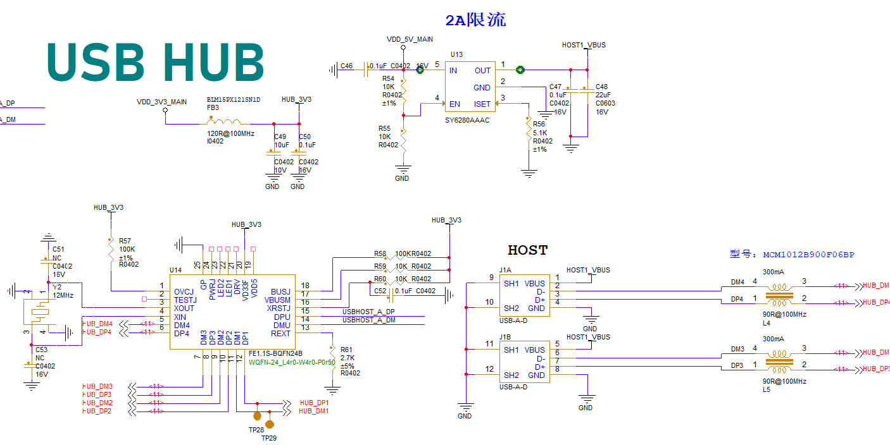

MIPI-CSI
--------

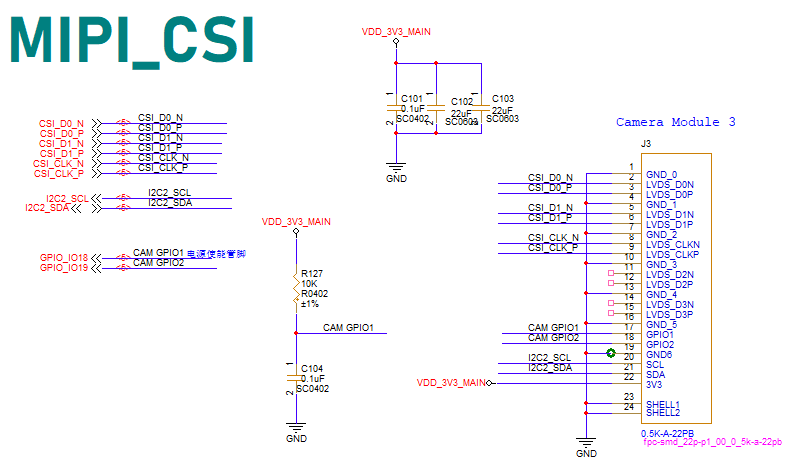

MIPI-DSI
--------

LCD

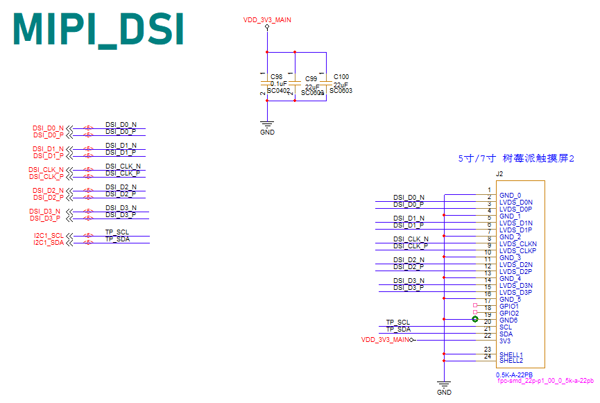

ETH1
----

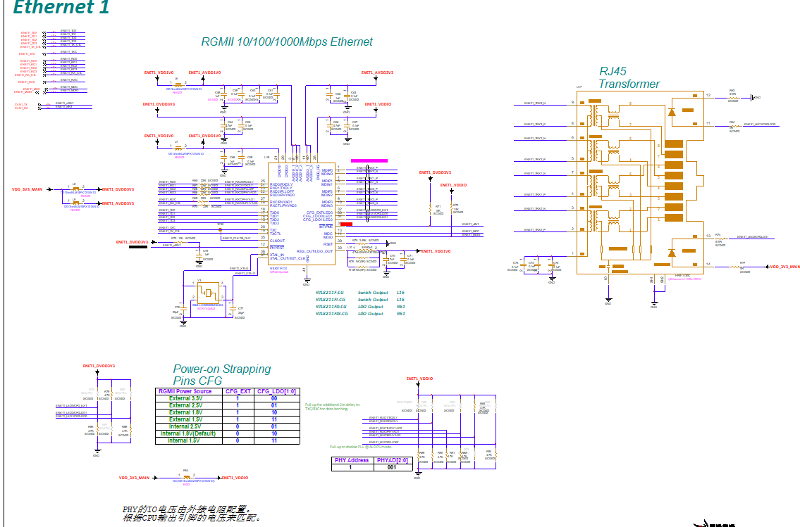

ETH2
----

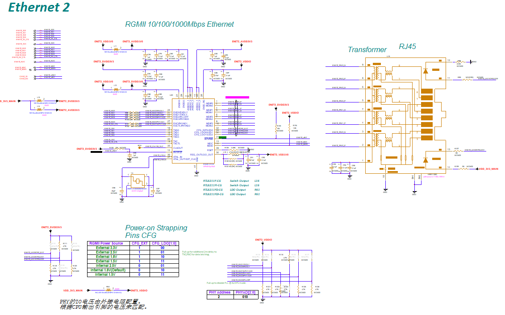

MICRO-SD
--------

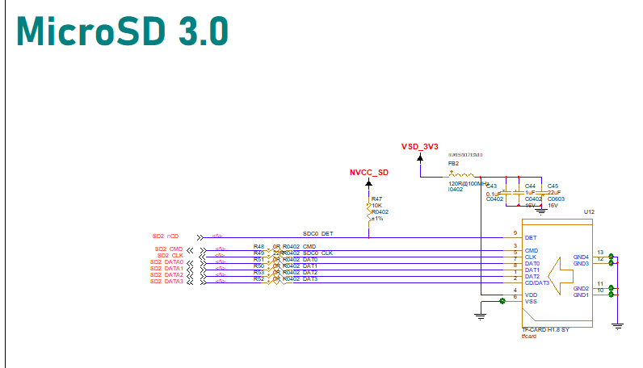

RTC
---

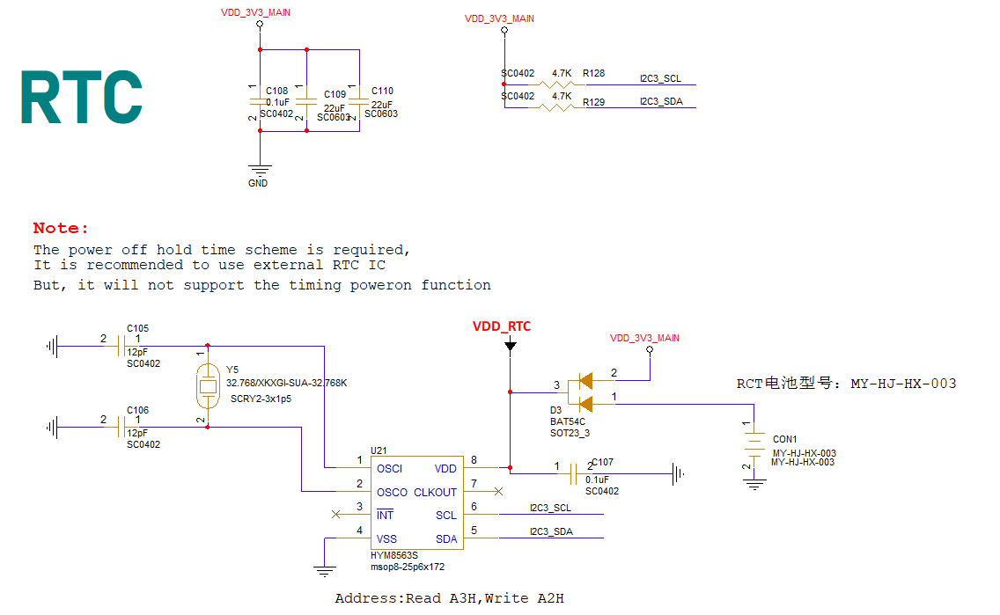

WIFI&BT
-------

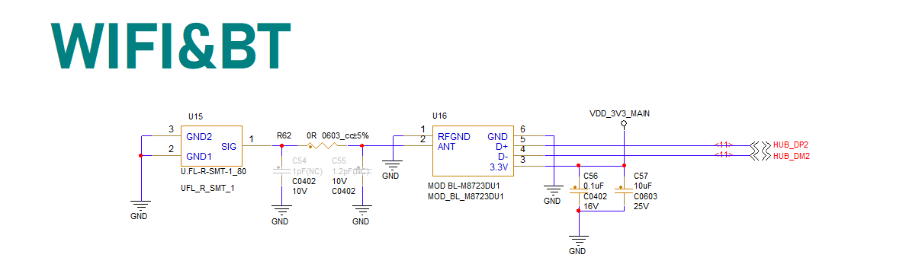

按键
----

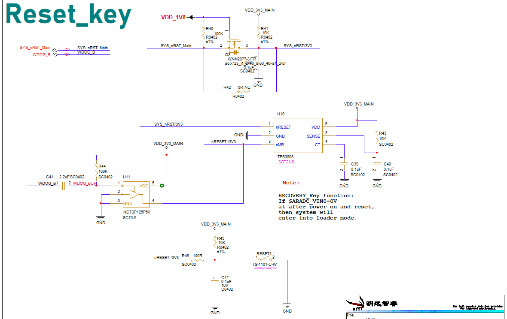
