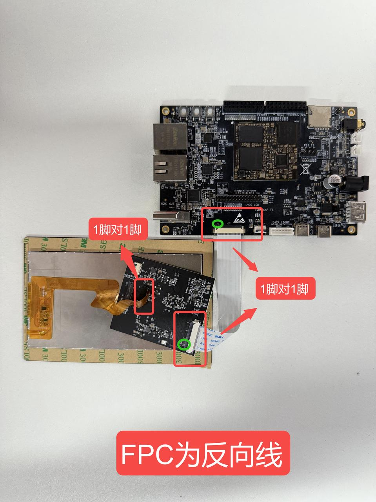

.. raw:: html

   

启动手册
========

开发板连接
----------

准备工作
--------

.. raw:: html

   

+----------------------+---------------------------------------+
| 检查并核对开发板配件                                         |
+======================+=======================================+
| 核心板               | 无                                    |
+----------------------+---------------------------------------+
| 主板                 | 1片                                   |
+----------------------+---------------------------------------+
| 电源                 | 1个，12V                              |
+----------------------+---------------------------------------+
| 烧录线               | 1条，Type-C 线                        |
+----------------------+---------------------------------------+
| 串口线               | 1条，Type-C 线                        |
+----------------------+---------------------------------------+
| 网线                 | 1条                                   |
+----------------------+---------------------------------------+
| HDMI线               | 1条                                   |
+----------------------+---------------------------------------+
| FPC线                | 1条，nPin，同侧/异侧                  |
+----------------------+---------------------------------------+
| 显示屏               | 1片（选配5寸屏）                      |
+----------------------+---------------------------------------+
| 摄像头               | 1个（选配OV13850 MIPI接口摄像头模组） |
+----------------------+---------------------------------------+

屏幕接法注意事项
~~~~~~~~~~~~~~~~

检查电源开关
~~~~~~~~~~~~

确认电源适配器输出正常。

确认开发板电源开关处于ON状态。

串口参数设置
~~~~~~~~~~~~

.. raw:: html

   

+---------+--------+--------+--------+
| 波特率  | 数据位 | 停止位 | 校验位 |
+=========+========+========+========+
| 1500000 | 8      | 1      |        |
+---------+--------+--------+--------+

拨码设置以及TTL串口模块
~~~~~~~~~~~~~~~~~~~~~~~

上电自启动，不需要拨码。

TTL串口模块接法
~~~~~~~~~~~~~~~

把Type-C线的一端连接"CON4"，另一端连接到电脑的后置USB口。

下载线的连接
~~~~~~~~~~~~

把Type-C线的一端连接"USB3.0 OTG(CON6)"，另一端连接到电脑的后置USB口。

电源线的连接
~~~~~~~~~~~~

把电源适配器的一端连接到开发板的"Power IN(J15)”，另一端插入到市电（220V的交流电）插座。

串口线的连接
~~~~~~~~~~~~

1. 把Type-C 线的一端连接到开发板的“CON4”口，另一端连接到电脑的后置USB 接口。

2. 参考 《Xshell 参考手册》 新建串口会话并打开会话。

网线的连接
~~~~~~~~~~

把网线的一端连接到“CON8”或“CON9”，另一端连接到电脑的网口。

HDMI显示屏连接
~~~~~~~~~~~~~~

将 HDMI显示屏连接线的一端接到开发板的CON14，另一端接到 HDMI 显示屏，并为 HDMI显示屏上电

注意： HDMI 显示屏的分辨率建议使用 1080P，以及使用HDMI 接口的显示屏，而不是转接为 HDMI 接口的。

启动开发板
----------

为开发板上电
~~~~~~~~~~~~

把电源适配器的一端连接到开发板的“J15”，以使开发板电源打开。

拨码设置
^^^^^^^^

上电自启动，不需要拨码。

开发板的启动信息解读
--------------------

开发板通电后在串口终端软件上可以看到开发板输出的启动信息。

.. code-block:: text

   U-Boot 2017.09 (Nov 26 2026 - 13:40:45 +0000)

   Model: Rockchip RK3562 Evaluation Board
   MPIDR: 0x80000000
   PreSerial: 0, raw, 0xff210000
   DRAM:  2 GiB
   Sysmem: init
   Relocation Offset: 7da4b000
   Relocation fdt: 7b9fa4f0 - 7b9fecd8
   CR: M/C/I
   Using default environment
   
   optee api revision: 2.0
   mmc@ff870000: 0, mmc@ff880000: 1
   Bootdev(atags): mmc 0
   MMC0: HS400 Enhanced Strobe, 200Mhz
   PartType: EFI
   TEEC: Waring: Could not find security partition
   DM: v2
   boot mode: None
   RESC: 'boot', blk@0x0001998d
   resource: sha256+
   FIT: no signed, no conf required
   DTB: rk-kernel.dtb
   HASH(c): OK

U-Boot信息
~~~~~~~~~~

  启动信息中 U-Boot 2017.09 (Nov 26 2026 - 13:40:45 +0000)包含以下信息：

　　【u-boot版本】 ：2017.09；

　　【u-boot文件的编译时间】 ：Nov 26 2026 - 13:40:45 +0000。

内核信息
~~~~~~~~

启动信息中

[    2.039034] Linux version 5.10.198 (linyn@myzr-u2004) (aarch64-none-linux-gnu-gcc (GNU Toolchain for the A-profile Architecture 10.3-2021.07 (arm-10.29)) 10.3.1 20210621, GNU ld (GNU Toolchain for the A-profile Architecture 10.3-2021.07 (arm-10.29)) 2.36.1.20210621) #1 SMP Thu Nov 26 13:41:29 UTC 2026

包含以下信息：

　　【内核版本】 ：Linux- 5.10.198；

　　【编译内核的GCC版本】 ： 10.3.1；

　　【内核文件的编译时间】 ：Thu Nov 26 13:41:29 UTC 2026。

开发板的登录
------------

串口登录
~~~~~~~~

.. code-block:: shell

   DDR V1.04 bae1baa081 typ 23/02/15-15:05:39
   LP4/4x derate en, other dram:1x trefi
   ddrconfig:0
   LPDDR4X, 324MHz
   BW=32 Col=10 Bk=8 CS0 Row=16 CS=1 Die BW=16 Size=2048MB
   tdqss: cs0 dqs0: 144ps, dqs1: 48ps, dqs2: 48ps, dqs3: -24ps, 
   
   change to: 324MHz
   PHY drv:clk:37,ca:37,DQ:30,odt:0
   vrefinner:24%, vrefout:41%
   dram drv:40,odt:0
   clk skew:0x5e
   
   change to: 528MHz
   PHY drv:clk:37,ca:37,DQ:30,odt:0
   vrefinner:24%, vrefout:41%
   dram drv:40,odt:0
   clk skew:0x58
   
   change to: 780MHz
   PHY drv:clk:37,ca:37,DQ:30,odt:0
   vrefinner:24%, vrefout:41%
   dram drv:40,odt:0
   clk skew:0x58
   
   change to: 1332MHz(final freq)
   PHY drv:clk:37,ca:37,DQ:30,odt:60
   vrefinner:16%, vrefout:22%
   dram drv:40,odt:80
   vref_ca:00000071
   clk skew:0x1f
   cs 0:
   the read training result:
   DQS0:0x34, DQS1:0x32, DQS2:0x32, DQS3:0x30, 
   min  : 0x4  0x5  0x5  0x7  0x0  0x4  0x3  0x5 , 0x3  0x4  0x3  0x3  0x2  0x4  0x2  0x4 ,
          0x4  0x6  0x6  0x6  0x3  0x5  0x4  0x3 , 0x2  0x1  0x2  0x1  0x2  0x2  0x0  0x3 ,
   mid  :0x18 0x19 0x1a 0x1c 0x16 0x18 0x16 0x19 ,0x1b 0x1c 0x1b 0x1a 0x1a 0x1c 0x19 0x1c ,
         0x19 0x1a 0x1a 0x1c 0x17 0x19 0x19 0x18 ,0x1a 0x19 0x1a 0x17 0x19 0x1a 0x18 0x1a ,
   max  :0x2d 0x2e 0x30 0x32 0x2c 0x2c 0x2a 0x2d ,0x34 0x34 0x33 0x32 0x32 0x35 0x30 0x35 ,
         0x2f 0x2e 0x2f 0x32 0x2b 0x2e 0x2e 0x2d ,0x32 0x32 0x32 0x2e 0x31 0x32 0x31 0x32 ,
   range:0x29 0x29 0x2b 0x2b 0x2c 0x28 0x27 0x28 ,0x31 0x30 0x30 0x2f 0x30 0x31 0x2e 0x31 ,
         0x2b 0x28 0x29 0x2c 0x28 0x29 0x2a 0x2a ,0x30 0x31 0x30 0x2d 0x2f 0x30 0x31 0x2f ,
   the write training result:
   DQS0:0x37, DQS1:0x27, DQS2:0x27, DQS3:0x1b, 
   min  :0x67 0x6a 0x69 0x6a 0x65 0x67 0x67 0x68 0x6b ,0x57 0x57 0x55 0x56 0x56 0x58 0x56 0x58 0x58 ,
         0x55 0x57 0x56 0x56 0x55 0x57 0x56 0x54 0x57 ,0x4c 0x4c 0x4e 0x4b 0x4d 0x4c 0x4c 0x4e 0x4e ,
   mid  :0x7f 0x81 0x81 0x82 0x7c 0x7f 0x7c 0x7f 0x81 ,0x74 0x74 0x71 0x72 0x72 0x74 0x72 0x74 0x74 ,
         0x6f 0x70 0x70 0x70 0x6e 0x6e 0x6f 0x6d 0x6f ,0x69 0x68 0x6a 0x67 0x69 0x68 0x68 0x69 0x68 ,
   max  :0x98 0x98 0x9a 0x9b 0x94 0x97 0x92 0x97 0x97 ,0x91 0x91 0x8d 0x8f 0x8e 0x91 0x8e 0x90 0x91 ,
         0x89 0x89 0x8a 0x8a 0x87 0x86 0x88 0x87 0x88 ,0x86 0x85 0x86 0x84 0x85 0x85 0x84 0x85 0x83 ,
   range:0x31 0x2e 0x31 0x31 0x2f 0x30 0x2b 0x2f 0x2c ,0x3a 0x3a 0x38 0x39 0x38 0x39 0x38 0x38 0x39 ,
         0x34 0x32 0x34 0x34 0x32 0x2f 0x32 0x33 0x31 ,0x3a 0x39 0x38 0x39 0x38 0x39 0x38 0x37 0x35 ,
   CA Training result:
   cs:0 min  :0x43 0x3f 0x3f 0x41 0x40 0x40 0x41 ,0x3b 0x3a 0x3c 0x3f 0x42 0x40 0x41 ,
   cs:0 mid  :0x80 0x7d 0x7c 0x7e 0x7e 0x7d 0x7e ,0x79 0x78 0x79 0x7a 0x7e 0x7c 0x6a ,
   cs:0 max  :0xbe 0xbc 0xb9 0xbc 0xbd 0xba 0xbb ,0xb8 0xb7 0xb6 0xb6 0xbb 0xb8 0x94 ,
   cs:0 range:0x7b 0x7d 0x7a 0x7b 0x7d 0x7a 0x7a ,0x7d 0x7d 0x7a 0x77 0x79 0x78 0x53 ,
   out
   U-Boot SPL board init
   U-Boot SPL 2017.09 (Nov 26 2026 - 13:40:45)
   unknown raw ID 0 0 0
   unrecognized JEDEC id bytes: 00, 00, 00
   Trying to boot from MMC2
   Card did not respond to voltage select!
   mmc_init: -95, time 12
   spl: mmc init failed with error: -95
   Trying to boot from MMC1
   SPL: A/B-slot: _a, successful: 0, tries-remain: 7
   Trying fit image at 0x4000 sector
   ## Verified-boot: 0
   ## Checking atf-1 0x00040000 ... sha256(b69e8292fd...) + OK
   ## Checking uboot 0x00200000 ... sha256(95b3bfcf40...) + OK
   ## Checking fdt 0x00314818 ... sha256(e7ffa453e5...) + OK
   ## Checking atf-2 0xfe481000 ... sha256(8857274472...) + OK
   ## Checking atf-3 0xfe490000 ... sha256(8da74bc229...) + OK
   ## Checking optee 0x08400000 ... sha256(34263f2418...) + OK
   Jumping to U-Boot(0x00200000) via ARM Trusted Firmware(0x00040000)
   Total: 96.438/159.407 ms
   
   UINFO:    Preloader serial: 0
   NOTICE:  BL31: v2.3():v2.3-632-g763689fe5:xsf
   NOTICE:  BL31: Built : 03:15:31, Aug 24 2023
   INFO:    rk_otp_init finish!
   NOTICE:  BL31: Rockchip release version: v1.0
   INFO:    ARM GICv2 driver initialized
   INFO:    nonboot cpus st-ee0
   INFO:    dfs DDR fsp_param[0].freq_mhz= 1332MHz
   INFO:    dfs DDR fsp_param[1].freq_mhz= 324MHz
   INFO:    dfs DDR fsp_param[2].freq_mhz= 528MHz
   INFO:    dfs DDR fsp_param[3].freq_mhz= 780MHz
   INFO:    BL31: Initializing runtime services
   INFO:    BL31: Initializing BL32
   I/TC: 
   I/TC: OP-TEE version: 3.13.0-743-gb5340fd65 #hisping.lin (gcc version 10.2.1 20201103 (GNU Toolchain for the A-profile Architecture 10.2-2020.11 (arm-10.16))) #7 Tue Aug 29 08:56:34 CST 2023 aarch64
   I/TC: Primary CPU initializing
   I/TC: Primary CPU switching to normal world boot
   INFO:    BL31: Preparing for EL3 exit to normal world
   INFO:    Entry point address = 0x200000
   INFO:    SPSR = 0x3c9
   
   
   U-Boot 2017.09 (Nov 26 2026 - 13:40:45 +0000)
   
   Model: Rockchip RK3562 Evaluation Board
   MPIDR: 0x80000000
   PreSerial: 0, raw, 0xff210000
   DRAM:  2 GiB
   Sysmem: init
   Relocation Offset: 7da4b000
   Relocation fdt: 7b9fa4f0 - 7b9fecd8
   CR: M/C/I
   Using default environment
   
   optee api revision: 2.0
   mmc@ff870000: 0, mmc@ff880000: 1
   Bootdev(atags): mmc 0
   MMC0: HS400 Enhanced Strobe, 200Mhz
   PartType: EFI
   TEEC: Waring: Could not find security partition
   DM: v2
   boot mode: None
   RESC: 'boot', blk@0x0001998d
   resource: sha256+
   FIT: no signed, no conf required
   DTB: rk-kernel.dtb
   HASH(c): OK
   rk3036_pll_set_rate: wait pll lock timeout! pll_id=3
   I2c0 speed: 100000Hz
   PMIC:  RK8090 (on=0x10, off=0x00)
   vdd_logic init 950000 uV
   vdd_cpu init 1050000 uV
   vdd_gpu init 900000 uV
   Could not find baseparameter partition
   Model: Rockchip RK3562 EVB2 DDR4 V10 Board
   MPIDR: 0x80000000
   Rockchip UBOOT DRM driver version: v1.0.1
   VOP have 1 active VP
   vp0 have layer nr:4[2 3 8 9 ], primary plane: 2
   vp1 have layer nr:0[], primary plane: 0
   Using display timing dts
   dsi@ffb10000:  detailed mode clock 148500 kHz, flags[6]
       H: 1920 2008 2052 2200
       V: 1080 1084 1089 1125
   bus_format: 100e
   VOP update mode to: 1920x1080p60, type: MIPI0 for VP0
   VP0 set crtc_clock to 148500KHz
   VOP VP0 enable Esmart0[654x270->654x270@633x405] fmt[2] addr[0x7df04000]
   final DSI-Link bandwidth: 990 Mbps x 4
   CLK: (sync kernel. arm: enter 600000 KHz, init 1008000 KHz, kernel 0N/A)
     apll 600000 KHz
     gpll 1188000 KHz
     vpll 594000 KHz
     hpll 983039 KHz
     cpll 1000000 KHz
     dpll 666000 KHz
     aclk_bus 198000 KHz
     hclk_bus 198000 KHz
     pclk_bus 99000 KHz
     aclk_peri 198000 KHz
     hclk_peri 148500 KHz
     pclk_peri 99000 KHz
   I2c1 speed: 100000Hz
   LT8912 chip ID: 0x12, 0xb2
   LT8912 0x9c~9f = 2e, 4d, 4, 65
   videoformat = VESA_1920x1080_60
   Net:   eth0: ethernet@ffa80000, eth1: ethernet@ffb30000
   Hit key to stop autoboot('CTRL+C'):  0 
   ANDROID: reboot reason: "(none)"
   Not AVB images, AVB skip
   No valid android hdr
   Android image load failed
   Android boot failed, error -1.
   ## Booting FIT Image at 0x794c7ac0 with size 0x02331a00
   Fdt Ramdisk skip relocation
   ## Loading kernel from FIT Image at 794c7ac0 ...
      Using 'conf' configuration
   ## Verified-boot: 0
      Trying 'kernel' kernel subimage
        Description:  unavailable
        Type:         Kernel Image
        Compression:  uncompressed
        Data Start:   0x794ec2c0
        Data Size:    36753920 Bytes = 35.1 MiB
        Architecture: AArch64
        OS:           Linux
        Load Address: 0x00400000
        Entry Point:  0x00400000
        Hash algo:    sha256
        Hash value:   9ae7cf6d601c4465f12f91b7c20015696ab474ec3500ad62f8acb401bdfb042d
      Verifying Hash Integrity ... sha256+ OK
   ## Loading fdt from FIT Image at 794c7ac0 ...
      Using 'conf' configuration
      Trying 'fdt' fdt subimage
        Description:  unavailable
        Type:         Flat Device Tree
        Compression:  uncompressed
        Data Start:   0x794c82c0
        Data Size:    147271 Bytes = 143.8 KiB
        Architecture: AArch64
        Load Address: 0x08300000
        Hash algo:    sha256
        Hash value:   4be377e9942461b8f0270a6338d0ca57cf7702c85e52dba12dcbef9f7928d3d7
      Verifying Hash Integrity ... sha256+ OK
      Loading fdt from 0x08300000 to 0x08300000
      Booting using the fdt blob at 0x08300000
      Loading Kernel Image from 0x794ec2c0 to 0x00400000 ... OK
      kernel loaded at 0x00400000, end = 0x0270d200
      Using Device Tree in place at 0000000008300000, end 0000000008326f46
   vp0, plane_mask:0x30c, primary-id:2, curser-id:-1
   ## reserved-memory:
     drm-logo@00000000: addr=7df00000 size=b8000
     vendor-storage-rm@00000000: addr=7bce0000 size=10000
     ramoops@110000: addr=110000 size=e0000
     amp-shmem@7800000: addr=7800000 size=400000
     rpmsg@7c00000: addr=7c00000 size=400000
     rpmsg-dma@8000000: addr=8000000 size=100000
     mcu@8200000: addr=8200000 size=100000
   Adding bank: 0x00200000 - 0x08400000 (size: 0x08200000)
   Adding bank: 0x08c00000 - 0x80000000 (size: 0x77400000)
   Total: 1839.399/2033.578 ms
   
   Starting kernel ...
   
   [    2.038562] Booting Linux on physical CPU 0x0000000000 [0x410fd034]
   [    2.038580] Linux version 5.10.198 (linyn@myzr-u2004) (aarch64-none-linux-gnu-gcc (GNU Toolchain for the A-profile Architecture 10.3-2021.07 (arm-10.29)) 10.3.1 20210621, GNU ld (GNU Toolchain for the A-profile Architecture 10.3-2021.07 (arm-10.29)) 2.36.1.20210621) #1 SMP Thu Nov 26 13:41:29 UTC 2026
   [    2.040157] random: crng init done
   [    2.043588] Machine model: Rockchip RK3562 EVB2 DDR4 V10 Board
   [    2.074534] earlycon: uart8250 at MMIO32 0x00000000ff210000 (options '')
   [    2.078970] printk: bootconsole [uart8250] enabled
   [    2.080505] efi: UEFI not found.
   [    2.082234] OF: fdt: Reserved memory: failed to reserve memory for node 'drm-cubic-lut@00000000': base 0x0000000000000000, size 0 MiB
   [    2.083401] Reserved memory: created DMA memory pool at 0x0000000008000000, size 1 MiB
   [    2.084120] OF: reserved mem: initialized node rpmsg-dma@8000000, compatible id shared-dma-pool
   [    2.115818] Zone ranges:
   [    2.116060]   DMA      [mem 0x0000000000200000-0x000000007fffffff]
   [    2.116626]   DMA32    empty
   [    2.116889]   Normal   empty
   [    2.117153] Movable zone start for each node
   [    2.117541] Early memory node ranges
   [    2.117868]   node   0: [mem 0x0000000000200000-0x00000000077fffff]
   [    2.118439]   node   0: [mem 0x0000000007800000-0x00000000080fffff]
   [    2.119009]   node   0: [mem 0x0000000008100000-0x00000000081fffff]
   [    2.119579]   node   0: [mem 0x0000000008200000-0x00000000082fffff]
   [    2.120148]   node   0: [mem 0x0000000008300000-0x00000000083fffff]
   [    2.120718]   node   0: [mem 0x0000000008c00000-0x000000007fffffff]
   [    2.121289] Initmem setup node 0 [mem 0x0000000000200000-0x000000007fffffff]
   [    2.130162] cma: Reserved 16 MiB at 0x000000007e800000
   [    2.130694] psci: probing for conduit method from DT.
   [    2.131157] psci: PSCIv1.1 detected in firmware.
   [    2.131577] psci: Using standard PSCI v0.2 function IDs
   [    2.132055] psci: Trusted OS migration not required
   [    2.132501] psci: SMC Calling Convention v1.2
   [    2.133075] percpu: Embedded 30 pages/cpu s83800 r8192 d30888 u122880
   [    2.133745] Detected VIPT I-cache on CPU0
   [    2.134135] CPU features: detected: ARM erratum 845719
   [    2.134785] Built 1 zonelists, mobility grouping on.  Total pages: 513544
   [    2.135407] Kernel command line: storagemedia=emmc androidboot.storagemedia=emmc androidboot.mode=normal  androidboot.verifiedbootstate=orange rw rootwait earlycon=uart8250,mmio32,0xff210000 console=ttyFIQ0 root=PARTUUID=614e0000-0000 androidboot.fwver=uboot-11/26/2026
   [    2.137954] Dentry cache hash table entries: 262144 (order: 9, 2097152 bytes, linear)
   [    2.138778] Inode-cache hash table entries: 131072 (order: 8, 1048576 bytes, linear)
   [    2.139483] mem auto-init: stack:off, heap alloc:off, heap free:off
   [    2.162938] Memory: 1981516K/2086912K available (18752K kernel code, 3508K rwdata, 6880K rodata, 6656K init, 797K bss, 89012K reserved, 16384K cma-reserved)
   [    2.164303] SLUB: HWalign=64, Order=0-3, MinObjects=0, CPUs=4, Nodes=1
   [    2.164921] ftrace: allocating 57311 entries in 224 pages
   [    2.213213] ftrace: allocated 224 pages with 3 groups
   [    2.213893] rcu: Hierarchical RCU implementation.
   [    2.214324] rcu:         RCU event tracing is enabled.
   [    2.214736] rcu:         RCU dyntick-idle grace-period acceleration is enabled.
   [    2.215344] rcu:         RCU restricting CPUs from NR_CPUS=8 to nr_cpu_ids=4.
   [    2.215938]         Rude variant of Tasks RCU enabled.
   [    2.216350] rcu: RCU calculated value of scheduler-enlistment delay is 30 jiffies.
   [    2.217038] rcu: Adjusting geometry for rcu_fanout_leaf=16, nr_cpu_ids=4
   [    2.221126] NR_IRQS: 64, nr_irqs: 64, preallocated irqs: 0
   [    2.223044] GIC: Using split EOI/Deactivate mode
   [    2.224019] rcu:         Offload RCU callbacks from CPUs: (none).
   [    2.249206] arch_timer: cp15 timer(s) running at 24.00MHz (phys).
   [    2.249772] clocksource: arch_sys_counter: mask: 0xffffffffffffff max_cycles: 0x588fe9dc0, max_idle_ns: 440795202592 ns
   [    2.250755] sched_clock: 56 bits at 24MHz, resolution 41ns, wraps every 4398046511097ns
   [    2.252258] Console: colour dummy device 80x25
   [    2.252687] Calibrating delay loop (skipped), value calculated using timer frequency.. 48.00 BogoMIPS (lpj=80000)
   [    2.253623] pid_max: default: 32768 minimum: 301
   [    2.254128] Mount-cache hash table entries: 4096 (order: 3, 32768 bytes, linear)
   [    2.254805] Mountpoint-cache hash table entries: 4096 (order: 3, 32768 bytes, linear)
   [    2.256300] rcu: Hierarchical SRCU implementation.
   [    2.257782] EFI services will not be available.
   [    2.258394] smp: Bringing up secondary CPUs ...
   I/TC: Secondary CPU 1 initializing
   I/TC: Secondary CPU 1 switching to normal world boot
   I/TC: Secondary CPU 2 initializing
   I/TC: Secondary CPU 2 switching to normal world boot
   I/TC: Secondary CPU 3 initializing
   I/TC: Secondary CPU 3 switching to normal world boot
   [    2.259817] Detected VIPT I-cache on CPU1
   [    2.259857] CPU1: Booted secondary processor 0x0000000001 [0x410fd034]
   [    2.260846] Detected VIPT I-cache on CPU2
   [    2.260869] CPU2: Booted secondary processor 0x0000000002 [0x410fd034]
   [    2.261817] Detected VIPT I-cache on CPU3
   [    2.261837] CPU3: Booted secondary processor 0x0000000003 [0x410fd034]
   [    2.261880] smp: Brought up 1 node, 4 CPUs
   [    2.265136] SMP: Total of 4 processors activated.
   [    2.265565] CPU features: detected: 32-bit EL0 Support
   [    2.266033] CPU features: detected: CRC32 instructions
   [    2.272634] CPU: All CPU(s) started at EL2
   [    2.273047] alternatives: patching kernel code
   [    2.274205] devtmpfs: initialized
   [    2.286901] Registered cp15_barrier emulation handler
   [    2.287391] Registered setend emulation handler
   [    2.287918] clocksource: jiffies: mask: 0xffffffff max_cycles: 0xffffffff, max_idle_ns: 6370867519511994 ns
   [    2.288810] futex hash table entries: 1024 (order: 4, 65536 bytes, linear)
   [    2.289856] pinctrl core: initialized pinctrl subsystem
   [    2.290680] DMI not present or invalid.
   [    2.291230] NET: Registered protocol family 16
   [    2.292752] DMA: preallocated 256 KiB GFP_KERNEL pool for atomic allocations
   [    2.293482] DMA: preallocated 256 KiB GFP_KERNEL|GFP_DMA pool for atomic allocations
   [    2.295989] Registered FIQ tty driver
   [    2.296533] thermal_sys: Registered thermal governor 'fair_share'
   [    2.296536] thermal_sys: Registered thermal governor 'step_wise'
   [    2.297090] thermal_sys: Registered thermal governor 'user_space'
   [    2.297636] thermal_sys: Registered thermal governor 'power_allocator'
   [    2.298401] cpuidle: using governor menu
   [    2.299519] hw-breakpoint: found 6 breakpoint and 4 watchpoint registers.
   [    2.300198] ASID allocator initialised with 65536 entries
   [    2.301715] ramoops: dmesg-0        0x18000@0x0000000000110000
   [    2.302196] ramoops: dmesg-1        0x18000@0x0000000000128000
   [    2.302684] ramoops: console        0x80000@0x0000000000140000
   [    2.303185] ramoops: pmsg        0x30000@0x00000000001c0000
   [    2.303841] printk: console [ramoops-1] enabled
   [    2.304256] pstore: Registered ramoops as persistent store backend
   [    2.304818] ramoops: using 0xe0000@0x110000, ecc: 0
   [    2.332457] rockchip-gpio ff260000.gpio: probed /pinctrl/gpio@ff260000
   [    2.333372] rockchip-gpio ff620000.gpio: probed /pinctrl/gpio@ff620000
   [    2.334218] rockchip-gpio ff630000.gpio: probed /pinctrl/gpio@ff630000
   [    2.335199] rockchip-gpio ffac0000.gpio: probed /pinctrl/gpio@ffac0000
   [    2.336049] rockchip-gpio ffad0000.gpio: probed /pinctrl/gpio@ffad0000
   [    2.336724] rockchip-pinctrl pinctrl: probed pinctrl
   [    2.350718] fiq_debugger fiq_debugger.0: IRQ fiq not found
   [    2.351236] fiq_debugger fiq_debugger.0: IRQ wakeup not found
   [    2.351765] fiq_debugger_probe: could not install nmi irq handler
   [[    2.352384] printk: console [ttyFIQ0] enabled
       2.352384] printk: console [ttyFIQ0] enabled
   [    2.353163] printk: bootconsole [uart8250] disabled
   [    2.353163] printk: bootconsole [uart8250] disabled
   [    2.353749] Registered fiq debugger ttyFIQ0
   [    2.354410] vcc3v3_pcie20: supplied by dc_12v
   [    2.354504] vcc5v0_sys: supplied by dc_12v
   [    2.354663] vcc5v0_usb: supplied by dc_12v
   [    2.354952] vcc5v0_usb_host: supplied by vcc5v0_usb
   [    2.355219] vcc5v0_usb_otg: supplied by vcc5v0_usb
   [    2.355372] vcc3v3_clk: supplied by vcc5v0_sys
   [    2.355463] vcc3v3_sys: supplied by dc_12v
   [    2.355625] vcc25_ddr: supplied by vcc3v3_sys
   [    2.356616] iommu: Default domain type: Translated 
   [    2.358617] SCSI subsystem initialized
   [    2.358755] usbcore: registered new interface driver usbfs
   [    2.358780] usbcore: registered new interface driver hub
   [    2.358802] usbcore: registered new device driver usb
   [    2.358859] mc: Linux media interface: v0.10
   [    2.358878] videodev: Linux video capture interface: v2.00
   [    2.358925] pps_core: LinuxPPS API ver. 1 registered
   [    2.358930] pps_core: Software ver. 5.3.6 - Copyright 2005-2007 Rodolfo Giometti <giometti@linux.it>
   [    2.358940] PTP clock support registered
   [    2.358967] EDAC MC: Ver: 3.0.0
   [    2.359644] arm-scmi firmware:scmi: SCMI Notifications - Core Enabled.
   [    2.359683] arm-scmi firmware:scmi: SCMI Protocol v2.0 'rockchip:' Firmware version 0x0
   [    2.361016] Advanced Linux Sound Architecture Driver Initialized.
   [    2.361289] Bluetooth: Core ver 2.22
   [    2.361313] NET: Registered protocol family 31
   [    2.361318] Bluetooth: HCI device and connection manager initialized
   [    2.361326] Bluetooth: HCI socket layer initialized
   [    2.361332] Bluetooth: L2CAP socket layer initialized
   [    2.361345] Bluetooth: SCO socket layer initialized
   [    2.361717] rockchip-cpuinfo cpuinfo: SoC                : 35621000
   [    2.361724] rockchip-cpuinfo cpuinfo: Serial                : dbc7c3d7d73c3503
   [    2.362195] clocksource: Switched to clocksource arch_sys_counter
   [    2.814021] NET: Registered protocol family 2
   [    2.814129] IP idents hash table entries: 32768 (order: 6, 262144 bytes, linear)
   [    2.814938] tcp_listen_portaddr_hash hash table entries: 1024 (order: 2, 16384 bytes, linear)
   [    2.814966] TCP established hash table entries: 16384 (order: 5, 131072 bytes, linear)
   [    2.815045] TCP bind hash table entries: 16384 (order: 6, 262144 bytes, linear)
   [    2.815189] TCP: Hash tables configured (established 16384 bind 16384)
   [    2.815253] UDP hash table entries: 1024 (order: 3, 32768 bytes, linear)
   [    2.815286] UDP-Lite hash table entries: 1024 (order: 3, 32768 bytes, linear)
   [    2.815385] NET: Registered protocol family 1
   [    2.815690] RPC: Registered named UNIX socket transport module.
   [    2.815695] RPC: Registered udp transport module.
   [    2.815700] RPC: Registered tcp transport module.
   [    2.815704] RPC: Registered tcp NFSv4.1 backchannel transport module.
   [    2.816388] PCI: CLS 0 bytes, default 64
   [    2.817808] rockchip-thermal ffa70000.tsadc: tsadc is probed successfully!
   [    2.818404] hw perfevents: enabled with armv8_cortex_a53 PMU driver, 7 counters available
   [    2.820921] Initialise system trusted keyrings
   [    2.821009] workingset: timestamp_bits=62 max_order=19 bucket_order=0
   [    2.823773] squashfs: version 4.0 (2009/01/31) Phillip Lougher
   [    2.824144] NFS: Registering the id_resolver key type
   [    2.824162] Key type id_resolver registered
   [    2.824167] Key type id_legacy registered
   [    2.824189] ntfs: driver 2.1.32 [Flags: R/O].
   [    2.824307] jffs2: version 2.2. (NAND) © 2001-2006 Red Hat, Inc.
   [    2.824470] fuse: init (API version 7.32)
   [    2.824648] SGI XFS with security attributes, no debug enabled
   [    2.850894] NET: Registered protocol family 38
   [    2.850913] Key type asymmetric registered
   [    2.850919] Asymmetric key parser 'x509' registered
   [    2.850944] Block layer SCSI generic (bsg) driver version 0.4 loaded (major 242)
   [    2.850950] io scheduler mq-deadline registered
   [    2.850954] io scheduler kyber registered
   [    2.851393] rockchip-csi2-dphy-hw ff3c0000.csi2-dphy0-hw: csi2 dphy hw probe successfully!
   [    2.851465] rockchip-csi2-dphy-hw ff3d0000.csi2-dphy1-hw: csi2 dphy hw probe successfully!
   [    2.851800] rockchip-csi2-dphy csi2-dphy0: csi2 dphy0 probe successfully!
   [    2.851901] rockchip-csi2-dphy csi2-dphy3: csi2 dphy3 probe successfully!
   [    2.853277] rockchip-usb2phy ff740000.usb2-phy: IRQ index 0 not found
   [    2.858294] pwm-backlight backlight: supply power not found, using dummy regulator
   [    2.858710] iep: Module initialized.
   [    2.858753] mpp_service mpp-srv: unknown mpp version for missing VCS info
   [    2.858758] mpp_service mpp-srv: probe start
   [    2.860305] mpp_jpgdec ff450000.jpegd: Adding to iommu group 7
   [    2.860440] mpp_jpgdec ff450000.jpegd: probe device
   [    2.860772] mpp_jpgdec ff450000.jpegd: probing finish
   [    2.861112] mpp_rkvdec2 ff340100.rkvdec: Adding to iommu group 1
   [    2.861238] mpp_rkvdec2 ff340100.rkvdec: rkvdec, probing start
   [    2.861365] rkvdec2_init:996: failed on clk_get clk_core
   [    2.861371] rkvdec2_init:999: failed on clk_get clk_cabac
   [    2.861393] mpp_rkvdec2 ff340100.rkvdec: shared_niu_a is not found!
   [    2.861398] rkvdec2_init:1022: No niu aclk reset resource define
   [    2.861404] mpp_rkvdec2 ff340100.rkvdec: shared_niu_h is not found!
   [    2.861408] rkvdec2_init:1025: No niu hclk reset resource define
   [    2.861414] mpp_rkvdec2 ff340100.rkvdec: shared_video_core is not found!
   [    2.861419] rkvdec2_init:1028: No core reset resource define
   [    2.861425] mpp_rkvdec2 ff340100.rkvdec: shared_video_cabac is not found!
   [    2.861429] rkvdec2_init:1031: No cabac reset resource define
   [    2.861491] mpp_rkvdec2 ff340100.rkvdec: could not find property rcb-iova
   [    2.861525] mpp_rkvdec2 ff340100.rkvdec: link mode probe finish
   [    2.861566] mpp_rkvdec2 ff340100.rkvdec: probing finish
   [    2.861969] mpp_rkvenc2 ff360000.rkvenc: Adding to iommu group 2
   [    2.862094] mpp_rkvenc2 ff360000.rkvenc: probing start
   [    2.862312] mpp_rkvenc2 ff360000.rkvenc: dev_pm_opp_set_regulators: no regulator (venc) found: -19
   [    2.862343] rkvenc_init:1905: failed to add venc devfreq
   [    2.862528] mpp_rkvenc2 ff360000.rkvenc: probing finish
   [    2.863052] mpp_service mpp-srv: probe success
   [    2.868953] dma-pl330 ff990000.dma-controller: Loaded driver for PL330 DMAC-241330
   [    2.868971] dma-pl330 ff990000.dma-controller:         DBUFF-128x8bytes Num_Chans-8 Num_Peri-32 Num_Events-16
   [    2.870227] rockchip-system-monitor rockchip-system-monitor: system monitor probe
   [    2.870681] arm-scmi firmware:scmi: Failed. SCMI protocol 22 not active.
   [    2.870850] Serial: 8250/16550 driver, 10 ports, IRQ sharing disabled
   [    2.871313] ff6c0000.serial: ttyS6 at MMIO 0xff6c0000 (irq = 51, base_baud = 1500000) is a 16550A
   [    2.873165] rockchip-vop2 ff400000.vop: Adding to iommu group 5
   [    2.878818] rockchip-vop2 ff400000.vop: [drm:vop2_bind] vp0 assign plane mask: 0x30c, primary plane phy id: 2
   [    2.879039] rockchip-drm display-subsystem: bound ff400000.vop (ops 0xffffffc00935e470)
   [    2.879119] dw-mipi-dsi-rockchip ffb10000.dsi: failed to find panel or bridge: -517
   [    2.883727] cacheinfo: Unable to detect cache hierarchy for CPU 0
   [    2.884222] brd: module loaded
   [    2.887106] loop: module loaded
   [    2.887329] zram: Added device: zram0
   [    2.887485] lkdtm: No crash points registered, enable through debugfs
   [    2.891518] rk_gmac-dwmac ffa80000.ethernet: IRQ eth_lpi not found
   [    2.891678] rk_gmac-dwmac ffa80000.ethernet: PTP uses main clock
   [    2.891712] rk_gmac-dwmac ffa80000.ethernet: supply phy not found, using dummy regulator
   [    2.891808] rk_gmac-dwmac ffa80000.ethernet: clock input or output? (output).
   [    2.891815] rk_gmac-dwmac ffa80000.ethernet: TX delay(0x35).
   [    2.891821] rk_gmac-dwmac ffa80000.ethernet: Can not read property: rx_delay.
   [    2.891826] rk_gmac-dwmac ffa80000.ethernet: set rx_delay to 0xffffffff
   [    2.891840] rk_gmac-dwmac ffa80000.ethernet: integrated PHY? (no).
   [    2.891851] rk_gmac-dwmac ffa80000.ethernet: cannot get clock mac_clk_rx
   [    2.891858] rk_gmac-dwmac ffa80000.ethernet: cannot get clock mac_clk_tx
   [    2.891874] rk_gmac-dwmac ffa80000.ethernet: cannot get clock clk_mac_speed
   [    2.892115] rk_gmac-dwmac ffa80000.ethernet: init for RGMII_RXID
   [    2.892260] rk_gmac-dwmac ffa80000.ethernet: User ID: 0x40, Synopsys ID: 0x51
   [    2.892268] rk_gmac-dwmac ffa80000.ethernet:         DWMAC4/5
   [    2.892275] rk_gmac-dwmac ffa80000.ethernet: DMA HW capability register supported
   [    2.892280] rk_gmac-dwmac ffa80000.ethernet: RX Checksum Offload Engine supported
   [    2.892285] rk_gmac-dwmac ffa80000.ethernet: TX Checksum insertion supported
   [    2.892289] rk_gmac-dwmac ffa80000.ethernet: Wake-Up On Lan supported
   [    2.892328] rk_gmac-dwmac ffa80000.ethernet: TSO supported
   [    2.892334] rk_gmac-dwmac ffa80000.ethernet: Enable RX Mitigation via HW Watchdog Timer
   [    2.892340] rk_gmac-dwmac ffa80000.ethernet: TSO feature enabled
   [    2.892346] rk_gmac-dwmac ffa80000.ethernet: Using 40 bits DMA width
   [    3.053426] rk_gmac-dwmac ffb30000.ethernet: IRQ eth_lpi not found
   [    3.053574] rk_gmac-dwmac ffb30000.ethernet: PTP uses main clock
   [    3.053605] rk_gmac-dwmac ffb30000.ethernet: supply phy not found, using dummy regulator
   [    3.053671] rk_gmac-dwmac ffb30000.ethernet: clock input or output? (input).
   [    3.053678] rk_gmac-dwmac ffb30000.ethernet: Can not read property: tx_delay.
   [    3.053684] rk_gmac-dwmac ffb30000.ethernet: set tx_delay to 0xffffffff
   [    3.053690] rk_gmac-dwmac ffb30000.ethernet: Can not read property: rx_delay.
   [    3.053695] rk_gmac-dwmac ffb30000.ethernet: set rx_delay to 0xffffffff
   [    3.053708] rk_gmac-dwmac ffb30000.ethernet: integrated PHY? (no).
   [    3.053720] rk_gmac-dwmac ffb30000.ethernet: cannot get clock mac_clk_rx
   [    3.053727] rk_gmac-dwmac ffb30000.ethernet: cannot get clock mac_clk_tx
   [    3.053746] rk_gmac-dwmac ffb30000.ethernet: cannot get clock clk_mac_speed
   [    3.053751] rk_gmac-dwmac ffb30000.ethernet: clock input from PHY
   [    3.053978] rk_gmac-dwmac ffb30000.ethernet: init for RMII
   [    3.054089] rk_gmac-dwmac ffb30000.ethernet: User ID: 0x10, Synopsys ID: 0x35
   [    3.054097] rk_gmac-dwmac ffb30000.ethernet:         DWMAC1000
   [    3.054103] rk_gmac-dwmac ffb30000.ethernet: DMA HW capability register supported
   [    3.054108] rk_gmac-dwmac ffb30000.ethernet: RX Checksum Offload Engine supported
   [    3.054113] rk_gmac-dwmac ffb30000.ethernet: COE Type 2
   [    3.054117] rk_gmac-dwmac ffb30000.ethernet: TX Checksum insertion supported
   [    3.054122] rk_gmac-dwmac ffb30000.ethernet: Wake-Up On Lan supported
   [    3.054159] rk_gmac-dwmac ffb30000.ethernet: Normal descriptors
   [    3.054165] rk_gmac-dwmac ffb30000.ethernet: Ring mode enabled
   [    3.054170] rk_gmac-dwmac ffb30000.ethernet: Enable RX Mitigation via HW Watchdog Timer
   [    3.673988] usbcore: registered new interface driver rtl8150
   [    3.674027] usbcore: registered new interface driver r8152
   [    3.679080] ehci_hcd: USB 2.0 'Enhanced' Host Controller (EHCI) Driver
   [    3.679107] ehci-pci: EHCI PCI platform driver
   [    3.679152] ehci-platform: EHCI generic platform driver
   [    3.682694] ehci-platform fed00000.usb: EHCI Host Controller
   [    3.682804] ehci-platform fed00000.usb: new USB bus registered, assigned bus number 1
   [    3.682883] ehci-platform fed00000.usb: irq 20, io mem 0xfed00000
   [    3.695544] ehci-platform fed00000.usb: USB 2.0 started, EHCI 1.00
   [    3.695648] usb usb1: New USB device found, idVendor=1d6b, idProduct=0002, bcdDevice= 5.10
   [    3.695655] usb usb1: New USB device strings: Mfr=3, Product=2, SerialNumber=1
   [    3.695661] usb usb1: Product: EHCI Host Controller
   [    3.695666] usb usb1: Manufacturer: Linux 5.10.198 ehci_hcd
   [    3.695671] usb usb1: SerialNumber: fed00000.usb
   [    3.695909] hub 1-0:1.0: USB hub found
   [    3.695931] hub 1-0:1.0: 1 port detected
   [    3.696370] ohci_hcd: USB 1.1 'Open' Host Controller (OHCI) Driver
   [    3.696383] ohci-platform: OHCI generic platform driver
   [    3.696591] ohci-platform fed40000.usb: Generic Platform OHCI controller
   [    3.696682] ohci-platform fed40000.usb: new USB bus registered, assigned bus number 2
   [    3.696757] ohci-platform fed40000.usb: irq 21, io mem 0xfed40000
   [    3.756280] usb usb2: New USB device found, idVendor=1d6b, idProduct=0001, bcdDevice= 5.10
   [    3.756290] usb usb2: New USB device strings: Mfr=3, Product=2, SerialNumber=1
   [    3.756296] usb usb2: Product: Generic Platform OHCI controller
   [    3.756301] usb usb2: Manufacturer: Linux 5.10.198 ohci_hcd
   [    3.756306] usb usb2: SerialNumber: fed40000.usb
   [    3.756533] hub 2-0:1.0: USB hub found
   [    3.756552] hub 2-0:1.0: 1 port detected
   [    3.757259] usbcore: registered new interface driver cdc_acm
   [    3.757267] cdc_acm: USB Abstract Control Model driver for USB modems and ISDN adapters
   [    3.757404] usbcore: registered new interface driver uas
   [    3.757444] usbcore: registered new interface driver usb-storage
   [    3.757489] usbcore: registered new interface driver usbserial_generic
   [    3.757503] usbserial: USB Serial support registered for generic
   [    3.757524] usbcore: registered new interface driver cp210x
   [    3.757537] usbserial: USB Serial support registered for cp210x
   [    3.757562] usbcore: registered new interface driver ftdi_sio
   [    3.757574] usbserial: USB Serial support registered for FTDI USB Serial Device
   [    3.757618] usbcore: registered new interface driver keyspan
   [    3.757631] usbserial: USB Serial support registered for Keyspan - (without firmware)
   [    3.757643] usbserial: USB Serial support registered for Keyspan 1 port adapter
   [    3.757655] usbserial: USB Serial support registered for Keyspan 2 port adapter
   [    3.757667] usbserial: USB Serial support registered for Keyspan 4 port adapter
   [    3.757694] usbcore: registered new interface driver option
   [    3.757706] usbserial: USB Serial support registered for GSM modem (1-port)
   [    3.757765] usbcore: registered new interface driver oti6858
   [    3.757778] usbserial: USB Serial support registered for oti6858
   [    3.757799] usbcore: registered new interface driver pl2303
   [    3.757812] usbserial: USB Serial support registered for pl2303
   [    3.757834] usbcore: registered new interface driver qcserial
   [    3.757847] usbserial: USB Serial support registered for Qualcomm USB modem
   [    3.757870] usbcore: registered new interface driver sierra
   [    3.757884] usbserial: USB Serial support registered for Sierra USB modem
   [    3.758549] usbcore: registered new interface driver usbtouchscreen
   [    3.758558] Sitronix TDDI Touch Driver v43.00.250117
   [    3.758801] .. rk pwm remotectl v2.0 init
   [    3.758974] input: ff230030.pwm as /devices/platform/ff230030.pwm/input/input0
   [    3.759204] remotectl-pwm ff230030.pwm: pwm version is 0x3150000
   [    3.759234] remotectl-pwm ff230030.pwm: Controller support pwrkey capture
   [    3.759552] i2c /dev entries driver
   [    3.761705] rk808 0-0020: chip id: 0x8090
   [    3.761745] rk808 0-0020: No cache defaults, reading back from HW
   [    3.785192] rk808 0-0020: source: on=0x10, off=0x00
   [    3.785205] rk808 0-0020: support dcdc3 fb mode:-22, 1
   [    3.785212] rk808 0-0020: support pmic reset mode:0,0
   [    3.789761] rk808-regulator rk808-regulator: there is no dvs0 gpio
   [    3.789789] rk808-regulator rk808-regulator: there is no dvs1 gpio
   [    3.790290] vdd_logic: supplied by vcc3v3_sys
   [    3.791150] vdd_cpu: supplied by vcc3v3_sys
   [    3.791613] vcc_ddr: supplied by vcc3v3_sys
   [    3.792088] vdd_gpu: supplied by vcc3v3_sys
   [    3.792899] vcc_1v8: supplied by vcc3v3_sys
   [    3.793350] vcc2v8_dvp: Bringing 600000uV into 2800000-2800000uV
   [    3.793762] vcc2v8_dvp: supplied by vcc3v3_sys
   [    3.794152] vdda_0v9: supplied by vcc3v3_sys
   [    3.795126] vdda0v9_pmu: supplied by vcc3v3_sys
   [    3.796087] vccio_acodec: supplied by vcc3v3_sys
   [    3.797384] vccio_sd: supplied by vcc3v3_sys
   [    3.798373] vcc3v3_pmu: supplied by vcc3v3_sys
   [    3.799661] vcca_1v8: supplied by vcc3v3_sys
   [    3.800640] vcca1v8_pmu: supplied by vcc3v3_sys
   [    3.801616] vcc1v8_dvp: Bringing 600000uV into 1800000-1800000uV
   [    3.802018] vcc1v8_dvp: supplied by vcc3v3_sys
   [    3.802410] vcc_3v3: supplied by vcc3v3_sys
   [    3.803190] vcc3v3_sd: supplied by vcc3v3_sys
   [    3.803635] rk817-battery: Failed to locate of_node [id: -1]
   [    3.803728] rk817-battery rk817-battery: Failed to find matching dt id
   [    3.803821] rk817-charger: Failed to locate of_node [id: -1]
   [    3.803874] rk817-charger rk817-charger: Failed to find matching dt id
   [    3.806653] input: rk805 pwrkey as /devices/platform/ff200000.i2c/i2c-0/0-0020/rk805-pwrkey/input/input1
   [    3.812305] rk808-rtc rk808-rtc: registered as rtc0
   [    3.813952] rk808-rtc rk808-rtc: setting system clock to 2017-08-04T10:22:04 UTC (1501842124)
   [    3.817249] <<GTP-INF>>[gt1x_ts_probe:560] GTP Driver Version: V1.4<2015/07/10>
   [    3.817272] <<GTP-INF>>[gt1x_ts_probe:561] GTP I2C Address: 0x14
   [    3.817318] <<GTP-ERR>>[gt1x_parse_dt:341] vdd_ana not specified, fallback to power-supply
   [    3.817427] <<GTP-INF>>[gt1x_parse_dt:348] Power Invert,no 
   [    3.817484] <<GTP-INF>>[gt1x_reset_guitar:788] GTP RESET!
   [    3.818064] rkcifhw ff3e0000.rkcif: Adding to iommu group 3
   [    3.818294] rkcifhw ff3e0000.rkcif: No reserved memory region assign to CIF
   [    3.818368] rkcif rkcif-mipi-lvds: Adding to iommu group 3
   [    3.818385] rkcif rkcif-mipi-lvds: rkcif driver version: v00.02.00
   [    3.818475] rkcif rkcif-mipi-lvds: attach to cif hw node
   [    3.818481] rkcif rkcif-mipi-lvds: rkcif wait line 0
   [    3.818489] : terminal subdev does not exist
   [    3.818494] : terminal subdev does not exist
   [    3.818498] : terminal subdev does not exist
   [    3.818503] : terminal subdev does not exist
   [    3.818509] : get_remote_sensor: video pad[0] is null
   [    3.818514] : rkcif_update_sensor_info: stream[0] get remote sensor_sd failed!
   [    3.818521] : rkcif_scale_set_fmt: req(80, 60) src out(0, 0)
   [    3.818525] : get_remote_sensor: video pad[0] is null
   [    3.818529] : rkcif_update_sensor_info: stream[0] get remote sensor_sd failed!
   [    3.818534] : rkcif_scale_set_fmt: req(80, 60) src out(0, 0)
   [    3.818539] : get_remote_sensor: video pad[0] is null
   [    3.818543] : rkcif_update_sensor_info: stream[0] get remote sensor_sd failed!
   [    3.818548] : rkcif_scale_set_fmt: req(80, 60) src out(0, 0)
   [    3.818552] : get_remote_sensor: video pad[0] is null
   [    3.818556] : rkcif_update_sensor_info: stream[0] get remote sensor_sd failed!
   [    3.818561] : rkcif_scale_set_fmt: req(80, 60) src out(0, 0)
   [    3.819494] rkcif rkcif-mipi-lvds: No memory-region-thunderboot specified
   [    3.819609] rkcif rkcif-mipi-lvds2: Adding to iommu group 3
   [    3.819628] rkcif rkcif-mipi-lvds2: rkcif driver version: v00.02.00
   [    3.819671] rkcif rkcif-mipi-lvds2: attach to cif hw node
   [    3.819677] rkcif rkcif-mipi-lvds2: rkcif wait line 0
   [    3.819684] : terminal subdev does not exist
   [    3.819689] : terminal subdev does not exist
   [    3.819693] : terminal subdev does not exist
   [    3.819698] : terminal subdev does not exist
   [    3.819704] : get_remote_sensor: video pad[0] is null
   [    3.819708] : rkcif_update_sensor_info: stream[0] get remote sensor_sd failed!
   [    3.819714] : rkcif_scale_set_fmt: req(80, 60) src out(0, 0)
   [    3.819719] : get_remote_sensor: video pad[0] is null
   [    3.819723] : rkcif_update_sensor_info: stream[0] get remote sensor_sd failed!
   [    3.819728] : rkcif_scale_set_fmt: req(80, 60) src out(0, 0)
   [    3.819733] : get_remote_sensor: video pad[0] is null
   [    3.819737] : rkcif_update_sensor_info: stream[0] get remote sensor_sd failed!
   [    3.819742] : rkcif_scale_set_fmt: req(80, 60) src out(0, 0)
   [    3.819746] : get_remote_sensor: video pad[0] is null
   [    3.819750] : rkcif_update_sensor_info: stream[0] get remote sensor_sd failed!
   [    3.819755] : rkcif_scale_set_fmt: req(80, 60) src out(0, 0)
   [    3.820557] rkcif rkcif-mipi-lvds2: No memory-region-thunderboot specified
   [    3.821514] rockchip-mipi-csi2-hw ff380000.mipi0-csi2-hw: enter mipi csi2 hw probe!
   [    3.821621] rockchip-mipi-csi2-hw ff380000.mipi0-csi2-hw: probe success, v4l2_dev:mipi0-csi2-hw!
   [    3.821660] rockchip-mipi-csi2-hw ff390000.mipi1-csi2-hw: enter mipi csi2 hw probe!
   [    3.821722] rockchip-mipi-csi2-hw ff390000.mipi1-csi2-hw: probe success, v4l2_dev:mipi1-csi2-hw!
   [    3.821758] rockchip-mipi-csi2-hw ff3a0000.mipi2-csi2-hw: enter mipi csi2 hw probe!
   [    3.821817] rockchip-mipi-csi2-hw ff3a0000.mipi2-csi2-hw: probe success, v4l2_dev:mipi2-csi2-hw!
   [    3.821853] rockchip-mipi-csi2-hw ff3b0000.mipi3-csi2-hw: enter mipi csi2 hw probe!
   [    3.821912] rockchip-mipi-csi2-hw ff3b0000.mipi3-csi2-hw: probe success, v4l2_dev:mipi3-csi2-hw!
   [    3.822278] rockchip-mipi-csi2 mipi0-csi2: attach to csi2 hw node
   [    3.822309] rkcif rkcif-mipi-lvds: Entity type for entity rockchip-mipi-csi2 was not initialized!
   [    3.822318] rockchip-mipi-csi2: Async registered subdev
   [    3.822331] rockchip-mipi-csi2: probe success, v4l2_dev:rkcif-mipi-lvds!
   [    3.822425] rockchip-mipi-csi2 mipi2-csi2: attach to csi2 hw node
   [    3.822444] rkcif rkcif-mipi-lvds2: Entity type for entity rockchip-mipi-csi2 was not initialized!
   [    3.822451] rockchip-mipi-csi2: Async registered subdev
   [    3.822458] rockchip-mipi-csi2: probe success, v4l2_dev:rkcif-mipi-lvds2!
   [    3.823177] rkisp_hw ff3f0000.isp: Adding to iommu group 4
   [    3.823281] rkisp_hw ff3f0000.isp: is_thunderboot: 0
   [    3.823288] rkisp_hw ff3f0000.isp: Missing rockchip,grf property
   [    3.823309] rkisp_hw ff3f0000.isp: max input:0x0@0fps
   [    3.823398] rkisp_hw ff3f0000.isp: no find phandle sram
   [    3.823598] rkisp rkisp-vir0: rkisp driver version: v02.04.00
   [    3.823682] rkisp rkisp-vir0: No memory-region-thunderboot specified
   [    3.823808] rkisp rkisp-vir0: Entity type for entity rkisp-isp-subdev was not initialized!
   [    3.825008] usbcore: registered new interface driver uvcvideo
   [    3.825017] USB Video Class driver (1.1.1)
   [    3.825806] Bluetooth: HCI UART driver ver 2.3
   [    3.825815] Bluetooth: HCI UART protocol H4 registered
   [    3.825820] Bluetooth: HCI UART protocol ATH3K registered
   [    3.825856] usbcore: registered new interface driver bfusb
   [    3.825884] usbcore: registered new interface driver btusb
   [    3.826205] cpu cpu0: bin=0
   [    3.826320] cpu cpu0: leakage=22
   [    3.826390] cpu cpu0: pvtm = 1421, get from otp
   [    3.826401] cpu cpu0: pvtm-volt-sel=3
   [    3.827203] cpu cpu0: avs=0
   [    3.827402] cpu cpu0: EM: created perf domain
   [    3.827439] cpu cpu0: l=10000 h=2147483647 hyst=5000 l_limit=0 h_limit=0 h_table=0
   [    3.829397] rockchip-pinctrl pinctrl: pin gpio0-11 already requested by ffa00000.i2c; cannot claim for sdio-pwrseq
   [    3.829414] rockchip-pinctrl pinctrl: pin-11 (sdio-pwrseq) status -22
   [    3.829420] rockchip-pinctrl pinctrl: could not request pin 11 (gpio0-11) from group wifi-enable-h  on device rockchip-pinctrl
   [    3.829425] pwrseq_simple sdio-pwrseq: Error applying setting, reverse things back
   [    3.829438] pwrseq_simple: probe of sdio-pwrseq failed with error -22
   [    3.829735] sdhci: Secure Digital Host Controller Interface driver
   [    3.829739] sdhci: Copyright(c) Pierre Ossman
   [    3.829744] Synopsys Designware Multimedia Card Interface Driver
   [    3.830059] sdhci-pltfm: SDHCI platform and OF driver helper
   [    3.830421] rockchip-pinctrl pinctrl: pin gpio1-11 already requested by rockchip-amp; cannot claim for ff880000.mmc
   [    3.830432] rockchip-pinctrl pinctrl: pin-43 (ff880000.mmc) status -22
   [    3.830438] rockchip-pinctrl pinctrl: could not request pin 43 (gpio1-11) from group sdmmc0-bus4  on device rockchip-pinctrl
   [    3.830444] dwmmc_rockchip ff880000.mmc: Error applying setting, reverse things back
   [    3.830505] dwmmc_rockchip: probe of ff880000.mmc failed with error -22
   [    3.830643] dwmmc_rockchip ff890000.mmc: No normal pinctrl state
   [    3.830650] dwmmc_rockchip ff890000.mmc: No idle pinctrl state
   [    3.830740] dwmmc_rockchip ff890000.mmc: IDMAC supports 32-bit address mode.
   [    3.830758] dwmmc_rockchip ff890000.mmc: Using internal DMA controller.
   [    3.830767] dwmmc_rockchip ff890000.mmc: Version ID is 270a
   [    3.830806] dwmmc_rockchip ff890000.mmc: DW MMC controller at irq 57,32 bit host data width,256 deep fifo
   [    3.831520] arm-scmi firmware:scmi: Failed. SCMI protocol 17 not active.
   [    3.831583] SMCCC: SOC_ID: ARCH_SOC_ID not implemented, skipping ....
   [    3.832239] cryptodev: driver 1.12 loaded.
   [    3.832279] hid: raw HID events driver (C) Jiri Kosina
   [    3.832436] usbcore: registered new interface driver usbhid
   [    3.832441] usbhid: USB HID core driver
   [    3.832797] rockchip-mailbox ffae0000.mailbox: IRQ index 1 not found
   [    3.832805] rockchip-mailbox ffae0000.mailbox: IRQ index 2 not found
   [    3.832812] rockchip-mailbox ffae0000.mailbox: IRQ index 3 not found
   [    3.833327] rockchip-rpmsg 7c00000.rpmsg: rockchip rpmsg platform probe.
   [    3.833442] rockchip-rpmsg 7c00000.rpmsg: assigned reserved memory node rpmsg-dma@8000000
   [    3.833449] rockchip-rpmsg 7c00000.rpmsg: rpdev vdev0: vring0 0x7c00000, vring1 0x7c08000
   [    3.833785] virtio_rpmsg_bus virtio0: rpmsg host is online
   [    3.836654] usbcore: registered new interface driver snd-usb-audio
   [    3.837932] rk817-codec rk817-codec: DMA mask not set
   [    3.841312] rk-multicodecs rk809-sound: Failed to get ADC channel
   [    3.841409] rk-multicodecs rk809-sound: ASoC: Property 'rockchip,audio-routing' does not exist or its length is not even
   [    3.842503] rk817-codec rk817-codec: rk817_probe: chip_name:0x80, chip_ver:0x9a
   [    3.846691] rk-multicodecs rk809-sound: Don't need to map headset detect gpio to irq
   [    3.848469] Initializing XFRM netlink socket
   [    3.848698] NET: Registered protocol family 10
   [    3.849241] Segment Routing with IPv6
   [    3.849286] NET: Registered protocol family 17
   [    3.849299] NET: Registered protocol family 15
   [    3.849447] Bluetooth: RFCOMM socket layer initialized
   [    3.849470] Bluetooth: RFCOMM ver 1.11
   [    3.849478] Bluetooth: HIDP (Human Interface Emulation) ver 1.2
   [    3.849484] Bluetooth: HIDP socket layer initialized
   [    3.849511] [BT_RFKILL]: Enter rfkill_rk_init
   [    3.849516] [WLAN_RFKILL]: Enter rfkill_wlan_init
   [    3.850006] Key type dns_resolver registered
   [    3.850713] ov13850 0-0010: driver version: 00.01.05
   [    3.850746] ov13850 0-0010: Failed to get power-gpios, maybe no use
   [    3.850759] ov13850 0-0010: Failed to get reset-gpios
   [    3.850808] ov13850 0-0010: supply avdd not found, using dummy regulator
   [    3.850886] ov13850 0-0010: supply dovdd not found, using dummy regulator
   [    3.850913] ov13850 0-0010: supply dvdd not found, using dummy regulator
   [    3.850945] ov13850 0-0010: could not get default pinstate
   [    3.850949] ov13850 0-0010: could not get sleep pinstate
   [    3.854258] ov13850 0-0010: Unexpected sensor id(000000), ret(-5)
   [    3.854522] ov13850 1-0010: driver version: 00.01.05
   [    3.854548] ov13850 1-0010: Failed to get power-gpios, maybe no use
   [    3.854560] ov13850 1-0010: Failed to get reset-gpios
   [    3.854595] ov13850 1-0010: supply avdd not found, using dummy regulator
   [    3.854657] ov13850 1-0010: supply dovdd not found, using dummy regulator
   [    3.854695] ov13850 1-0010: supply dvdd not found, using dummy regulator
   [    3.854715] ov13850 1-0010: could not get default pinstate
   [    3.854719] ov13850 1-0010: could not get sleep pinstate
   [    3.858836] ov13850 1-0010: Unexpected sensor id(000000), ret(-5)
   [    3.859496] Loading compiled-in X.509 certificates
   [    3.860027] pstore: Using crash dump compression: deflate
   [    3.860724] rga2 ff440000.rga: Adding to iommu group 6
   [    3.860839] rga: rga2, irq = 48, match scheduler
   [    3.861174] rga: rga2 hardware loaded successfully, hw_version:3.6.92812.
   [    3.861213] rga: rga2 probe successfully
   [    3.861329] rga_iommu: IOMMU binding successfully, default mapping core[0x4]
   [    3.861454] rga: Module initialized. v1.3.1
   [    3.861467] mmc0: SDHCI controller on ff870000.mmc [ff870000.mmc] using ADMA
   [    3.873389] dwmmc_rockchip ff890000.mmc: No normal pinctrl state
   [    3.873407] dwmmc_rockchip ff890000.mmc: No idle pinctrl state
   [    3.873451] rockchip-pinctrl pinctrl: pin gpio1-11 already requested by rockchip-amp; cannot claim for ff880000.mmc
   [    3.873458] rockchip-pinctrl pinctrl: pin-43 (ff880000.mmc) status -22
   [    3.873464] rockchip-pinctrl pinctrl: could not request pin 43 (gpio1-11) from group sdmmc0-bus4  on device rockchip-pinctrl
   [    3.873469] dwmmc_rockchip ff880000.mmc: Error applying setting, reverse things back
   [    3.873488] dwmmc_rockchip: probe of ff880000.mmc failed with error -22
   [    3.873498] dwmmc_rockchip ff890000.mmc: IDMAC supports 32-bit address mode.
   [    3.873516] dwmmc_rockchip ff890000.mmc: Using internal DMA controller.
   [    3.873524] dwmmc_rockchip ff890000.mmc: Version ID is 270a
   [    3.873549] dwmmc_rockchip ff890000.mmc: DW MMC controller at irq 57,32 bit host data width,256 deep fifo
   [    3.873910] rockchip-dmc dmc: bin=0
   [    3.874025] rockchip-dmc dmc: leakage=27
   [    3.874035] rockchip-dmc dmc: leakage-volt-sel=2
   [    3.874186] rockchip-dmc dmc: avs=0
   [    3.874196] rockchip-dmc dmc: current ATF version 0x101
   [    3.874566] rockchip-dmc dmc: normal_rate = 780000000
   [    3.874573] rockchip-dmc dmc: reboot_rate = 1332000000
   [    3.874578] rockchip-dmc dmc: suspend_rate = 324000000
   [    3.874583] rockchip-dmc dmc: video_4k_rate = 780000000
   [    3.874588] rockchip-dmc dmc: video_4k_10b_rate = 780000000
   [    3.874593] rockchip-dmc dmc: boost_rate = 1332000000
   [    3.874598] rockchip-dmc dmc: fixed_rate(isp|cif0|cif1|dualview) = 1332000000
   [    3.874603] rockchip-dmc dmc: performance_rate = 1332000000
   [    3.874611] rockchip-dmc dmc: failed to get vop bandwidth to dmc rate
   [    3.874615] rockchip-dmc dmc: failed to get vop pn to msch rl
   [    3.874722] rockchip-dmc dmc: l=10000 h=2147483647 hyst=5000 l_limit=0 h_limit=0 h_table=0
   [    3.875184] rockchip-dmc dmc: could not find power_model node
   [    3.889088] <<GTP-ERR>>[_do_i2c_write:432] I2c transfer error! (-6)
   [    3.889101] <<GTP-ERR>>[gt1x_init:2319] Reset guitar failed!
   [    3.889106] <<GTP-INF>>[gt1x_reset_guitar:788] GTP RESET!
   [    3.889750] mali ff320000.gpu: Kernel DDK version g18p0-01eac0
   [    3.890181] mali ff320000.gpu: bin=0
   [    3.890283] mali ff320000.gpu: leakage=9
   [    3.890345] mali ff320000.gpu: pvtm = 875, get from otp
   [    3.890358] mali ff320000.gpu: pvtm-volt-sel=3
   [    3.890873] mali ff320000.gpu: avs=0
   [    3.890892] W : [File] : drivers/gpu/arm/bifrost/platform/rk/mali_kbase_config_rk.c; [Line] : 143; [Func] : kbase_platform_rk_init(); power-off-delay-ms not available.
   [    3.891437] mali ff320000.gpu: GPU identified as 0x2 arch 7.4.0 r1p0 status 0
   [    3.891516] mali ff320000.gpu: No priority control manager is configured
   [    3.891729] mali ff320000.gpu: No memory group manager is configured
   [    3.893067] rockchip-vop2 ff400000.vop: [drm:vop2_bind] vp0 assign plane mask: 0x30c, primary plane phy id: 2
   [    3.893245] mali ff320000.gpu: l=10000 h=2147483647 hyst=5000 l_limit=0 h_limit=0 h_table=0
   [    3.893298] rockchip-drm display-subsystem: bound ff400000.vop (ops 0xffffffc00935e470)
   [    3.893449] rockchip-drm display-subsystem: bound ffb10000.dsi (ops 0xffffffc00936e958)
   [    3.894404] mali ff320000.gpu: Probed as mali0
   [    3.900584] mmc0: Host Software Queue enabled
   [    3.900610] mmc0: new HS400 Enhanced strobe MMC card at address 0001
   [    3.901337] mmcblk0: mmc0:0001 08A391 7.28 GiB 
   [    3.901524] mmcblk0boot0: mmc0:0001 08A391 partition 1 4.00 MiB
   [    3.901698] mmcblk0boot1: mmc0:0001 08A391 partition 2 4.00 MiB
   [    3.901869] mmcblk0rpmb: mmc0:0001 08A391 partition 3 4.00 MiB, chardev (235:0)
   [    3.904449]  mmcblk0: p1 p2 p3 p4 p5 p6 p7 p8
   [    3.911216] rockchip-drm display-subsystem: [drm] fb0: rockchipdrmfb frame buffer device
   [    3.911786] [drm] Initialized rockchip 3.0.0 20140818 for display-subsystem on minor 0
   [    3.912464] input: adc-keys as /devices/platform/adc-keys/input/input2
   [    3.913392] rockchip-pinctrl pinctrl: pin gpio0-11 already requested by ffa00000.i2c; cannot claim for sdio-pwrseq
   [    3.913403] rockchip-pinctrl pinctrl: pin-11 (sdio-pwrseq) status -22
   [    3.913410] rockchip-pinctrl pinctrl: could not request pin 11 (gpio0-11) from group wifi-enable-h  on device rockchip-pinctrl
   [    3.913416] pwrseq_simple sdio-pwrseq: Error applying setting, reverse things back
   [    3.913435] pwrseq_simple: probe of sdio-pwrseq failed with error -22
   [    3.915073] dwmmc_rockchip ff890000.mmc: No normal pinctrl state
   [    3.915097] dwmmc_rockchip ff890000.mmc: No idle pinctrl state
   [    3.915217] dwmmc_rockchip ff890000.mmc: IDMAC supports 32-bit address mode.
   [    3.915248] dwmmc_rockchip ff890000.mmc: Using internal DMA controller.
   [    3.915262] dwmmc_rockchip ff890000.mmc: Version ID is 270a
   [    3.915307] dwmmc_rockchip ff890000.mmc: DW MMC controller at irq 57,32 bit host data width,256 deep fifo
   [    3.916349] rkcif rkcif-mipi-lvds: clear unready subdev num: 1
   [    3.916736] rkcif-mipi-lvds: rkcif_update_sensor_info: stream[0] get remote terminal sensor failed!
   [    3.916756] rkcif-mipi-lvds: Async subdev notifier completed
   [    3.916768] rkcif-mipi-lvds: rkcif_update_sensor_info: stream[0] get remote terminal sensor failed!
   [    3.916773] rkcif-mipi-lvds: There is not terminal subdev, not synchronized with ISP
   [    3.916782] rkcif rkcif-mipi-lvds2: clear unready subdev num: 1
   [    3.917015] rkcif-mipi-lvds2: rkcif_update_sensor_info: stream[0] get remote terminal sensor failed!
   [    3.917026] rkcif-mipi-lvds2: Async subdev notifier completed
   [    3.917037] rkcif-mipi-lvds2: rkcif_update_sensor_info: stream[0] get remote terminal sensor failed!
   [    3.917042] rkcif-mipi-lvds2: There is not terminal subdev, not synchronized with ISP
   [    3.917056] rkcif-mipi-lvds2: rkcif_update_sensor_info: stream[0] get remote terminal sensor failed!
   [    3.917062] rkcif-mipi-lvds2: There is not terminal subdev, not synchronized with ISP
   [    3.917128] rkcif-mipi-lvds: rkcif_update_sensor_info: stream[0] get remote terminal sensor failed!
   [    3.917134] rkcif-mipi-lvds: There is not terminal subdev, not synchronized with ISP
   [    3.918198] cfg80211: Loading compiled-in X.509 certificates for regulatory database
   [    3.920322] cfg80211: Loaded X.509 cert 'sforshee: 00b28ddf47aef9cea7'
   [    3.922152] I : [File] : drivers/gpu/arm/mali400/mali/linux/mali_kernel_linux.c; [Line] : 406; [Func] : mali_module_init(); svn_rev_string_from_arm of this mali_ko is '', rk_ko_ver is '5', built at '13:43:13', on 'Nov 26 2026'.
   [    3.922664] Mali: 
   [    3.922667] Mali device driver loaded
   [    3.922687] rkisp rkisp-vir0: clear unready subdev num: 2
   [    3.922879] platform regulatory.0: Direct firmware load for regulatory.db failed with error -2
   [    3.922890] cfg80211: failed to load regulatory.db
   [    3.923039] rkisp-vir0: Async subdev notifier completed
   [    3.923053] ALSA device list:
   [    3.923059]   #0: rockchip-rk809
   [    3.957763] vendor storage:20190527 ret = 0
   [    3.959219] <<GTP-ERR>>[_do_i2c_write:432] I2c transfer error! (-6)
   [    3.959234] <<GTP-ERR>>[gt1x_init:2319] Reset guitar failed!
   [    3.959240] <<GTP-INF>>[gt1x_reset_guitar:788] GTP RESET!
   [    4.029323] <<GTP-ERR>>[_do_i2c_write:432] I2c transfer error! (-6)
   [    4.029369] <<GTP-ERR>>[gt1x_init:2319] Reset guitar failed!
   [    4.029390] <<GTP-INF>>[gt1x_reset_guitar:788] GTP RESET!
   [    4.099433] <<GTP-ERR>>[_do_i2c_write:432] I2c transfer error! (-6)
   [    4.099464] <<GTP-ERR>>[gt1x_init:2319] Reset guitar failed!
   [    4.099478] <<GTP-INF>>[gt1x_reset_guitar:788] GTP RESET!
   [    4.169476] <<GTP-ERR>>[_do_i2c_write:432] I2c transfer error! (-6)
   [    4.169517] <<GTP-ERR>>[gt1x_init:2319] Reset guitar failed!
   [    4.169537] <<GTP-ERR>>[gt1x_init:2345] Init failed, use default setting
   [    4.169852] <<GTP-ERR>>[_do_i2c_read:390] I2c Transfer error! (-6)
   [    4.169880] <<GTP-ERR>>[gt1x_get_chip_type:895] I2c communication error.
   [    4.169897] <<GTP-ERR>>[gt1x_init:2355] Get chip type failed!
   [    4.170199] <<GTP-ERR>>[_do_i2c_read:390] I2c Transfer error! (-6)
   [    4.170225] <<GTP-ERR>>[gt1x_read_version:845] Read version failed!
   [    4.276103] <<GTP-ERR>>[_do_i2c_read:390] I2c Transfer error! (-6)
   [    4.276142] <<GTP-ERR>>[gt1x_read_version:845] Read version failed!
   [    4.382811] <<GTP-ERR>>[_do_i2c_read:390] I2c Transfer error! (-6)
   [    4.382856] <<GTP-ERR>>[gt1x_read_version:845] Read version failed!
   [    4.489041] <<GTP-INF>>[gt1x_read_version:863] IC VERSION:GT_000000(Patch)_0000(Mask)_00(SensorID)
   [    4.489088] <<GTP-INF>>[gt1x_init_panel:606] Config group0 used, length:239
   [    4.489114] <<GTP-INF>>[gt1x_init_panel:657] X_MAX=4096,Y_MAX=4096,TRIGGER=0x01,WAKEUP_LEVEL=1
   [    4.735737] rk3x-i2c ffa10000.i2c: timeout, ipd: 0x30, state: 3
   [    4.735786] <<GTP-ERR>>[_do_i2c_write:432] I2c transfer error! (-110)
   [    4.975724] rk3x-i2c ffa10000.i2c: timeout, ipd: 0x30, state: 3
   [    4.975775] <<GTP-ERR>>[_do_i2c_write:432] I2c transfer error! (-110)
   [    5.215717] rk3x-i2c ffa10000.i2c: timeout, ipd: 0x30, state: 3
   [    5.215767] <<GTP-ERR>>[_do_i2c_write:432] I2c transfer error! (-110)
   [    5.455712] rk3x-i2c ffa10000.i2c: timeout, ipd: 0x30, state: 3
   [    5.455760] <<GTP-ERR>>[_do_i2c_write:432] I2c transfer error! (-110)
   [    5.695727] rk3x-i2c ffa10000.i2c: timeout, ipd: 0x30, state: 3
   [    5.695776] <<GTP-ERR>>[_do_i2c_write:432] I2c transfer error! (-110)
   [    5.695797] <<GTP-ERR>>[gt1x_send_cfg:551] Send config failed!
   [    5.695817] <<GTP-ERR>>[gt1x_init:2367] Init panel failed.
   [    5.696521] <<GTP-ERR>>[gt1x_ts_probe:587] GTP init failed!!!
   [    5.696934] Goodix-TS-GT1X: probe of 2-0014 failed with error -2147483644
   [    5.841039] EXT4-fs (mmcblk0p6): recovery complete
   [    5.841457] EXT4-fs (mmcblk0p6): mounted filesystem with ordered data mode. Opts: (null)
   [    5.841580] VFS: Mounted root (ext4 filesystem) on device 179:6.
   [    5.842643] devtmpfs: mounted
   [    5.850578] Freeing unused kernel memory: 6656K
   [    5.850827] Run /sbin/init as init process
   [    5.905308] EXT4-fs (mmcblk0p6): re-mounted. Opts: (null)
   [    6.049681] EXT4-fs (mmcblk0p7): recovery complete
   [    6.050029] EXT4-fs (mmcblk0p7): mounted filesystem with ordered data mode. Opts: (null)
   [    6.061149] EXT4-fs (mmcblk0p8): recovery complete
   [    6.061484] EXT4-fs (mmcblk0p8): mounted filesystem with ordered data mode. Opts: (null)
   Start mounting all internal partitions in /etc/fstab
   Log saved to /var/log/mount-all.log
   Note: Will skip fsck, remove /.skip_fsck to enable
   [0]: Handling /dev/mmcblk0p6 / ext4 rw,noauto 1
   [1]: Handling /dev/mmcblk0p7 /oem ext4 defaults 2
   [2]: Handling /dev/mmcblk0p8 /userdata ext4 defaults 2
   [2]: Already resized /dev/mmcblk0p8(ext4)
   [0]: Already resized /dev/mmcblk0p6(ext4)
   [1]: Already resized /dev/mmcblk0p7(ext4)
   Starting syslogd: OK
   Starting klogd: OK
   Running sysctl: OK
   Populating /dev using udev: [    6.337668] udevd[305]: starting version 3.2.10
   [    6.352562] udevd[310]: starting eudev-3.2.10
   [    6.497271] rkcif-mipi-lvds: rkcif_update_sensor_info: stream[0] get remote terminal sensor failed!
   [    6.497316] stream_cif_mipi_id0: update sensor info failed -19
   [    6.500428] rkcif-mipi-lvds: rkcif_update_sensor_info: stream[2] get remote terminal sensor failed!
   [    6.500466] stream_cif_mipi_id2: update sensor info failed -19
   [    6.502162] rkcif-mipi-lvds: rkcif_update_sensor_info: stream[3] get remote terminal sensor failed!
   [    6.502250] stream_cif_mipi_id3: update sensor info failed -19
   [    6.502619] rkcif-mipi-lvds: rkcif_update_sensor_info: stream[0] get remote terminal sensor failed!
   [    6.502639] rkcif_scale_ch0: update sensor info failed -19
   [    6.504297] rkcif-mipi-lvds: rkcif_update_sensor_info: stream[2] get remote terminal sensor failed!
   [    6.504318] rkcif_tools_id2: update sensor info failed -19
   [    6.506470] rkcif-mipi-lvds: rkcif_update_sensor_info: stream[1] get remote terminal sensor failed!
   [    6.506490] stream_cif_mipi_id1: update sensor info failed -19
   [    6.511771] rkcif-mipi-lvds: rkcif_update_sensor_info: stream[2] get remote terminal sensor failed!
   [    6.511829] rkcif_scale_ch2: update sensor info failed -19
   [    6.512822] rkcif-mipi-lvds: rkcif_update_sensor_info: stream[1] get remote terminal sensor failed!
   [    6.512846] rkcif_tools_id1: update sensor info failed -19
   [    6.516233] rkcif-mipi-lvds: rkcif_update_sensor_info: stream[1] get remote terminal sensor failed!
   [    6.516264] rkcif_scale_ch1: update sensor info failed -19
   [    6.518195] rkcif-mipi-lvds2: rkcif_update_sensor_info: stream[0] get remote terminal sensor failed!
   [    6.518217] stream_cif_mipi_id0: update sensor info failed -19
   [    6.519064] rkcif-mipi-lvds: rkcif_update_sensor_info: stream[3] get remote terminal sensor failed!
   [    6.519084] rkcif_scale_ch3: update sensor info failed -19
   [    6.521776] rkcif-mipi-lvds2: rkcif_update_sensor_info: stream[0] get remote terminal sensor failed!
   [    6.521797] rkcif_scale_ch0: update sensor info failed -19
   [    6.525444] rkcif-mipi-lvds: rkcif_update_sensor_info: stream[0] get remote terminal sensor failed!
   [    6.525474] rkcif_tools_id0: update sensor info failed -19
   [    6.531108] rkcif-mipi-lvds2: rkcif_update_sensor_info: stream[2] get remote terminal sensor failed!
   [    6.531149] stream_cif_mipi_id2: update sensor info failed -19
   [    6.531520] rkcif-mipi-lvds2: rkcif_update_sensor_info: stream[0] get remote terminal sensor failed!
   [    6.531552] rkcif_tools_id0: update sensor info failed -19
   [    6.533300] rkcif-mipi-lvds2: rkcif_update_sensor_info: stream[2] get remote terminal sensor failed!
   [    6.533324] rkcif_scale_ch2: update sensor info failed -19
   [    6.534432] rkcif-mipi-lvds2: rkcif_update_sensor_info: stream[3] get remote terminal sensor failed!
   [    6.534453] stream_cif_mipi_id3: update sensor info failed -19
   [    6.538183] rkcif-mipi-lvds2: rkcif_update_sensor_info: stream[2] get remote terminal sensor failed!
   [    6.538216] rkcif_tools_id2: update sensor info failed -19
   [    6.541565] rkcif-mipi-lvds2: rkcif_update_sensor_info: stream[1] get remote terminal sensor failed!
   [    6.541627] rkcif_tools_id1: update sensor info failed -19
   [    6.544241] rkcif-mipi-lvds2: rkcif_update_sensor_info: stream[1] get remote terminal sensor failed!
   [    6.544297] stream_cif_mipi_id1: update sensor info failed -19
   [    6.554275] rkcif-mipi-lvds2: rkcif_update_sensor_info: stream[3] get remote terminal sensor failed!
   [    6.554306] rkcif_scale_ch3: update sensor info failed -19
   [    6.557876] rkcif-mipi-lvds2: rkcif_update_sensor_info: stream[1] get remote terminal sensor failed!
   [    6.557908] rkcif_scale_ch1: update sensor info failed -19
   done
   Starting irqbalance: OK
   Initializing random number generator: OK
   Saving random seed: OK
   Starting system message bus: done
   Starting bluetoothd: OK
   Starting network: Failed to detect Wi-Fi/BT chip!
   ln: failed to create symbolic link '': No such file or directory
   OK
   Starting dhcpcd...
   dhcpcd-9.4.1 starting
   DHCPCD_ARGS: interface not found
   dhcpcd exited
   Starting ntpd: OK
   starting weston... done.
   Starting dropbear sshd: OK
   Starting pulseaudio: OK
   Starting dnsmasq: OK
   Starting input-event-daemon: done
   W: [pulseaudio] main.c: This program is not intended to be run as root (unless --system is specified).
   W: [pulseaudio] main.c: Compiled with DEPRECATED libsamplerate support!
   root@rk3562-buildroot:/# Date: 2017-08-04 UTC
   [10:22:07.872] weston 13.0.0
                  https://wayland.freedesktop.org
                  Bug reports to: https://gitlab.freedesktop.org/wayland/weston/issues/
                  Build: 13.0.0
   [10:22:07.873] Command line: /usr/bin/weston
   [10:22:07.873] OS: Linux, 5.10.198, #1 SMP Thu Nov 26 13:41:29 UTC 2026, aarch64
   [10:22:07.873] Flight recorder: enabled
   [10:22:07.873] warning: XDG_RUNTIME_DIR "/var/run" is not configured
   correctly.  Unix access mode must be 0700 (current mode is 0755),
   and must be owned by the user UID 0 (current owner is UID 0).
   Refer to your distribution on how to get it, or
   http://www.freedesktop.org/wiki/Specifications/basedir-spec
   on how to implement it.
   /etc/xdg/weston/weston.ini.d/02-desktop.ini: "shell/locking" from "false" to "true"
   [10:22:07.876] Using config file '/etc/xdg/weston/weston.ini'
   [10:22:07.876] Output repaint window is -1 ms maximum.
   [10:22:07.877] Loading module '/usr/lib/libweston-13/drm-backend.so'
   [10:22:07.880] initializing drm backend
   [10:22:07.880] Entering mirror mode.
   [10:22:07.880] Trying direct launcher...
   [10:22:07.881] using /dev/dri/card0
   [10:22:07.881] DRM: does not support atomic modesetting
   [10:22:07.881] DRM: does not support GBM modifiers
   [10:22:07.881] DRM: does not support async page flipping
   [10:22:07.881] DRM: supports picture aspect ratio
   [10:22:07.884] Loading module '/usr/lib/libweston-13/gl-renderer.so'
   E: [pulseaudio] module-rescue-streams.c: module-rescue-stream is obsolete and should no longer be loaded. Please remove it from your configuration.
   arm_release_ver: g13p0-01eac0, rk_so_ver: 10
   E: [pulseaudio] module-console-kit.c: GetSessionsForUnixUser() call failed: org.freedesktop.DBus.Error.ServiceUnknown: The name org.freedesktop.ConsoleKit was not provided by any .service files
   E: [pulseaudio] module.c: Failed to load module "module-console-kit" (argument: ""): initialization failed.
   W: [pulseaudio] server-lookup.c: Unable to contact D-Bus: org.freedesktop.DBus.Error.NotSupported: Using X11 for dbus-daemon autolaunch was disabled at compile time, set your DBUS_SESSION_BUS_ADDRESS instead
   W: [pulseaudio] main.c: Unable to contact D-Bus: org.freedesktop.DBus.Error.NotSupported: Using X11 for dbus-daemon autolaunch was disabled at compile time, set your DBUS_SESSION_BUS_ADDRESS instead
   [10:22:07.907] EGL version: 1.4 Bifrost-"g13p0-01eac0"
   [10:22:07.907] EGL vendor: ARM
   [10:22:07.907] EGL client APIs: OpenGL_ES
   [10:22:07.907] EGL features:
                  EGL Wayland extension: yes
                  context priority: yes
                  buffer age: no
                  partial update: yes
                  swap buffers with damage: no
                  configless context: yes
                  surfaceless context: yes
                  dmabuf support: modifiers
   [10:22:07.919] GL version: OpenGL ES 3.2 v1.g13p0-01eac0.98c5dad4e3309b873e3189000b74ea36
   [10:22:07.919] GLSL version: OpenGL ES GLSL ES 3.20
   [10:22:07.919] GL vendor: ARM
   [10:22:07.919] GL renderer: Mali-G52
   [    7.331963] file system registered
   [    7.394511] read descriptors
   [    7.394555] read strings
   [10:22:08.084] GL ES 3.2 - renderer features:
                  read-back format: ARGB8888
                  glReadPixels supports y-flip: no
                  wl_shm 10 bpc formats: yes
                  wl_shm 16 bpc formats: no
                  wl_shm half-float formats: no
                  internal R and RG formats: yes
                  OES_EGL_image_external: yes
                  wl_shm sub-image to texture: yes
   [10:22:08.084] Using GL renderer
   [10:22:08.096] event2  - adc-keys: is tagged by udev as: Keyboard
   [10:22:08.096] event2  - adc-keys: device is a keyboard
   [10:22:08.097] event1  - rk805 pwrkey: is tagged by udev as: Keyboard
   [10:22:08.098] event1  - rk805 pwrkey: device is a keyboard
   [10:22:08.099] event0  - ff230030.pwm: is tagged by udev as: Keyboard
   [10:22:08.099] event0  - ff230030.pwm: device is a keyboard
   [10:22:08.143] libinput: configuring device "adc-keys".
   [10:22:08.143] libinput: configuring device "rk805 pwrkey".
   [10:22:08.143] libinput: configuring device "ff230030.pwm".
   [10:22:08.143] Registered plugin API 'weston_drm_output_api_v1' of size 40
   [10:22:08.143] Color manager: no-op
   [10:22:08.143] Compositor capabilities:
                  arbitrary surface rotation: yes
                  screen capture uses y-flip: yes
                  cursor planes: yes
                  arbitrary resolutions: no
                  view mask clipping: yes
                  explicit sync: yes
                  color operations: no
                  presentation clock: CLOCK_MONOTONIC, id 1
                  presentation clock resolution: 0.000000001 s
   [10:22:08.144] Loading module '/usr/lib/weston/desktop-shell.so'
   [10:22:08.146] DRM: head 'DSI-1' found, connector 128 is connected, EDID make 'unknown', model 'unknown', serial ''
                  Supported EOTF modes: SDR
   [10:22:08.146] launching '/usr/libexec/weston-keyboard'
   [10:22:08.147] launching '/usr/libexec/weston-desktop-shell'
   [10:22:08.149] DSI-1 using at least 2 buffers
   [10:22:08.149] Output 'DSI-1' attempts EOTF mode: SDR
   [10:22:08.149] Output 'DSI-1' using color profile: stock sRGB color profile
   [10:22:08.149] Chosen EGL config details: id:   9 rgba: 8 8 8 0 buf: 24 dep:  0 stcl: 0 int: 0-1 type: win|pbf|swap_preserved vis_id: XRGB8888 (0x34325258)
   [10:22:08.150] Output DSI-1 (crtc 71) video modes:
                  1920x1080@60.0, preferred, current, 148.5 MHz
   [10:22:08.150] associating input device event2 with output DSI-1 (none by udev)
   [10:22:08.150] associating input device event1 with output DSI-1 (none by udev)
   [10:22:08.150] associating input device event0 with output DSI-1 (none by udev)
   [10:22:08.150] Output 'DSI-1' enabled with head(s) DSI-1
   could not load cursor 'dnd-move'
   could not load cursor 'dnd-move'
   could not load cursor 'dnd-copy'
   could not load cursor 'dnd-copy'
   could not load cursor 'dnd-none'
   could not load cursor 'dnd-none'
   [    7.567644] android_work: did not send uevent (0 0 0000000000000000)
   xkbcommon: ERROR: couldn't find a Compose file for locale "en_US.UTF-8" (mapped to "en_US.UTF-8")
   could not create XKB compose table for locale 'en_US.UTF-8'.  Disabiling compose
   xkbcommon: ERROR: couldn't find a Compose file for locale "en_US.UTF-8" (mapped to "en_US.UTF-8")
   could not create XKB compose table for locale 'en_US.UTF-8'.  Disabiling compose
   [    8.496020] Freeing drm_logo memory: 736K
   
   root@rk3562-buildroot:/# [   34.309199] vcc3v3_clk: disabling

adb连接登陆
~~~~~~~~~~~

.. code-block:: text

   # 使用 Type-c 数据线将开发板 OTG 接口和 PC 主机的 USB 接口连接。
   # 在 PC 主机上开启一个 powershell 窗口，在窗口中输入 adb shell 即可登入

网线ssh登录
~~~~~~~~~~~

.. code-block:: shell

   使用网线，连接开发板和PC主机
   
   # 自动获取 IP 地址
   udhcpc -i eth0/eth1
   
   在 Xshell 中新建一个终端，在 属性 中，选中 ssh 协议，并输入获取的 IP 地址，输入密码进行登入
   
   用户名：root
   密码：rockchip
