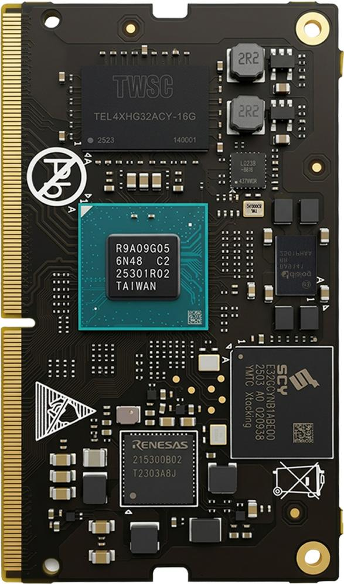
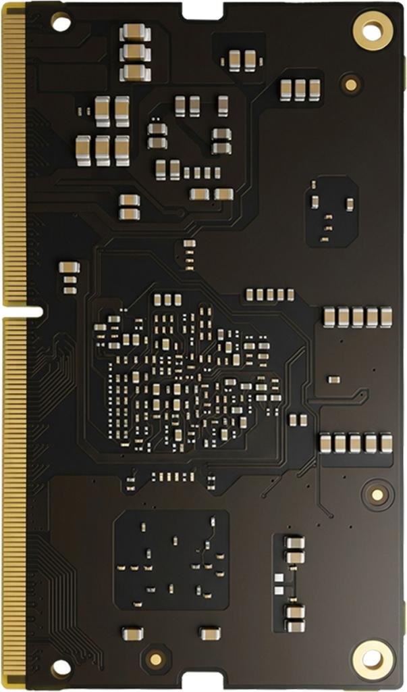
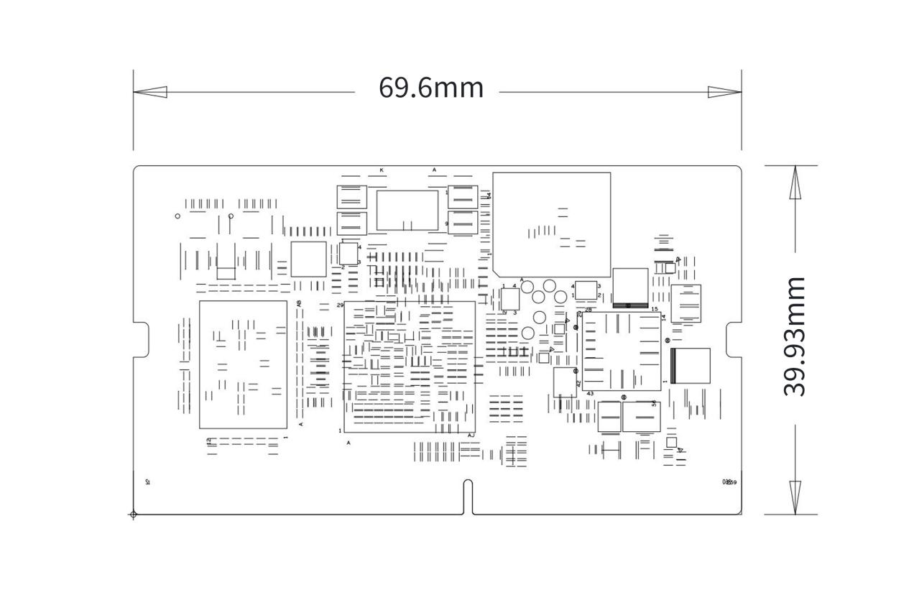
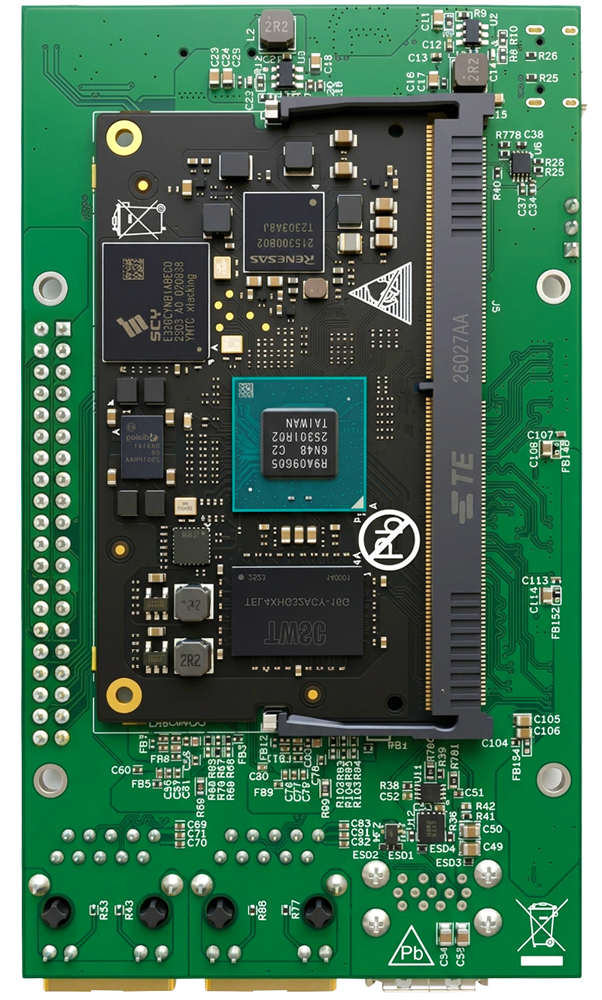
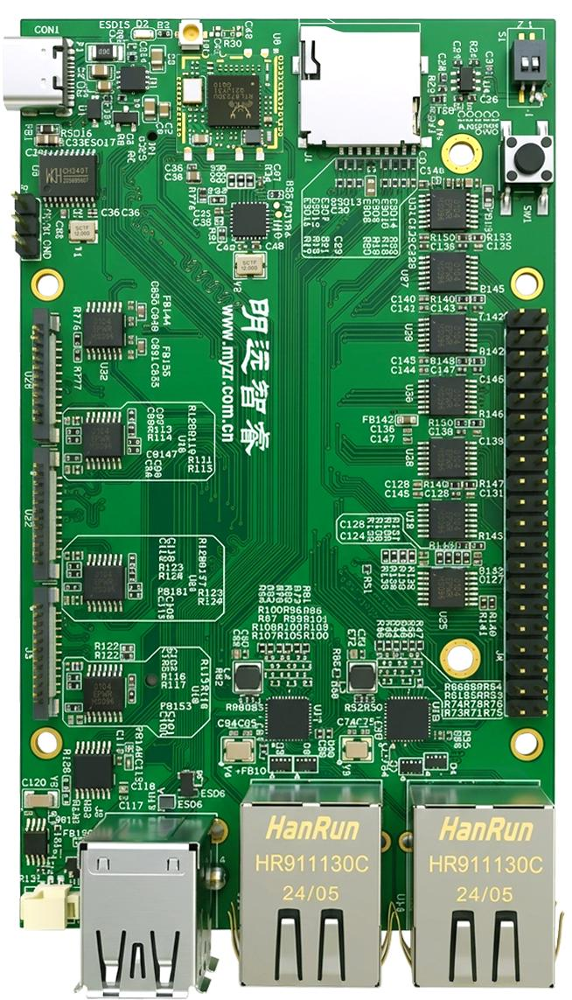
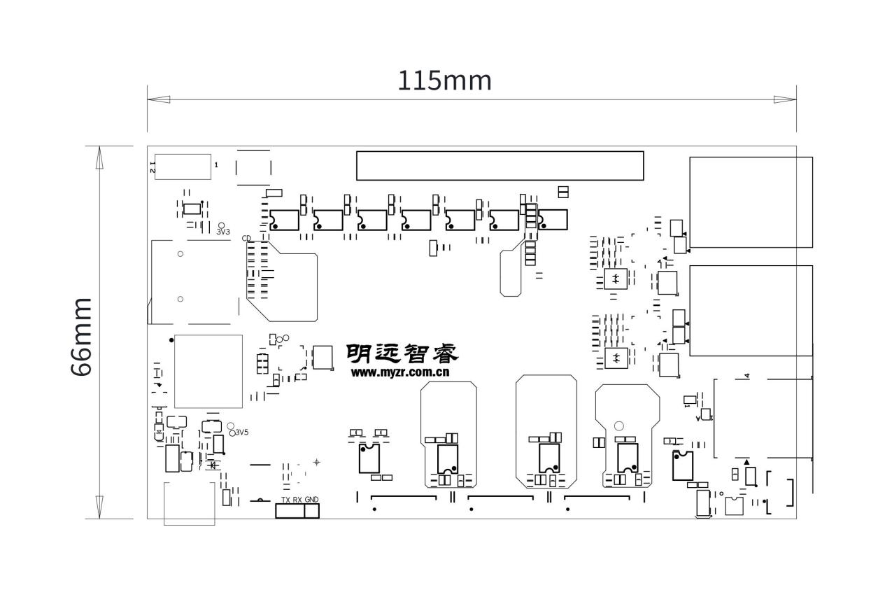
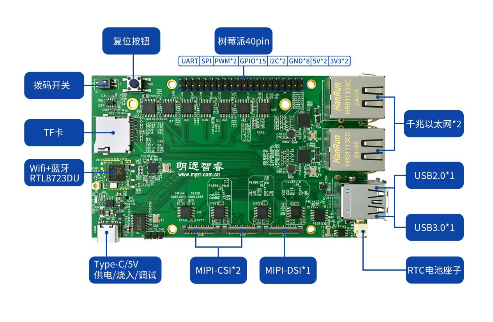

.. raw:: html

   

产品介绍
========

核心板介绍
----------

硬件资源
~~~~~~~~

RZ/V2N 是瑞萨 RZ/V 系列中的中端视觉 AI 微处理器（MPU），核心卖点是“15TOPS 算力 + 10TOPS/W 能效，无需散热风扇”，定位在入门级 RZ/V2L（0.5TOPS）与高端 RZ/V2H（最高 80TOPS）之间，主打高性价比的边缘视觉推理。

主要规格
^^^^^^^^

.. raw:: html

   

+------------------+--------------------------------------------------------+
| 功能模块         | 配置与性能                                             |
+==================+========================================================+
| 应用处理器       | 4 核 Arm Cortex-A55，最高 1.8 GHz                      |
+------------------+--------------------------------------------------------+
| 实时处理器       | 单核 Arm Cortex-M33，最高 200 MHz                      |
+------------------+--------------------------------------------------------+
| AI 加速器        | DRP-AI3，稠密算力 4 TOPS，稀疏算力最高 15 TOPS         |
+------------------+--------------------------------------------------------+
| AI 加速能效      |   瑞萨公布的 DRP-AI3 能效约为 10 TOPS/W                |
+------------------+--------------------------------------------------------+
| 片上存储         | 1.5 MB 片上共享 SRAM，支持 ECC                         |
+------------------+--------------------------------------------------------+
| 3D 图形处理      | Arm Mali-G31 GPU，视芯片料号而定                       |
+------------------+--------------------------------------------------------+
| 图像信号处理     | Arm Mali-C55 ISP，视芯片料号而定，最高支持 4K 图像处理 |
+------------------+--------------------------------------------------------+
| 摄像头输入       | 2 路 MIPI CSI-2                                        |
+------------------+--------------------------------------------------------+
| H.264 硬件编解码 | 编码和解码最高支持 1920 × 1080 @ 60 fps                |
+------------------+--------------------------------------------------------+
| H.265 硬件编解码 | 编码和解码最高支持 3840 × 2160 @ 30 fps                |
+------------------+--------------------------------------------------------+

核心板规格
----------

.. raw:: html

   

+------------+----------+------------------------------------+
| 核心板规格                                                 |
+============+==========+====================================+
| 1          | 型号     | MYZR-V2N-CB260                     |
+------------+----------+------------------------------------+
| 2          | 尺寸     | 69.6mmx39.93mm                     |
+------------+----------+------------------------------------+
| 3          | PCB      | 10层2阶盲埋沉金工艺设计 MXM 260pin |
+------------+----------+------------------------------------+
| 4          | 内存     | LPDDR4/4X 2/4/8/12GByte            |
+------------+----------+------------------------------------+
| 5          | 存储     | eMMC5.1 8/16/32/64/128GByte        |
+------------+----------+------------------------------------+
| 6          | 启动方式 | eMMC                               |
+------------+----------+------------------------------------+

核心板正反图
~~~~~~~~~~~~
.. raw:: html

    

.. raw:: html

    

核心板尺寸图
~~~~~~~~~~~~

命名规则及可选配置
~~~~~~~~~~~~~~~~~~

.. raw:: html

   

+------------------+----------------------------------------------+---------------+--------------+--------------+
| 核心板型号       | 命名规则                                                                                   |
+==================+==============================================+===============+==============+==============+
| MYZR-RZV2H-CB320 | MYZR                                         | RZV2N         | CB/EK        | 260          |
+                  +----------------------------------------------+---------------+--------------+--------------+
|                  | 明远智睿                                     | MPU主控型号   | 封装         | 核心板引脚数 |
+                  +----------------------------------------------+---------------+--------------+--------------+
|                  |                                              | V2N【工业级】 | CB【金手指】 | 260pin       |
+                  +----------------------------------------------+---------------+--------------+--------------+
|                  |                                              |               | EK【开发板】 |              |
+                  +----------------------------------------------+---------------+--------------+--------------+
|                  | **可选配置**                                                                               |
+                  +----------------------------------------------+---------------+--------------+--------------+
|                  | 内存：LPDDR4/4X 2/4/8/16GByte                                                              |
+                  +----------------------------------------------+---------------+--------------+--------------+
|                  | 存储：8/16/32/64/128GByte eMMC 5.1                                                         |
+                  +----------------------------------------------+---------------+--------------+--------------+
|                  | 型号命名例子 核心板：MYZR-V2N-CB260-4G-32G-C                                               |
|                  | -RevA           开发板：MYZR-V2N-EK260-4G-32G-C-RevA                                       |
+------------------+----------------------------------------------+---------------+--------------+--------------+

供电模式
~~~~~~~~

.. raw:: html

   

+----------+------------------------------+------+------+------+------+------------------------+
| 功能     | 引脚标号                     | 规格                      | 说明                   |
+==========+==============================+======+======+======+======+========================+
|          |                              | 最小 | 典型 | 最大 | 单位 |                        |
+          +                              +------+------+------+------+                        +
| 电源供电 | 230、232、234、236、238、240 | /    | 1.5  | /    | W    | 具体功耗以实际工作为准 |
+----------+------------------------------+------+------+------+------+------------------------+

工作环境
~~~~~~~~

.. raw:: html

   

+--------+------+------+------+------+-----------------------+
| 参数   | 规格 |      |      |      | 说明                  |
+========+======+======+======+======+=======================+
|        | 最小 | 典型 | 最大 | 单位 |                       |
+        +------+------+------+------+                       +
| 工业级 | -40℃ | 25℃  | 85℃  | ℃    | 实测-35至 80℃运行正常 |
+--------+------+------+------+------+-----------------------+

启动配置
~~~~~~~~

.. raw:: html

   

+-----------+-----------+---------------------+
| MD\_BOOT1 | MD\_BOOT0 | 启动模式            |
+===========+===========+=====================+
| Low       | Low       | SD 卡启动，默认配置 |
+-----------+-----------+---------------------+
| Low       | High      | eMMC 启动           |
+-----------+-----------+---------------------+
| High      | Low       | xSPI 启动           |
+-----------+-----------+---------------------+
| High      | High      | SCIF 下载模式       |
+-----------+-----------+---------------------+

核心板安装示意图
~~~~~~~~~~~~~~~~

信号定义
--------

.. raw:: html

   

+---------+---------------------------+--------+------------------------+
| Pin NO. | Pin Name                  | Pin NO | Pin Name               |
+=========+===========================+========+========================+
| 1       | GND                       | 2      | SD1\_DATA2             |
+---------+---------------------------+--------+------------------------+
| 3       | PCIE\_REFCLK\_EP\_N0      | 4      | SD1\_DATA3             |
+---------+---------------------------+--------+------------------------+
| 5       | PCIE\_REFCLK\_EP\_P0      | 6      | SD1\_DATA0             |
+---------+---------------------------+--------+------------------------+
| 7       | GND                       | 8      | SD1\_CMD               |
+---------+---------------------------+--------+------------------------+
| 9       | GND                       | 10     | SD1\_DATA1             |
+---------+---------------------------+--------+------------------------+
| 11      | GND                       | 12     | SD1\_CLK               |
+---------+---------------------------+--------+------------------------+
| 13      | PCIE0\_RST\_OUTB          | 14     | ET1\_MDIO              |
+---------+---------------------------+--------+------------------------+
| 15      | GND                       | 16     | ET1\_MDC               |
+---------+---------------------------+--------+------------------------+
| 17      | PCEI\_TXD\_P1             | 18     | ET1\_PHY\_INTR         |
+---------+---------------------------+--------+------------------------+
| 19      | PCEI\_TXD\_N1             | 20     | ET1\_TXD1              |
+---------+---------------------------+--------+------------------------+
| 21      | GND                       | 22     | ET1\_TXD2              |
+---------+---------------------------+--------+------------------------+
| 23      | PCEI\_TXD\_P0             | 24     | ET1\_TXD3              |
+---------+---------------------------+--------+------------------------+
| 25      | PCEI\_TXD\_N0             | 26     | ET1\_TXC\_TX\_CLK      |
+---------+---------------------------+--------+------------------------+
| 27      | GND                       | 28     | ET1\_TXD0              |
+---------+---------------------------+--------+------------------------+
| 29      | PCEI\_RXD\_P1             | 30     | ET1\_TX\_CTL\_TX\_EN   |
+---------+---------------------------+--------+------------------------+
| 31      | PCEI\_RXD\_N1             | 32     | ET1\_RXD3              |
+---------+---------------------------+--------+------------------------+
| 33      | GND                       | 34     | ET1\_RXD0              |
+---------+---------------------------+--------+------------------------+
| 35      | PCEI\_RXD\_P0             | 36     | ET1\_RXD2              |
+---------+---------------------------+--------+------------------------+
| 37      | PCEI\_RXD\_N0             | 38     | ET1\_RXD1              |
+---------+---------------------------+--------+------------------------+
| 39      | GND                       | 40     | ET1\_RX\_CTL\_RX\_DV   |
+---------+---------------------------+--------+------------------------+
| 41      | P06/I2C8\_SDA/1V8         | 42     | ET1\_RXC\_RX\_CLK      |
+---------+---------------------------+--------+------------------------+
| 43      | P07/I2C8\_SCL/1V8         | 44     | ET0\_TXC\_TX\_CLK      |
+---------+---------------------------+--------+------------------------+
| 45      | P12\_SSI3\_SCK/1V8        | 46     | ET0\_TXD1              |
+---------+---------------------------+--------+------------------------+
| 47      | P04\_SSI3\_SDATA\_OUT/1V8 | 48     | ET0\_TXD2              |
+---------+---------------------------+--------+------------------------+
| 49      | P47\_I2C7\_SCL/1V8        | 50     | ET0\_TXD3              |
+---------+---------------------------+--------+------------------------+
| 51      | P46\_I2C7\_SDA/1V8        | 52     | ET0\_TX\_CTL\_TX\_EN   |
+---------+---------------------------+--------+------------------------+
| 53      | GND                       | 54     | ET0\_TXD0              |
+---------+---------------------------+--------+------------------------+
| 55      | DSI\_D2\_N                | 56     | ET0\_MDIO              |
+---------+---------------------------+--------+------------------------+
| 57      | DSI\_D2\_P                | 58     | ET0\_MDC               |
+---------+---------------------------+--------+------------------------+
| 59      | GND                       | 60     | ET0\_PHYINTR           |
+---------+---------------------------+--------+------------------------+
| 61      | DSI\_D1\_N                | 62     | ET0\_RXD2              |
+---------+---------------------------+--------+------------------------+
| 63      | DSI\_D1\_P                | 64     | ET0\_RXD3              |
+---------+---------------------------+--------+------------------------+
| 65      | GND                       | 66     | ET0\_RX\_CTL\_RX\_DV   |
+---------+---------------------------+--------+------------------------+
| 67      | DSI\_D0\_N                | 68     | ET0\_RXD0              |
+---------+---------------------------+--------+------------------------+
| 69      | DSI\_D0\_P                | 70     | ET0\_RXD1              |
+---------+---------------------------+--------+------------------------+
| 71      | GND                       | 72     | ET0\_RXC\_RX\_CLK      |
+---------+---------------------------+--------+------------------------+
| 73      | DSI\_D3\_N                | 74     | P62/1V8                |
+---------+---------------------------+--------+------------------------+
| 75      | DSI\_D3\_P                | 76     | P67/1V8                |
+---------+---------------------------+--------+------------------------+
| 77      | GND                       | 78     | P51/1V8                |
+---------+---------------------------+--------+------------------------+
| 79      | DSI\_CLK\_N               | 80     | P40\_I2C4\_SDA/1V8     |
+---------+---------------------------+--------+------------------------+
| 81      | DSI\_CLK\_P               | 82     | P41\_I2C4\_SCL/1V8     |
+---------+---------------------------+--------+------------------------+
| 83      | GND                       | 84     | P30\_I2C0\_SDA/1V8     |
+---------+---------------------------+--------+------------------------+
| 85      | CSI1\_DATA1\_N            | 86     | P31\_I2C0\_SCL/1V8     |
+---------+---------------------------+--------+------------------------+
| 87      | CSI1\_DATA1\_P            | 88     | P33\_I2C1\_SCL/1V8     |
+---------+---------------------------+--------+------------------------+
| 89      | GND                       | 90     | P32\_I2C1\_SDA/1V8     |
+---------+---------------------------+--------+------------------------+
| 91      | CSI1\_DATA0\_N            | 92     | P37\_I2C3\_SCL/1V8     |
+---------+---------------------------+--------+------------------------+
| 93      | CSI1\_DATA0\_P            | 94     | P36\_I2C3\_SDA/1V8     |
+---------+---------------------------+--------+------------------------+
| 95      | GND                       | 96     | P35\_I2C2\_SCL/1V8     |
+---------+---------------------------+--------+------------------------+
| 97      | CSI1\_DATA2\_N            | 98     | P34\_I2C2\_SDA/1V8     |
+---------+---------------------------+--------+------------------------+
| 99      | CSI1\_DATA2\_P            | 100    | P42\_I2C5\_SDA/1V8     |
+---------+---------------------------+--------+------------------------+
| 101     | GND                       | 102    | P43\_I2C5\_SCL/1V8     |
+---------+---------------------------+--------+------------------------+
| 103     | CSI1\_DATA3\_N            | 104    | P05/1V8                |
+---------+---------------------------+--------+------------------------+
| 105     | CSI1\_DATA3\_P            | 106    | P00/1V8                |
+---------+---------------------------+--------+------------------------+
| 107     | GND                       | 108    | P01/1V8                |
+---------+---------------------------+--------+------------------------+
| 109     | CSI1\_CLKP                | 110    | P14/1V8                |
+---------+---------------------------+--------+------------------------+
| 111     | CSI1\_CLKN                | 112    | P13\_SSI3\_WS/1V8      |
+---------+---------------------------+--------+------------------------+
| 113     | GND                       | 114    | P50/1V8                |
+---------+---------------------------+--------+------------------------+
| 115     | CSI0\_DATA3\_P            | 116    | P64/1V8                |
+---------+---------------------------+--------+------------------------+
| 117     | CSI0\_DATA3\_N            | 118    | P54\_TXD2/1V8          |
+---------+---------------------------+--------+------------------------+
| 119     | GND                       | 120    | P55\_RXD2/1V8          |
+---------+---------------------------+--------+------------------------+
| 121     | CSI0\_CLKP                | 122    | P44\_I2C6\_SDA/1V8     |
+---------+---------------------------+--------+------------------------+
| 123     | CSI0\_CLKN                | 124    | P45\_I2C6\_SCL/1V8     |
+---------+---------------------------+--------+------------------------+
| 125     | GND                       | 126    | P65/1V8                |
+---------+---------------------------+--------+------------------------+
| 127     | CSI0\_DATA1\_P            | 128    | P61/1V8                |
+---------+---------------------------+--------+------------------------+
| 129     | CSI0\_DATA1\_N            | 130    | P60/1V8                |
+---------+---------------------------+--------+------------------------+
| 131     | GND                       | 132    | P66/1V8                |
+---------+---------------------------+--------+------------------------+
| 133     | CSI0\_DATA2\_N            | 134    | P63/1V8                |
+---------+---------------------------+--------+------------------------+
| 135     | CSI0\_DATA2\_P            | 136    | P53\_RXD1/1V8          |
+---------+---------------------------+--------+------------------------+
| 137     | GND                       | 138    | P52\_TXD1/1V8          |
+---------+---------------------------+--------+------------------------+
| 139     | CSI0\_DATA0\_N            | 140    | P86\_CAN\_TX3/1V8      |
+---------+---------------------------+--------+------------------------+
| 141     | CSI0\_DATA0\_P            | 142    | P87\_CAN\_RX3/1V8      |
+---------+---------------------------+--------+------------------------+
| 143     | GND                       | 144    | P80\_TXD8/1V8          |
+---------+---------------------------+--------+------------------------+
| 145     | ANI202                    | 146    | P81\_RXD8/1V8          |
+---------+---------------------------+--------+------------------------+
| 147     | ANI205                    | 148    | P70\_TXD4/1V8          |
+---------+---------------------------+--------+------------------------+
| 149     | ANI200                    | 150    | P71\_RXD4/1V8          |
+---------+---------------------------+--------+------------------------+
| 151     | ANI204                    | 152    | P82\_TXD9/1V8          |
+---------+---------------------------+--------+------------------------+
| 153     | ANI206                    | 154    | P83\_RXD9/1V8          |
+---------+---------------------------+--------+------------------------+
| 155     | ANI203                    | 156    | P84\_CAN\_TX2/1V8      |
+---------+---------------------------+--------+------------------------+
| 157     | ANI207                    | 158    | P85\_CAN\_RX2/1V8      |
+---------+---------------------------+--------+------------------------+
| 159     | ANI201                    | 160    | P92/1V8                |
+---------+---------------------------+--------+------------------------+
| 161     | ANI101                    | 162    | SD1PWEN/1V8            |
+---------+---------------------------+--------+------------------------+
| 163     | ANI100                    | 164    | P93/1V8                |
+---------+---------------------------+--------+------------------------+
| 165     | ANI102                    | 166    | PA1/1V8                |
+---------+---------------------------+--------+------------------------+
| 167     | ANI106                    | 168    | XSPI0\_CS0\_N          |
+---------+---------------------------+--------+------------------------+
| 169     | ANI104                    | 170    | XSPI0\_IO0             |
+---------+---------------------------+--------+------------------------+
| 171     | ANI107                    | 172    | XSPI0\_IO3             |
+---------+---------------------------+--------+------------------------+
| 173     | ANI103                    | 174    | XSPI0\_IO2             |
+---------+---------------------------+--------+------------------------+
| 175     | ANI105                    | 176    | XSPI0\_IO1             |
+---------+---------------------------+--------+------------------------+
| 177     | ANI005                    | 178    | XSPI0\_CKP             |
+---------+---------------------------+--------+------------------------+
| 179     | ANI000                    | 180    | XSPI0\_RESET0\_N       |
+---------+---------------------------+--------+------------------------+
| 181     | ANI002                    | 182    | MICROSD1\_1833V        |
+---------+---------------------------+--------+------------------------+
| 183     | ANI001                    | 184    | MICROSD1\_1833V        |
+---------+---------------------------+--------+------------------------+
| 185     | ANI007                    | 186    | S1.2V                  |
+---------+---------------------------+--------+------------------------+
| 187     | ANI004                    | 188    | S1.2V                  |
+---------+---------------------------+--------+------------------------+
| 189     | ANI003                    | 190    | LDO3\_1P2              |
+---------+---------------------------+--------+------------------------+
| 191     | ANI006                    | 192    | LDO1\_3V3              |
+---------+---------------------------+--------+------------------------+
| 193     | SCIF\_TXD/AJ2/1V8         | 194    | LDO1\_3V3              |
+---------+---------------------------+--------+------------------------+
| 195     | SCIF\_RXD/AJ3/1V8         | 196    | QRESN                  |
+---------+---------------------------+--------+------------------------+
| 197     | P02/1V8                   | 198    | USB30\_VBUSEN/1V8      |
+---------+---------------------------+--------+------------------------+
| 199     | P03/1V8                   | 200    | P74\_TXD6/1V8          |
+---------+---------------------------+--------+------------------------+
| 201     | P15\_SSI4\_SDATA\_IN/1V8  | 202    | P75\_RXD6/1V8          |
+---------+---------------------------+--------+------------------------+
| 203     | P57\_RXD3/1V8             | 204    | P76\_TXD7/1V8          |
+---------+---------------------------+--------+------------------------+
| 205     | P56\_TXD3/1V8             | 206    | P77\_RXD7/1V8          |
+---------+---------------------------+--------+------------------------+
| 207     | P72\_TXD5/1V8             | 208    | PA2/1V8                |
+---------+---------------------------+--------+------------------------+
| 209     | P73\_RXD5/1V8             | 210    | PA0/1V8                |
+---------+---------------------------+--------+------------------------+
| 211     | PA5/1V8                   | 212    | P91/1V8                |
+---------+---------------------------+--------+------------------------+
| 213     | QSD1\_CD/1V8              | 214    | P90/1V8                |
+---------+---------------------------+--------+------------------------+
| 215     | PA4/1V8                   | 216    | P97\_AUDIO\_CLKOUT/1V8 |
+---------+---------------------------+--------+------------------------+
| 217     | USB20\_VBUSEN/1V8         | 218    | USB20\_OVRCUR/1V8      |
+---------+---------------------------+--------+------------------------+
| 219     | GND                       | 220    | P21/1V8                |
+---------+---------------------------+--------+------------------------+
| 221     | USB30\_SSRXM              | 222    | P20/1V8                |
+---------+---------------------------+--------+------------------------+
| 223     | USB30\_SSRXP              | 224    | GND                    |
+---------+---------------------------+--------+------------------------+
| 225     | GND                       | 226    | GND                    |
+---------+---------------------------+--------+------------------------+
| 227     | USB30\_USB\_DM            | 228    | GND                    |
+---------+---------------------------+--------+------------------------+
| 229     | USB30\_USB\_DP            | 230    | D3.5V                  |
+---------+---------------------------+--------+------------------------+
| 231     | GND                       | 232    | D3.5V                  |
+---------+---------------------------+--------+------------------------+
| 233     | USB30\_SSTXM              | 234    | D3.5V                  |
+---------+---------------------------+--------+------------------------+
| 235     | USB30\_SSTXP              | 236    | D3.5V                  |
+---------+---------------------------+--------+------------------------+
| 237     | GND                       | 238    | D3.5V                  |
+---------+---------------------------+--------+------------------------+
| 239     | USB20\_QDM                | 240    | D3.5V                  |
+---------+---------------------------+--------+------------------------+
| 241     | USB20\_QDP                | 242    | D3.3V                  |
+---------+---------------------------+--------+------------------------+
| 243     | GND                       | 244    | D3.3V                  |
+---------+---------------------------+--------+------------------------+
| 245     | USB20\_VUBUSIN            | 246    | D3.3V                  |
+---------+---------------------------+--------+------------------------+
| 247     | USB20\_OTGID              | 248    | S1.8V                  |
+---------+---------------------------+--------+------------------------+
| 249     | GND                       | 250    | S1.8V                  |
+---------+---------------------------+--------+------------------------+
| 251     | PB4\_SPI3\_MOSI/1V8       | 252    | S1.8V                  |
+---------+---------------------------+--------+------------------------+
| 253     | PB5\_SPI3\_CLK/1V8        | 254    | MD\_BOOT0              |
+---------+---------------------------+--------+------------------------+
| 255     | PB3\_SPI3\_MISO/1V8       | 256    | MD\_BOOT1              |
+---------+---------------------------+--------+------------------------+
| 257     | PA6\_SPI3\_CS1/1V8        | 258    | USB30\_OVRCUR/1V8      |
+---------+---------------------------+--------+------------------------+
| 259     | PA7\_SPI3\_CS0/1V8        | 260    | PB2/1V8                |
+---------+---------------------------+--------+------------------------+

接口资源
--------

.. raw:: html

   

+--------+------------------+-----------------+--------------------------------------------------------------------------+
| 分类   | 接口             | 芯片资源        | 规格说明                                                                 |
+========+==================+=================+==========================================================================+
| 网络   | 千兆以太网       | 2 路            | 支持 10/100/1000 Mb/s、全双工和半双工，MAC 支持 RGMII 和 MII 接口。      |
+--------+------------------+-----------------+--------------------------------------------------------------------------+
| USB    | USB 2.0          | 1 路            | 支持 Host、Device 和 OTG，具备专用 DMA，支持控制、批量、中断及等时传输。 |
+        +------------------+-----------------+--------------------------------------------------------------------------+
|        | USB 3.2 Gen 2 ×1 | 1 路            | Host 控制器，芯片侧最高信令速率为 10 Gb/s，具备专用 DMA。底板端口按现有  |
|        |                  |                 | 资料标注为 USB 3.0 Host。                                                |
+--------+------------------+-----------------+--------------------------------------------------------------------------+
| 通信   | UART             | 10 路           | 10 路 RSCI 控制器可配置为异步串口。底板 J4 的部分 I/O 可复用为 UART。    |
+        +------------------+-----------------+--------------------------------------------------------------------------+
|        | SPI              | 3 路            | 支持 SPI 传输，以及通过 MOSI、MISO 和 RSPCK 实现的三线时钟同步通信。     |
+        +------------------+-----------------+--------------------------------------------------------------------------+
|        | I²C              | 9 路            | 支持标准模式（100 kHz）、快速模式（400 kHz）及快速增强模式（1 MHz），支  |
|        |                  |                 | 持多主模式、DMA 和事件链接。                                             |
+        +------------------+-----------------+--------------------------------------------------------------------------+
|        | I3C              | 1 路            | 支持 1.2 V 和 1.8 V I/O、多主模式、DMA 和事件链接。                      |
+        +------------------+-----------------+--------------------------------------------------------------------------+
|        | CAN FD           | 6 路            | CAN FD 数据阶段的芯片侧最高传输速率为 8 Mb/s。                           |
+--------+------------------+-----------------+--------------------------------------------------------------------------+
| 扩展   | PCIe 3.0         | 1 路            | 芯片支持 1 或 2 条 Lane，核心板及底板的引出情况待确认。                  |
+--------+------------------+-----------------+--------------------------------------------------------------------------+
| 模拟   | ADC              | 24 通道         | 12 位分辨率，支持 0.25、0.5、1.0、2.0 和 2.5 MS/s，支持单次、连续及分组  |
|        |                  |                 | 扫描。原表记录 8 路，核心板实际引出数量待核对。                          |
+--------+------------------+-----------------+--------------------------------------------------------------------------+
| 音频   | I²S              | 最多 5 路全双工 | 串行音频通道可配对实现全双工通信。                                       |
+--------+------------------+-----------------+--------------------------------------------------------------------------+
| 存储   | SD/MMC           | 3 路            | 3 路均支持 SD 主机功能，其中通道 0 另支持 eMMC。底板提供 1 个 TF 卡槽。  |
+--------+------------------+-----------------+--------------------------------------------------------------------------+
| 多媒体 | MIPI CSI-2       | 2 路            | 用于摄像头输入。每路支持 1、2 或 4 条数据 Lane，芯片规格最高为 4K RAW12  |
|        |                  |                 | @ 30 fps。                                                               |
+        +------------------+-----------------+--------------------------------------------------------------------------+
|        | MIPI DSI         | 1 路            | 用于显示输出。按芯片吞吐能力，RGB888 可达 1920 × 1200 @ 60 Hz 或 1280 ×  |
|        |                  |                 | 1024 @ 120 Hz。                                                          |
+--------+------------------+-----------------+--------------------------------------------------------------------------+

开发板介绍
----------

开发板正反图片
~~~~~~~~~~~~~~

开发板尺寸机械图
~~~~~~~~~~~~~~~~

开发板接口图
~~~~~~~~~~~~

开发板基础参数
~~~~~~~~~~~~~~

.. raw:: html

   

+------+------------+------------------+
| 序号 | 项目       | 规格             |
+======+============+==================+
| 1    | 型号       | MYZR-RZV2N-PI260 |
+------+------------+------------------+
| 2    | PCB尺寸    | 115x66mm         |
+------+------------+------------------+
| 3    | PCB层数    | 4层              |
+------+------------+------------------+
| 4    | PCB厚度    | 1.2mm            |
+------+------------+------------------+
| 5    | PCB颜色    | 绿色             |
+------+------------+------------------+
| 6    | 核心板接口 | MXM金手指        |
+------+------------+------------------+

开发板标配及可选配件
~~~~~~~~~~~~~~~~~~~~

.. raw:: html

   

+------------------+------------------------+-----------------------+
| 型号             | 开发板标配             |                       |
+==================+========================+=======================+
| MYZR-RZV2N-PI260 | 开发板×1【内含核心板】 | TYPE-C充电数据线×1    |
+                  +------------------------+-----------------------+
|                  | 网线×1                 | TTL串口模块×1【赠品】 |
+------------------+------------------------+-----------------------+

开发板搭配MYZR-RZV2N-PI260核心板使用，集成开发调试所需的全部常用接口，方便用户进行系统开发与功能验证。

开发板资源
~~~~~~~~~~

.. raw:: html

   

+------+--------------+-----------------------------------------+-------------------------------------------+
| 序号 | 接口         | 功能                                    | 接口形式                                  |
+======+==============+=========================================+===========================================+
| 1    | 千兆以太网 1 | 10/100/1000 Mb/s 以太网通信             | 带指示灯的直插式 RJ45 网口                |
+------+--------------+-----------------------------------------+-------------------------------------------+
| 2    | 千兆以太网 2 | 10/100/1000 Mb/s 以太网通信             | 带指示灯的直插式 RJ45 网口                |
+------+--------------+-----------------------------------------+-------------------------------------------+
| 3    | USB 3.0 Host | 连接 USB 外设                           | 蓝色 USB Type-A 母座，卧式贴装            |
+------+--------------+-----------------------------------------+-------------------------------------------+
| 4    | USB 2.0 Host | 连接 USB 外设                           | 双层 USB Type-A 母座，弯脚直插            |
+------+--------------+-----------------------------------------+-------------------------------------------+
| 5    | UART         | 串行通信，由扩展排针的部分 I/O 复用引出 | J4，40 针扩展排针                         |
+------+--------------+-----------------------------------------+-------------------------------------------+
| 6    | PCIe 3.0     | PCIe 外设扩展                           |                                           |
+------+--------------+-----------------------------------------+-------------------------------------------+
| 7    | PCIe 2.0     | PCIe 外设扩展                           |                                           |
+------+--------------+-----------------------------------------+-------------------------------------------+
| 8    | MIPI DSI     | 显示输出，连接显示模组                  | H4.4 抽拉式连接器，单侧接触，SMD 错位立贴 |
+------+--------------+-----------------------------------------+-------------------------------------------+
| 9    | MIPI CSI 1   | 摄像头输入，连接摄像头模组              | H4.4 抽拉式连接器，单侧接触，SMD 错位立贴 |
+------+--------------+-----------------------------------------+-------------------------------------------+
| 10   | MIPI CSI 2   | 摄像头输入，连接摄像头模组              | H4.4 抽拉式连接器，单侧接触，SMD 错位立贴 |
+------+--------------+-----------------------------------------+-------------------------------------------+
| 11   | TF 卡        | SD 卡访问，可按启动配置用作启动介质     | 9 针 TF 卡座（TF-01A）                    |
+------+--------------+-----------------------------------------+-------------------------------------------+
| 12   | Wi-Fi 天线   | Wi-Fi 射频信号收发                      | 板载 SMD 天线                             |
+------+--------------+-----------------------------------------+-------------------------------------------+

开发板各模块电路设计说明
------------------------

1.电源电路
~~~~~~~~~~

开发板采用 Type-C 接口输入 5 V 直流电源，并通过板载 DC/DC、LDO 等电源转换电路产生系统所需的 3.5 V、3.3 V 及其他核心电压。各路电源分别为处理器、DDR、存储器、以太网 PHY、无线通信模块及外设接口供电。

电源设计中配置了输入滤波、去耦和稳压电路，以降低电源纹波及负载突变对系统稳定性的影响。调试时应重点检查各路电源的输出电压、纹波、上电时序和带载能力是否满足器件要求。

2.BOOT 启动配置电路
~~~~~~~~~~~~~~~~~~~

开发板通过启动模式选择信号MD_BOOT[1:0]配置处理器的启动介质。拨码开关改变启动配置引脚的高、低电平组合，处理器在冷启动或复位释放阶段对该信号进行采样。

.. raw:: html

   

+-----------+-----------+---------------------+
| MD\_BOOT1 | MD\_BOOT0 | 启动模式            |
+===========+===========+=====================+
| Low       | Low       | SD 卡启动，默认配置 |
+-----------+-----------+---------------------+
| Low       | High      | eMMC 启动           |
+-----------+-----------+---------------------+
| High      | Low       | xSPI 启动           |
+-----------+-----------+---------------------+
| High      | High      | SCIF 下载模式       |
+-----------+-----------+---------------------+

BOOT 配置主要用于系统镜像烧录、启动介质切换及故障恢复。拨码设置应在断电状态下完成，重新上电后配置才可可靠生效。

3.复位电路
~~~~~~~~~~

开发板采用 TPS3808G18 电源监控及复位芯片产生系统复位信号。该电路在上电、掉电或被监测电源异常时，将处理器保持在复位状态；待电源电压稳定并达到规定条件后，再延时释放复位，从而避免电源未稳定时处理器异常启动。

板载复位按键可用于手动触发硬件复位，便于系统调试及异常恢复。复位电路设计时需确认复位有效电平、延时时间及被监测电源门限与主控芯片要求一致。

4.TF 卡（SDIO）接口电路
~~~~~~~~~~~~~~~~~~~~~~~

开发板配置一路 TF 卡接口，通过 SDIO 总线与TF卡连接，可用于系统启动、操作系统镜像存储、数据记录及外部存储扩展。

接口电路主要包括 SDIO 时钟、命令和数据线，以及卡槽供电、上拉、滤波和静电防护电路。布线时应控制时钟与数据线长度及信号完整性，避免高速传输过程中出现数据错误。

5.千兆以太网电路
~~~~~~~~~~~~~~~~

开发板配置两路千兆以太网接口。每路网络接口采用 Realtek RTL8211F-CG 千兆以太网 PHY，通过 RGMII 等数字接口与处理器的以太网 MAC 连接。

PHY 输出的差分网络信号经过网络变压器后连接至 RJ45 接口，实现电气隔离、阻抗匹配及共模干扰抑制。电路同时配置参考时钟、复位、MDIO/MDC 管理接口及状态指示信号，支持 10/100/1000 Mbps 网络通信。

6.Type-C 电源、烧录及调试接口
~~~~~~~~~~~~~~~~~~~~~~~~~~~~~

板载 Type-C 接口为复用接口，可用于 5 V 电源输入、系统镜像烧录（SCIF模式）及调试通信。其 USB 数据线连接至处理器的 USB 2.0 控制器，具体工作模式由系统启动配置及软件功能决定。

作为供电接口使用时，应保证外部电源具有足够的输出电流；作为烧录或调试接口使用时，需要配合相应的 USB 驱动、烧录工具或串口调试软件。

7.USB HOST 接口电路
~~~~~~~~~~~~~~~~~~~

开发板提供一路 USB 2.0 Host 和一路 USB 3.0 Host 接口，可连接U盘、键盘、鼠标、摄像头、USB网卡等外部设备。

USB Host 电路包括数据差分线、5 V VBUS 供电、限流或过流保护以及接口静电防护。USB 3.0 接口除 USB 2.0 的 D+/D− 信号外，还包含高速 SuperSpeed 差分信号，PCB 布线需满足差分阻抗、等长及回流路径要求。

8.Wi-Fi与蓝牙模块电路
~~~~~~~~~~~~~~~~~~~~~

开发板搭载 RTL8723DU Wi-Fi与蓝牙组合模块，用于实现无线局域网及蓝牙通信功能。模块与处理器之间通过USB HUB芯片使用USB 2.0 连接，并配置独立的供电、使能、复位及天线匹配电路。

无线部分的 PCB 设计应保证天线区域净空，避免金属结构、高速信号及开关电源靠近天线，以降低无线信号衰减和电磁干扰。

9.调试接口
~~~~~~~~~~

开发板通过 Type-C 接口提供系统调试功能，可根据硬件连接和软件配置实现调试串口、USB Device或下载接口等功能。

调试接口主要用于查看启动日志、执行命令、诊断系统故障及进行软件开发。使用串口功能时，应确认接口实际输出的电平标准及通信参数，避免将TTL电平串口直接连接至传统RS-232接口。

10.40Pin扩展接口
~~~~~~~~~~~~~~~~

开发板配置兼容树莓派形式的40Pin扩展接口，引出UART、SPI、PWM、GPIO、I²C、电源和地等信号，便于连接传感器、显示模块、执行器及其他扩展板。

图中标注的资源包括UART、SPI、2路PWM、约15路GPIO、2路I²C、8个GND、2个5 V及2个3.3 V引脚。实际复用功能、电平标准和最大输出电流应以接口定义表及主控芯片复用配置为准。

11.MIPI摄像头与显示接口
~~~~~~~~~~~~~~~~~~~~~~~

开发板提供两路MIPI-CSI摄像头接口，可连接兼容的摄像头模组，用于图像采集、机器视觉及视频监控等应用；同时提供一路MIPI-DSI接口，可连接兼容的液晶显示模组。

MIPI接口属于高速差分接口，对连接器定义、差分阻抗、走线等长及模组供电时序要求较高，使用前应确认摄像头或显示屏的接口电压、Lane数量及驱动兼容性。

12.RTC电池接口
~~~~~~~~~~~~~~

开发板设置RTC后备电池座，用于在主电源断开后继续为实时时钟电路供电，从而保存系统日期和时间。

安装电池时应确认电池规格、额定电压及正负极方向，避免反接造成器件损坏。
