.. raw:: html

   

刷机手册
========

准备文件
--------

下载固件

#. 打开网盘到1.通用资料，下载1.2-固件目录。

#. 打开网盘到1.通用资料，下载1.3-工具目录。

复制文件

#. 把1.2-固件/Linux-6.1.141目录里的所有文件复制到 FAT32 U 盘第一分区的根目录。

准备工具

#. 把1.3-工具/TeraTerm.v4.108.zip解压到 Windows。

开发板连接
----------

拨码到刷机模式：把模式拨码（丝印S1）的1拨到OFF，2拨到ON。

连接固件U盘：把前面的 U 盘插入到开发板的 USB 接口上。

.. note::

   为了避免不必要的问题，建议使用 USB 2.0 的 U 盘连接到开发板 USB 座子上的 USB 2.0 接口。

连接调试线：使用USB Type-C数据线连接开发板的 Type-C 座子（丝印CON1）和电脑，打开电脑的设备管理器，可以看到端口（COM 和 LPT）下面多出一个USB-SERIAL CH340 (COMx)，记住COMx这个串口号，后面需要使用。

.. note::

   提示 1：如果连接 Type-C 线后USB-SERIAL CH340 (COMx)上有一个三角形的感叹号，则需要电脑更新 CH340 的驱动（驱动位置1.3-工具/MYZR-RZV2N-USB驱动.zip）。

   提示 2：如果连接 Type-C 线后没有多出一个USB-SERIAL CH340 (COMx)设备，则换一条 Type-C 线，以及换一台电脑连接。

刷新 BOOT
---------

配置串口
~~~~~~~~

运行解压1.3-工具/TeraTerm.v4.108.zip得到的ttermpro.exe。 新建连接时选择前面接上 Type-C 线时出来的 COM 口。

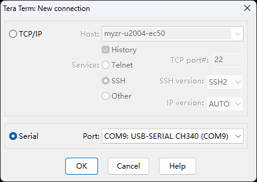

点击 Tera Term 菜单栏的Setup -> Serial port...，选择好参数。设置为 115200 bit/s、8 位数据、无校验、1 位停止位，关闭流控。

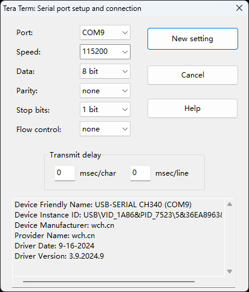

点 Tera Term 软件菜单栏的Setup -> Save setup保存配置，文件名和路径默认即可。这样下次使用时会自动载入我们刚才的配置。

接通电源
~~~~~~~~

接通开发板电源，在 Tera Term 串口终端查看以下提示。

.. code-block:: text

   SCI Download mode (Normal SCI boot)
   -- Load Program to SRAM ---------------

加载工具
~~~~~~~~

加载 Flash 工具：把1.2-固件/Linux-6.1.141目录里的Flash_Writer_SCIF_RZV2N_DEV_LPDDR4X.mot文件直接拖入到 Tera Term 软件窗口上。

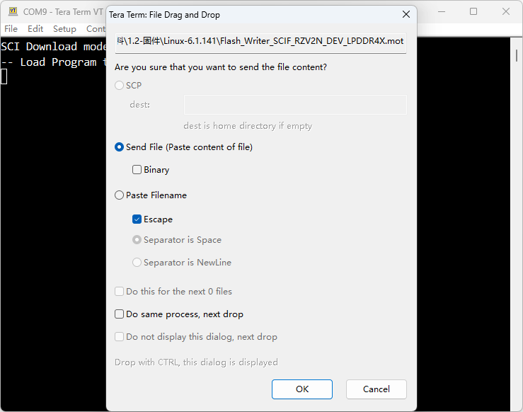

等待 Flash 工具传输完成，传输过程中可以看到传输进度。

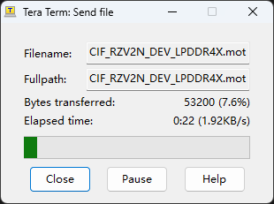

切换传输速率
~~~~~~~~~~~~

在上一步的 Flash 工具传输完成后，在 Tera Term 上输入sup

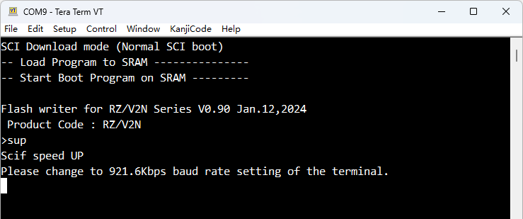

修改串口速率（加快后续文件传输）：在 Tera Term 的菜单栏上点击Setup -> Serial port...，修改串口波特率为921600。

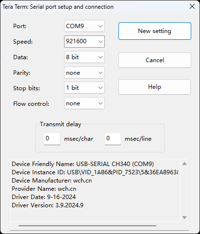

刷入 bl2 固件
~~~~~~~~~~~~~

在 Tera Term 软件上输入如下：

.. code-block:: text

   em_w
   1
   1
   8101e00

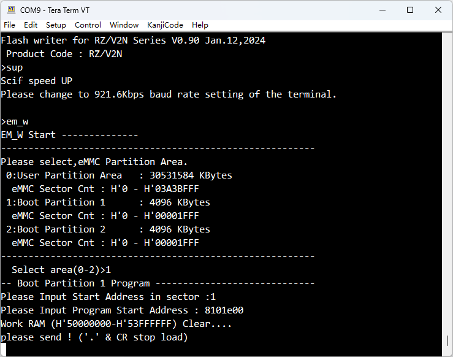

传输 bl2 固件：把1.2-固件/Linux-6.1.141目录的bl2_bp_mmc-myzr-rzv2n-pi260.srec文件直接拖入到 Tera Term 软件窗口上，并等待传输完成。

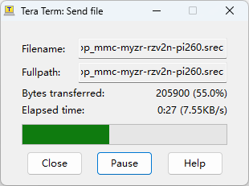

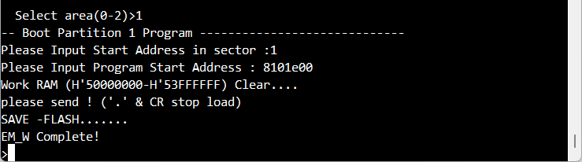

刷入 fip 固件
~~~~~~~~~~~~~

在 Tera Term 软件上输入如下：

.. code-block:: text

   em_w
   1
   300
   0

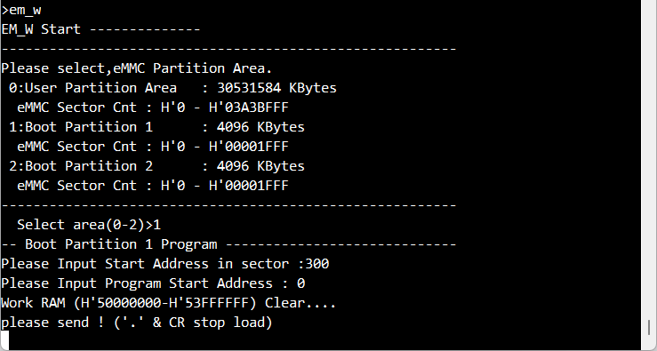

传输 fip 固件：把1.2-固件/Linux-6.1.141目录的fip-myzr-rzv2n-pi260.srec文件直接拖入到 Tera Term 软件窗口上，并等待传输完成。

.. warning::

   BL2 和 FIP 必须来自同一套固件，并与板卡的 4 GiB 或 8 GiB 内存配置一致。

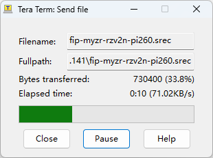

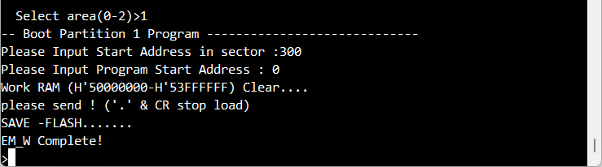

烧录 Boot 完成
~~~~~~~~~~~~~~

确认 Flash Writer 报告 BL2 和 FIP 写入成功，然后断开电源，准备切回 eMMC 启动模式。

刷新系统
--------

启动 BOOT
~~~~~~~~~

#. 断电后将S1.1和S1.2都拨到ON，切回 eMMC 启动模式。

#. 将准备好的 U 盘插入J2的 USB Host 口。在 Tera Term 将波特率恢复到115200 bit/s。

#. 重新上电，看到 U-Boot 倒计时时按键进入命令行。

刷新系统
~~~~~~~~

USB 恢复会重建 eMMC 用户区分区表并清除两个分区中的原有数据。确认目标板数据已备份后，在 U-Boot 命令行执行以下命令。

.. code-block:: text

   run bootcmd_usb

第一分区挂载后，脚本会复制约 823 MiB 的 Weston 归档及其他固件，串口可能有一段时间没有新增日志。随后脚本格式化第二分区并解压系统。看到以下成功提示后，系统停在维护 Shell。

.. code-block:: text

   MYZR[RESET] Info: System reset completed successfully.

进入系统
--------

确认恢复已成功并返回维护 Shell，拔出 U 盘，保持 eMMC 启动拨码，重启后等待 Linux 串口登录提示。正常启动和登录步骤见 启动手册。
