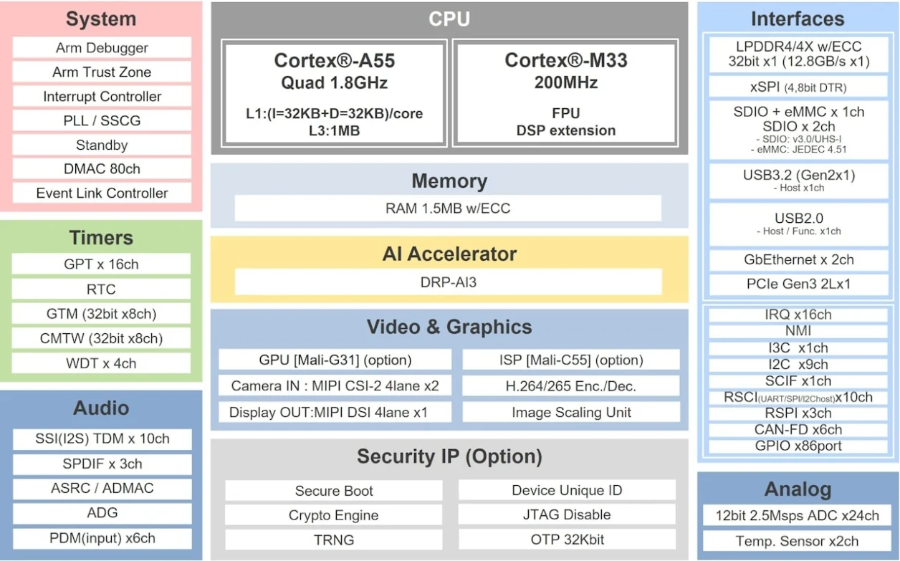

.. raw:: html

   

平台介绍
========

产品简介
--------

RZ/V2N 是瑞萨（Renesas）推出的中端视觉 AI MPU，属于 RZ/V 系列，面向高性价比边缘视觉 AI 场景，集成自研 DRP-AI3 动态可重构 AI 加速器，四核 Cortex‑A55 + Cortex‑M33 双核异构架构，内置 Mali‑C55 ISP、Mali‑G31 GPU、H.264/H.265 编解码器，原生支持双路 MIPI 相机输入，兼顾 AI 算力、实时控制、低功耗与小尺寸，是工业、车载、智能视觉设备的主流边缘 AI 处理器。

目标应用
--------

#. 协作机器人（Cobot）：基于 ROS 2 构建并具备视觉、语音和实时控制能力的 AI 驱动协作机器人系统。

#. AI 行车记录仪：采用 AI 技术的行车记录仪，具备高性能视觉处理、ADAS 和实时智能分析功能。

#. 人工智能监控摄像机：具有 DRP-AI 功能的 AI 监控摄像机可通过 4K 成像和低功耗提高安全性。

#. 基于 RZ/V2N 的单板计算机：高性能视觉 AI，支持 4K 摄像头、高效的 AI 处理和紧凑的硬件设计。

主要特点
--------

#. 异构 CPU 架构：4×Cortex‑A55 @1.8GHz（应用 Linux）+ 1×Cortex‑M33 @200MHz（硬实时控制），算力与实时控制兼顾

#. 高能效 DRP‑AI3：最高 15TOPS AI 推理，能效可达 10TOPS/W，支持模型剪枝优化，算力密度高、发热低

#. 原生双摄视觉链路：双路 MIPI CSI‑2，搭配 Mali‑C55 ISP，支持双目采集、空间感知、立体视觉

#. 多媒体引擎：内置 H.264/H.265 编解码、Mali‑G31 GPU，支持显示输出，适合带 UI 的视觉终端

#. 丰富高速接口：PCIe Gen3、USB3.2、双路 RGMII 千兆网、SDIO 等，扩展能力强

#. 封装小型化：相比 RZ/V2H 面积缩减 38%，PCB 布板更友好，适合紧凑整机

#. 安全支持：内置安全引擎、OTP、加密模块，满足工业、车载信息安全需求

#. 宽温稳定：支持工业宽温，适配严苛现场环境，Yocto Linux + Zephyr 生态成熟

处理器框图
----------

处理器参数
----------

.. raw:: html

   

+--------------------------------+---------------------------------------------------+
| 属性                           | 值                                                |
+================================+===================================================+
| CPU 架构                       | Arm                                               |
+--------------------------------+---------------------------------------------------+
| 主处理器                       | Cortex-A55（4 核），最高工作频率 1800MHz          |
+--------------------------------+---------------------------------------------------+
| 辅助处理器                     | Cortex-M33                                        |
+--------------------------------+---------------------------------------------------+
| 片上 RAM（KB）                 | 1536                                              |
+--------------------------------+---------------------------------------------------+
| 神经网络处理单元（NPU）        | 支持                                              |
+--------------------------------+---------------------------------------------------+
| DRAM 接口                      | LPDDR4-3200、LPDDR4X-3200（32 位）                |
+--------------------------------+---------------------------------------------------+
| 3D 图形处理器                  | Arm Mali-G31 或无（依具体料号）                   |
+--------------------------------+---------------------------------------------------+
| 结温范围（°C）                 | −40～+125                                         |
+--------------------------------+---------------------------------------------------+
| 以太网速率                     | 10 Mbit/s、100 Mbit/s、1 Gbit/s                   |
+--------------------------------+---------------------------------------------------+
| 以太网通道数                   | 2                                                 |
+--------------------------------+---------------------------------------------------+
| USB 全速（主机／设备通道数）   | 2/1/26                                            |
+--------------------------------+---------------------------------------------------+
| USB 高速（主机／设备通道数）   | 2/1/26                                            |
+--------------------------------+---------------------------------------------------+
| USB 超高速（主机／设备通道数） | 1 / 0                                             |
+--------------------------------+---------------------------------------------------+
| PCIe 版本与接口数              | PCIe Gen3.0，1 个接口（2 条传输通道）             |
+--------------------------------+---------------------------------------------------+
| SCI 或 UART 通道数             | 10                                                |
+--------------------------------+---------------------------------------------------+
| SPI 通道数                     | 3                                                 |
+--------------------------------+---------------------------------------------------+
| I²C 接口数                     | 9                                                 |
+--------------------------------+---------------------------------------------------+
| CAN FD 通道数                  | 6                                                 |
+--------------------------------+---------------------------------------------------+
| SDHI 通道数                    | 3                                                 |
+--------------------------------+---------------------------------------------------+
| 32 位定时器通道数              | 32                                                |
+--------------------------------+---------------------------------------------------+
| 待机状态可运行的定时器         | 不支持                                            |
+--------------------------------+---------------------------------------------------+
| 12 位模数转换器通道数          | 24                                                |
+--------------------------------+---------------------------------------------------+
| 显示接口                       | MIPI DSI x 1                                      |
+--------------------------------+---------------------------------------------------+
| 摄像头接口                     | MIPI CSI x 2                                      |
+--------------------------------+---------------------------------------------------+
| 视频编解码                     | H.264、H.265                                      |
+--------------------------------+---------------------------------------------------+
| 安全与加密                     | 依料号提供 AES、ECC、RSA、SHA-2、TRNG，或无此功能 |
+--------------------------------+---------------------------------------------------+
