.. raw:: html

   

硬件开发指导
============

1.电源
------

1.1 5v输入
~~~~~~~~~

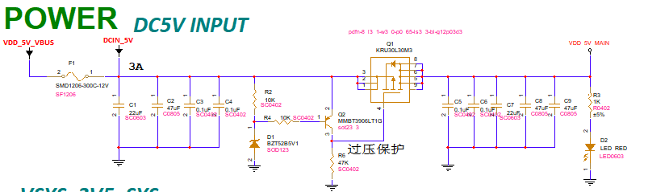

1.2 5v转3.5v
~~~~~~~~~~~

此电源专为核心板供电，电源最好按照3a设计，留足电源余量。

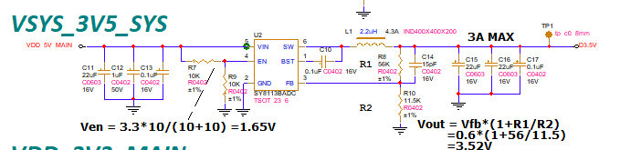

1.3 5v转3.3v
~~~~~~~~~~~

此电源为底板3v3供电

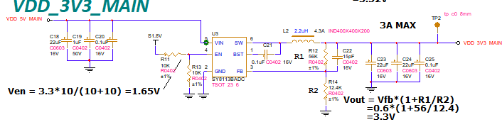

2.千兆以太网
------------

使用两颗RTL8211F-CG作为PHY芯片，连接V2N主控板的下列两组信号，做到两组千兆以太网。

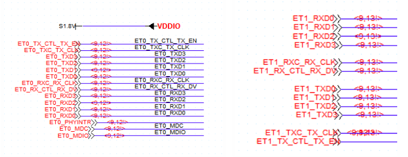

3.MIPI-CSI
----------

下列为v2n开发板MIPI-CSI信号及端子线序

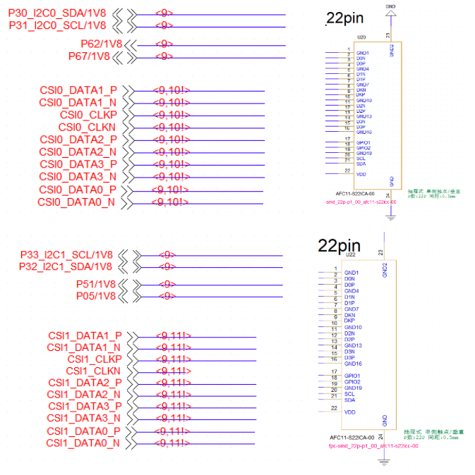

4.MIPI-DSI
----------

下列为v2n开发板MIPI-DSI信号及端子线序

.. raw:: html

    

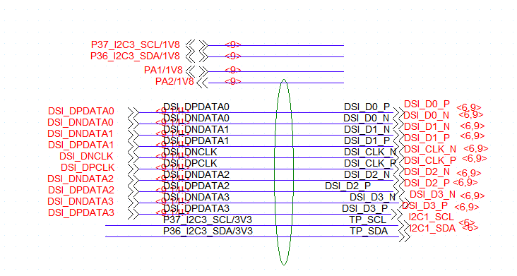

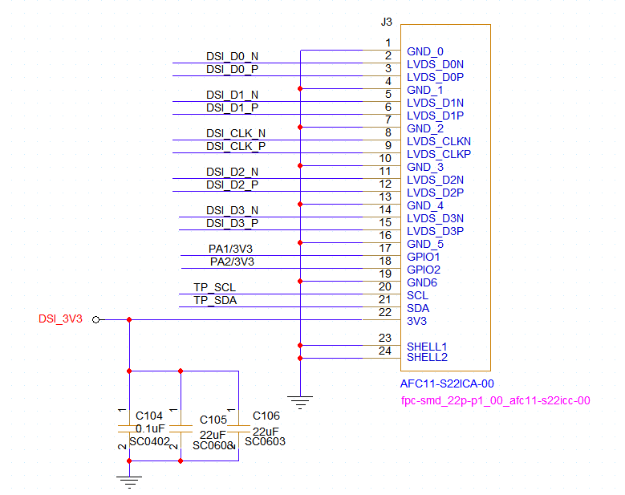

.. raw:: html

    

5.TF卡
------

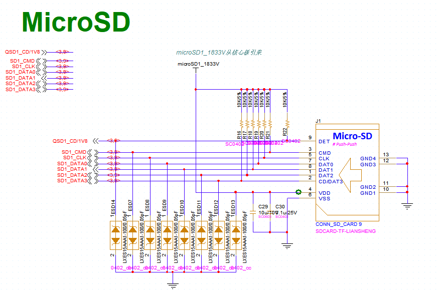

6.BOOT/RESET
------------

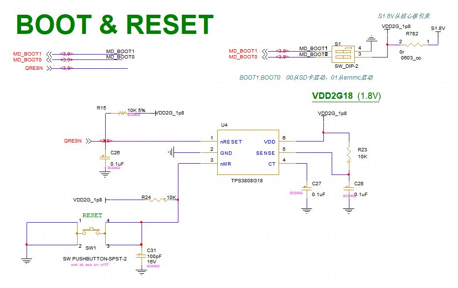

7.DEBUG/UART
------------

TTYPE-C接口，由usb通过CH340T转为串口调试

8.RTC
-----

RTC芯片HYM8563S通过I2C接到v2n主控，以及一个nRQ脚，实现实时时钟。

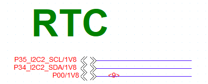

9.40PIN排针
-----------

15个GPIO具有高复用性

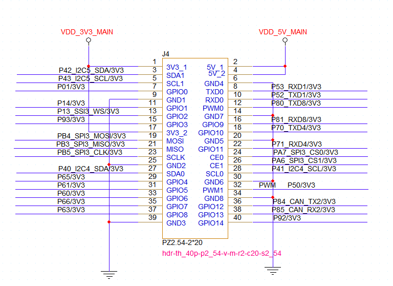

10.功能框图
-----------

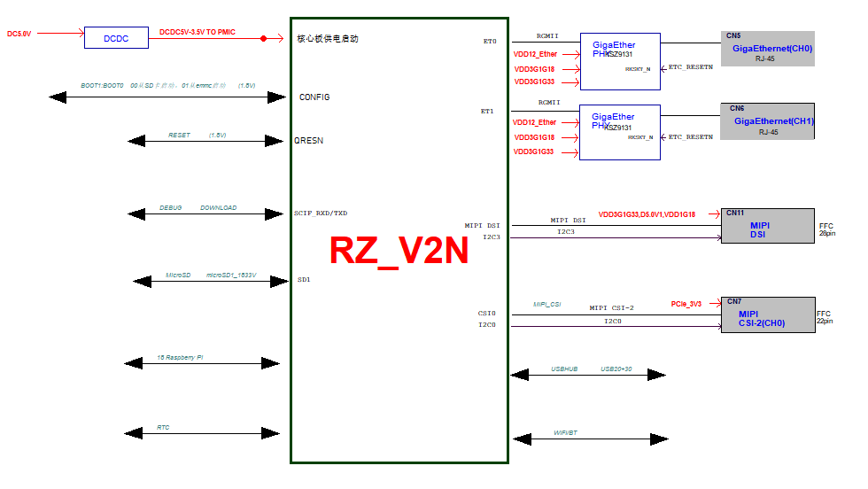

