.. raw:: html

   

Hardware Development Guide
==========================

Power Supply Block Diagram
--------------------------

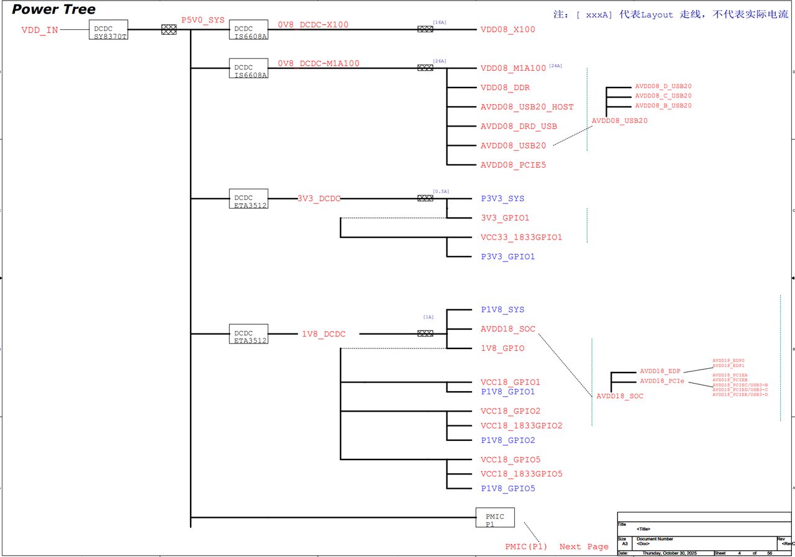

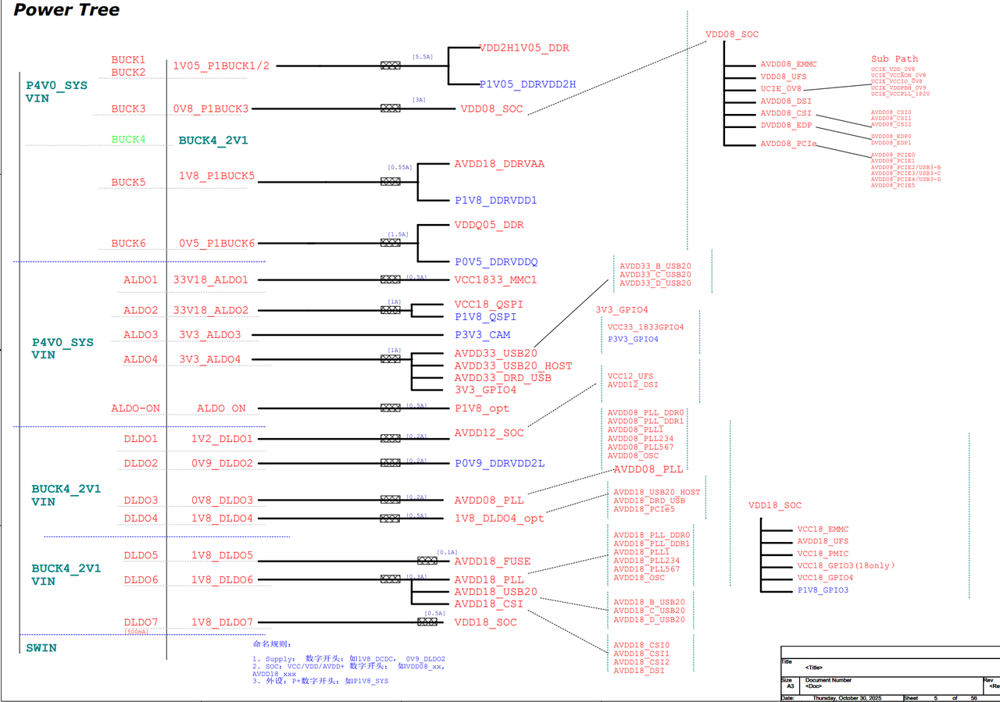

Boot Download Sel & JTAG Sel
----------------------------

The schematic diagrams of Boot Download Sel and JTAG Sel are shown below.

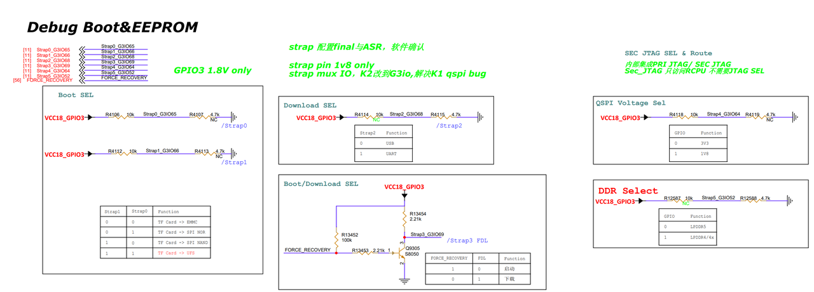

I2C Address
-----------

The K3 CoM260 reserves a wide range of peripheral interfaces. When debugging the I2C peripheral, I2C channel multiplexing may be involved. The figure below lists the I2C addresses and pull-up power supply configurations corresponding to the K3 CoM260 development kit to avoid address conflicts and level mismatches.

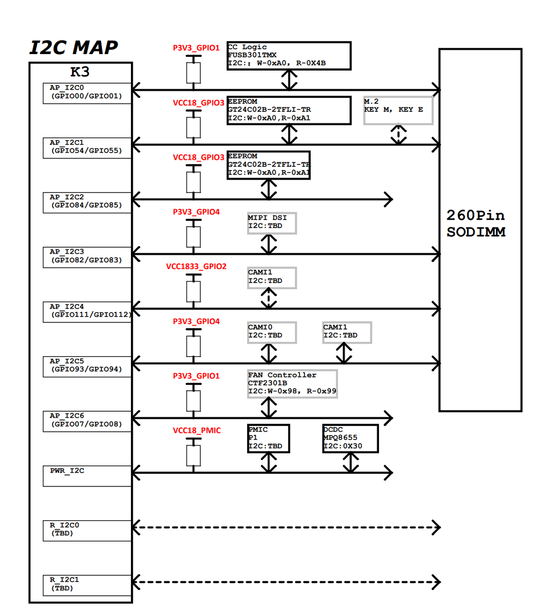

Module Overview
---------------

Power Input
~~~~~~~~~~~

The K3 CoM260 Development Kit only offers one power input method, DCIN. The onboard DC Jack interface has an outer diameter of 6.3 mm and an inner diameter of 2.5 mm, and requires a DC Jack power adapter that supports 19 V /2.37 A or 12 V /5 A output.

Memory
~~~~~~

The K3 CoM260 module integrates the following 4 types of memory:

#. UFS2.2: The module's onboard storage is UFS, with a default capacity of 128 GB.

#. SPI Flash: Onboard SPI Flash.

#. DDR: Uses 2 LPDDR5 chips, with a capacity of 4 GB / 8 GB / 16 GB per chip, corresponding to a total module capacity of 8 GB / 16 GB / 32 GB.

#. EEPROM: Used to store board information.

Keypad Input
~~~~~~~~~~~~

The K3 CoM260 Development Kit provides a multi-function button interface, including a power button, a reset button, and a download button.

.. image:: ../../../image/MYZR-进迭时空/MYZR-K3-CoM260/按键输入.jpeg
   :alt: 按键输入.jpeg
   :width: 100%

.. raw:: html

   

+------+-----------------+------------------------------------+
| Pin  | Signal Name     | Function                           |
+======+=================+====================================+
| 1    | PC\_LED-        | LED Negative Electrode             |
+------+-----------------+------------------------------------+
| 2    | PC\_LED+        | LED Positive Electrode             |
+------+-----------------+------------------------------------+
| 3    | UART0\_RXD      | DEBUG UART RX                      |
+------+-----------------+------------------------------------+
| 4    | UART0\_TXD      | DEBUG UART TX                      |
+------+-----------------+------------------------------------+
| 5    | BMCU\_ACOK      | Set to power on with button        |
+------+-----------------+------------------------------------+
| 6    | AUTO\_ON\_DIS   | Short-circuit with BMCU \_ACOK,    |
|      |                 | set to power on by button          |
+------+-----------------+------------------------------------+
| 7    | GND             | Power ground                       |
+------+-----------------+------------------------------------+
| 8    | PMIC\_RST\_OUTn | Reset                              |
+------+-----------------+------------------------------------+
| 9    | Gnd             | Power ground                       |
+------+-----------------+------------------------------------+
| 10   | FORCE\_RECOVERY | Download                           |
+------+-----------------+------------------------------------+
| 11   | Gnd             | Power ground                       |
+------+-----------------+------------------------------------+
| 12   | SLEEP/WAKE      | Power On /关机                     |
+------+-----------------+------------------------------------+

MIPI CSI High-Speed Connector
~~~~~~~~~~~~~~~~~~~~~~~~~~~~~

The K3- CoM260 does not specify support for specific camera module models. Its high-speed connector provides two sets of 4-lane MIPI CSI signals, and different link combination modes can be flexibly selected through the resistor configuration on the module.

Under the default configuration,

#. CAM0 supports 2 lanes

#. CAM1 supports 2+2 lanes or 4 lanes

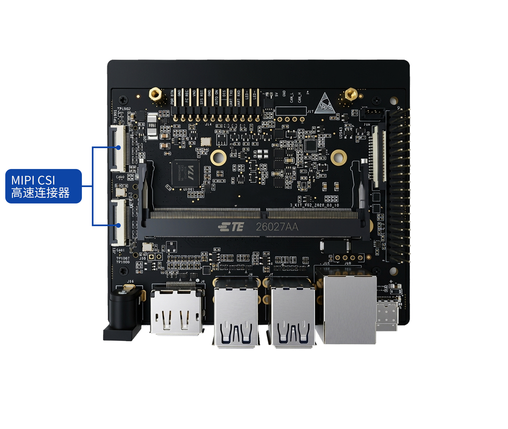

The pinout of the 22-pin high-speed connector interface is as follows:

CAM0

.. raw:: html

   

+------+------------------+
| Pin  | Signal Name      |
+======+==================+
| 1    | VDD\_3V3\_SYS    |
+------+------------------+
| 2    | I2C4\_SDA        |
+------+------------------+
| 3    | I2C4\_SCL        |
+------+------------------+
| 4    | GND              |
+------+------------------+
| 5    | CLK\_CAMCK       |
+------+------------------+
| 6    | CAM\_PWDN        |
+------+------------------+
| 7    | GND              |
+------+------------------+
| 8    | MIPI\_CSI0\_DP1  |
+------+------------------+
| 9    | MIPI\_CSI0\_DN1  |
+------+------------------+
| 10   | GND              |
+------+------------------+
| 11   | MIPI\_CSI0\_DP0  |
+------+------------------+
| 12   | MIPI\_CSI0\_DN0  |
+------+------------------+
| 13   | GND              |
+------+------------------+
| 14   | MIPI\_CSI1\_CLKP |
+------+------------------+
| 15   | MIPI\_CSI1\_CLKN |
+------+------------------+
| 16   | GND              |
+------+------------------+
| 17   | MIPI\_CSI1\_DP1  |
+------+------------------+
| 18   | MIPI\_CSI1\_DN1  |
+------+------------------+
| 19   | GND              |
+------+------------------+
| 20   | MIPI\_CSI1\_DP0  |
+------+------------------+
| 21   | MIPI\_CSI1\_DN0  |
+------+------------------+
| 22   | GND              |
+------+------------------+

CAM1

.. raw:: html

   

+------+------------------+
| Pin  | Signal Name      |
+======+==================+
| 1    | VDD\_3V3\_SYS    |
+------+------------------+
| 2    | I2C4\_SDA        |
+------+------------------+
| 3    | I2C4\_SCL        |
+------+------------------+
| 4    | GND              |
+------+------------------+
| 5    | CLK\_CAMCK       |
+------+------------------+
| 6    | CAM\_PWDN        |
+------+------------------+
| 7    | GND              |
+------+------------------+
| 8    | MIPI\_CSI3\_DP1  |
+------+------------------+
| 9    | MIPI\_CSI3\_DN1  |
+------+------------------+
| 10   | GND              |
+------+------------------+
| 11   | MIPI\_CSI3\_DP0  |
+------+------------------+
| 12   | MIPI\_CSI3\_DN0  |
+------+------------------+
| 13   | GND              |
+------+------------------+
| 14   | MIPI\_CSI2\_CLKP |
+------+------------------+
| 15   | MIPI\_CSI2\_CLKN |
+------+------------------+
| 16   | GND              |
+------+------------------+
| 17   | MIPI\_CSI2\_DP1  |
+------+------------------+
| 18   | MIPI\_CSI2\_DN1  |
+------+------------------+
| 19   | GND              |
+------+------------------+
| 20   | MIPI\_CSI2\_DP0  |
+------+------------------+
| 21   | MIPI\_CSI2\_DN0  |
+------+------------------+
| 22   | GND              |
+------+------------------+

MIPI DSI Screen Connector
~~~~~~~~~~~~~~~~~~~~~~~~~

The K3 CoM260 supports a 4.3-inch capacitive touch display for Raspberry Pi.

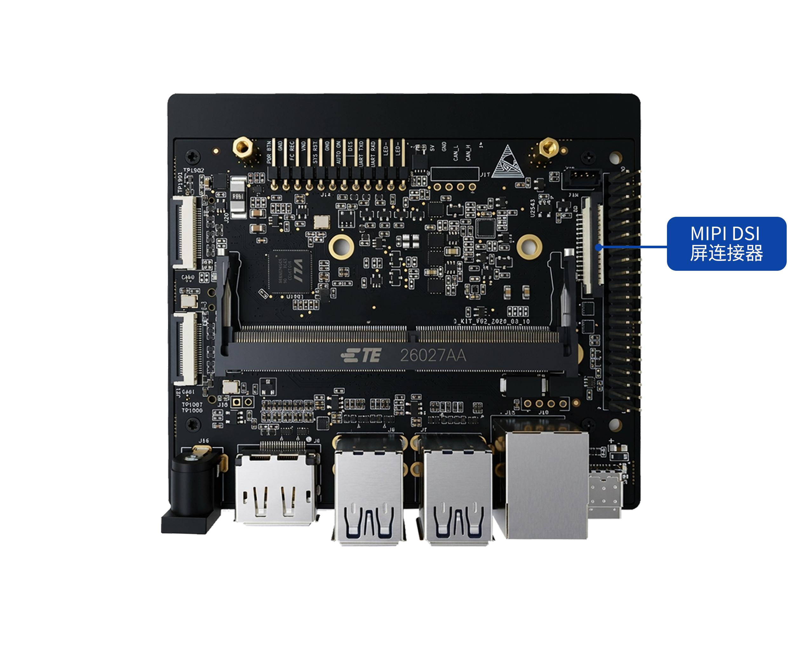

The pinout of the screen interface is as follows:

.. raw:: html

   

+------+-----------------------+-----------------------+------+
| Pin  | Signal Name           | Signal Name           | Pin  |
+======+=======================+=======================+======+
| 1    | GND                   | GND                   | 2    |
+------+-----------------------+-----------------------+------+
| 3    | MIPI\_DSI1\_LANE1\_DN | MIPI\_DSI1\_LANE1\_DN | 4    |
+------+-----------------------+-----------------------+------+
| 5    | MIPI\_DSI1\_LANE1\_DP | MIPI\_DSI1\_LANE1\_DP | 6    |
+------+-----------------------+-----------------------+------+
| 7    | GND                   | GND                   | 8    |
+------+-----------------------+-----------------------+------+
| 9    | MIPI\_DSI1\_CLK\_N    | MIPI\_DSI1\_CLK\_N    | 10   |
+------+-----------------------+-----------------------+------+
| 11   | MIPI\_DSI1\_CLK\_P    | MIPI\_DSI1\_CLK\_P    | 12   |
+------+-----------------------+-----------------------+------+
| 13   | GND                   | GND                   | 14   |
+------+-----------------------+-----------------------+------+
| 15   | MIPI\_DSI1\_LANE0\_DN | MIPI\_DSI1\_LANE0\_DN | 16   |
+------+-----------------------+-----------------------+------+
| 17   | MIPI\_DSI1\_LANE0\_DP | MIPI\_DSI1\_LANE0\_DP | 18   |
+------+-----------------------+-----------------------+------+
| 19   | GND                   | GND                   | 20   |
+------+-----------------------+-----------------------+------+
| 21   | I2C3\_SCL             | I2C3\_SCL             | 22   |
+------+-----------------------+-----------------------+------+
| 23   | I2C3\_SDA             | I2C3\_SDA             | 24   |
+------+-----------------------+-----------------------+------+
| 25   | GND                   | GND                   | 26   |
+------+-----------------------+-----------------------+------+
| 27   | LCD\_VCC33            | LCD\_VCC33            | 28   |
+------+-----------------------+-----------------------+------+
| 29   | LCD\_VCC33            | LCD\_VCC33            | 30   |
+------+-----------------------+-----------------------+------+

Type-C Connector
~~~~~~~~~~~~~~~~

The Type-C connector of the K3 CoM260 Development Kit only supports OTG mode and does not support internal power supply.

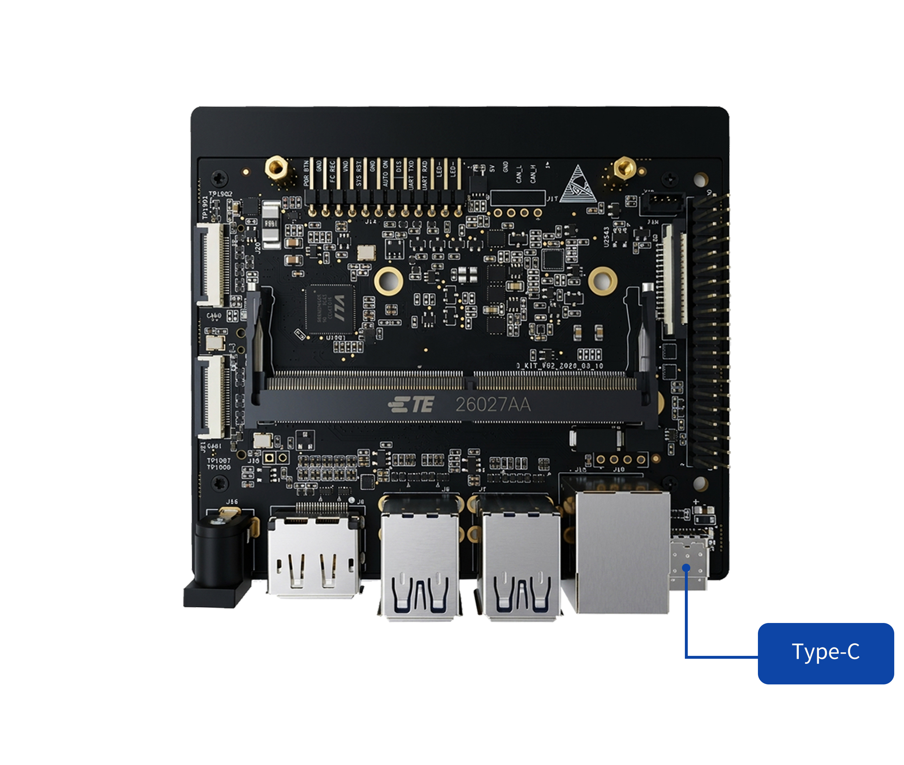

DP Output Port
~~~~~~~~~~~~~~

The K3 CoM260 Development Kit supports 1 DP Type-A output interface, up to DP 1.2, and a maximum video output of 3840 × 2160 @ 60fps.

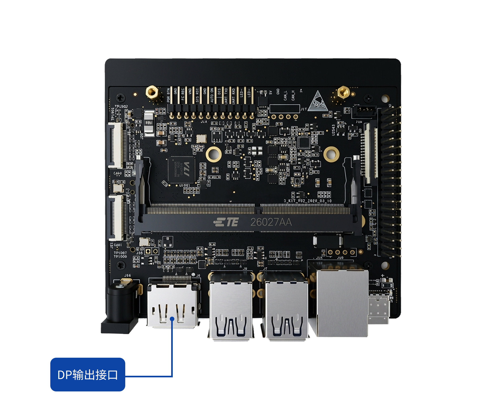

DP Display Instructions for Use:

#. The K3 CoM260 Development Kit only supports DP display output (HDMI is not supported). Please use a DP cable to connect to a monitor that supports DP input in order for the screen to turn on normally.

#. To connect a HDMI monitor, please use an active DP to HDMI converter (with a built-in DP to HDMI conversion chip). A passive DP to HDMI adapter cable does not have a conversion chip and cannot be used. Reference link: DP to HDMI Active Converter

.. code-block:: text

   Note: Most of the DP-to-HDMI cables supplied with other development platforms are passive and do not contain an internal protocol conversion chip. When used with the DP interface of this kit, they will not be able to output images properly. Please do not directly reuse the display cables supplied with other platforms. Instead, select an active converter yourself according to the requirements above.

USB Interface
~~~~~~~~~~~~~

The K3 CoM260 Development Kit provides four USB 3.0 Type-A interfaces for easy connection to various USB peripherals.

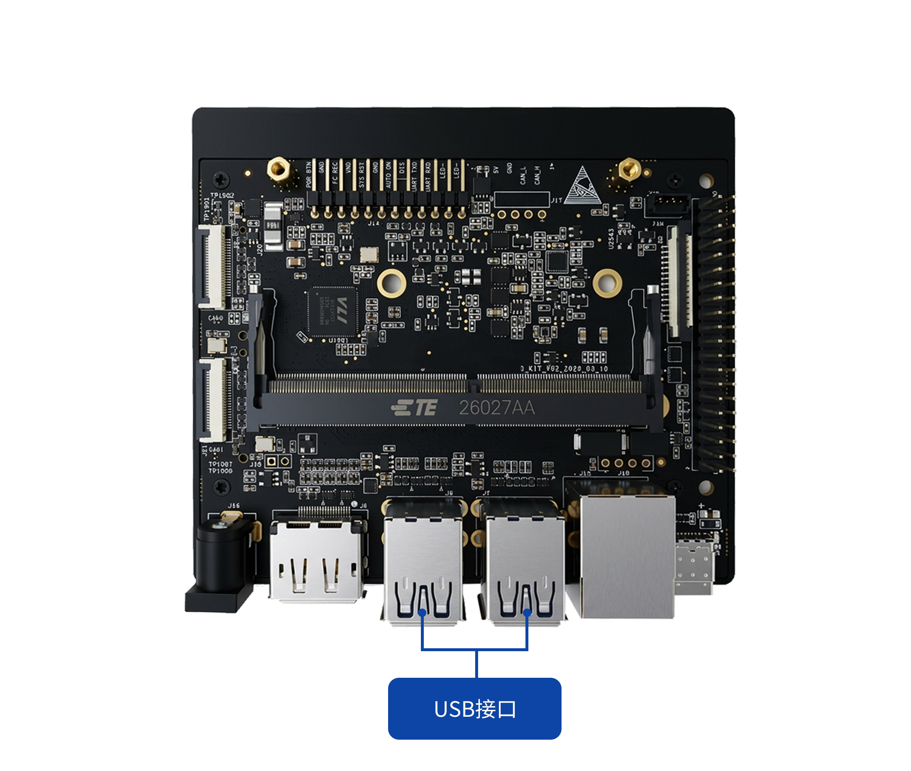

RJ45 Interface
~~~~~~~~~~~~~~

The K3 CoM260 Development Kit supports 1 RJ45 Gigabit Ethernet interface.

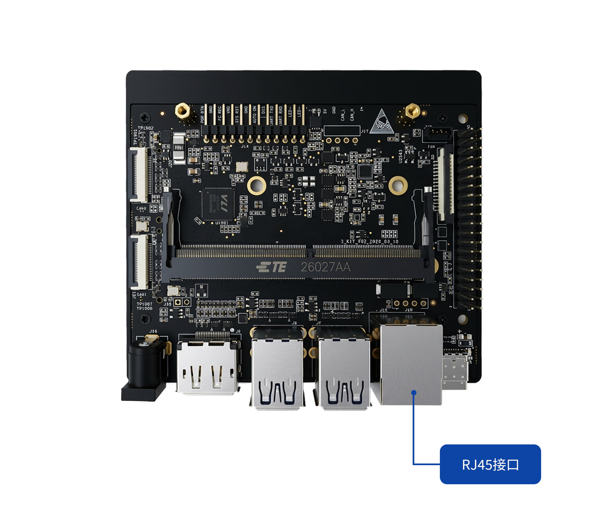

Wi-Fi /BT Module
~~~~~~~~~~~~~~~~

The K3 CoM260 Development Kit supports the integration of M.2 2230 E-Key modules, enabling wireless network and Bluetooth functionality.

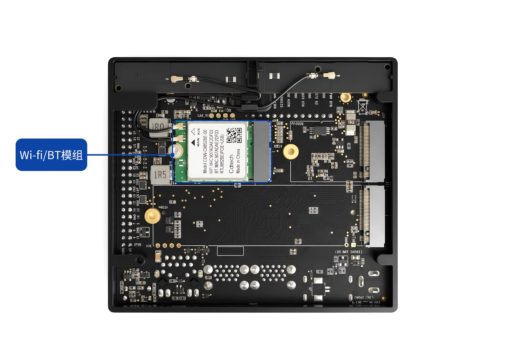

40-Pin Interface
~~~~~~~~~~~~~~~~

The K3 CoM260 Development Kit provides a 40-pin dual-row pin header interface with the following pinout:

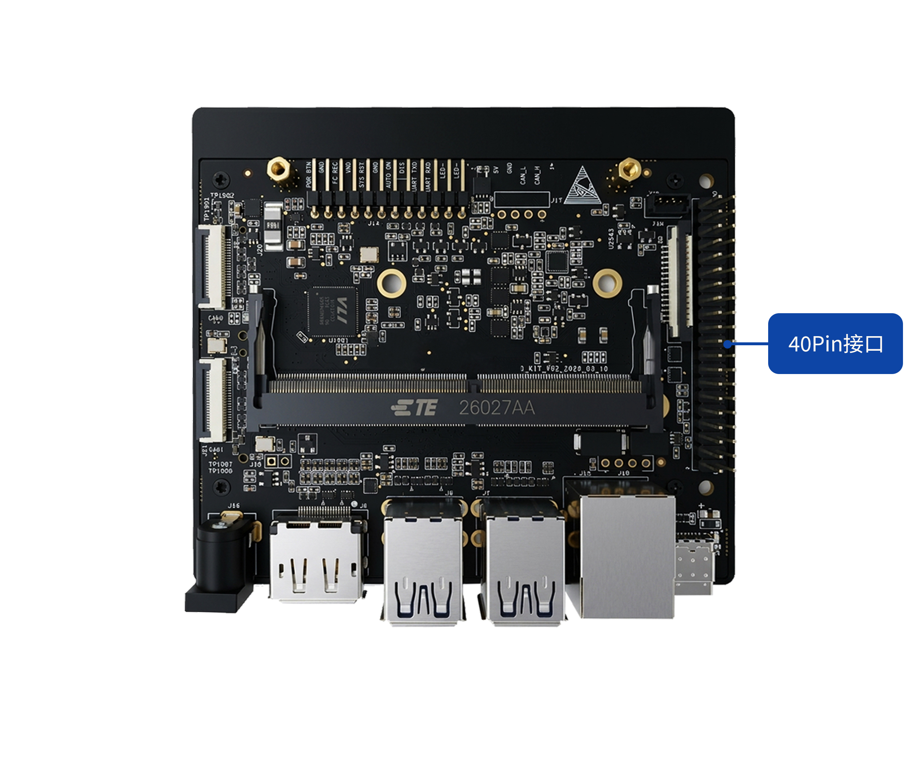

.. code-block:: text

   Note: The IO Function can be configured as needed.

.. raw:: html

   

+------+------------------+------------------+------+
| Pin  | Signal Name      | Signal Name      | Pin  |
+======+==================+==================+======+
| 1    | VDD\_3V3\_SYS    | VDD\_5V\_GPIO    | 2    |
+------+------------------+------------------+------+
| 3    | I2C3\_SDA        | VDD\_5V\_GPIO    | 4    |
+------+------------------+------------------+------+
| 5    | I2C3\_SCL        | GND              | 6    |
+------+------------------+------------------+------+
| 7    | GPIO09           | UART1\_TXD\_LS   | 8    |
+------+------------------+------------------+------+
| 9    | GND              | UART1\_RXD\_LS   | 10   |
+------+------------------+------------------+------+
| 11   | UART1\_RTS\_LS   | I2S0\_SCLK\_LS   | 12   |
+------+------------------+------------------+------+
| 13   | R-SPI0\_SCK\_LS  | GND              | 14   |
+------+------------------+------------------+------+
| 15   | GPIO12\_LS       | R-SPI0\_CS1\_LS  | 16   |
+------+------------------+------------------+------+
| 17   | VDD\_3V3\_SYS    | R-SPI0\_CS\_LS   | 18   |
+------+------------------+------------------+------+
| 19   | SPI0\_MOSI\_LS   | GND              | 20   |
+------+------------------+------------------+------+
| 21   | SPI0\_MISO\_LS   | R-SPI0\_MISO\_LS | 22   |
+------+------------------+------------------+------+
| 23   | SPI0\_SCK\_LS    | SPI0\_CS0\_LS    | 24   |
+------+------------------+------------------+------+
| 25   | GND              | SPI0\_CS1\_LS    | 26   |
+------+------------------+------------------+------+
| 27   | I2C0\_SDA        | I2C0\_SCL        | 28   |
+------+------------------+------------------+------+
| 29   | GPIO01\_LS       | GND              | 30   |
+------+------------------+------------------+------+
| 31   | GPIO11\_LS       | GPIO07\_LS       | 32   |
+------+------------------+------------------+------+
| 33   | GPIO13\_LS       | GND              | 34   |
+------+------------------+------------------+------+
| 35   | I2S0\_LRCK\_LS   | UART1\_CTS\_LS   | 36   |
+------+------------------+------------------+------+
| 37   | R-SPI0\_MOSI\_LS | I2S0\_SDIN\_LS   | 38   |
+------+------------------+------------------+------+
| 39   | GND              | I2S0\_SDOUT\_LS  | 40   |
+------+------------------+------------------+------+

TF- Card Interface
~~~~~~~~~~~~~~~~~~

The K3 CoM260 supports TF card access, making it easy to expand storage devices. It also supports a Debug expansion card for JTAG debugging.

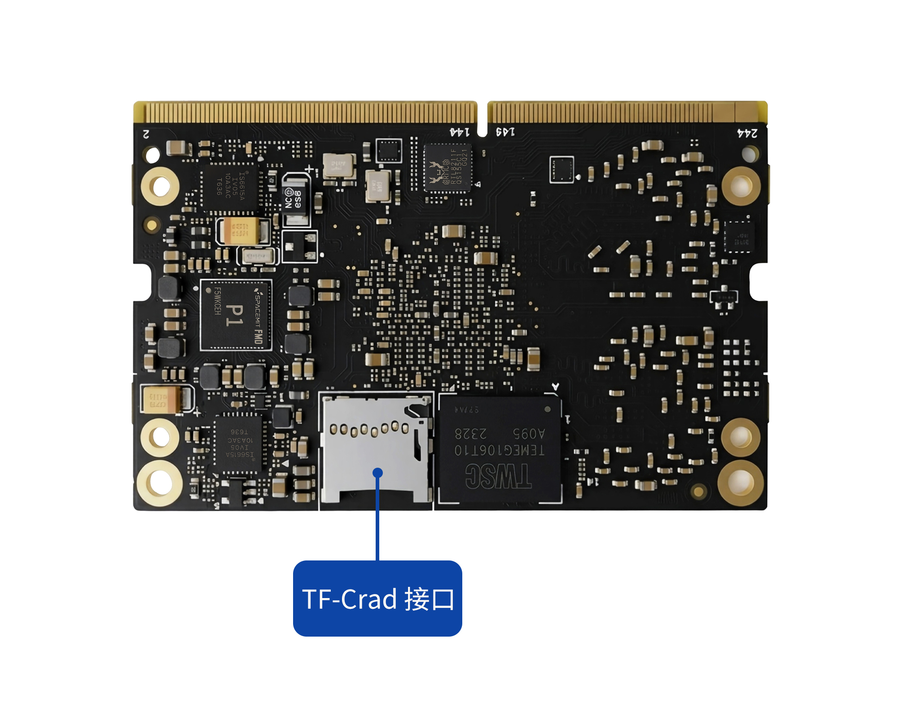

M.2 M-Key Interface
~~~~~~~~~~~~~~~~~~~

The K3 CoM260 Development Kit provides 2 × M.2 M-Key interfaces, supporting NVMe SSD in 2280 (the longer one, SSD, in the figure) and 2230 (the shorter one, SSD, in the figure) specifications, respectively, for easy connection to SSD and other M.2 M-Key devices.

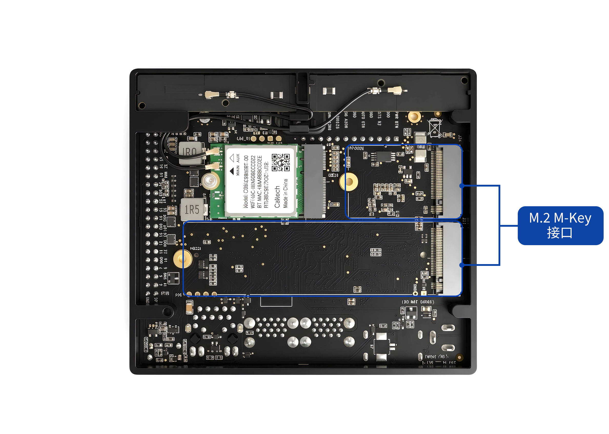

CAN FD Interface
~~~~~~~~~~~~~~~~

The K3 CoM260 Development Kit features an onboard CAN transceiver, enabling direct connection to CAN devices.

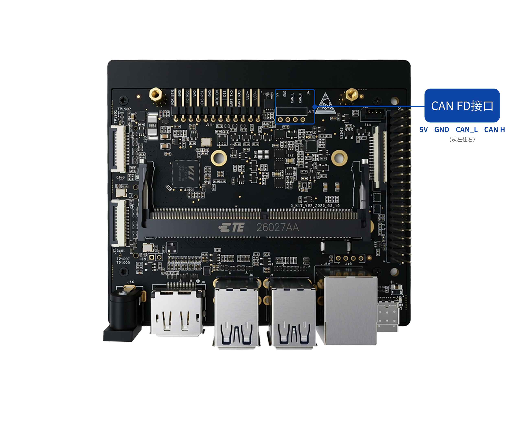
