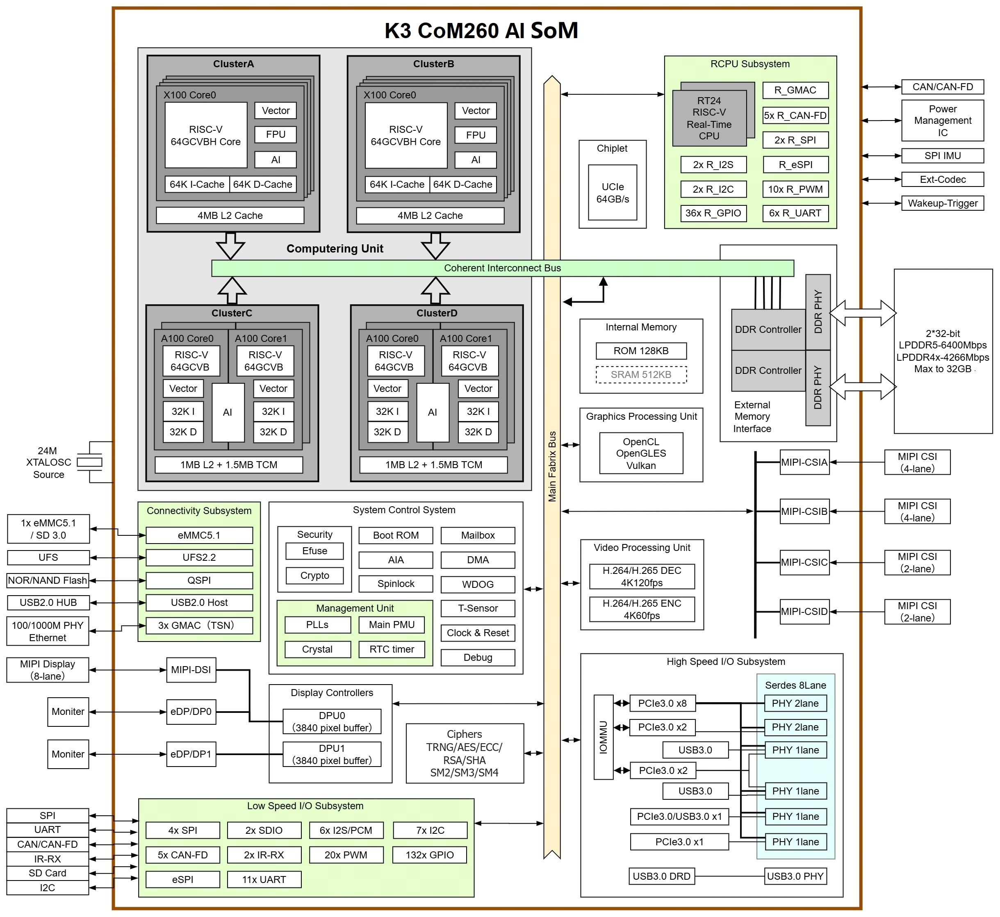

.. raw:: html

   

Platform Introduction
=====================

Click to download the `K3 CoM260 Development Kit User Guide (PDF) <https://cdn-resource.spacemit.com/file/product/K3/k3_com260_ug_zh.pdf>`_.

Product Overview
----------------

K3- CoM260 is the first Gold Finger package product launched by Jintie Spacetime, integrating RISC-V AI, CPU chip K3, LPDDR5 chip, GPHY chip, and passive components, etc.

K3- CoM260 supports a variety of operating systems and development kits, including Jindian's native Bianbu system, Ubuntu operating system, Linux, OpenHarmony, etc., and comes with an AI full-stack development kit to meet diverse AI development needs.

The K3- CoM260 offers a wide range of interfaces, including MIPI-DSI, MIPI-CSI, DP 1.2, SDIO 3.0, eSPI, SPI, I2S, I2C, CAN-FD, PWM, UART, USB 2.0, USB 3.0, PCIe 3.0, GMAC, and more. With its high performance and extensive Interface Resources, the K3- CoM260 is the superior choice for RISC-V edge-side application solutions and product development.

Target Applications
-------------------

#. AI Edge Computing

#. Large Model Inference All-in-One Machine

#. ai robot

#. Product Block Diagram

Main characteristics
--------------------

#. Outstanding CPU performance: 8 high-performance computing big cores X100 combined with 8 AI cores A100, delivering over 130 KDMIPS of CPU computing power. X100 Single-core SPECint2006 > 9.0 /GHz, maximum clock speed of 2.4 GHz.

#. Homogeneous and integrated AI computing power: Provides 60 TOPS AI computing power, offering robust general-purpose AI computing power through ultra-wide parallel computing AI cores, enabling rapid integration with all mainstream AI ecosystems. 7B local large model computing power > 10 Tokens /s。

#. The latest RISC-V architecture with super parallel computing capabilities: A100 supports up to 1024-bit RVV 1.0 parallel computing and the latest RVA23 Profile and Vector Crypto standards.

#. Abundant I /O expansion interfaces: Integrates multiple sets of high-speed expansion interfaces to flexibly meet various computer expansion needs: 8 lanes PCIe, 3 sets of USB 3.0, 1 set of GMAC, etc.

#. Full hardware virtualization: Full hardware virtualization technology that supports RV Hypervisor 1.0 extensions, RV AIA extensions, and RV IOMMU extensions, providing full hardware virtualization for CPU, memory, interrupts, and I /O.

#. Higher-level security defense technology support: M /S/U three processor privileges; supports hardware resistance to Spectre, Meltdown, and other attacks; supports GM/T 2, 3, and 4 hardware security technologies.

#. Compliance with industrial-grade standards: The CPU core, multi-level cache, and SRAM support ECC design can still provide stable and reliable continuous computing power output at ambient temperatures ranging from -40˚C to 85˚C, meeting the stringent environmental requirements of industrial applications.

Processor Block Diagram
-----------------------

