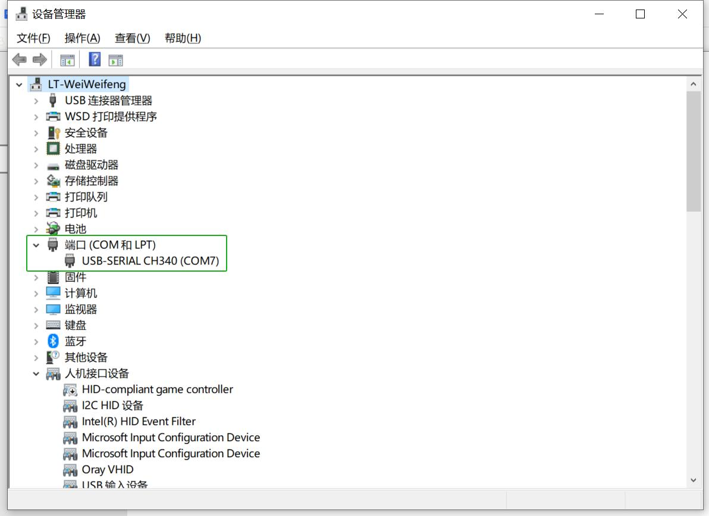
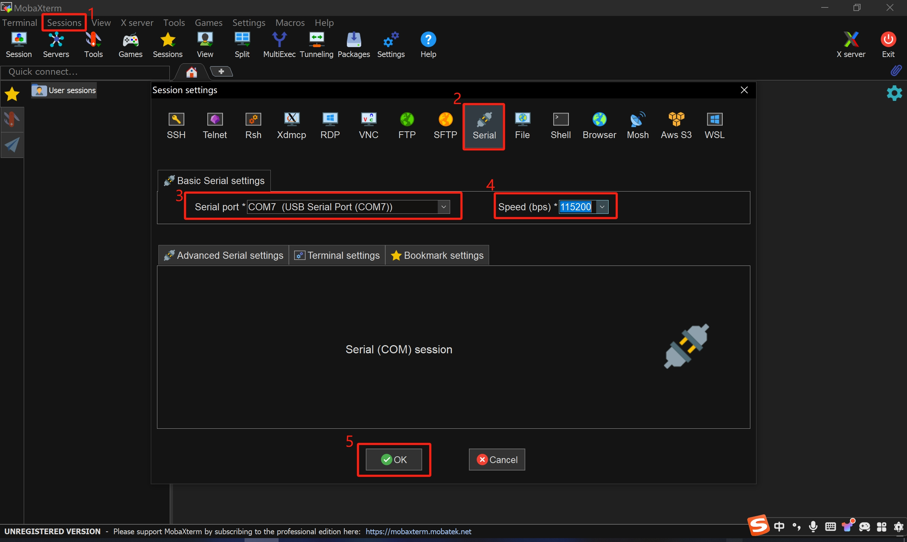

.. raw:: html

   

Test Guide
==========

Interface Connection
--------------------

Please correctly connect the host computer to the TX, RX, and GND of the 12-pin interface of the K3- CoM260 carrier board via the USB to TTL device. The interface signals are shown in the figure below:

.. image:: ../../../image/MYZR-进迭时空/MYZR-K3-CoM260/接口连接.jpeg
   :alt: 接口连接.jpeg
   :width: 100%

Windows Debugging
-----------------

The following is an example of the steps using MobaXterm:

Please first connect the hardware serial port correctly and confirm in the "Ports" section of the Windows Device Manager that the system has recognized the corresponding COM port (as shown in the figure).

#. Open the MobaXterm software and select Sessions → New Session.

#. In the pop-up dialog box, select Serial.

#. In the Serial port drop-down menu, select the identified COM port.

#. Set Speed to 115200.

#. Click OK to enter the serial port log output page.

Notes
-----

The K3 CoM260 is suitable for laboratory or engineering environments. Before starting operation, please read the following precautions carefully:

#. Under no circumstances should hot-swapping be performed on the screen interface, the CSI interface, or the expansion board.

#. Before unpacking and installation, please take necessary anti-static measures to avoid damage to the Development Board hardware due to electrostatic discharge (ESD).

#. When handling the Development Board, hold the edges of the board and avoid touching the exposed metal parts on the board to prevent electrostatic damage to the components on the board.

#. Please place the Development Board on a dry, level surface and ensure that it is kept away from heat sources, sources of electromagnetic interference, radiation sources, and devices sensitive to electromagnetic radiation (such as medical equipment), etc.
