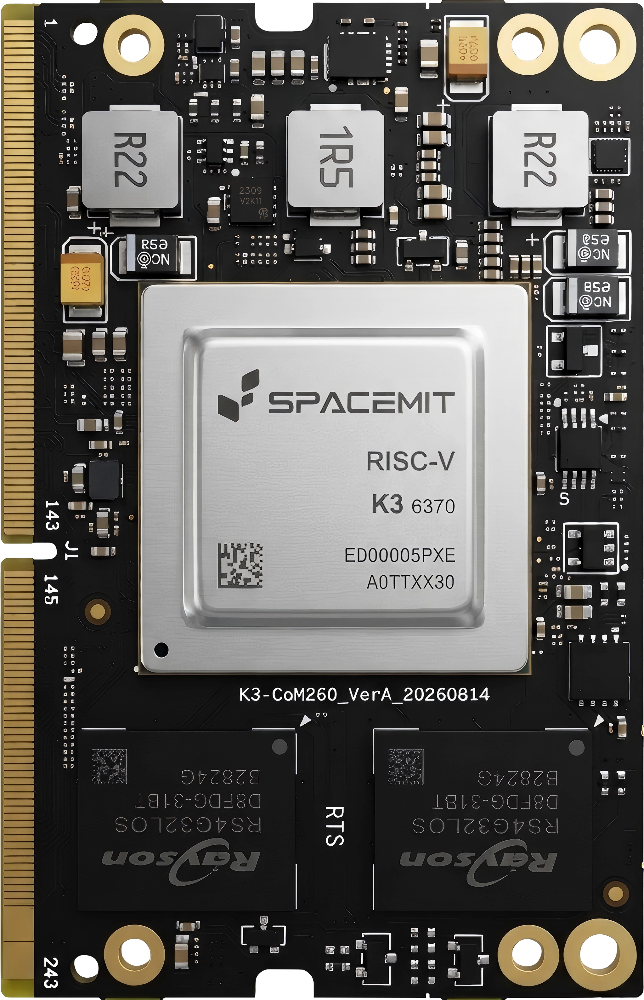
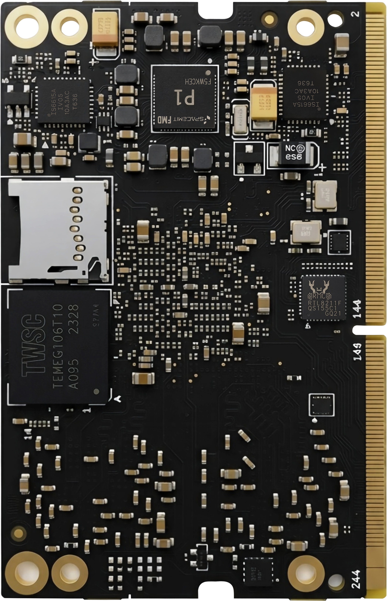
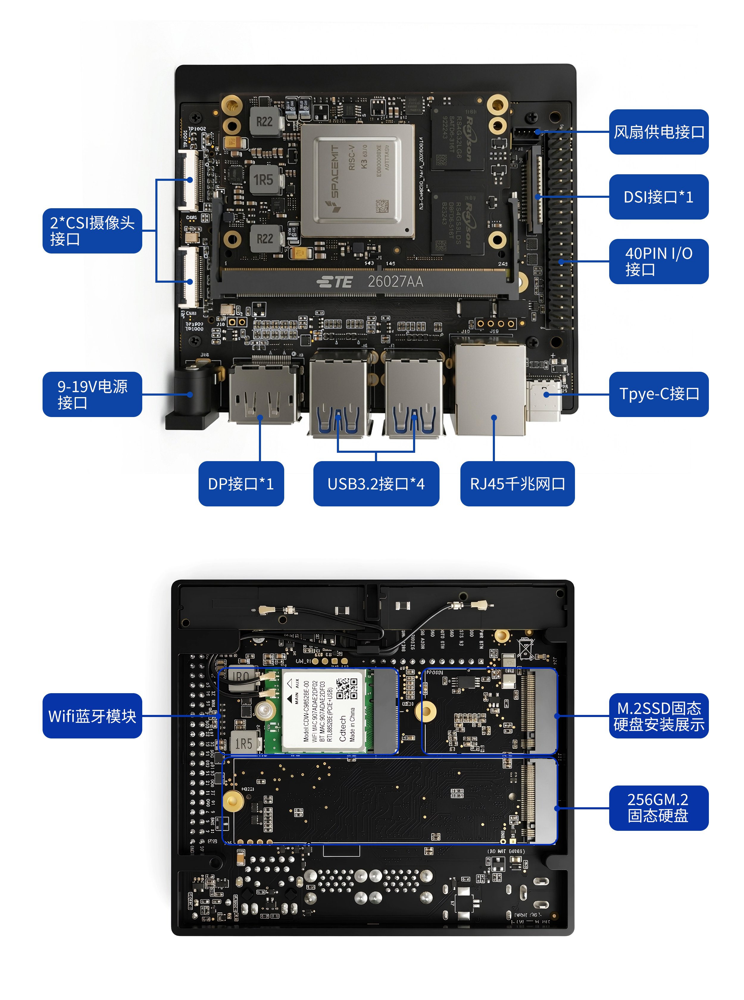
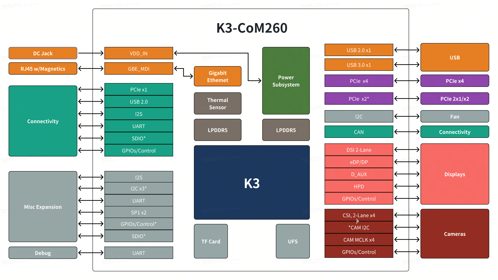

.. raw:: html

   

产品介绍
========

产品规格
--------

.. raw:: html

   

+--------------+--------------------------------------------------------------------------+
| 模块         | 描述                                                                     |
+==============+==========================================================================+
| 芯片         | SpacemiT K3 RISC-V AI 芯片                                               |
+--------------+--------------------------------------------------------------------------+
| CPU          | 8 核 X100™ 64 位 RISC-V CPU                                              |
|              | - 2 Clusters x 4 Cores/Cluster，每个 Cluster 拥有 4MB L2 共享缓存，并可  |
|              | 跨 Cluster 访问                                                          |
|              | - 每个 X100 核具有 64KB I-Cache、64KB D-Cache                            |
|              | - 支持 RVA23 profile 标准                                                |
|              | - 支持 RVV1.0，VLEN：256bit                                              |
+--------------+--------------------------------------------------------------------------+
| AI 性能      | 8 核 A100™ AI 核心，提供 60 TOPS AI 算力                                 |
|              | - 2 Clusters x 4 Cores/Cluster，每个 Cluster 内拥有 1MB L2 共享缓存和 1. |
|              | 5MB 专用加速缓存（TCM），并可跨 Cluster 访问                             |
|              | - 每个 A100 核具有 32KB I-Cache、32KB D-Cache                            |
|              | - 支持 RVV1.0，VLEN：1024bit                                             |
+--------------+--------------------------------------------------------------------------+
| 硬件安全引擎 | 支持国际通用密码算法及中国商用密码算法                                   |
|              | - 哈希算法：SHA1 / SHA224 / SHA256、SM3                                  |
|              | - 对称加密算法：AES-128/192/256、SM4                                     |
|              | - 非对称加密算法：RSA-1024/2048/4096、ECC-128/256/512、SM2               |
+--------------+--------------------------------------------------------------------------+
| 安全系统方案 | 支持基于 HW-RoT 的 Secure Boot                                           |
|              | 支持 RISC-V 架构（PMP/IOPMP 隔离机制）的 TEE 可信计算                    |
|              | 支持 OP-TEE 安全操作系统                                                 |
+--------------+--------------------------------------------------------------------------+
| GPU          | 集成 3D-GPU，支持 Vulkan、OpenCL、OpenGLES                               |
+--------------+--------------------------------------------------------------------------+
| 内存         | 8GB/16GB/32GB 64 位 LPDDR5、6400MT/s                                     |
+--------------+--------------------------------------------------------------------------+
| 存储         | 支持内部 UFS、SD 卡插槽及外置 NVMe                                       |
+--------------+--------------------------------------------------------------------------+
| 视频编码     | 4K60（H.264/H.265）                                                      |
+--------------+--------------------------------------------------------------------------+
| 视频解码     | 1 x 4K120 (H.264/H.265/VP9)                                              |
|              | 2 x 4K60 (H.264/H.265/VP9)                                               |
|              | 8 x 1080p60 (H.264/H.265/VP9)                                            |
|              | 16 x 1080p30 (H.264/H.265/VP9)                                           |
+--------------+--------------------------------------------------------------------------+
| 功耗         | 18W ~ 35W                                                                |
+--------------+--------------------------------------------------------------------------+

核心板正反面
------------

.. raw:: html

    

.. raw:: html

    

实物接口图
----------

功能接口
--------

.. raw:: html

   

+-------------------------+---------------+
| 功能                    | 可用（是/否） |
+=========================+===============+
| 2×LPDDR5 (4GB/8GB/16GB) | 是            |
+-------------------------+---------------+
| UFS (128GB)             | 是            |
+-------------------------+---------------+
| SPI FLASH               | 是            |
+-------------------------+---------------+
| DC Jack                 | 是            |
+-------------------------+---------------+
| DP 1.2 OUT              | 是            |
+-------------------------+---------------+
| MIPI DSI                | 是            |
+-------------------------+---------------+
| MIPI CSI                | 是            |
+-------------------------+---------------+
| SD-Card                 | 是            |
+-------------------------+---------------+
| Wi-Fi & BT              | 是            |
+-------------------------+---------------+
| Gbe                     | 是            |
+-------------------------+---------------+
| 2 × M.2 M-KEY           | 是            |
+-------------------------+---------------+
| 2 × USB 3.0 Type-A Dual | 是            |
+-------------------------+---------------+
| 40 Pin                  | 是            |
+-------------------------+---------------+
| 12 Pin                  | 是            |
+-------------------------+---------------+
| FAN                     | 是            |
+-------------------------+---------------+
| CAN                     | 否            |
+-------------------------+---------------+
| RTC                     | 否            |
+-------------------------+---------------+

模块框图
--------

K3-CoM260 模块框图如下图所示。

接口定义
--------

下表列出了 K3-CoM260 的主要接口及其相关特性。

MIPI_DSI
^^^^^^^^

.. raw:: html

   

+-----------------------------+------+-------------------+
| 信号名称                    | 类型 | 描述              |
+=============================+======+===================+
| MIPI\_DSI1\_LANEx\_DP[1:0]  | O    | DSI1 DATA LANE ±  |
+-----------------------------+------+-------------------+
| MIPI\_DSI1\_LANEx\_DNx[1:0] | O    | DSI1 DATA LANE ±  |
+-----------------------------+------+-------------------+
| MIPI\_DSI1\_CLKP            | O    | DSI1 Clock LANE ± |
+-----------------------------+------+-------------------+
| MIPI\_DSI1\_CLKN            | O    | DSI1 Clock LANE ± |
+-----------------------------+------+-------------------+

MIPI_CSI
^^^^^^^^

.. raw:: html

   

+-----------------------+------+------------------+
| 信号名称              | 类型 | 描述             |
+=======================+======+==================+
| MIPI\_CSI0\_DPx[1:0]  | I    | CSI0 DATA LANE ± |
+-----------------------+------+------------------+
| MIPI\_CSI0\_DNx[1:0]  | I    | CSI0 DATA LANE ± |
+-----------------------+------+------------------+
| MIPI\_CSI1\_DPx[3:0]  | I    | CSI1 DATA LANE ± |
+-----------------------+------+------------------+
| MIPI\_CSI1\_DNx[3:0]  | I    | CSI1 DATA LANE ± |
+-----------------------+------+------------------+
| MIPI\_CSI2\_DPx[1:0]  | I    | CSI2 DATA LANE ± |
+-----------------------+------+------------------+
| MIPI\_CSI2\_DNx[1:0]  | I    | CSI2 DATA LANE ± |
+-----------------------+------+------------------+
| MIPI\_CSI3\_DxP[1:0]  | I    | CSI3 DATA LANE ± |
+-----------------------+------+------------------+
| MIPI\_CSI3\_DxN[1:0]  | I    | CSI3 DATA LANE ± |
+-----------------------+------+------------------+
| MIPI\_CSIx\_CLKN[3:0] | O    | CSI Clock LANE ± |
+-----------------------+------+------------------+
| MIPI\_CSIx\_CLKP[3:0] | O    | CSI Clock LANE ± |
+-----------------------+------+------------------+

DP 1.2
^^^^^^

.. raw:: html

   

+-----------------+------+-----------------------+
| 信号名称        | 类型 | 描述                  |
+=================+======+=======================+
| EDP1\_TXxN[3:0] | O    | EDP1 DATA LANE ±      |
+-----------------+------+-----------------------+
| EDP1\_TXxP[3:0] | O    |                       |
+-----------------+------+-----------------------+
| DP1\_AUXN       | O    | EDP1 Auxiliary LANE ± |
+-----------------+------+-----------------------+
| DP1\_AUXP       | O    |                       |
+-----------------+------+-----------------------+

eMMC
^^^^

.. raw:: html

   

+---------------+------+------------------+
| 信号名称      | 类型 | 描述             |
+===============+======+==================+
| EMMC\_Dx[7:0] | I/O  | eMMC DATA        |
+---------------+------+------------------+
| EMMC\_CLK     | I/O  | eMMC Clock       |
+---------------+------+------------------+
| EMMC\_CMD     | I/O  | eMMC command     |
+---------------+------+------------------+
| EMMC\_DS      | I/O  | eMMC data strobe |
+---------------+------+------------------+

SDIO 3.0
^^^^^^^^

.. raw:: html

   

+-----------------+------+-----------------+
| 信号名称        | 类型 | 描述            |
+=================+======+=================+
| MMC1\_DATx[3:0] | I/O  | SD Card DATA    |
+-----------------+------+-----------------+
| MMC1\_CLK       | I/O  | SD Card Clock   |
+-----------------+------+-----------------+
| MMC1\_CMD       | I/O  | SD Card Command |
+-----------------+------+-----------------+
| MMC2\_DATx[3:0] | I/O  | SDIO DATA       |
+-----------------+------+-----------------+
| MMC2\_CLK       | I/O  | SDIO Clock      |
+-----------------+------+-----------------+
| MMC2\_CMD       | I/O  | SDIO Command    |
+-----------------+------+-----------------+

eSPI I/O
^^^^^^^^

.. raw:: html

   

+----------------+------+--------------------------------------------------------------------------+
| 信号名称       | 类型 | 描述                                                                     |
+================+======+==========================================================================+
| ESPI0\_Dx[3:0] | I/O  | Four data lines for command, address, and data transfer.                 |
|                |      | Operates in single-, dual-, or quad-I/O modes depending on configuration |
|                |      | .                                                                        |
+----------------+------+--------------------------------------------------------------------------+
| ESPI0\_CS0     | I    | Chip Select, active low.                                                 |
|                |      | Used by the master to select a specific slave device.                    |
+----------------+------+--------------------------------------------------------------------------+
| ESPI0\_CLK     | I    | eSPI clock signal generated by the master.                               |
|                |      | Synchronizes data transfer between master and slave.                     |
+----------------+------+--------------------------------------------------------------------------+

SPI
^^^

.. raw:: html

   

+-----------------+------+--------------------------------------------------------------------------+
| 信号名称        | 类型 | 描述                                                                     |
+=================+======+==========================================================================+
| SPix[2:0]\_SCLK | I/O  | Synchronous Serial Port Clock 0/2                                        |
|                 |      | The serial bit clock can be configured as an output (master mode operati |
|                 |      | on) or an input (slave mode operation).                                  |
+-----------------+------+--------------------------------------------------------------------------+
| SPix[2:0]\_FRM  | I/O  | Synchronous Serial Port Frame 0/2                                        |
|                 |      | The serial frame sync can be configured as an output (master mode operat |
|                 |      | ion) or an input (slave mode operation).                                 |
+-----------------+------+--------------------------------------------------------------------------+
| SPix[2:0]\_TXD  | O    | Synchronous Serial Port Transmit Data 0/2                                |
|                 |      | Serial data driven out synchronously with the bit clock.                 |
+-----------------+------+--------------------------------------------------------------------------+
| SPix[2:0]\_RXD  | I    | Synchronous Serial Port Receive Data 0/2                                 |
|                 |      | Serial data latched using the bit clock.                                 |
+-----------------+------+--------------------------------------------------------------------------+
| R.SPI0\_SCLK    | I/O  | RT24 Synchronous Serial Port Clock 0/2                                   |
|                 |      | The serial bit clock can be configured as an output (master mode operati |
|                 |      | on) or an input (slave mode operation).                                  |
+-----------------+------+--------------------------------------------------------------------------+
| R.SPI0\_FRM     | I/O  | RT24 Synchronous Serial Port Frame 0/2                                   |
|                 |      | The serial frame sync can be configured as an output (master mode operat |
|                 |      | ion) or an input (slave mode operation).                                 |
+-----------------+------+--------------------------------------------------------------------------+
| R.SPI0\_TXD     | O    | RT24 Synchronous Serial Port Transmit Data 0/2                           |
|                 |      | Serial data driven out synchronously with the bit clock.                 |
+-----------------+------+--------------------------------------------------------------------------+
| R.SPI0\_RXD     | I    | RT24 Synchronous Serial Port Receive Data 0/2                            |
|                 |      | Serial data latched using the bit clock.                                 |
+-----------------+------+--------------------------------------------------------------------------+

I2S
^^^

.. raw:: html

   

+-----------------+------+----------------------------+
| 信号名称        | 类型 | 描述                       |
+=================+======+============================+
| I2S0\_SCLK      | I/O  | I2S Continues Serial Clock |
+-----------------+------+----------------------------+
| I2S0\_LRCK      | I/O  | I2S Left–Right Clock       |
+-----------------+------+----------------------------+
| I2S0\_TXD       | O    | I2S Serial Transmit Data   |
+-----------------+------+----------------------------+
| I2S0\_RXD       | I    | I2S Serial Receive Data    |
+-----------------+------+----------------------------+
| I2Sx[5:2]\_SCLK | I/O  | I2S Continues Serial Clock |
+-----------------+------+----------------------------+
| I2Sx[5:2]\_LRCK | I/O  | I2S Left–Right Clock       |
+-----------------+------+----------------------------+
| I2Sx[5:2]\_TXD  | O    | I2S Serial Transmit Data   |
+-----------------+------+----------------------------+
| I2Sx[5:2]\_RXD  | I    | I2S Serial Receive Data    |
+-----------------+------+----------------------------+

I2C
^^^

.. raw:: html

   

+------------------+------+------------------------------+
| 信号名称         | 类型 | 描述                         |
+==================+======+==============================+
| I2Cx[6:0]\_SDA   | I/O  | I2C Serial Data              |
+------------------+------+------------------------------+
| I2Cx[6:0]\_SCL   | I/O  | I2C Serial Clock             |
+------------------+------+------------------------------+
| R.I2Cx[1:0]\_SDA | I/O  | RT24 domain I2C Serial Data  |
+------------------+------+------------------------------+
| R.I2Cx[1:0]\_SCL | I/O  | RT24 domain I2C Serial Clock |
+------------------+------+------------------------------+

CAN-FD
^^^^^^

.. raw:: html

   

+---------------+------+-------------------------------+
| 信号名称      | 类型 | 描述                          |
+===============+======+===============================+
| CANx[4:0]\_TX | O    | CAN Transmit Data             |
+---------------+------+-------------------------------+
| CANx[4:0]\_RX | I    | CAN Receive Data              |
+---------------+------+-------------------------------+
| R.CAN0\_TX    | O    | RT24 domain CAN Transmit Data |
+---------------+------+-------------------------------+
| R.CAN0\_RX    | I    | RT24 domain CAN Receive Data  |
+---------------+------+-------------------------------+
| R.CAN2\_TX    | O    | RT24 domain CAN Transmit Data |
+---------------+------+-------------------------------+
| R.CAN2\_RX    | I    | RT24 domain CAN Receive Data  |
+---------------+------+-------------------------------+

FAN
^^^

.. raw:: html

   

+----------+------+----------------------------+
| 信号名称 | 类型 | 描述                       |
+==========+======+============================+
| PWM      | O    | FAN Pulse-width modulation |
+----------+------+----------------------------+
| TACH     | I    | FAN Tachometer             |
+----------+------+----------------------------+

UART
^^^^

.. raw:: html

   

+---------------------+------+--------------------------------+
| 信号名称            | 类型 | 描述                           |
+=====================+======+================================+
| UART0\_TXD          | O    | DEBUG UART Transmit Data       |
+---------------------+------+--------------------------------+
| UART0\_RXD          | I    | DEBUG UART Receive Data        |
+---------------------+------+--------------------------------+
| UART1\_TXD          | O    | UART1 Transmit Data            |
+---------------------+------+--------------------------------+
| UART1\_RXD          | I    | UART1 Receive Data             |
+---------------------+------+--------------------------------+
| UART1\_CTS\_N       | I    | UART1 Clear-to-Send            |
+---------------------+------+--------------------------------+
| UART1\_RTS\_N       | O    | UART1 Request-to-Send          |
+---------------------+------+--------------------------------+
| UARTx[10:3]\_TXD    | O    | UART Transmit Data             |
+---------------------+------+--------------------------------+
| UARTx[10:3]\_RXD    | I    | UART Receive Data              |
+---------------------+------+--------------------------------+
| UARTx[10:3]\_CTS\_N | I    | UART Clear-to-Send             |
+---------------------+------+--------------------------------+
| UARTx[10:3]\_RTS\_N | O    | UART Request-to-Send           |
+---------------------+------+--------------------------------+
| R.UART0\_TXD        | O    | RT24 domain UART Transmit Data |
+---------------------+------+--------------------------------+
| R.UART0\_RXD        | I    | RT24 domain UART Receive Data  |
+---------------------+------+--------------------------------+
| R.UARTx[5:2]\_TXD   | O    | RT24 domain UART Transmit Data |
+---------------------+------+--------------------------------+
| R.UARTx[5:2]\_RXD   | I    | RT24 domain UART Receive Data  |
+---------------------+------+--------------------------------+

GPIO
^^^^

.. raw:: html

   

+-----------------+------+------------------+
| 信号名称        | 类型 | 描述             |
+=================+======+==================+
| GPIO[1]/[4]     | I/O  | 3.3V GPIO domain |
+-----------------+------+------------------+
| GPIO[2]/[3]/[5] | I/O  | 1.8V GPIO domain |
+-----------------+------+------------------+

USB 2.0
^^^^^^^

.. raw:: html

   

+-----------------------+------+--------------------------------------+
| 信号名称              | 类型 | 描述                                 |
+=======================+======+======================================+
| USB20\_A\_DRD\_USB\_M | I/O  | DOWNLOAD USB D±, usually for USB 2.0 |
+-----------------------+------+--------------------------------------+
| USB20\_A\_DRD\_USB\_P | I/O  |                                      |
+-----------------------+------+--------------------------------------+

USB 3.0
^^^^^^^

.. raw:: html

   

+-----------------------+------+---------------------------------------+
| 信号名称              | 类型 | 描述                                  |
+=======================+======+=======================================+
| USB20\_A\_DRD\_USB\_M | I/O  | DOWNLOAD USB D±, usually for Download |
+-----------------------+------+---------------------------------------+
| USB20\_A\_DRD\_USB\_P | I/O  |                                       |
+-----------------------+------+---------------------------------------+
| USB\_DRD\_RXxN[1:0]   | I/O  | USB 3.0 Receive Data ± for Download   |
+-----------------------+------+---------------------------------------+
| USB\_DRD\_RXxP[1:0]   | I/O  |                                       |
+-----------------------+------+---------------------------------------+
| USB\_DRD\_TXxN[1:0]   | I/O  | USB 3.0 Transmit Data ± for Download  |
+-----------------------+------+---------------------------------------+
| USB\_DRD\_TXxP[1:0]   | I/O  |                                       |
+-----------------------+------+---------------------------------------+

PCIe 3.0
^^^^^^^^

.. raw:: html

   

+-----------------+------+----------------------------------------------------+
| 信号名称        | 类型 | 描述                                               |
+=================+======+====================================================+
| PCIE\_RXxN[1:0] | I/O  | PCIe Receive Data ±, usually for PCIeB, PCIeC      |
+-----------------+------+----------------------------------------------------+
| PCIE\_RXxP[1:0] | I/O  |                                                    |
+-----------------+------+----------------------------------------------------+
| PCIE\_TXxN[1:0] | I/O  | PCIe Transmit Data ±, usually for PCIeB, PCIeC     |
+-----------------+------+----------------------------------------------------+
| PCIE\_TXxP[1:0] | I/O  |                                                    |
+-----------------+------+----------------------------------------------------+
| PCIE\_REFCLK\_N | I/O  | PCIe Clock LANE ±, usually for PCIeA, PCIeB, PCIeC |
+-----------------+------+----------------------------------------------------+
| PCIE\_REFCLK\_P | I/O  |                                                    |
+-----------------+------+----------------------------------------------------+

GMAC
^^^^

.. raw:: html

   

+--------------------+------+-------------------------------------+
| 信号名称           | 类型 | 描述                                |
+====================+======+=====================================+
| GMAC1\_RXDV        | I    | GMAC1 Receive Data Valid            |
+--------------------+------+-------------------------------------+
| GMAC1\_RX\_Dx[3:0] | I    | GMAC1 Receive Data                  |
+--------------------+------+-------------------------------------+
| GMAC1\_RX\_CLK     | I    | GMAC1 Receive Clock                 |
+--------------------+------+-------------------------------------+
| GMAC1\_TX\_Dx[3:0] | O    | GMAC1 Transmit Data                 |
+--------------------+------+-------------------------------------+
| GMAC1\_TX\_EN      | O    | GMAC1 Transmit Data Enable          |
+--------------------+------+-------------------------------------+
| GMAC1\_MDC         | I/O  | GMAC1 Configuration interface clock |
+--------------------+------+-------------------------------------+
| GMAC1\_MDIO        | I/O  | GMAC1 Configuration interface I/O   |
+--------------------+------+-------------------------------------+
| GMAC1\_INT\_N      | I/O  | GMAC1 Interrupt                     |
+--------------------+------+-------------------------------------+

引脚定义
--------

引脚封装

本节详细介绍了 K3-CoM260 的引脚封装信息。

K3-CoM260 模块采用以下封装规格：

#. 接口：金手指（260 Pin，SODIMM）

#. 尺寸：69.6 mm × 45.0 mm × 1.2 mm

#. 引脚间距（Pitch）：0.5 mm

下表提供了 K3-CoM260 的引脚布局。

.. raw:: html

   

+----------------------------------------------+---------+---------+--------------------------------------------------------------------------+
| Pin name                                     | Pin No. | Pin No. | Pin Name                                                                 |
+==============================================+=========+=========+==========================================================================+
| GND                                          | 1       | 2       | GND                                                                      |
+----------------------------------------------+---------+---------+--------------------------------------------------------------------------+
| MIPI\_CSI0\_DN0                              | 3       | 4       | MIPI\_CSI1\_DN0                                                          |
+----------------------------------------------+---------+---------+--------------------------------------------------------------------------+
| MIPI\_CSI0\_DP0                              | 5       | 6       | MIPI\_CSI1\_DP0                                                          |
+----------------------------------------------+---------+---------+--------------------------------------------------------------------------+
| GND                                          | 7       | 8       | GND                                                                      |
+----------------------------------------------+---------+---------+--------------------------------------------------------------------------+
| MIPI\_CSI0\_CLKN                             | 9       | 10      | MIPI\_CSI1\_CLKN                                                         |
+----------------------------------------------+---------+---------+--------------------------------------------------------------------------+
| MIPI\_CSI0\_CLKP                             | 11      | 12      | MIPI\_CSI1\_CLKP                                                         |
+----------------------------------------------+---------+---------+--------------------------------------------------------------------------+
| GND                                          | 13      | 14      | GND                                                                      |
+----------------------------------------------+---------+---------+--------------------------------------------------------------------------+
| MIPI\_CSI0\_DN1                              | 15      | 16      | MIPI\_CSI1\_DN1                                                          |
+----------------------------------------------+---------+---------+--------------------------------------------------------------------------+
| MIPI\_CSI0\_DP1                              | 17      | 18      | MIPI\_CSI1\_DP1                                                          |
+----------------------------------------------+---------+---------+--------------------------------------------------------------------------+
| GND                                          | 19      | 20      | GND                                                                      |
+----------------------------------------------+---------+---------+--------------------------------------------------------------------------+
| MIPI\_CSI2\_DN2                              | 21      | 22      | MIPI\_CSI2\_DN0                                                          |
+----------------------------------------------+---------+---------+--------------------------------------------------------------------------+
| MIPI\_CSI2\_DP2                              | 23      | 24      | MIPI\_CSI2\_DP0                                                          |
+----------------------------------------------+---------+---------+--------------------------------------------------------------------------+
| GND                                          | 25      | 26      | GND                                                                      |
+----------------------------------------------+---------+---------+--------------------------------------------------------------------------+
| MIPI\_CSI3\_CLKN                             | 27      | 28      | MIPI\_CSI2\_CLKN                                                         |
+----------------------------------------------+---------+---------+--------------------------------------------------------------------------+
| MIPI\_CSI3\_CLKP                             | 29      | 30      | MIPI\_CSI2\_CLKP                                                         |
+----------------------------------------------+---------+---------+--------------------------------------------------------------------------+
| GND                                          | 31      | 32      | GND                                                                      |
+----------------------------------------------+---------+---------+--------------------------------------------------------------------------+
| MIPI\_CSI2\_DN3                              | 33      | 34      | MIPI\_CSI2\_DN1                                                          |
+----------------------------------------------+---------+---------+--------------------------------------------------------------------------+
| MIPI\_CSI2\_DP3                              | 35      | 36      | MIPI\_CSI2\_DP1                                                          |
+----------------------------------------------+---------+---------+--------------------------------------------------------------------------+
| GND                                          | 37      | 38      | GND                                                                      |
+----------------------------------------------+---------+---------+--------------------------------------------------------------------------+
| USB\_DRD\_RX1N                               | 39      | 40      | PCIE4/USB3-D\_RX0N                                                       |
+----------------------------------------------+---------+---------+--------------------------------------------------------------------------+
| USB\_DRD\_RX1P                               | 41      | 42      | PCIE4/USB3-D\_RX0P                                                       |
+----------------------------------------------+---------+---------+--------------------------------------------------------------------------+
| GND                                          | 43      | 44      | GND                                                                      |
+----------------------------------------------+---------+---------+--------------------------------------------------------------------------+
| USB\_DRD\_TX1N                               | 45      | 46      | PCIE4/USB3-D\_TX0N                                                       |
+----------------------------------------------+---------+---------+--------------------------------------------------------------------------+
| USB\_DRD\_TX1P                               | 47      | 48      | PCIE4/USB3-D\_TX0P                                                       |
+----------------------------------------------+---------+---------+--------------------------------------------------------------------------+
| GND                                          | 49      | 50      | GND                                                                      |
+----------------------------------------------+---------+---------+--------------------------------------------------------------------------+
| USB\_DRD\_RX2N                               | 51      | 52      | PCIE4\_REFCLK\_N                                                         |
+----------------------------------------------+---------+---------+--------------------------------------------------------------------------+
| USB\_DRD\_RX2P                               | 53      | 54      | PCIE4\_REFCLK\_P                                                         |
+----------------------------------------------+---------+---------+--------------------------------------------------------------------------+
| GND                                          | 55      | 56      | GND                                                                      |
+----------------------------------------------+---------+---------+--------------------------------------------------------------------------+
| USB\_DRD\_TX2N                               | 57      | 58      | PCIE3/USB3-C\_RX0N                                                       |
+----------------------------------------------+---------+---------+--------------------------------------------------------------------------+
| USB\_DRD\_TX2P                               | 59      | 60      | PCIE3/USB3-C\_RX0P                                                       |
+----------------------------------------------+---------+---------+--------------------------------------------------------------------------+
| GND                                          | 61      | 62      | GND                                                                      |
+----------------------------------------------+---------+---------+--------------------------------------------------------------------------+
| EDP1\_TX0N                                   | 63      | 64      | PCIE3/USB3-C\_TX0N                                                       |
+----------------------------------------------+---------+---------+--------------------------------------------------------------------------+
| EDP1\_TX0P                                   | 65      | 66      | PCIE3/USB3-C\_TX0P                                                       |
+----------------------------------------------+---------+---------+--------------------------------------------------------------------------+
| GND                                          | 67      | 68      | GND                                                                      |
+----------------------------------------------+---------+---------+--------------------------------------------------------------------------+
| EDP1\_TX1N                                   | 69      | 70      | MIPI\_DSI1\_D0N                                                          |
+----------------------------------------------+---------+---------+--------------------------------------------------------------------------+
| EDP1\_TX1P                                   | 71      | 72      | MIPI\_DSI1\_D0P                                                          |
+----------------------------------------------+---------+---------+--------------------------------------------------------------------------+
| GND                                          | 73      | 74      | GND                                                                      |
+----------------------------------------------+---------+---------+--------------------------------------------------------------------------+
| EDP1\_TX2N                                   | 75      | 76      | MIPI\_DSI1\_CLKN                                                         |
+----------------------------------------------+---------+---------+--------------------------------------------------------------------------+
| EDP1\_TX2P                                   | 77      | 78      | MIPI\_DSI1\_CLKP                                                         |
+----------------------------------------------+---------+---------+--------------------------------------------------------------------------+
| GND                                          | 79      | 80      | GND                                                                      |
+----------------------------------------------+---------+---------+--------------------------------------------------------------------------+
| EDP1\_TX3N                                   | 81      | 82      | MIPI\_DSI1\_D1N                                                          |
+----------------------------------------------+---------+---------+--------------------------------------------------------------------------+
| EDP1\_TX3P                                   | 83      | 84      | MIPI\_DSI1\_D1P                                                          |
+----------------------------------------------+---------+---------+--------------------------------------------------------------------------+
| GND                                          | 85      | 86      | GND                                                                      |
+----------------------------------------------+---------+---------+--------------------------------------------------------------------------+
| GPIO[3]\_58 { GMAC2\_PPS / R.UART2\_RXD / R. | 87      | 88      | GPIO[3]\_74 { R.GMAC3\_CLK\_REF / CLK\_CAMCK2 / ESPI0\_RESETN / VCXO\_RE |
| CAN0\_TXD / PCIEC\_PERSTN / R.I2C0\_SDA / PW |         |         | Q / USB30H-1\_DRV / R.I2C0\_SCL }                                        |
| M16 }                                        |         |         |                                                                          |
+----------------------------------------------+---------+---------+--------------------------------------------------------------------------+
| GPIO[5]\_104 { SSP0\_TXD / SSP2\_TXD / USB30 | 89      | 90      | GPIO[3]\_67 { R.GMAC3\_TX\_CLK / R.GPIO[22] / R.SSP1\_FRM / CLK\_CAMCK4  |
| H-1\_DRV / CAN3\_RXD / PCIED\_PWRDET }       |         |         | / PCIEC\_PWRDET / R.PWM3 }                                               |
+----------------------------------------------+---------+---------+--------------------------------------------------------------------------+
| GPIO[5]\_106 { SSP0\_SCLK / SSP2\_SCLK / R.I | 91      | 92      | GPIO[3]\_53 { GMAC2\_TX\_EN / UART3\_CTSN / SSP0\_TXD / PCIEA\_EINT / PW |
| 2C1\_SDA / I2C3\_SDA / PCIED\_WAKEN / PWM18  |         |         | M11 }                                                                    |
| }                                            |         |         |                                                                          |
+----------------------------------------------+---------+---------+--------------------------------------------------------------------------+
| GPIO[5]\_105 { SSP0\_RXD / SSP2\_RXD / R.I2C | 93      | 94      | GPIO[1]\_02 { GMAC0\_RX\_D1 / SSPA5\_TXD / PWM2 / ESPI0\_D2 / I2C1\_SCL  |
| 1\_SCL / I2C3\_SCL / PCIED\_PERSTN / PWM17 } |         |         | }                                                                        |
+----------------------------------------------+---------+---------+--------------------------------------------------------------------------+
| GPIO[5]\_107 { SSP0\_FRM / SSP2\_FRM / R.CAN | 95      | 96      | GPIO[3]\_72 { R.GMAC3\_MDIO / SSPA4\_RXD / ESPI0\_CS / E/DP1\_HPD / DSI0 |
| 4\_TXD / USB30-0\_DIR / PCIED\_CLKREQN / PWM |         |         | \_TE }                                                                   |
| 19 }                                         |         |         |                                                                          |
+----------------------------------------------+---------+---------+--------------------------------------------------------------------------+
| GPIO[3]\_70 { R.GMAC3\_TX\_EN / SSPA4\_FRM / | 97      | 98      | EDP1\_AUXN                                                               |
| ESPI0\_D2 / IR1\_RX / MNCLK\_OUT1 / SSP3\_S  |         |         |                                                                          |
| CLK }                                        |         |         |                                                                          |
+----------------------------------------------+---------+---------+--------------------------------------------------------------------------+
| GPIO[3]\_48 { GMAC2\_TX\_D0 / UART6\_TXD / C | 99      | 100     | EDP1\_AUXP                                                               |
| AN1\_RXD / PCIEA\_AUXEN / I2C0\_SCL / PWM6 } |         |         |                                                                          |
+----------------------------------------------+---------+---------+--------------------------------------------------------------------------+
| GPIO[3]\_49 { GMAC2\_TX\_D1 / UART6\_RXD / C | 101     | 102     | GND                                                                      |
| AN1\_TXD / PCIEA\_PWRDET / I2C0\_SDA / PWM7  |         |         |                                                                          |
| }                                            |         |         |                                                                          |
+----------------------------------------------+---------+---------+--------------------------------------------------------------------------+
| GPIO[3]\_51 { GMAC2\_TX\_D2 / UART6\_RTS / C | 103     | 104     | GPIO[3]\_60 { R.GMAC3\_RX\_D0 / R.UART5\_RXD / R.SSP0\_TXD / PCIEC\_CLKR |
| AN2\_RXD / PCIEA\_ATNLED / I2C4\_SDA / PWM9  |         |         | EQN / R.I2C1\_SDA / PWM18 }                                              |
| }                                            |         |         |                                                                          |
+----------------------------------------------+---------+---------+--------------------------------------------------------------------------+
| GPIO[3]\_50 { GMAC2\_TX\_CLK / UART6\_CTS /  | 105     | 106     | GPIO[3]\_62 { R.GMAC3\_RX\_CLK / R.SSP0\_SCLK / PCIEC\_ATTN / I2C6\_SDA  |
| CAN2\_TXD / PCIEA\_MRLN / I2C4\_SCL / PWM8 } |         |         | }                                                                        |
+----------------------------------------------+---------+---------+--------------------------------------------------------------------------+
| GND                                          | 107     | 108     | GPIO[3]\_61 { R.GMAC3\_RX\_D1 / R.SSP0\_RXD / PCIEC\_PRSNT2N / I2C6\_SCL |
|                                              |         |         |  / PWM19 }                                                               |
+----------------------------------------------+---------+---------+--------------------------------------------------------------------------+
| USB20\_A\_DRD\_USB\_M                        | 109     | 110     | GPIO[3]\_63 { R.GMAC3\_RX\_D2 / R.GPIO[18] / R.SSP0\_FRM / PCIEC\_PWRCTN |
|                                              |         |         |  / I2C5\_SCL }                                                           |
+----------------------------------------------+---------+---------+--------------------------------------------------------------------------+
| USB20\_A\_DRD\_USB\_P                        | 111     | 112     | GPIO[3]\_71 { R.GMAC3\_MDC / SSPA4\_TXD / ESPI0\_D3 / R.IR0\_RX / MNCLK\ |
|                                              |         |         | _OUT2 / SSP3\_FRM }                                                      |
+----------------------------------------------+---------+---------+--------------------------------------------------------------------------+
| GND                                          | 113     | 114     | GPIO[3]\_45 { GMAC2\_RX\_CLK / UART10\_RXD / CAN0\_RXD / PCIEA\_PRSNT2N  |
|                                              |         |         | / PWM3 }                                                                 |
+----------------------------------------------+---------+---------+--------------------------------------------------------------------------+
| USB20\_B\_USB\_M                             | 115     | 116     | GPIO[3]\_75 { R.GMAC3\_PPS / CLK\_CAMCK1 / ESPI0\_ALERT / VCXO\_OUT / US |
|                                              |         |         | B30H-2\_DRV / R.I2C0\_SDA }                                              |
+----------------------------------------------+---------+---------+--------------------------------------------------------------------------+
| USB20\_B\_USB\_P                             | 117     | 118     | GPIO[5]\_122 { MMC2\_DAT[3] / SSPA1\_CLK / UART6\_TXD / R.UART0\_TXD / P |
|                                              |         |         | CIEB\_ATNLED }                                                           |
+----------------------------------------------+---------+---------+--------------------------------------------------------------------------+
| GND                                          | 119     | 120     | GPIO[3]\_44 { GMAC2\_RX\_D1 / UART10\_TXD / CAN0\_TXD / PCIEA\_CLKREQN / |
|                                              |         |         |  PWM2 }                                                                  |
+----------------------------------------------+---------+---------+--------------------------------------------------------------------------+
| USB20\_HOST\_M                               | 121     | 122     | GPIO[4]\_85 { CLK\_CAMCK3 / SSPA0\_SYSCLK / UART9\_RXD / USB30-2\_DRV /  |
|                                              |         |         | PCIEA\_AUXEN }                                                           |
+----------------------------------------------+---------+---------+--------------------------------------------------------------------------+
| USB20\_HOST\_P                               | 123     | 124     | GPIO[4]\_77 { R.SSPA0\_FRM / SSPA2\_FRM / UART8\_RXD / CAN0\_RXD / PCIEE |
|                                              |         |         | \_WAKEN / I2C0\_SDA }                                                    |
+----------------------------------------------+---------+---------+--------------------------------------------------------------------------+
| GND                                          | 125     | 126     | GPIO[3]\_57 { GMAC2\_CLK\_REF / R.UART2\_TXD / R.CAN0\_RXD / EDP0\_HPD / |
|                                              |         |         |  R.I2C0\_SCL / PWM15 }                                                   |
+----------------------------------------------+---------+---------+--------------------------------------------------------------------------+
| GPIO[3]\_59 { R.GMAC3\_RXDV / R.UART5\_TXD / | 127     | 128     | GPIO[3]\_73 { R.GMAC3\_INT\_N / SSPA4\_SYSCLK / ESPI0\_CLK / R.IR1\_RX / |
|  PCIEC\_WAKEN / R.I2C1\_SCL / PWM17 }        |         |         |  USB20\_HOST\_DRV }                                                      |
+----------------------------------------------+---------+---------+--------------------------------------------------------------------------+
| GND                                          | 129     | 130     | GPIO[5]\_103 { / SSPA3\_SYSCLK / USB20\_HOST\_DRV / CAN3\_TXD / PCIED\_A |
|                                              |         |         | UXEN / I2C1\_SDA }                                                       |
+----------------------------------------------+---------+---------+--------------------------------------------------------------------------+
| PCIE0\_RX0N                                  | 131     | 132     | GND                                                                      |
+----------------------------------------------+---------+---------+--------------------------------------------------------------------------+
| PCIE0\_RX0P                                  | 133     | 134     | PCIE0\_TX0N                                                              |
+----------------------------------------------+---------+---------+--------------------------------------------------------------------------+
| GND                                          | 135     | 136     | PCIE0\_TX0P                                                              |
+----------------------------------------------+---------+---------+--------------------------------------------------------------------------+
| PCIE0\_RX1N                                  | 137     | 138     | GND                                                                      |
+----------------------------------------------+---------+---------+--------------------------------------------------------------------------+
| PCIE0\_RX1P                                  | 139     | 140     | PCIE0\_TX1N                                                              |
+----------------------------------------------+---------+---------+--------------------------------------------------------------------------+
| GND                                          | 141     | 142     | PCIE0\_TX1P                                                              |
+----------------------------------------------+---------+---------+--------------------------------------------------------------------------+
| GPIO[4]\_87 { R.SSP0\_RXD / R.ESPI0\_D1 / UA | 143     | 144     | GND                                                                      |
| RT4\_RXD / CAN2\_RXD / PCIEA\_MRLN / PCIEB\_ |         |         |                                                                          |
| PRSNT2N }                                    |         |         |                                                                          |
+----------------------------------------------+---------+---------+--------------------------------------------------------------------------+
| GPIO[4]\_86 { R.SSP0\_TXD / R.ESPI0\_D0 / UA | 145     | 146     | GND                                                                      |
| RT4\_TXD / CAN2\_TXD / PCIEA\_PWRDET / USB30 |         |         |                                                                          |
| -0\_DIR }                                    |         |         |                                                                          |
+----------------------------------------------+---------+---------+--------------------------------------------------------------------------+
| GND                                          | 147     | 148     | PCIE1\_TX0N                                                              |
+----------------------------------------------+---------+---------+--------------------------------------------------------------------------+
| PCIE1\_RX0N                                  | 149     | 150     | PCIE1\_TX0P                                                              |
+----------------------------------------------+---------+---------+--------------------------------------------------------------------------+
| PCIE1\_RX0P                                  | 151     | 152     | GND                                                                      |
+----------------------------------------------+---------+---------+--------------------------------------------------------------------------+
| GND                                          | 153     | 154     | PCIE1\_TX1N                                                              |
+----------------------------------------------+---------+---------+--------------------------------------------------------------------------+
| PCIE1\_RX1N                                  | 155     | 156     | PCIE1\_TX1P                                                              |
+----------------------------------------------+---------+---------+--------------------------------------------------------------------------+
| PCIE1\_RX1P                                  | 157     | 158     | GND                                                                      |
+----------------------------------------------+---------+---------+--------------------------------------------------------------------------+
| GND                                          | 159     | 160     | PCIE0\_REFCLK\_N                                                         |
+----------------------------------------------+---------+---------+--------------------------------------------------------------------------+
| PCIE2/USB3-B\_RX0N                           | 161     | 162     | PCIE0\_REFCLK\_P                                                         |
+----------------------------------------------+---------+---------+--------------------------------------------------------------------------+
| PCIE2/USB3-B\_RX0P                           | 163     | 164     | GND                                                                      |
+----------------------------------------------+---------+---------+--------------------------------------------------------------------------+
| GND                                          | 165     | 166     | PCIE2/USB3-B\_TX0N                                                       |
+----------------------------------------------+---------+---------+--------------------------------------------------------------------------+
| PCIE5\_RX0N                                  | 167     | 168     | PCIE2/USB3-B\_TX0P                                                       |
+----------------------------------------------+---------+---------+--------------------------------------------------------------------------+
| PCIE5\_RX0P                                  | 169     | 170     | GND                                                                      |
+----------------------------------------------+---------+---------+--------------------------------------------------------------------------+
| GND                                          | 171     | 172     | PCIE5\_TX0N                                                              |
+----------------------------------------------+---------+---------+--------------------------------------------------------------------------+
| PCIE5\_REFCLK\_N                             | 173     | 174     | PCIE5\_TX0P                                                              |
+----------------------------------------------+---------+---------+--------------------------------------------------------------------------+
| PCIE5\_REFCLK\_P                             | 175     | 176     | GND                                                                      |
+----------------------------------------------+---------+---------+--------------------------------------------------------------------------+
| GND                                          | 177     | 178     | GPIO[3]\_42 { GMAC2\_RXDV / UART0\_TXD / PCIEA\_PERSTN / I2C0\_SCL / PWM |
|                                              |         |         | 0 }                                                                      |
+----------------------------------------------+---------+---------+--------------------------------------------------------------------------+
| GPIO[4]\_80 { R.SSPA0\_SYSCLK / SSPA2\_SYSCL | 179     | 180     | GPIO[4]\_81 { SSP0\_TXD / SSPA0\_CLK / R.UART4\_RXD / CAN3\_TXD / PCIEA\ |
| K / R.UART4\_TXD / CAN3\_RXD / PCIEA\_WAKEN  |         |         | _CLKREQN / I2C2\_SDA }                                                   |
| / I2C2\_SCL }                                |         |         |                                                                          |
+----------------------------------------------+---------+---------+--------------------------------------------------------------------------+
| GPIO[4]\_79 { R.SSPA0\_RXD / SSPA2\_RXD / UA | 181     | 182     | GPIO[4]\_78 { R.SSPA0\_TXD / SSPA2\_TXD / UART8\_CTS / PCIEE\_CLKREQN /  |
| RT8\_RTS / PCIEA\_PERSTN / I2C1\_SDA }       |         |         | I2C1\_SCL }                                                              |
+----------------------------------------------+---------+---------+--------------------------------------------------------------------------+
| GPIO[4]\_76 { R.SSPA0\_CLK / SSPA2\_CLK / UA | 183     | 184     | PHY1\_MDI0-                                                              |
| RT8\_TXD / CAN0\_TXD / PCIEE\_PERSTN / I2C0\ |         |         |                                                                          |
| _SCL }                                       |         |         |                                                                          |
+----------------------------------------------+---------+---------+--------------------------------------------------------------------------+
| GPIO[1]\_00 { GMAC0\_RXDV / SSPA5\_CLK / PWM | 185     | 186     | PHY1\_MDI0+                                                              |
| 0 / IR1\_RX / ESPI0\_D0 / I2C0\_SCL }        |         |         |                                                                          |
+----------------------------------------------+---------+---------+--------------------------------------------------------------------------+
| GPIO[1]\_01 { GMAC0\_RX\_D0 / SSPA5\_FRM / P | 187     | 188     | PHY1\_LED1/CFG\_LDO0                                                     |
| WM1 / R.IR1\_RX / ESPI0\_D1 / I2C0\_SDA }    |         |         |                                                                          |
+----------------------------------------------+---------+---------+--------------------------------------------------------------------------+
| GPIO[4]\_82 { SSP0\_TXD / SSPA0\_FRM / UART9 | 189     | 190     | PHY1\_MDI1-                                                              |
| \_CTSN / UART5\_RXD / PCIEA\_PRSNT2N / I2C3\ |         |         |                                                                          |
| _SCL }                                       |         |         |                                                                          |
+----------------------------------------------+---------+---------+--------------------------------------------------------------------------+
| GPIO[4]\_83 { SSP0\_SCLK / SSPA0\_TXD / UART | 191     | 192     | PHY1\_MDI1+                                                              |
| 9\_RTSN / UART5\_TXD / PCIEA\_ATTN / I2C3\_S |         |         |                                                                          |
| DA }                                         |         |         |                                                                          |
+----------------------------------------------+---------+---------+--------------------------------------------------------------------------+
| GPIO[5]\_113 { SSP1\_SCLK / SSPA0\_TXD / R.G | 193     | 194     | PHY1\_LED2/CFG\_LDO1                                                     |
| PIO[30] / PCIEB\_PERSTN / }                  |         |         |                                                                          |
+----------------------------------------------+---------+---------+--------------------------------------------------------------------------+
| GPIO[5]\_114 { SSP1\_FRM / SSPA0\_RXD / R.GP | 195     | 196     | PHY1\_MDI2-                                                              |
| IO[31] / PCIEB\_WAKEN / }                    |         |         |                                                                          |
+----------------------------------------------+---------+---------+--------------------------------------------------------------------------+
| GPIO[5]\_112 { SSP1\_RXD / SSPA0\_FRM / UCIE | 197     | 198     | PHY1\_MDI2+                                                              |
| \_DESDA / I2C4\_SDA / USB30-3\_DRV / R.PWM9  |         |         |                                                                          |
| }                                            |         |         |                                                                          |
+----------------------------------------------+---------+---------+--------------------------------------------------------------------------+
| GPIO[5]\_111 { SSP1\_TXD / SSPA0\_CLK / UCIE | 199     | 200     | GND                                                                      |
| \_DESCL / I2C4\_SCL / USB30-0\_INT / R.PWM8  |         |         |                                                                          |
| }                                            |         |         |                                                                          |
+----------------------------------------------+---------+---------+--------------------------------------------------------------------------+
| GND                                          | 201     | 202     | PHY1\_MDI3-                                                              |
+----------------------------------------------+---------+---------+--------------------------------------------------------------------------+
| GPIO[5]\_121 { UART1\_TXD / I2C2\_SDA / R.CA | 203     | 204     | PHY1\_MDI3+                                                              |
| N3\_RXD / CAN4\_RXD / PCIEB\_MRLN }          |         |         |                                                                          |
+----------------------------------------------+---------+---------+--------------------------------------------------------------------------+
| GPIO[5]\_120 { UART1\_RXD / I2C2\_SCL / R.CA | 205     | 206     | GPIO[5]\_123 { MMC2\_DAT[2] / SSPA1\_FRM / UART6\_RXD / R.UART0\_RXD / P |
| N3\_TXD / CAN4\_TXD / PCIEB\_PWRDET }        |         |         | CIEB\_PWRLED / }                                                         |
+----------------------------------------------+---------+---------+--------------------------------------------------------------------------+
| GPIO[5]\_118 { UART1\_RTSN / USB30\_DRD\_DRV | 207     | 208     | FAN\_TACH(1V8)                                                           |
|  / R.GPIO[35] / PCIEB\_PWRCTN }              |         |         |                                                                          |
+----------------------------------------------+---------+---------+--------------------------------------------------------------------------+
| GPIO[5]\_119 { UART1\_CTSN / USB30-0\_INT /  | 209     | 210     | PMIC\_32K\_OUT(3V3)                                                      |
| PCIEB\_AUXEN }                               |         |         |                                                                          |
+----------------------------------------------+---------+---------+--------------------------------------------------------------------------+
| GPIO[5]\_124 { MMC2\_DAT[1] / SSPA1\_TXD / P | 211     | 212     | GPIO[3]\_56 { GMAC2\_INT\_N / UART3\_TXD / SSP0\_FRM / R.UART3\_TXD / PW |
| CIED\_PERSTN / E/DP0\_HPD / PCIEB\_EINT / }  |         |         | M14 }                                                                    |
+----------------------------------------------+---------+---------+--------------------------------------------------------------------------+
| GPIO[4]\_93 { R.GPIO[25] / R.ESPI0\_ALERT /  | 213     | 214     | GPIO[3]\_69 { R.GMAC3\_TX\_D3 / SSPA4\_CLK / ESPI0\_D1 / E/DP1\_HPD / DS |
| UART0\_TXD / ESPI0\_D2 / I2C5\_SCL / R.PWM4  |         |         | I0\_TE / SSP3\_RXD }                                                     |
| }                                            |         |         |                                                                          |
+----------------------------------------------+---------+---------+--------------------------------------------------------------------------+
| GPIO[4]\_94 { R.GPIO[26] / UART0\_RXD / ESPI | 215     | 216     | GPIO[5]\_125 { MMC2\_DAT[0] / SSPA1\_RXD / PCIED\_WAKEN / E/DP1\_HPD / P |
| 0\_D3 / I2C5\_SDA / R.PWM6 }                 |         |         | CIEB\_EINTEG }                                                           |
+----------------------------------------------+---------+---------+--------------------------------------------------------------------------+
| NA                                           | 217     | 218     | GPIO[5]\_126 { MMC2\_CMD / SSPA1\_SYSCLK / PCIED\_CLKREQN / I2C5\_SCL /  |
|                                              |         |         | }                                                                        |
+----------------------------------------------+---------+---------+--------------------------------------------------------------------------+
| GPIO[1]\_03 { GMAC0\_RX\_CLK / SSPA5\_RXD /  | 219     | 220     | GPIO[5]\_101 { SSP3\_SCLK / SSPA3\_TXD / UART4\_CTS / CAN4\_RXD / PCIED\ |
| PWM3 / PCIED\_PERSTN / ESPI0\_D3 / I2C1\_SDA |         |         | _ATTN / MNCLK\_OUT1 }                                                    |
| }                                            |         |         |                                                                          |
+----------------------------------------------+---------+---------+--------------------------------------------------------------------------+
| GPIO[1]\_05 { GMAC0\_RX\_D3 / PWM5 / PCIED\_ | 221     | 222     | GPIO[5]\_102 { SSP3\_FRM / SSPA3\_RXD / UART4\_RTS / CAN4\_TXD / PCIED\_ |
| CLKREQN / ESPI0\_CLK / I2C2\_SCL }           |         |         | PWRCTN / I2C1\_SCL }                                                     |
+----------------------------------------------+---------+---------+--------------------------------------------------------------------------+
| GPIO[1]\_12 { GMAC0\_MDC / UART7\_CTSN / CAN | 223     | 224     | GPIO[5]\_100 { SSP3\_RXD / SSPA3\_FRM / UART4\_RXD / R.CAN2\_RXD / PCIED |
| 0\_RXD / PCIEC\_PERSTN / UART8\_TXD / I2C4\_ |         |         | \_PRSNT2N / CLK32K\_OUT }                                                |
| SDA }                                        |         |         |                                                                          |
+----------------------------------------------+---------+---------+--------------------------------------------------------------------------+
| GPIO[1]\_14 { GMAC0\_INT\_N / UART7\_RXD / P | 225     | 226     | GPIO[5]\_99 { SSP3\_TXD / SSPA3\_CLK / UART4\_TXD / R.CAN2\_TXD / CLK\_C |
| WM14 / PCIEC\_CLKREQN / MNCLK\_OUT1 / I2C6\_ |         |         | AMCK4 }                                                                  |
| SCL }                                        |         |         |                                                                          |
+----------------------------------------------+---------+---------+--------------------------------------------------------------------------+
| PCIE3\_REFCLK\_N                             | 227     | 228     | GPIO[5]\_127 { MMC2\_CLK / PCIED\_PRSNT2N / I2C5\_SDA / USB30-2\_DRV }   |
+----------------------------------------------+---------+---------+--------------------------------------------------------------------------+
| PCIE3\_REFCLK\_P                             | 229     | 230     | FAN\_PWM(1V8)                                                            |
+----------------------------------------------+---------+---------+--------------------------------------------------------------------------+
| GND                                          | 231     | 232     | GPIO[3]\_54 { GMAC2\_MDC / UART3\_RTSN / SSP0\_RXD / PCIEA\_EINTEG / I2C |
|                                              |         |         | 1\_SCL / PWM12 }                                                         |
+----------------------------------------------+---------+---------+--------------------------------------------------------------------------+
| GPIO[4]\_88 { R.SSP0\_SCLK / R.ESPI0\_D2 / R | 233     | 234     | GPIO[3]\_55 { GMAC2\_MDIO / UART3\_RXD / SSP0\_SCLK / R.UART3\_RXD / I2C |
| .UART3\_TXD / PCIEB\_PERSTN / PCIEA\_ATNLED  |         |         | 1\_SDA / PWM13 }                                                         |
| / CAN1\_RXD }                                |         |         |                                                                          |
+----------------------------------------------+---------+---------+--------------------------------------------------------------------------+
| VCC\_RTC(5V)                                 | 235     | 236     | PWR\_SSP\_SCLK { GPIO[122] / UART0\_TXD }                                |
+----------------------------------------------+---------+---------+--------------------------------------------------------------------------+
| POWER\_EN(5V)                                | 237     | 238     | PWR\_SSP\_FRM { GPIO[123] / UART0\_RXD }                                 |
+----------------------------------------------+---------+---------+--------------------------------------------------------------------------+
| PMIC\_RST\_OUTn(1V8)                         | 239     | 240     | GPIO[4]\_84 { SSP0\_FRM / SSPA0\_RXD / UART9\_TXD / USB30-1\_DRV / PCIEA |
|                                              |         |         | \_PWRCTN / DSI0\_TE }                                                    |
+----------------------------------------------+---------+---------+--------------------------------------------------------------------------+
| GND                                          | 241     | 242     | GND                                                                      |
+----------------------------------------------+---------+---------+--------------------------------------------------------------------------+
| GND                                          | 243     | 244     | GND                                                                      |
+----------------------------------------------+---------+---------+--------------------------------------------------------------------------+
| GND                                          | 245     | 246     | GND                                                                      |
+----------------------------------------------+---------+---------+--------------------------------------------------------------------------+
| GND                                          | 247     | 248     | GND                                                                      |
+----------------------------------------------+---------+---------+--------------------------------------------------------------------------+
| GND                                          | 249     | 250     | GND                                                                      |
+----------------------------------------------+---------+---------+--------------------------------------------------------------------------+
| VDD\_IN(20V)                                 | 251     | 252     | VDD\_IN(20V)                                                             |
+----------------------------------------------+---------+---------+--------------------------------------------------------------------------+
| VDD\_IN(20V)                                 | 253     | 254     | VDD\_IN(20V)                                                             |
+----------------------------------------------+---------+---------+--------------------------------------------------------------------------+
| VDD\_IN(20V)                                 | 255     | 256     | VDD\_IN(20V)                                                             |
+----------------------------------------------+---------+---------+--------------------------------------------------------------------------+
| VDD\_IN(20V)                                 | 257     | 258     | VDD\_IN(20V)                                                             |
+----------------------------------------------+---------+---------+--------------------------------------------------------------------------+
| VDD\_IN(20V)                                 | 259     | 260     | VDD\_IN(20V)                                                             |
+----------------------------------------------+---------+---------+--------------------------------------------------------------------------+

下表列出了 K3-CoM260 的引脚类型定义。

.. raw:: html

   

+------+----------------------------------------------+---------+----------+-----------------+-----------------------------+------------------------------------------+
| PIN  | Pin definition                               | Pin NO. | Pad Type | IO power domain | Function for K3-CoM260\_KIT | Default function description             |
+======+==============================================+=========+==========+=================+=============================+==========================================+
| 1    | GND                                          |         | G        | GND             | Digital core Ground         |                                          |
+------+----------------------------------------------+---------+----------+-----------------+-----------------------------+------------------------------------------+
| 3    | MIPI\_CSI0\_DN0                              | AE38    | I        |                 | MIPI\_CSI0\_DN0             | CSI0 DATA0 LANEN                         |
+------+----------------------------------------------+---------+----------+-----------------+-----------------------------+------------------------------------------+
| 5    | MIPI\_CSI0\_DP0                              | AE39    | I        |                 | MIPI\_CSI0\_DP0             | CSI0 DATA0 LANEP                         |
+------+----------------------------------------------+---------+----------+-----------------+-----------------------------+------------------------------------------+
| 7    | GND                                          |         | G        |                 | GND                         | Digital core Ground                      |
+------+----------------------------------------------+---------+----------+-----------------+-----------------------------+------------------------------------------+
| 9    | MIPI\_CSI0\_CLKN                             | AB39    | O        |                 | MIPI\_CSI0\_CLKN            | CSI0 Clock LANEN                         |
+------+----------------------------------------------+---------+----------+-----------------+-----------------------------+------------------------------------------+
| 11   | MIPI\_CSI0\_CLKP                             | AB40    | O        |                 | MIPI\_CSI0\_CLKP            | CSI0 Clock LANEP                         |
+------+----------------------------------------------+---------+----------+-----------------+-----------------------------+------------------------------------------+
| 13   | GND                                          |         | G        |                 | GND                         | Digital core Ground                      |
+------+----------------------------------------------+---------+----------+-----------------+-----------------------------+------------------------------------------+
| 15   | MIPI\_CSI0\_DN1                              | AD39    | I        |                 | MIPI\_CSI0\_DN1             | CSI0 DATA1 LANEN                         |
+------+----------------------------------------------+---------+----------+-----------------+-----------------------------+------------------------------------------+
| 17   | MIPI\_CSI0\_DP1                              | AD40    | I        |                 | MIPI\_CSI0\_DP1             | CSI0 DATA1 LANEP                         |
+------+----------------------------------------------+---------+----------+-----------------+-----------------------------+------------------------------------------+
| 19   | GND                                          |         | G        | GND             | Digital core Ground         |                                          |
+------+----------------------------------------------+---------+----------+-----------------+-----------------------------+------------------------------------------+
| 21   | MIPI\_CSI2\_DN2                              | V39     | I        |                 | MIPI\_CSI2\_DN2             | CSI2 DATA2 LANEN                         |
+------+----------------------------------------------+---------+----------+-----------------+-----------------------------+------------------------------------------+
| 23   | MIPI\_CSI2\_DP2                              | V40     | I        |                 | MIPI\_CSI2\_DP2             | CSI2 DATA2 LANEP                         |
+------+----------------------------------------------+---------+----------+-----------------+-----------------------------+------------------------------------------+
| 25   | GND                                          |         | G        | GND             | Digital core Ground         |                                          |
+------+----------------------------------------------+---------+----------+-----------------+-----------------------------+------------------------------------------+
| 27   | MIPI\_CSI3\_CLKN                             | W38     | O        |                 | MIPI\_CSI3\_CLKN            | CSI3 Clock LANEN                         |
+------+----------------------------------------------+---------+----------+-----------------+-----------------------------+------------------------------------------+
| 29   | MIPI\_CSI3\_CLKP                             | W39     | O        |                 | MIPI\_CSI3\_CLKP            | CSI3 Clock LANEP                         |
+------+----------------------------------------------+---------+----------+-----------------+-----------------------------+------------------------------------------+
| 31   | GND                                          |         | G        | GND             | Digital core Ground         |                                          |
+------+----------------------------------------------+---------+----------+-----------------+-----------------------------+------------------------------------------+
| 33   | MIPI\_CSI2\_DN3                              | V36     | I        |                 | MIPI\_CSI2\_DN3             | CSI2 DATA3 LANEN                         |
+------+----------------------------------------------+---------+----------+-----------------+-----------------------------+------------------------------------------+
| 35   | MIPI\_CSI2\_DP3                              | V37     | I        |                 | MIPI\_CSI2\_DP3             | CSI2 DATA3 LANEP                         |
+------+----------------------------------------------+---------+----------+-----------------+-----------------------------+------------------------------------------+
| 37   | GND                                          |         | G        | GND             | Digital core Ground         |                                          |
+------+----------------------------------------------+---------+----------+-----------------+-----------------------------+------------------------------------------+
| 39   | USB\_DRD\_RX1N                               | AT12    | I        |                 | USB\_DRD\_RX1N              | USB3.0\_DRD RX1 LANEN                    |
+------+----------------------------------------------+---------+----------+-----------------+-----------------------------+------------------------------------------+
| 41   | USB\_DRD\_RX1P                               | AU12    | I        |                 | USB\_DRD\_RX1P              | USB3.0\_DRD RX1 LANEP                    |
+------+----------------------------------------------+---------+----------+-----------------+-----------------------------+------------------------------------------+
| 43   | GND                                          |         | G        | GND             | Digital core Ground         |                                          |
+------+----------------------------------------------+---------+----------+-----------------+-----------------------------+------------------------------------------+
| 45   | USB\_DRD\_TX1N                               | AY10    | O        |                 | USB\_DRD\_TX1N              | USB3.0\_DRD TX1 LANEN                    |
+------+----------------------------------------------+---------+----------+-----------------+-----------------------------+------------------------------------------+
| 47   | USB\_DRD\_TX1P                               | AW10    | O        |                 | USB\_DRD\_TX1P              | USB3.0\_DRD TX1 LANEP                    |
+------+----------------------------------------------+---------+----------+-----------------+-----------------------------+------------------------------------------+
| 49   | GND                                          |         | G        | GND             | Digital core Ground         |                                          |
+------+----------------------------------------------+---------+----------+-----------------+-----------------------------+------------------------------------------+
| 51   | USB\_DRD\_RX2N                               | AW11    | I        |                 | USB\_DRD\_RX2N              | USB3.0\_DRD RX2 LANEN                    |
+------+----------------------------------------------+---------+----------+-----------------+-----------------------------+------------------------------------------+
| 53   | USB\_DRD\_RX2P                               | AV11    | I        |                 | USB\_DRD\_RX2P              | USB3.0\_DRD RX2 LANEP                    |
+------+----------------------------------------------+---------+----------+-----------------+-----------------------------+------------------------------------------+
| 55   | GND                                          |         | G        | GND             | Digital core Ground         |                                          |
+------+----------------------------------------------+---------+----------+-----------------+-----------------------------+------------------------------------------+
| 57   | USB\_DRD\_TX2N                               | AW12    | O        |                 | USB\_DRD\_TX2N              | USB3.0\_DRD TX2 LANEN                    |
+------+----------------------------------------------+---------+----------+-----------------+-----------------------------+------------------------------------------+
| 59   | USB\_DRD\_TX2P                               | AY12    | O        |                 | USB\_DRD\_TX2P              | USB3.0\_DRD TX2 LANEP                    |
+------+----------------------------------------------+---------+----------+-----------------+-----------------------------+------------------------------------------+
| 61   | GND                                          |         | G        | GND             | Digital core Ground         |                                          |
+------+----------------------------------------------+---------+----------+-----------------+-----------------------------+------------------------------------------+
| 63   | EDP1\_TX0N                                   | AT18    | O        |                 | DP1\_TX0N                   | DP DATA0 LANEN                           |
+------+----------------------------------------------+---------+----------+-----------------+-----------------------------+------------------------------------------+
| 65   | EDP1\_TX0P                                   | AU18    | O        |                 | DP1\_TX0P                   | DP DATA0 LANEP                           |
+------+----------------------------------------------+---------+----------+-----------------+-----------------------------+------------------------------------------+
| 67   | GND                                          |         | G        | GND             | Digital core Ground         |                                          |
+------+----------------------------------------------+---------+----------+-----------------+-----------------------------+------------------------------------------+
| 69   | EDP1\_TX1N                                   | AW18    | O        |                 | DP1\_TX1N                   | DP DATA1 LANEN                           |
+------+----------------------------------------------+---------+----------+-----------------+-----------------------------+------------------------------------------+
| 71   | EDP1\_TX1P                                   | AY18    | O        |                 | DP1\_TX1P                   | DP DATA1 LANEP                           |
+------+----------------------------------------------+---------+----------+-----------------+-----------------------------+------------------------------------------+
| 73   | GND                                          |         | G        | GND             | Digital core Ground         |                                          |
+------+----------------------------------------------+---------+----------+-----------------+-----------------------------+------------------------------------------+
| 75   | EDP1\_TX2N                                   | AW19    | O        |                 | DP1\_TX2N                   | DP DATA2 LANEN                           |
+------+----------------------------------------------+---------+----------+-----------------+-----------------------------+------------------------------------------+
| 77   | EDP1\_TX2P                                   | AV19    | O        |                 | DP1\_TX2P                   | DP DATA2 LANEP                           |
+------+----------------------------------------------+---------+----------+-----------------+-----------------------------+------------------------------------------+
| 79   | GND                                          |         | G        | GND             | Digital core Ground         |                                          |
+------+----------------------------------------------+---------+----------+-----------------+-----------------------------+------------------------------------------+
| 81   | EDP1\_TX3N                                   | AW20    | O        |                 | DP1\_TX3N                   | DP DATA3 LANEN                           |
+------+----------------------------------------------+---------+----------+-----------------+-----------------------------+------------------------------------------+
| 83   | EDP1\_TX3P                                   | AY20    | O        |                 | DP1\_TX3P                   | DP DATA3 LANEP                           |
+------+----------------------------------------------+---------+----------+-----------------+-----------------------------+------------------------------------------+
| 85   | GND                                          |         | G        | GND             | Digital core Ground         |                                          |
+------+----------------------------------------------+---------+----------+-----------------+-----------------------------+------------------------------------------+
| 87   | GPIO[3]\_58 {GMAC2\_PPS/R.UART2\_RXD/R.CAN0\ | M36     | I        | 1.8V            | USB0\_VBUS\_DET             | General purpose I/O3 58                  |
|      | _TXD/PCIEC\_PERSTN/R.I2C0\_SDA/PWM16 }       |         |          |                 |                             |                                          |
+------+----------------------------------------------+---------+----------+-----------------+-----------------------------+------------------------------------------+
| 89   | GPIO[5]\_104 { SSP0\_TXD / SSP2\_TXD / USB30 | AW27    | O        | 1.8V            | SPI0\_MOSI                  | SPI0\_MOSI                               |
|      | H-1\_DRV / CAN3\_RXD / PCIED\_PWRDET / }     |         |          |                 |                             |                                          |
+------+----------------------------------------------+---------+----------+-----------------+-----------------------------+------------------------------------------+
| 91   | GPIO[5]\_106 { SSP0\_SCLK / SSP2\_SCLK / R.I | AP27    | O        | 1.8V            | SPI0\_SCK                   | SPI0\_SCK                                |
|      | 2C1\_SDA / I2C3\_SDA / PCIED\_WAKEN / PWM18  |         |          |                 |                             |                                          |
|      | }                                            |         |          |                 |                             |                                          |
+------+----------------------------------------------+---------+----------+-----------------+-----------------------------+------------------------------------------+
| 93   | GPIO[5]\_105 { SSP0\_RXD / SSP2\_RXD / R.I2C | AR27    | I        | 1.8V            | SPI0\_MISO                  | SPI0\_MISO                               |
|      | 1\_SCL / I2C3\_SCL / PCIED\_PERSTN / PWM17 } |         |          |                 |                             |                                          |
+------+----------------------------------------------+---------+----------+-----------------+-----------------------------+------------------------------------------+
| 95   | GPIO[5]\_107 { SSP0\_FRM / SSP2\_FRM / R.CAN | AY27    | I        | 1.8V            | SPI0\_CS                    | SPI0\_CS                                 |
|      | 4\_TXD / USB30-0\_DIR / PCIED\_CLKREQN / PWM |         |          |                 |                             |                                          |
|      | 19 }                                         |         |          |                 |                             |                                          |
+------+----------------------------------------------+---------+----------+-----------------+-----------------------------+------------------------------------------+
| 97   | GPIO[3]\_70 { R.GMAC3\_TX\_EN / SSPA4\_FRM / | J40     | I        | 1.8V            | SPI0\_CS1                   | General purpose I/O3 70                  |
|      | ESPI0\_D2 / IR1\_RX / MNCLK\_OUT1 / SSP3\_S  |         |          |                 |                             |                                          |
|      | CLK }                                        |         |          |                 |                             |                                          |
+------+----------------------------------------------+---------+----------+-----------------+-----------------------------+------------------------------------------+
| 99   | GPIO[3]\_48 { GMAC2\_TX\_D0 / UART6\_TXD / C | J35     | O        | 1.8V            | UART6\_TXD                  | UART6\_TXD                               |
|      | AN1\_RXD / PCIEA\_AUXEN / I2C0\_SCL / PWM6 } |         |          |                 |                             |                                          |
+------+----------------------------------------------+---------+----------+-----------------+-----------------------------+------------------------------------------+
| 101  | GPIO[3]\_49 { GMAC2\_TX\_D1 / UART6\_RXD / C | K35     | I        | 1.8V            | UART6\_RXD                  | UART6\_RXD                               |
|      | AN1\_TXD / PCIEA\_PWRDET / I2C0\_SDA / PWM7  |         |          |                 |                             |                                          |
|      | }                                            |         |          |                 |                             |                                          |
+------+----------------------------------------------+---------+----------+-----------------+-----------------------------+------------------------------------------+
| 103  | GPIO[3]\_51 { GMAC2\_TX\_D2 / UART6\_RTS / C | M35     | I        | 1.8V            | UART6\_RTS                  | UART6\_RTS                               |
|      | AN2\_RXD / PCIEA\_ATNLED / I2C4\_SDA / PWM9  |         |          |                 |                             |                                          |
|      | }                                            |         |          |                 |                             |                                          |
+------+----------------------------------------------+---------+----------+-----------------+-----------------------------+------------------------------------------+
| 105  | GPIO[3]\_50 { GMAC2\_TX\_CLK / UART6\_CTS /  | L35     | O        | 1.8V            | UART6\_CTS                  | UART6\_RTS                               |
|      | CAN2\_TXD / PCIEA\_MRLN / I2C4\_SCL / PWM8 } |         |          |                 |                             |                                          |
+------+----------------------------------------------+---------+----------+-----------------+-----------------------------+------------------------------------------+
| 107  | GND                                          |         | G        | GND             | Digital core Ground         |                                          |
+------+----------------------------------------------+---------+----------+-----------------+-----------------------------+------------------------------------------+
| 109  | USB20\_A\_DRD\_USB\_M                        | AU14    | I/O      |                 | USB20\_A\_DRD\_USB\_M       | USB2.0\_A\_DRD D- differential data line |
+------+----------------------------------------------+---------+----------+-----------------+-----------------------------+------------------------------------------+
| 111  | USB20\_A\_DRD\_USB\_P                        | AT14    | I/O      |                 | USB20\_A\_DRD\_USB\_P       | USB2.0\_A\_DRD D+ differential data line |
+------+----------------------------------------------+---------+----------+-----------------+-----------------------------+------------------------------------------+
| 113  | GND                                          |         | G        | GND             | Digital core Ground         |                                          |
+------+----------------------------------------------+---------+----------+-----------------+-----------------------------+------------------------------------------+
| 115  | USB20\_B\_USB\_M                             | C18     | I/O      |                 | USB20\_B\_USB\_M            | USB2.0\_B D- differential data line      |
+------+----------------------------------------------+---------+----------+-----------------+-----------------------------+------------------------------------------+
| 117  | USB20\_B\_USB\_P                             | B18     | I/O      |                 | USB20\_B\_USB\_P            | USB2.0\_B D+ differential data line      |
+------+----------------------------------------------+---------+----------+-----------------+-----------------------------+------------------------------------------+
| 119  | GND                                          |         | G        | GND             | Digital core Ground         |                                          |
+------+----------------------------------------------+---------+----------+-----------------+-----------------------------+------------------------------------------+
| 121  | USB20\_HOST\_M                               | B22     | I/O      |                 | USB20\_HOST\_M              | USB2.0\_HOST D- differential data line   |
+------+----------------------------------------------+---------+----------+-----------------+-----------------------------+------------------------------------------+
| 123  | USB20\_HOST\_P                               | C22     | I/O      |                 | USB20\_HOST\_P              | USB2.0\_HOST D+ differential data line   |
+------+----------------------------------------------+---------+----------+-----------------+-----------------------------+------------------------------------------+
| 125  | GND                                          |         | G        | GND             | Digital core Ground         |                                          |
+------+----------------------------------------------+---------+----------+-----------------+-----------------------------+------------------------------------------+
| 127  | GPIO[3]\_59 { R.GMAC3\_RXDV / R.UART5\_TXD / | J38     | O        | 1.8V            | PWR\_LED\_CTRL              | General purpose I/O3 59                  |
|      |  PCIEC\_WAKEN / R.I2C1\_SCL / PWM17 }        |         |          |                 |                             |                                          |
+------+----------------------------------------------+---------+----------+-----------------+-----------------------------+------------------------------------------+
| 129  | GND                                          |         | G        | GND             | Digital core Ground         |                                          |
+------+----------------------------------------------+---------+----------+-----------------+-----------------------------+------------------------------------------+
| 131  | PCIE0\_RX0N                                  | G22     | I        |                 | PCIE0\_RX0N                 | PCIE0 RX0 LANEN                          |
+------+----------------------------------------------+---------+----------+-----------------+-----------------------------+------------------------------------------+
| 133  | PCIE0\_RX0P                                  | F22     | I        |                 | PCIE0\_RX0P                 | PCIE0 RX0 LANEP                          |
+------+----------------------------------------------+---------+----------+-----------------+-----------------------------+------------------------------------------+
| 135  | GND                                          |         | G        | GND             | Digital core Ground         |                                          |
+------+----------------------------------------------+---------+----------+-----------------+-----------------------------+------------------------------------------+
| 137  | PCIE0\_RX1N                                  | E21     | I        |                 | PCIE0\_RX1N                 | PCIE0 RX1 LANEN                          |
+------+----------------------------------------------+---------+----------+-----------------+-----------------------------+------------------------------------------+
| 139  | PCIE0\_RX1P                                  | D21     | I        |                 | PCIE0\_RX1P                 | PCIE0 RX1 LANEP                          |
+------+----------------------------------------------+---------+----------+-----------------+-----------------------------+------------------------------------------+
| 141  | GND                                          |         | G        | GND             | Digital core Ground         |                                          |
+------+----------------------------------------------+---------+----------+-----------------+-----------------------------+------------------------------------------+
| 143  | GPIO[4]\_87 { R.SSP0\_RXD / R.ESPI0\_D1 / UA | AU35    | I        | 3.3V            | CAN2\_RXD                   | CAN2\_RXD                                |
|      | RT4\_RXD / CAN2\_RXD / PCIEA\_MRLN / PCIEB\_ |         |          |                 |                             |                                          |
|      | PRSNT2N }                                    |         |          |                 |                             |                                          |
+------+----------------------------------------------+---------+----------+-----------------+-----------------------------+------------------------------------------+
| 145  | GPIO[4]\_86 { R.SSP0\_TXD / R.ESPI0\_D0 / UA | AT35    | O        | 3.3V            | CAN2\_TXD                   | CAN2\_TXD                                |
|      | RT4\_TXD / CAN2\_TXD / PCIEA\_PWRDET / USB30 |         |          |                 |                             |                                          |
|      | -0\_DIR }                                    |         |          |                 |                             |                                          |
+------+----------------------------------------------+---------+----------+-----------------+-----------------------------+------------------------------------------+
| 147  | GND                                          |         | G        | GND             | Digital core Ground         |                                          |
+------+----------------------------------------------+---------+----------+-----------------+-----------------------------+------------------------------------------+
| 149  | PCIE1\_RX0N                                  | E19     | I        |                 | PCIE1\_RX0N                 | PCIE1 RX0 LANEN                          |
+------+----------------------------------------------+---------+----------+-----------------+-----------------------------+------------------------------------------+
| 151  | PCIE1\_RX0P                                  | D19     | I        |                 | PCIE1\_RX0P                 | PCIE1 RX0 LANEP                          |
+------+----------------------------------------------+---------+----------+-----------------+-----------------------------+------------------------------------------+
| 153  | GND                                          |         | G        | GND             | Digital core Ground         |                                          |
+------+----------------------------------------------+---------+----------+-----------------+-----------------------------+------------------------------------------+
| 155  | PCIE1\_RX1N                                  | F18     | I        |                 | PCIE1\_RX1N                 | PCIE1 RX1 LANEN                          |
+------+----------------------------------------------+---------+----------+-----------------+-----------------------------+------------------------------------------+
| 157  | PCIE1\_RX1P                                  | G18     | I        |                 | PCIE1\_RX1P                 | PCIE1 RX1 LANEP                          |
+------+----------------------------------------------+---------+----------+-----------------+-----------------------------+------------------------------------------+
| 159  | GND                                          |         | G        | GND             | Digital core Ground         |                                          |
+------+----------------------------------------------+---------+----------+-----------------+-----------------------------+------------------------------------------+
| 161  | PCIE2/USB3-B\_RX0N                           | E17     | I        |                 | PCIE2/USB3-B\_RX0N          | USB3.0\_B RX0 LANEN                      |
+------+----------------------------------------------+---------+----------+-----------------+-----------------------------+------------------------------------------+
| 163  | PCIE2/USB3-B\_RX0P                           | D17     | I        |                 | PCIE2/USB3-B\_RX0P          | USB3.0\_B RX0 LANEP                      |
+------+----------------------------------------------+---------+----------+-----------------+-----------------------------+------------------------------------------+
| 165  | GND                                          |         | G        | GND             | Digital core Ground         |                                          |
+------+----------------------------------------------+---------+----------+-----------------+-----------------------------+------------------------------------------+
| 167  | PCIE5\_RX0N                                  | E9      | I        |                 | PCIE5\_RX0N                 | PCIE5 RX0 LANEN                          |
+------+----------------------------------------------+---------+----------+-----------------+-----------------------------+------------------------------------------+
| 169  | PCIE5\_RX0P                                  | D9      | I        |                 | PCIE5\_RX0P                 | PCIE5 RX0 LANEP                          |
+------+----------------------------------------------+---------+----------+-----------------+-----------------------------+------------------------------------------+
| 171  | GND                                          |         | G        | GND             | Digital core Ground         |                                          |
+------+----------------------------------------------+---------+----------+-----------------+-----------------------------+------------------------------------------+
| 173  | PCIE5\_REFCLK\_N                             | B8      | O        |                 | PCIE5\_REFCLK\_N            | PCIE5 Clock LANEN                        |
+------+----------------------------------------------+---------+----------+-----------------+-----------------------------+------------------------------------------+
| 175  | PCIE5\_REFCLK\_P                             | C8      | O        |                 | PCIE5\_REFCLK\_P            | PCIE5 Clock LANEP                        |
+------+----------------------------------------------+---------+----------+-----------------+-----------------------------+------------------------------------------+
| 177  | GND                                          |         | G        | GND             | Digital core Ground         |                                          |
+------+----------------------------------------------+---------+----------+-----------------+-----------------------------+------------------------------------------+
| 179  | GPIO[4]\_80 { R.SSPA0\_SYSCLK / SSPA2\_SYSCL | AR34    | I        | 3.3V            | PCIeA\_WAKEn                | PCIeA\_WAKEn                             |
|      | K / R.UART4\_TXD / CAN3\_RXD / PCIEA\_WAKEN  |         |          |                 |                             |                                          |
|      | / I2C2\_SCL }                                |         |          |                 |                             |                                          |
+------+----------------------------------------------+---------+----------+-----------------+-----------------------------+------------------------------------------+
| 181  | GPIO[4]\_79 { R.SSPA0\_RXD / SSPA2\_RXD / UA | AP34    | O        | 3.3V            | PCIeA\_PERSTn               | PCIeA\_PERSTn                            |
|      | RT8\_RTS / PCIEA\_PERSTN / I2C1\_SDA }       |         |          |                 |                             |                                          |
+------+----------------------------------------------+---------+----------+-----------------+-----------------------------+------------------------------------------+
| 183  | GPIO[4]\_76 { R.SSPA0\_CLK / SSPA2\_CLK / UA | AR33    | O        | 3.3V            | PCIeE\_PERSTn               | PCIeA\_PERSTn                            |
|      | RT8\_TXD / CAN0\_TXD / PCIEE\_PERSTN / I2C0\ |         |          |                 |                             |                                          |
|      | _SCL }                                       |         |          |                 |                             |                                          |
+------+----------------------------------------------+---------+----------+-----------------+-----------------------------+------------------------------------------+
| 185  | GPIO[1]\_00 { GMAC0\_RXDV / SSPA5\_CLK / PWM | AY32    | O        | 3.3V            | I2C0\_SCL                   | I2C0\_SCL                                |
|      | 0 / IR1\_RX / ESPI0\_D0 / I2C0\_SCL }        |         |          |                 |                             |                                          |
+------+----------------------------------------------+---------+----------+-----------------+-----------------------------+------------------------------------------+
| 187  | GPIO[1]\_01 { GMAC0\_RX\_D0 / SSPA5\_FRM / P | AW32    | I/O      | 3.3V            | I2C0\_SDA                   | I2C0\_SDA                                |
|      | WM1 / R.IR1\_RX / ESPI0\_D1 / I2C0\_SDA }    |         |          |                 |                             |                                          |
+------+----------------------------------------------+---------+----------+-----------------+-----------------------------+------------------------------------------+
| 189  | GPIO[4]\_82 { SSP0\_RXD / SSPA0\_FRM / UART9 | AV34    | O        | 3.3V            | I2C3\_SCL                   | I2C3\_SCL                                |
|      | \_CTSN / UART5\_RXD / PCIEA\_PRSNT2N / I2C3\ |         |          |                 |                             |                                          |
|      | _SCL }                                       |         |          |                 |                             |                                          |
+------+----------------------------------------------+---------+----------+-----------------+-----------------------------+------------------------------------------+
| 191  | GPIO[4]\_83 { SSP0\_SCLK / SSPA0\_TXD / UART | AW34    | I/O      | 3.3V            | I2C3\_SDA                   | I2C3\_SDA                                |
|      | 9\_RTSN / UART5\_TXD / PCIEA\_ATTN / I2C3\_S |         |          |                 |                             |                                          |
|      | DA }                                         |         |          |                 |                             |                                          |
+------+----------------------------------------------+---------+----------+-----------------+-----------------------------+------------------------------------------+
| 193  | GPIO[5]\_113 { SSP1\_SCLK / SSPA0\_TXD / R.G | AY26    | O        | 1.8V            | I2S0\_SDOUT                 | I2S0\_SDOUT                              |
|      | PIO[30] / PCIEB\_PERSTN }                    |         |          |                 |                             |                                          |
+------+----------------------------------------------+---------+----------+-----------------+-----------------------------+------------------------------------------+
| 195  | GPIO[5]\_114 { SSP1\_FRM / SSPA0\_RXD / R.GP | AP25    | I        | 1.8V            | I2S0\_SDIN                  | I2S0\_SDIN                               |
|      | IO[31] / PCIEB\_WAKEN }                      |         |          |                 |                             |                                          |
+------+----------------------------------------------+---------+----------+-----------------+-----------------------------+------------------------------------------+
| 197  | GPIO[5]\_112 { SSP1\_RXD / SSPA0\_FRM / UCIE | AW26    | I        | 1.8V            | I2S0\_LRCK                  | I2S0\_LRCK                               |
|      | \_DESDA / I2C4\_SDA / USB30-3\_DRV / R.PWM9  |         |          |                 |                             |                                          |
|      | }                                            |         |          |                 |                             |                                          |
+------+----------------------------------------------+---------+----------+-----------------+-----------------------------+------------------------------------------+
| 199  | GPIO[5]\_111 { SSP1\_TXD / SSPA0\_CLK / UCIE | AU26    | O        | 1.8V            | I2S0\_CLK                   | I2S0\_CLK                                |
|      | \_DESCL / I2C4\_SCL / USB30-0\_INT / R.PWM8  |         |          |                 |                             |                                          |
|      | }                                            |         |          |                 |                             |                                          |
+------+----------------------------------------------+---------+----------+-----------------+-----------------------------+------------------------------------------+
| 201  | GND                                          |         | G        | GND             | Digital core Ground         |                                          |
+------+----------------------------------------------+---------+----------+-----------------+-----------------------------+------------------------------------------+
| 203  | GPIO[5]\_121 { UART1\_TXD / I2C2\_SDA / R.CA | AT24    | O        | 1.8V            | UART1\_TXD                  | UART1\_TXD                               |
|      | N3\_RXD / CAN4\_RXD / PCIEB\_MRLN }          |         |          |                 |                             |                                          |
+------+----------------------------------------------+---------+----------+-----------------+-----------------------------+------------------------------------------+
| 205  | GPIO[5]\_120 { UART1\_RXD / I2C2\_SCL / R.CA | AR24    | I        | 1.8V            | UART1\_RXD                  | UART1\_TXD                               |
|      | N3\_TXD / CAN4\_TXD / PCIEB\_PWRDET / }      |         |          |                 |                             |                                          |
+------+----------------------------------------------+---------+----------+-----------------+-----------------------------+------------------------------------------+
| 207  | GPIO[5]\_118 { UART1\_RTSN / USB30\_DRD\_DRV | AW25    | I        | 1.8V            | UART1\_RTSn                 | UART1\_RTSn                              |
|      |  / R.GPIO[35] / PCIEB\_PWRCTN }              |         |          |                 |                             |                                          |
+------+----------------------------------------------+---------+----------+-----------------+-----------------------------+------------------------------------------+
| 209  | GPIO[5]\_119 { UART1\_CTSN / USB30-0\_INT /  | AP24    | O        | 1.8V            | UART1\_CTSn                 | UART1\_CTSn                              |
|      | PCIEB\_AUXEN / }                             |         |          |                 |                             |                                          |
+------+----------------------------------------------+---------+----------+-----------------+-----------------------------+------------------------------------------+
| 211  | GPIO[5]\_124 { MMC2\_DAT[1] / SSPA1\_TXD / P | AT23    | I/O      | 1.8V            | MMC2\_DAT1                  | General purpose I/O5 124                 |
|      | CIED\_PERSTN / E/DP0\_HPD / PCIEB\_EINT }    |         |          |                 |                             |                                          |
+------+----------------------------------------------+---------+----------+-----------------+-----------------------------+------------------------------------------+
| 213  | GPIO[4]\_93 { R.GPIO[25] / R.ESPI0\_ALERT /  | AW37    | O        | 3.3V            | I2C5\_SCL                   | I2C5\_SCL                                |
|      | UART0\_TXD / ESPI0\_D2 / I2C5\_SCL / R.PWM4  |         |          |                 |                             |                                          |
|      | }                                            |         |          |                 |                             |                                          |
+------+----------------------------------------------+---------+----------+-----------------+-----------------------------+------------------------------------------+
| 215  | GPIO[4]\_94 { R.GPIO[26] / UART0\_RXD / ESPI | AY37    | I/O      | 3.3V            | I2C5\_SDA                   | I2C5\_SDA                                |
|      | 0\_D3 / I2C5\_SDA / R.PWM6 }                 |         |          |                 |                             |                                          |
+------+----------------------------------------------+---------+----------+-----------------+-----------------------------+------------------------------------------+
| 217  | NA                                           |         | I/O      | 3.3V            | MODULE\_ID                  | NA                                       |
+------+----------------------------------------------+---------+----------+-----------------+-----------------------------+------------------------------------------+
| 219  | GPIO[1]\_03 { GMAC0\_RX\_CLK / SSPA5\_RXD /  | AU32    | O        | 3.3V            | PCIeD\_PERSTn               | PCIeD\_PERSTn                            |
|      | PWM3 / PCIED\_PERSTN / ESPI0\_D3 / I2C1\_SDA |         |          |                 |                             |                                          |
|      | }                                            |         |          |                 |                             |                                          |
+------+----------------------------------------------+---------+----------+-----------------+-----------------------------+------------------------------------------+
| 221  | GPIO[1]\_05 { GMAC0\_RX\_D3 / PWM5 / PCIED\_ | AP32    | I        | 3.3V            | PCIeD\_CLKREQn              | PCIeD\_CLKREQn                           |
|      | CLKREQN / ESPI0\_CLK / I2C2\_SCL }           |         |          |                 |                             |                                          |
+------+----------------------------------------------+---------+----------+-----------------+-----------------------------+------------------------------------------+
| 223  | GPIO[1]\_12 { GMAC0\_MDC / UART7\_CTSN / CAN | AW30    | O        | 3.3V            | PCIeC\_PERSTn               | PCIeC\_PERSTn                            |
|      | 0\_RXD / PCIEC\_PERSTN / UART8\_TXD / I2C4\_ |         |          |                 |                             |                                          |
|      | SDA }                                        |         |          |                 |                             |                                          |
+------+----------------------------------------------+---------+----------+-----------------+-----------------------------+------------------------------------------+
| 225  | GPIO[1]\_14 { GMAC0\_INT\_N / UART7\_RXD / P | AW29    | I        | 3.3V            | PCIeC\_CLKREQn              | PCIeC\_CLKREQn                           |
|      | WM14 / PCIEC\_CLKREQN / MNCLK\_OUT1 / I2C6\_ |         |          |                 |                             |                                          |
|      | SCL }                                        |         |          |                 |                             |                                          |
+------+----------------------------------------------+---------+----------+-----------------+-----------------------------+------------------------------------------+
| 227  | PCIE3\_REFCLK\_N                             | B12     | O        |                 | PCIE3\_REFCLK\_N            | PCIE3 Clock LANEN                        |
+------+----------------------------------------------+---------+----------+-----------------+-----------------------------+------------------------------------------+
| 229  | PCIE3\_REFCLK\_P                             | C12     | O        |                 | PCIE3\_REFCLK\_P            | PCIE3 Clock LANEP                        |
+------+----------------------------------------------+---------+----------+-----------------+-----------------------------+------------------------------------------+
| 231  | GND                                          |         | G        | GND             | Digital core Ground         |                                          |
+------+----------------------------------------------+---------+----------+-----------------+-----------------------------+------------------------------------------+
| 233  | GPIO[4]\_88 { R.SSP0\_SCLK / R.ESPI0\_D2 / R | AV35    | O        | 3.3V            | SHUTDOWN\_REQ               | General purpose I/O4 88                  |
|      | .UART3\_TXD / PCIEB\_PERSTN / PCIEA\_ATNLED  |         |          |                 |                             |                                          |
|      | / CAN1\_RXD }                                |         |          |                 |                             |                                          |
+------+----------------------------------------------+---------+----------+-----------------+-----------------------------+------------------------------------------+
| 235  | VCC\_RTC(5V)                                 |         |          | 1.85-5.5V       | VCC\_RTC                    | RTC power                                |
+------+----------------------------------------------+---------+----------+-----------------+-----------------------------+------------------------------------------+
| 237  | POWER\_EN(5V)                                |         | I        | 5V              | POWER\_EN                   | K3-CoM260 Power Enable                   |
+------+----------------------------------------------+---------+----------+-----------------+-----------------------------+------------------------------------------+
| 239  | PMIC\_RST\_OUTn(1V8)                         |         | O        | 1.8V            | PMIC\_RST\_OUTn             | K3-CoM260 Reset                          |
+------+----------------------------------------------+---------+----------+-----------------+-----------------------------+------------------------------------------+
| 241  | GND                                          |         | G        | G               | GND                         | Digital core Ground                      |
+------+----------------------------------------------+---------+----------+-----------------+-----------------------------+------------------------------------------+
| 243  | GND                                          |         |          |                 |                             |                                          |
+------+----------------------------------------------+---------+----------+-----------------+-----------------------------+------------------------------------------+
| 245  | GND                                          |         |          |                 |                             |                                          |
+------+----------------------------------------------+---------+----------+-----------------+-----------------------------+------------------------------------------+
| 247  | GND                                          |         |          |                 |                             |                                          |
+------+----------------------------------------------+---------+----------+-----------------+-----------------------------+------------------------------------------+
| 249  | GND                                          |         |          |                 |                             |                                          |
+------+----------------------------------------------+---------+----------+-----------------+-----------------------------+------------------------------------------+
| 251  | VDD\_IN(20V)                                 |         | P        | 9~19V           | VDD\_IN                     | K3-CoM260 Power                          |
+------+----------------------------------------------+---------+----------+-----------------+-----------------------------+------------------------------------------+
| 253  | VDD\_IN(20V)                                 |         |          |                 |                             |                                          |
+------+----------------------------------------------+---------+----------+-----------------+-----------------------------+------------------------------------------+
| 255  | VDD\_IN(20V)                                 |         |          |                 |                             |                                          |
+------+----------------------------------------------+---------+----------+-----------------+-----------------------------+------------------------------------------+
| 257  | VDD\_IN(20V)                                 |         |          |                 |                             |                                          |
+------+----------------------------------------------+---------+----------+-----------------+-----------------------------+------------------------------------------+
| 259  | VDD\_IN(20V)                                 |         |          |                 |                             |                                          |
+------+----------------------------------------------+---------+----------+-----------------+-----------------------------+------------------------------------------+
| 2    | GND                                          |         | G        | GND             | Digital core Ground         |                                          |
+------+----------------------------------------------+---------+----------+-----------------+-----------------------------+------------------------------------------+
| 4    | MIPI\_CSI1\_DN0                              | AD37    | I        |                 | MIPI\_CSI1\_DN0             | CSI1 DATA0 LANEN                         |
+------+----------------------------------------------+---------+----------+-----------------+-----------------------------+------------------------------------------+
| 6    | MIPI\_CSI1\_DP0                              | AD36    | I        |                 | MIPI\_CSI1\_DP0             | CSI1 DATA0 LANEP                         |
+------+----------------------------------------------+---------+----------+-----------------+-----------------------------+------------------------------------------+
| 8    | GND                                          |         | G        |                 | GND                         | Digital core Ground                      |
+------+----------------------------------------------+---------+----------+-----------------+-----------------------------+------------------------------------------+
| 10   | MIPI\_CSI1\_CLKN                             | AB39    | O        |                 | MIPI\_CSI1\_CLKN            | CSI1 Clock LANEN                         |
+------+----------------------------------------------+---------+----------+-----------------+-----------------------------+------------------------------------------+
| 12   | MIPI\_CSI1\_CLKP                             | AB40    | O        |                 | MIPI\_CSI1\_CLKP            | CSI1 Clock LANEP                         |
+------+----------------------------------------------+---------+----------+-----------------+-----------------------------+------------------------------------------+
| 14   | GND                                          |         | G        |                 | GND                         | Digital core Ground                      |
+------+----------------------------------------------+---------+----------+-----------------+-----------------------------+------------------------------------------+
| 16   | MIPI\_CSI1\_DN1                              | AC39    | I        |                 | MIPI\_CSI1\_DN1             | CSI1 DATA1 LANEN                         |
+------+----------------------------------------------+---------+----------+-----------------+-----------------------------+------------------------------------------+
| 18   | MIPI\_CSI1\_DP1                              | AC38    | I        |                 | MIPI\_CSI1\_DP1             | CSI1 DATA1 LANEP                         |
+------+----------------------------------------------+---------+----------+-----------------+-----------------------------+------------------------------------------+
| 20   | GND                                          |         | G        | GND             | Digital core Ground         |                                          |
+------+----------------------------------------------+---------+----------+-----------------+-----------------------------+------------------------------------------+
| 22   | MIPI\_CSI2\_DN0                              | Y40     | I        |                 | MIPI\_CSI2\_DN0             | CSI2 DATA0 LANEN                         |
+------+----------------------------------------------+---------+----------+-----------------+-----------------------------+------------------------------------------+
| 24   | MIPI\_CSI2\_DP0                              | Y39     | I        |                 | MIPI\_CSI2\_DP0             | CSI2 DATA0 LANEP                         |
+------+----------------------------------------------+---------+----------+-----------------+-----------------------------+------------------------------------------+
| 26   | GND                                          |         | G        | GND             | Digital core Ground         |                                          |
+------+----------------------------------------------+---------+----------+-----------------+-----------------------------+------------------------------------------+
| 28   | MIPI\_CSI2\_CLKN                             | AB33    | O        |                 | MIPI\_CSI2\_CLKN            | CSI2 Clock LANEN                         |
+------+----------------------------------------------+---------+----------+-----------------+-----------------------------+------------------------------------------+
| 30   | MIPI\_CSI2\_CLKP                             | AB34    | O        |                 | MIPI\_CSI2\_CLKP            | CSI2 Clock LANEP                         |
+------+----------------------------------------------+---------+----------+-----------------+-----------------------------+------------------------------------------+
| 32   | GND                                          |         | G        | GND             | Digital core Ground         |                                          |
+------+----------------------------------------------+---------+----------+-----------------+-----------------------------+------------------------------------------+
| 34   | MIPI\_CSI2\_DN1                              | Y37     | I        |                 | MIPI\_CSI2\_DN1             | CSI2 DATA1 LANEN                         |
+------+----------------------------------------------+---------+----------+-----------------+-----------------------------+------------------------------------------+
| 36   | MIPI\_CSI2\_DP1                              | Y36     | I        |                 | MIPI\_CSI2\_DP1             | CSI2 DATA1 LANEP                         |
+------+----------------------------------------------+---------+----------+-----------------+-----------------------------+------------------------------------------+
| 38   | GND                                          |         | G        | GND             | Digital core Ground         |                                          |
+------+----------------------------------------------+---------+----------+-----------------+-----------------------------+------------------------------------------+
| 40   | PCIE4/USB3-D\_RX0N                           | D13     | I        |                 | PCIE4/USB3-D\_RX0N          | PCIE4 RX0 LANEN                          |
+------+----------------------------------------------+---------+----------+-----------------+-----------------------------+------------------------------------------+
| 42   | PCIE4/USB3-D\_RX0P                           | E13     | I        |                 | PCIE4/USB3-D\_RX0P          | PCIE4 RX0 LANEP                          |
+------+----------------------------------------------+---------+----------+-----------------+-----------------------------+------------------------------------------+
| 44   | GND                                          |         | G        | GND             | Digital core Ground         |                                          |
+------+----------------------------------------------+---------+----------+-----------------+-----------------------------+------------------------------------------+
| 46   | PCIE4/USB3-D\_TX0N                           | A9      | O        |                 | PCIE4/USB3-D\_TX0N          | PCIE4 TX0 LANEN                          |
+------+----------------------------------------------+---------+----------+-----------------+-----------------------------+------------------------------------------+
| 48   | PCIE4/USB3-D\_TX0P                           | B9      | O        |                 | PCIE4/USB3-D\_TX0P          | PCIE4 TX0 LANEP                          |
+------+----------------------------------------------+---------+----------+-----------------+-----------------------------+------------------------------------------+
| 50   | GND                                          |         | G        | GND             | Digital core Ground         |                                          |
+------+----------------------------------------------+---------+----------+-----------------+-----------------------------+------------------------------------------+
| 52   | PCIE4\_REFCLK\_N                             | C10     | O        |                 | PCIE4\_REFCLK\_N            | PCIE4 Clock LANEN                        |
+------+----------------------------------------------+---------+----------+-----------------+-----------------------------+------------------------------------------+
| 54   | PCIE4\_REFCLK\_P                             | B10     | O        |                 | PCIE4\_REFCLK\_P            | PCIE4 Clock LANEP                        |
+------+----------------------------------------------+---------+----------+-----------------+-----------------------------+------------------------------------------+
| 56   | GND                                          |         | G        | GND             | Digital core Ground         |                                          |
+------+----------------------------------------------+---------+----------+-----------------+-----------------------------+------------------------------------------+
| 58   | PCIE3/USB3-C\_RX0N                           | D15     | I        |                 | PCIE3/USB3-C\_RX0N          | PCIE3 RX0 LANEN                          |
+------+----------------------------------------------+---------+----------+-----------------+-----------------------------+------------------------------------------+
| 60   | PCIE3/USB3-C\_RX0P                           | E15     | I        |                 | PCIE3/USB3-C\_RX0P          | PCIE3 RX0 LANEP                          |
+------+----------------------------------------------+---------+----------+-----------------+-----------------------------+------------------------------------------+
| 62   | GND                                          |         | G        | GND             | Digital core Ground         |                                          |
+------+----------------------------------------------+---------+----------+-----------------+-----------------------------+------------------------------------------+
| 64   | PCIE3/USB3-C\_TX0N                           | A11     | O        |                 | PCIE3/USB3-C\_TX0N          | PCIE3 TX0 LANEN                          |
+------+----------------------------------------------+---------+----------+-----------------+-----------------------------+------------------------------------------+
| 66   | PCIE3/USB3-C\_TX0P                           | B11     | O        |                 | PCIE3/USB3-C\_TX0P          | PCIE3 TX0 LANEP                          |
+------+----------------------------------------------+---------+----------+-----------------+-----------------------------+------------------------------------------+
| 68   | GND                                          |         | G        | GND             | Digital core Ground         |                                          |
+------+----------------------------------------------+---------+----------+-----------------+-----------------------------+------------------------------------------+
| 70   | MIPI\_DSI1\_D0N                              | AK34    | O        |                 | MIPI\_DSI1\_D0N             | DSI 1 DATA0 LANEN                        |
+------+----------------------------------------------+---------+----------+-----------------+-----------------------------+------------------------------------------+
| 72   | MIPI\_DSI1\_D0P                              | AK33    | O        |                 | MIPI\_DSI1\_D0P             | DSI 1 DATA0 LANEP                        |
+------+----------------------------------------------+---------+----------+-----------------+-----------------------------+------------------------------------------+
| 74   | GND                                          |         | G        | GND             | Digital core Ground         |                                          |
+------+----------------------------------------------+---------+----------+-----------------+-----------------------------+------------------------------------------+
| 76   | MIPI\_DSI1\_CLKN                             | AJ38    | O        |                 | MIPI\_DSI1\_CLKN            | DSI 1 Clock LANEN                        |
+------+----------------------------------------------+---------+----------+-----------------+-----------------------------+------------------------------------------+
| 78   | MIPI\_DSI1\_CLKP                             | AJ39    | O        |                 | MIPI\_DSI1\_CLKP            | DSI 1 Clock LANEP                        |
+------+----------------------------------------------+---------+----------+-----------------+-----------------------------+------------------------------------------+
| 80   | GND                                          |         | G        | GND             | Digital core Ground         |                                          |
+------+----------------------------------------------+---------+----------+-----------------+-----------------------------+------------------------------------------+
| 82   | MIPI\_DSI1\_D1N                              | AH39    | O        |                 | MIPI\_DSI1\_D1N             | DSI 1 DATA1 LANEN                        |
+------+----------------------------------------------+---------+----------+-----------------+-----------------------------+------------------------------------------+
| 84   | MIPI\_DSI1\_D1P                              | AH40    | O        |                 | MIPI\_DSI1\_D1P             | DSI 1 DATA1 LANEP                        |
+------+----------------------------------------------+---------+----------+-----------------+-----------------------------+------------------------------------------+
| 86   | GND                                          |         | G        | GND             | Digital core Ground         |                                          |
+------+----------------------------------------------+---------+----------+-----------------+-----------------------------+------------------------------------------+
| 88   | GPIO[3]\_74 { R.GMAC3\_CLK\_REF / CLK\_CAMCK | N40     | O        | 1.8V            | CLK\_CAMCK2                 | CLK\_CAMCK2                              |
|      | 2 / ESPI0\_RESETN / VCXO\_REQ / USB30H-1\_DR |         |          |                 |                             |                                          |
|      | V / R.I2C0\_SCL }                            |         |          |                 |                             |                                          |
+------+----------------------------------------------+---------+----------+-----------------+-----------------------------+------------------------------------------+
| 90   | GPIO[3]\_67 { R.GMAC3\_TX\_CLK / R.GPIO[22]  | M39     | O        | 1.8V            | CLK\_CAMCK4                 | CLK\_CAMCK4                              |
|      | / R.SSP1\_FRM / CLK\_CAMCK4 / PCIEC\_PWRDET  |         |          |                 |                             |                                          |
|      | / R.PWM3 }                                   |         |          |                 |                             |                                          |
+------+----------------------------------------------+---------+----------+-----------------+-----------------------------+------------------------------------------+
| 92   | GPIO[3]\_53 { GMAC2\_TX\_EN / UART3\_CTSN /  | H36     | O        | 1.8V            | MIPI\_CSI3\_PWDN            | General purpose I/O3 53                  |
|      | SSP0\_TXD / PCIEA\_EINT / PWM11 }            |         |          |                 |                             |                                          |
+------+----------------------------------------------+---------+----------+-----------------+-----------------------------+------------------------------------------+
| 94   | GPIO[1]\_02 { GMAC0\_RX\_D1 / SSPA5\_TXD / P | AV32    | O        | 1.8V            | MIPI\_CSI1\_PWDN            | General purpose I/O1 02                  |
|      | WM2 / ESPI0\_D2 / I2C1\_SCL }                |         |          |                 |                             |                                          |
+------+----------------------------------------------+---------+----------+-----------------+-----------------------------+------------------------------------------+
| 96   | GPIO[3]\_72 { R.GMAC3\_MDIO / SSPA4\_RXD / E | L40     | I        | 1.8V            | e/DP1\_HPD                  | e/DP1\_HPD                               |
|      | SPI0\_CS / E/DP1\_HPD / DSI0\_TE }           |         |          |                 |                             |                                          |
+------+----------------------------------------------+---------+----------+-----------------+-----------------------------+------------------------------------------+
| 98   | EDP1\_AUXN                                   | AW17    | I/O      |                 | DP1\_AUXN                   | DP1 AUX LANEN                            |
+------+----------------------------------------------+---------+----------+-----------------+-----------------------------+------------------------------------------+
| 100  | EDP1\_AUXP                                   | AV17    | I/O      |                 | DP1\_AUXP                   | DP1 AUX LANEP                            |
+------+----------------------------------------------+---------+----------+-----------------+-----------------------------+------------------------------------------+
| 102  | GND                                          |         | G        | GND             | Digital core Ground         |                                          |
+------+----------------------------------------------+---------+----------+-----------------+-----------------------------+------------------------------------------+
| 104  | GPIO[3]\_60 { R.GMAC3\_RX\_D0 / R.UART5\_RXD | L38     | O        | 1.8V            | R-SPI0\_MOSI                | R.SPI0\_MOSI                             |
|      | / R.SSP0\_TXD / PCIEC\_CLKREQN / R.I2C1\_SD  |         |          |                 |                             |                                          |
|      | A / PWM18 }                                  |         |          |                 |                             |                                          |
+------+----------------------------------------------+---------+----------+-----------------+-----------------------------+------------------------------------------+
| 106  | GPIO[3]\_62 { R.GMAC3\_RX\_CLK / R.SSP0\_SCL | N38     | O        | 1.8V            | R-SPI0\_SCK                 | R.SPI0\_SCK                              |
|      | K / PCIEC\_ATTN / I2C6\_SDA }                |         |          |                 |                             |                                          |
+------+----------------------------------------------+---------+----------+-----------------+-----------------------------+------------------------------------------+
| 108  | GPIO[3]\_61 { R.GMAC3\_RX\_D1 / R.SSP0\_RXD  | M38     | I        | 1.8V            | R-SPI0\_MISO                | R.SPI0\_MISO                             |
|      | / PCIEC\_PRSNT2N / I2C6\_SCL / PWM19 }       |         |          |                 |                             |                                          |
+------+----------------------------------------------+---------+----------+-----------------+-----------------------------+------------------------------------------+
| 110  | GPIO[3]\_63 { R.GMAC3\_RX\_D2 / R.GPIO[18] / | P38     | I        | 1.8V            | R-SPI0\_CS                  | R.SPI0\_CS                               |
|      |  R.SSP0\_FRM / PCIEC\_PWRCTN / I2C5\_SCL }   |         |          |                 |                             |                                          |
+------+----------------------------------------------+---------+----------+-----------------+-----------------------------+------------------------------------------+
| 112  | GPIO[3]\_71 { R.GMAC3\_MDC / SSPA4\_TXD / ES | K40     | I        | 1.8V            | R-SPI0\_CS1                 | General purpose I/O3 71                  |
|      | PI0\_D3 / R.IR0\_RX / MNCLK\_OUT2 / SSP3\_FR |         |          |                 |                             |                                          |
|      | M }                                          |         |          |                 |                             |                                          |
+------+----------------------------------------------+---------+----------+-----------------+-----------------------------+------------------------------------------+
| 114  | GPIO[3]\_45 { GMAC2\_RX\_CLK / UART10\_RXD / | L34     | O        | 1.8V            | MIPI\_CSI0\_PWDN            | General purpose I/O3 45                  |
|      |  CAN0\_RXD / PCIEA\_PRSNT2N / PWM3 }         |         |          |                 |                             |                                          |
+------+----------------------------------------------+---------+----------+-----------------+-----------------------------+------------------------------------------+
| 116  | GPIO[3]\_75 { R.GMAC3\_PPS / CLK\_CAMCK1 / E | P40     | O        | 1.8V            | CLK\_CAMCK1                 | General purpose I/O3 75                  |
|      | SPI0\_ALERT / VCXO\_OUT / USB30H-2\_DRV / R. |         |          |                 |                             |                                          |
|      | I2C0\_SDA }                                  |         |          |                 |                             |                                          |
+------+----------------------------------------------+---------+----------+-----------------+-----------------------------+------------------------------------------+
| 118  | GPIO[5]\_122 { MMC2\_DAT[3] / SSPA1\_CLK / U | AW24    | I/O      | 1.8V            | MMC2\_DAT3                  | General purpose I/O5 122                 |
|      | ART6\_TXD / R.UART0\_TXD / PCIEB\_ATNLED }   |         |          |                 |                             |                                          |
+------+----------------------------------------------+---------+----------+-----------------+-----------------------------+------------------------------------------+
| 120  | GPIO[3]\_44 { GMAC2\_RX\_D1 / UART10\_TXD /  | K34     | O        | 1.8V            | MIPI\_CSI2\_PWDN            | General purpose I/O3 44                  |
|      | CAN0\_TXD / PCIEA\_CLKREQN / PWM2 }          |         |          |                 |                             |                                          |
+------+----------------------------------------------+---------+----------+-----------------+-----------------------------+------------------------------------------+
| 122  | GPIO[4]\_85 { CLK\_CAMCK3 / SSPA0\_SYSCLK /  | AY33    | O        | 1.8V            | CLK\_CAMCK3                 | CLK\_CAMCK3                              |
|      | UART9\_RXD / USB30-2\_DRV / PCIEA\_AUXEN }   |         |          |                 |                             |                                          |
+------+----------------------------------------------+---------+----------+-----------------+-----------------------------+------------------------------------------+
| 124  | GPIO[4]\_77 { R.SSPA0\_FRM / SSPA2\_FRM / UA | AT33    | I        | 3.3V            | BT\_M2\_WAKE\_AP            | General purpose I/O4 77                  |
|      | RT8\_RXD / CAN0\_RXD / PCIEE\_WAKEN / I2C0\_ |         |          |                 |                             |                                          |
|      | SDA }                                        |         |          |                 |                             |                                          |
+------+----------------------------------------------+---------+----------+-----------------+-----------------------------+------------------------------------------+
| 126  | GPIO[3]\_57 { GMAC2\_CLK\_REF / R.UART2\_TXD | L37     | O        | 1.8V            | BT\_M2\_EN                  | General purpose I/O3 57                  |
|      | / R.CAN0\_RXD / EDP0\_HPD / R.I2C0\_SCL / P  |         |          |                 |                             |                                          |
|      | WM15 }                                       |         |          |                 |                             |                                          |
+------+----------------------------------------------+---------+----------+-----------------+-----------------------------+------------------------------------------+
| 128  | GPIO[3]\_73 { R.GMAC3\_INT\_N / SSPA4\_SYSCL | M40     | O        | 1.8V            | W\_DISABLE1\_CTRL           | General purpose I/O3 73                  |
|      | K / ESPI0\_CLK / R.IR1\_RX / USB20\_HOST\_DR |         |          |                 |                             |                                          |
|      | V }                                          |         |          |                 |                             |                                          |
+------+----------------------------------------------+---------+----------+-----------------+-----------------------------+------------------------------------------+
| 130  | GPIO[5]\_103 { SSPA3\_SYSCLK / USB20\_HOST\_ | AY28    | O        | 1.8V            | CAM\_MUX\_SEL               | General purpose I/O5 103                 |
|      | DRV / CAN3\_TXD / PCIED\_AUXEN / I2C1\_SDA } |         |          |                 |                             |                                          |
+------+----------------------------------------------+---------+----------+-----------------+-----------------------------+------------------------------------------+
| 132  | GND                                          |         | G        | GND             | Digital core Ground         |                                          |
+------+----------------------------------------------+---------+----------+-----------------+-----------------------------+------------------------------------------+
| 134  | PCIE0\_TX0N                                  | A21     | O        |                 | PCIE0\_TX0N                 | PCIE0 TX0 LANEN                          |
+------+----------------------------------------------+---------+----------+-----------------+-----------------------------+------------------------------------------+
| 136  | PCIE0\_TX0P                                  | B21     | O        |                 | PCIE0\_TX0P                 | PCIE0 TX0 LANEP                          |
+------+----------------------------------------------+---------+----------+-----------------+-----------------------------+------------------------------------------+
| 138  | GND                                          |         | G        | GND             | Digital core Ground         |                                          |
+------+----------------------------------------------+---------+----------+-----------------+-----------------------------+------------------------------------------+
| 140  | PCIE0\_TX1N                                  | B19     | O        |                 | PCIE0\_TX1N                 | PCIE0 TX1 LANEN                          |
+------+----------------------------------------------+---------+----------+-----------------+-----------------------------+------------------------------------------+
| 142  | PCIE0\_TX1P                                  | A19     | O        |                 | PCIE0\_TX1P                 | PCIE0 TX1 LANEP                          |
+------+----------------------------------------------+---------+----------+-----------------+-----------------------------+------------------------------------------+
| 144  | GND                                          |         | G        | GND             | Digital core Ground         |                                          |
+------+----------------------------------------------+---------+----------+-----------------+-----------------------------+------------------------------------------+
| 146  | GND                                          |         | G        | GND             | Digital core Ground         |                                          |
+------+----------------------------------------------+---------+----------+-----------------+-----------------------------+------------------------------------------+
| 148  | PCIE1\_TX0N                                  | A17     | O        |                 | PCIE1\_TX0N                 | PCIE1 TX0 LANEN                          |
+------+----------------------------------------------+---------+----------+-----------------+-----------------------------+------------------------------------------+
| 150  | PCIE1\_TX0P                                  | B17     | O        |                 | PCIE1\_TX0P                 | PCIE1 TX0 LANEP                          |
+------+----------------------------------------------+---------+----------+-----------------+-----------------------------+------------------------------------------+
| 152  | GND                                          |         | G        | GND             | Digital core Ground         |                                          |
+------+----------------------------------------------+---------+----------+-----------------+-----------------------------+------------------------------------------+
| 154  | PCIE1\_TX1N                                  | B15     | O        |                 | PCIE1\_TX1N                 | PCIE1 TX1 LANEN                          |
+------+----------------------------------------------+---------+----------+-----------------+-----------------------------+------------------------------------------+
| 156  | PCIE1\_TX1P                                  | A15     | O        |                 | PCIE1\_TX1P                 | PCIE1 TX1 LANEP                          |
+------+----------------------------------------------+---------+----------+-----------------+-----------------------------+------------------------------------------+
| 158  | GND                                          |         | G        | GND             | Digital core Ground         |                                          |
+------+----------------------------------------------+---------+----------+-----------------+-----------------------------+------------------------------------------+
| 160  | PCIE0\_REFCLK\_N                             | C20     | O        |                 | PCIE0\_REFCLK\_N            | PCIE0 Clock LANEN                        |
+------+----------------------------------------------+---------+----------+-----------------+-----------------------------+------------------------------------------+
| 162  | PCIE0\_REFCLK\_P                             | B20     | O        |                 | PCIE0\_REFCLK\_P            | PCIE0 Clock LANEP                        |
+------+----------------------------------------------+---------+----------+-----------------+-----------------------------+------------------------------------------+
| 164  | GND                                          |         | G        | GND             | Digital core Ground         |                                          |
+------+----------------------------------------------+---------+----------+-----------------+-----------------------------+------------------------------------------+
| 166  | PCIE2/USB3-B\_TX0N                           | A13     | O        |                 | PCIE2/USB3-B\_TX0N          | USB3\_B TX0 LANEN                        |
+------+----------------------------------------------+---------+----------+-----------------+-----------------------------+------------------------------------------+
| 168  | PCIE2/USB3-B\_TX0P                           | B13     | O        |                 | PCIE2/USB3-B\_TX0P          | USB3\_B TX0 LANEP                        |
+------+----------------------------------------------+---------+----------+-----------------+-----------------------------+------------------------------------------+
| 170  | GND                                          |         | G        | GND             | Digital core Ground         |                                          |
+------+----------------------------------------------+---------+----------+-----------------+-----------------------------+------------------------------------------+
| 172  | PCIE5\_TX0N                                  | A7      | O        |                 | PCIE5\_TX0N                 | PCIE5 TX0 LANEN                          |
+------+----------------------------------------------+---------+----------+-----------------+-----------------------------+------------------------------------------+
| 174  | PCIE5\_TX0P                                  | B7      | O        |                 | PCIE5\_TX0P                 | PCIE5 TX0 LANEP                          |
+------+----------------------------------------------+---------+----------+-----------------+-----------------------------+------------------------------------------+
| 176  | GND                                          |         | G        | GND             | Digital core Ground         |                                          |
+------+----------------------------------------------+---------+----------+-----------------+-----------------------------+------------------------------------------+
| 178  | GPIO[3]\_42 { GMAC2\_RXDV / UART0\_TXD / PCI | H34     | O        | 1.8V            | MOD\_SLEEP                  | General purpose I/O3 42                  |
|      | EA\_PERSTN / I2C0\_SCL / PWM0 }              |         |          |                 |                             |                                          |
+------+----------------------------------------------+---------+----------+-----------------+-----------------------------+------------------------------------------+
| 180  | GPIO[4]\_81 { SSP0\_TXD / SSPA0\_CLK / R.UAR | AT34    | I        | 3.3V            | PCIeA\_CLKREQn              | PCIeA\_CLKREQn                           |
|      | T4\_RXD / CAN3\_TXD / PCIEA\_CLKREQN / I2C2\ |         |          |                 |                             |                                          |
|      | _SDA }                                       |         |          |                 |                             |                                          |
+------+----------------------------------------------+---------+----------+-----------------+-----------------------------+------------------------------------------+
| 182  | GPIO[4]\_78 { R.SSPA0\_TXD / SSPA2\_TXD / UA | AP35    | I        | 3.3V            | PCIeE\_CLKREQn              | PCIeE\_CLKREQn                           |
|      | RT8\_CTS / PCIEE\_CLKREQN / I2C1\_SCL }      |         |          |                 |                             |                                          |
+------+----------------------------------------------+---------+----------+-----------------+-----------------------------+------------------------------------------+
| 184  | PHY1\_MDI0-                                  |         | I/O      |                 | PHY1\_MDI0-                 | PHY1 MDI0 LANEN                          |
+------+----------------------------------------------+---------+----------+-----------------+-----------------------------+------------------------------------------+
| 186  | PHY1\_MDI0+                                  |         | I/O      |                 | PHY1\_MDI0+                 | PHY1 MDI0 LANEP                          |
+------+----------------------------------------------+---------+----------+-----------------+-----------------------------+------------------------------------------+
| 188  | PHY1\_LED1/CFG\_LDO0                         |         | O        |                 | PHY1\_LED1/CFG\_LDO0        | PHY1\_LED1/CFG\_LDO0                     |
+------+----------------------------------------------+---------+----------+-----------------+-----------------------------+------------------------------------------+
| 190  | PHY1\_MDI1-                                  |         | I/O      |                 | PHY1\_MDI1-                 | PHY1 MDI1 LANEN                          |
+------+----------------------------------------------+---------+----------+-----------------+-----------------------------+------------------------------------------+
| 192  | PHY1\_MDI1+                                  |         | I/O      |                 | PHY1\_MDI1+                 | PHY1 MDI1 LANEP                          |
+------+----------------------------------------------+---------+----------+-----------------+-----------------------------+------------------------------------------+
| 194  | PHY1\_LED2/CFG\_LDO1                         |         | O        |                 | PHY1\_LED2/CFG\_LDO1        | PHY1\_LED2/CFG\_LDO1                     |
+------+----------------------------------------------+---------+----------+-----------------+-----------------------------+------------------------------------------+
| 196  | PHY1\_MDI2-                                  |         | I/O      |                 | PHY1\_MDI2-                 | PHY1 MDI2 LANEN                          |
+------+----------------------------------------------+---------+----------+-----------------+-----------------------------+------------------------------------------+
| 198  | PHY1\_MDI2+                                  |         | I/O      |                 | PHY1\_MDI2+                 | PHY1 MDI2 LANEP                          |
+------+----------------------------------------------+---------+----------+-----------------+-----------------------------+------------------------------------------+
| 200  | GND                                          |         | G        | GND             | Digital core Ground         |                                          |
+------+----------------------------------------------+---------+----------+-----------------+-----------------------------+------------------------------------------+
| 202  | PHY1\_MDI3-                                  |         | I/O      |                 | PHY1\_MDI3-                 | PHY1 MDI3 LANEN                          |
+------+----------------------------------------------+---------+----------+-----------------+-----------------------------+------------------------------------------+
| 204  | PHY1\_MDI3+                                  |         | I/O      |                 | PHY1\_MDI3+                 | PHY1 MDI3 LANEP                          |
+------+----------------------------------------------+---------+----------+-----------------+-----------------------------+------------------------------------------+
| 206  | GPIO[5]\_123 { MMC2\_DAT[2] / SSPA1\_FRM / U | AY24    | I/O      | 1.8V            | MMC2\_DAT2                  | General purpose I/O5 123                 |
|      | ART6\_RXD / R.UART0\_RXD / PCIEB\_PWRLED }   |         |          |                 |                             |                                          |
+------+----------------------------------------------+---------+----------+-----------------+-----------------------------+------------------------------------------+
| 208  | FAN\_TACH(1V8)                               |         | I        | 1.8V            | FAN\_TACH                   | FAN TACH                                 |
+------+----------------------------------------------+---------+----------+-----------------+-----------------------------+------------------------------------------+
| 210  | PMIC\_32K\_OUT(3V3)                          |         | O        | 1.8V            | PMIC\_32K\_OUT              | PMIC 32KHz Clock                         |
+------+----------------------------------------------+---------+----------+-----------------+-----------------------------+------------------------------------------+
| 212  | GPIO[3]\_56 { GMAC2\_INT\_N / UART3\_TXD / S | J37     | I        | 1.8V            | M2\_ALERT                   | General purpose I/O3 56                  |
|      | SP0\_FRM / R.UART3\_TXD / PWM14 }            |         |          |                 |                             |                                          |
+------+----------------------------------------------+---------+----------+-----------------+-----------------------------+------------------------------------------+
| 214  | GPIO[3]\_69 { R.GMAC3\_TX\_D3 / SSPA4\_CLK / | H40     | I        | 1.8V            | FORCE\_RECOVERY             | General purpose Strp I/O3 69             |
|      | ESPI0\_D1 / E/DP1\_HPD / DSI0\_TE / SSP3\_R  |         |          |                 |                             |                                          |
|      | XD }                                         |         |          |                 |                             |                                          |
+------+----------------------------------------------+---------+----------+-----------------+-----------------------------+------------------------------------------+
| 216  | GPIO[5]\_125 { MMC2\_DAT[0] / SSPA1\_RXD / P | AU23    | I/O      | 1.8V            | MMC2\_DAT0                  | General purpose I/O5 125                 |
|      | CIED\_WAKEN / E/DP1\_HPD / PCIEB\_EINTEG }   |         |          |                 |                             |                                          |
+------+----------------------------------------------+---------+----------+-----------------+-----------------------------+------------------------------------------+
| 218  | GPIO[5]\_126 { MMC2\_CMD / SSPA1\_SYSCLK / P | AV23    | I/O      | 1.8V            | MMC2\_CMD                   | General purpose I/O5 126                 |
|      | CIED\_CLKREQN / I2C5\_SCL }                  |         |          |                 |                             |                                          |
+------+----------------------------------------------+---------+----------+-----------------+-----------------------------+------------------------------------------+
| 220  | GPIO[5]\_101 { SSP3\_SCLK / SSPA3\_TXD / UAR | AU28    | O        | 1.8V            | I2S3\_SDOUT                 | I2S3\_SDOUT                              |
|      | T4\_CTS / CAN4\_RXD / PCIED\_ATTN / MNCLK\_O |         |          |                 |                             |                                          |
|      | UT1 }                                        |         |          |                 |                             |                                          |
+------+----------------------------------------------+---------+----------+-----------------+-----------------------------+------------------------------------------+
| 222  | GPIO[5]\_102 { SSP3\_FRM / SSPA3\_RXD / UART | AV28    | I        | 1.8V            | I2S3\_SDIN                  | I2S3\_SDIN                               |
|      | 4\_RTS / CAN4\_TXD / PCIED\_PWRCTN / I2C1\_S |         |          |                 |                             |                                          |
|      | CL }                                         |         |          |                 |                             |                                          |
+------+----------------------------------------------+---------+----------+-----------------+-----------------------------+------------------------------------------+
| 224  | GPIO[5]\_100 { SSP3\_RXD / SSPA3\_FRM / UART | AT28    | I        | 1.8V            | I2S3\_LRCK                  | I2S3\_LRCK                               |
|      | 4\_RXD / R.CAN2\_RXD / PCIED\_PRSNT2N / CLK3 |         |          |                 |                             |                                          |
|      | 2K\_OUT }                                    |         |          |                 |                             |                                          |
+------+----------------------------------------------+---------+----------+-----------------+-----------------------------+------------------------------------------+
| 226  | GPIO[5]\_99 { SSP3\_TXD / SSPA3\_CLK / UART4 | AR28    | O        | 1.8V            | I2S3\_CLK                   | I2S3\_CLK                                |
|      | \_TXD / R.CAN2\_TXD / CLK\_CAMCK4 }          |         |          |                 |                             |                                          |
+------+----------------------------------------------+---------+----------+-----------------+-----------------------------+------------------------------------------+
| 228  | GPIO[5]\_127 { MMC2\_CLK / PCIED\_PRSNT2N /  | AY23    | I/O      | 1.8V            | MMC2\_CLK                   | General purpose I/O5 127                 |
|      | I2C5\_SDA / USB30-2\_DRV }                   |         |          |                 |                             |                                          |
+------+----------------------------------------------+---------+----------+-----------------+-----------------------------+------------------------------------------+
| 230  | FAN\_PWM(1V8)                                |         | O        | 1.8V            | FAN\_PWM                    | FAN PWM                                  |
+------+----------------------------------------------+---------+----------+-----------------+-----------------------------+------------------------------------------+
| 232  | GPIO[3]\_54 { GMAC2\_MDC / UART3\_RTSN / SSP | H38     | O        | 1.8V            | I2C1\_SCL                   | I2C1\_SCL                                |
|      | 0\_RXD / PCIEA\_EINTEG / I2C1\_SCL / PWM12 } |         |          |                 |                             |                                          |
+------+----------------------------------------------+---------+----------+-----------------+-----------------------------+------------------------------------------+
| 234  | GPIO[3]\_55 { GMAC2\_MDIO / UART3\_RXD / SSP | H37     | I/O      | 1.8V            | I2C1\_SDA                   | I2C1\_SDA                                |
|      | 0\_SCLK / R.UART3\_RXD / I2C1\_SDA / PWM13 } |         |          |                 |                             |                                          |
+------+----------------------------------------------+---------+----------+-----------------+-----------------------------+------------------------------------------+
| 236  | PWR\_SSP\_SCLK { GPIO[122] / UART0\_TXD }    | G40     | O        | 1.8V            | UART0\_TXD\_PMU             | Debug UART0\_TXD                         |
+------+----------------------------------------------+---------+----------+-----------------+-----------------------------+------------------------------------------+
| 238  | PWR\_SSP\_FRM { GPIO[123] / UART0\_RXD }     | E36     | I        | 1.8V            | UART0\_RXD\_PMU             | Debug UART0\_RXD                         |
+------+----------------------------------------------+---------+----------+-----------------+-----------------------------+------------------------------------------+
| 240  | GPIO[4]\_84 { SSP0\_FRM / SSPA0\_RXD / UART9 | AY34    | I/O      | 3.3V            | SLEEP/WAKE                  | General purpose I/O4 84                  |
|      | \_TXD / USB30-1\_DRV / PCIEA\_PWRCTN / DSI0\ |         |          |                 |                             |                                          |
|      | _TE }                                        |         |          |                 |                             |                                          |
+------+----------------------------------------------+---------+----------+-----------------+-----------------------------+------------------------------------------+
| 242  | GND                                          |         | G        | G               | GND                         | Digital core Ground                      |
+------+----------------------------------------------+---------+----------+-----------------+-----------------------------+------------------------------------------+
| 244  | GND                                          |         |          |                 |                             |                                          |
+------+----------------------------------------------+---------+----------+-----------------+-----------------------------+------------------------------------------+
| 246  | GND                                          |         |          |                 |                             |                                          |
+------+----------------------------------------------+---------+----------+-----------------+-----------------------------+------------------------------------------+
| 248  | GND                                          |         |          |                 |                             |                                          |
+------+----------------------------------------------+---------+----------+-----------------+-----------------------------+------------------------------------------+
| 250  | GND                                          |         |          |                 |                             |                                          |
+------+----------------------------------------------+---------+----------+-----------------+-----------------------------+------------------------------------------+
| 252  | VDD\_IN(20V)                                 |         | P        | 9~19V           | VDD\_IN                     | K3-CoM260 Power                          |
+------+----------------------------------------------+---------+----------+-----------------+-----------------------------+------------------------------------------+
| 254  | VDD\_IN(20V)                                 |         |          |                 |                             |                                          |
+------+----------------------------------------------+---------+----------+-----------------+-----------------------------+------------------------------------------+
| 256  | VDD\_IN(20V)                                 |         |          |                 |                             |                                          |
+------+----------------------------------------------+---------+----------+-----------------+-----------------------------+------------------------------------------+
| 258  | VDD\_IN(20V)                                 |         |          |                 |                             |                                          |
+------+----------------------------------------------+---------+----------+-----------------+-----------------------------+------------------------------------------+
| 260  | VDD\_IN(20V)                                 |         |          |                 |                             |                                          |
+------+----------------------------------------------+---------+----------+-----------------+-----------------------------+------------------------------------------+

电气、机械及热特性
------------------

运行和最大额定值
^^^^^^^^^^^^^^^^

推荐操作条件
^^^^^^^^^^^^

.. raw:: html

   

+--------+---------------------------+---------+---------+---------+------+
| Symbol | Parameter                 | Minimum | Typical | Maximum | Unit |
+========+===========================+=========+=========+=========+======+
| VDDDC  | VDD\_IN (MODULE\_ID high) | 6       | -       | 20      | V    |
+--------+---------------------------+---------+---------+---------+------+
|        | VCC\_RTC                  | 1.85    | -       | 5.5     | V    |
+--------+---------------------------+---------+---------+---------+------+

.. code-block:: text

   注意
   现核心板设计仅支持高压（12 V～20 V）输入供电。载板设计须满足以下要求：
   1. 将 MODULE_ID（Pin 217）通过上拉电阻连接至 3.3 V。
   2. MODULE_ID 上拉电源必须先于 VDD_IN 建立，否则核心板可能无法正常启动。
   3. 如需 5 V 供电模式，请联系进迭时空。

绝对最大额定值
^^^^^^^^^^^^^^

.. raw:: html

   

+---------+-------------------------------+---------+-----------+------+----------------------------------------------+
| Symbol  | Parameter                     | Minimum | Maximum   | Unit | Notes                                        |
+=========+===============================+=========+===========+======+==============================================+
| VDDMAX  | VDD\_IN (MODULE\_ID high)     | -0.5    | 20.5      | V    |                                              |
+---------+-------------------------------+---------+-----------+------+----------------------------------------------+
|         | VCC\_RTC                      | -0.3    | 7         | V    |                                              |
+---------+-------------------------------+---------+-----------+------+----------------------------------------------+
| IDDMAX  | VDD\_IN Imax                  | -       | 5         | A    |                                              |
+---------+-------------------------------+---------+-----------+------+----------------------------------------------+
| VM\_PIN | 施加到任何有电 I/O 引脚的电压 | -0.5    | VDD + 0.2 | V    | 当 SYS\_RESET* 为高电平且相关 I/O 电源已供电 |
|         |                               |         |           |      | 时为 VDD + 0.2。                             |
|         |                               |         |           |      | SYS\_RESET* 变为高电平之前，I/O 引脚不能为高 |
|         |                               |         |           |      | 电平（>0.5V）。                              |
|         |                               |         |           |      | 当 SYS\_RESET* 为低电平时，施加在任何 I/O 引 |
|         |                               |         |           |      | 脚上的最大电压为 0.5V。                      |
+---------+-------------------------------+---------+-----------+------+----------------------------------------------+
| TOP     | 工作温度                      | -25     | 105       | °C   |                                              |
+---------+-------------------------------+---------+-----------+------+----------------------------------------------+
| TSTG    | 存储温度                      | 0       | 35        | °C   | K3-CoM260 KIT 套件存储温度                   |
+---------+-------------------------------+---------+-----------+------+----------------------------------------------+
