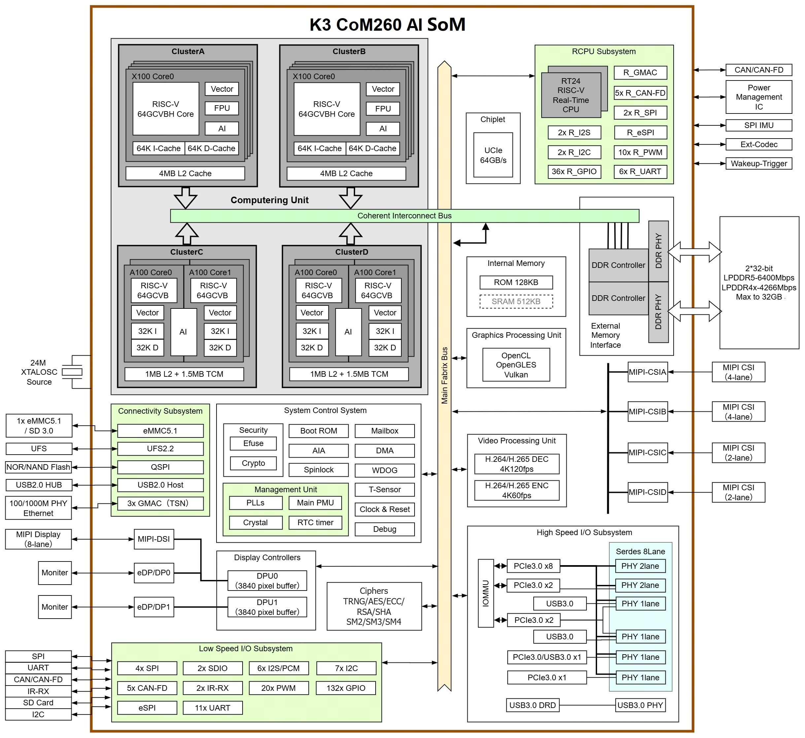

.. raw:: html

   

平台介绍
========

点击下载 `K3 CoM260 开发套件用户使用指南 (PDF) <https://cdn-resource.spacemit.com/file/product/K3/k3_com260_ug_zh.pdf>`_

产品简介
--------

K3-CoM260 是进迭时空推出的首款金手指（Gold Finger）封装产品，集成 RISC-V AI CPU 芯片 K3、LPDDR5 芯片、GPHY 芯片和无源器件等。

K3-CoM260 支持多种操作系统和开发套件，包括进迭原生的 Bianbu 系统、Ubuntu 操作系统、Linux 和 OpenHarmony 等，配套 AI 全栈开发套件，能够满足 AI 多样化的开发需求。

K3-CoM260 提供了丰富的接口，涵盖 MIPI-DSI、MIPI-CSI、DP 1.2、SDIO 3.0、eSPI、SPI、I2S、I2C、CAN-FD、PWM、UART、USB 2.0、USB 3.0、PCIe 3.0、GMAC 等。凭借其高性能和丰富的接口资源，K3-CoM260 是 RISC-V 端侧应用方案和产品开发的更优选择。

目标应用
--------

#. AI 边缘计算

#. 大模型推理一体机

#. 智能机器人

#. 产品框图

主要特点
--------

#. 卓越的 CPU 性能：8 个高性能计算大核 X100 结合 8 个 AI 核 A100，提供超过 130 KDMIPS 的 CPU 算力。X100 单核 SPECint2006 > 9.0/GHz，最大主频 2.4 GHz。

#. 同构融合 AI 算力：提供 60 TOPS AI 算力，以超宽并行计算的 AI 核提供强大的通用 AI 算力，实现与所有主流 AI 生态的快速对接，7B 本地大模型算力 > 10 Tokens/s。

#. 最新的 RISC-V 架构，超级并行计算能力：A100 支持高达 1024 bit 的 RVV 1.0 并行计算，支持最新的 RVA23 Profile 和 Vector Crypto 标准。

#. 丰富的 I/O 扩展接口：集成多套高速扩展接口，灵活应对各类计算机扩展需求：8 lanes PCIe、3 套 USB 3.0、1 套 GMAC 等。

#. 完整的硬件虚拟化：完整的硬件虚拟化技术，支持 RV Hypervisor 1.0 扩展、RV AIA 扩展、RV IOMMU 扩展，提供 CPU、内存、中断、I/O 的完整硬件虚拟化。

#. 更高等级的安全防御技术支持：M/S/U 三种处理器权限；支持硬件抵抗幽灵、熔断等攻击；支持国密 2、3、4 硬件安全技术。

#. 符合工业级标准：CPU 核、多级 Cache、SRAM 支持 ECC 设计，在 -40˚C～85˚C 的环境温度下仍能提供稳定可靠的持续算力输出，满足工业应用的苛刻环境需求。

处理器框图
----------

