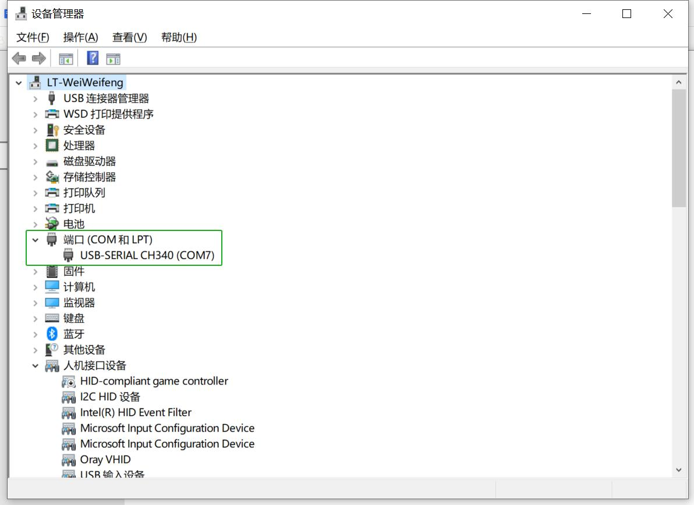
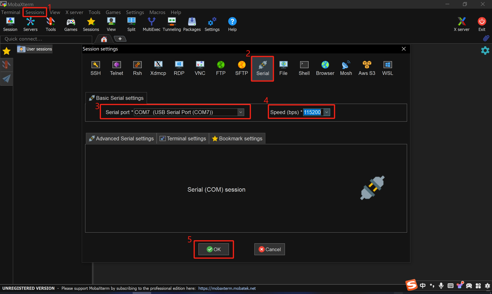

.. raw:: html

   

测试指导
========

接口连接
--------

请将上位机通过 USB 转 TTL 设备与 K3-CoM260 载板 12 Pin 接口的 TX、RX、GND 正确连接。接口信号如下图所示：

.. image:: ../../../image/MYZR-进迭时空/MYZR-K3-CoM260/接口连接.jpeg
   :alt: 接口连接.jpeg
   :width: 100%

Windows 调试
------------

以下以 MobaXterm 为例说明操作步骤：

请先正确连接硬件串口，并在 Windows 设备管理器的“端口”中确认系统已识别对应的 COM 口（如图所示）。

#. 打开 MobaXterm 软件，依次选择Sessions → New Session。

#. 在弹出的对话框中，选择Serial。

#. 在Serial port下拉菜单中，选择已识别的 COM 口。

#. 将Speed设置为115200。

#. 点击OK，进入串口日志输出页面。

注意事项
--------

K3 CoM260 适用于实验室或工程环境。开始操作前，请仔细阅读以下注意事项：

#. 任何情况下不可对屏幕接口、CSI 接口及扩展板进行热插拔操作。

#. 拆封包装和安装前，为避免静电释放（ESD）对开发板硬件造成损伤，请采取必要的防静电措施。

#. 拿取开发板时，请握持板边，避免触碰板上的外露金属部分，以免静电损坏板上元器件。

#. 请将开发板放置于干燥、平整的表面，并确保其远离热源、电磁干扰源、辐射源以及电磁辐射敏感设备（如医疗设备）等。
