.. raw:: html

   

硬件开发指导
============

电源框图
--------

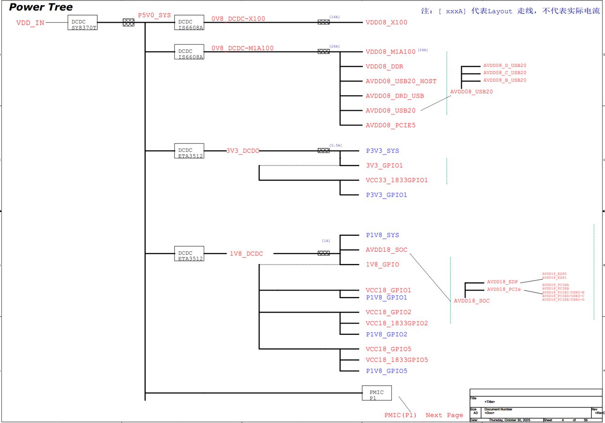

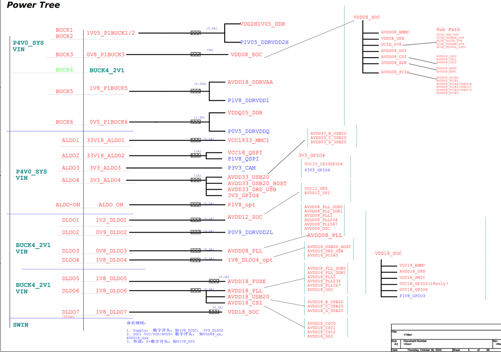

Boot Download Sel & JTAG Sel
----------------------------

Boot Download Sel 与 JTAG Sel 示意图如下。

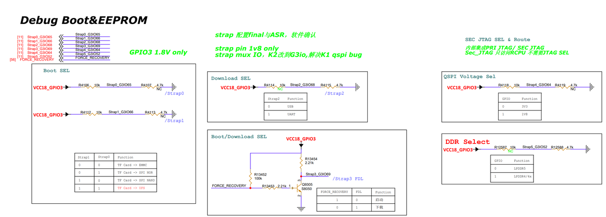

I2C 地址
--------

K3 CoM260 预留了丰富的外围接口。在调试 I2C 外设时，可能涉及 I2C 通道复用。下图列出了 K3 CoM260 开发套件对应的 I2C 地址及上拉电源配置，以避免地址冲突和电平不匹配。

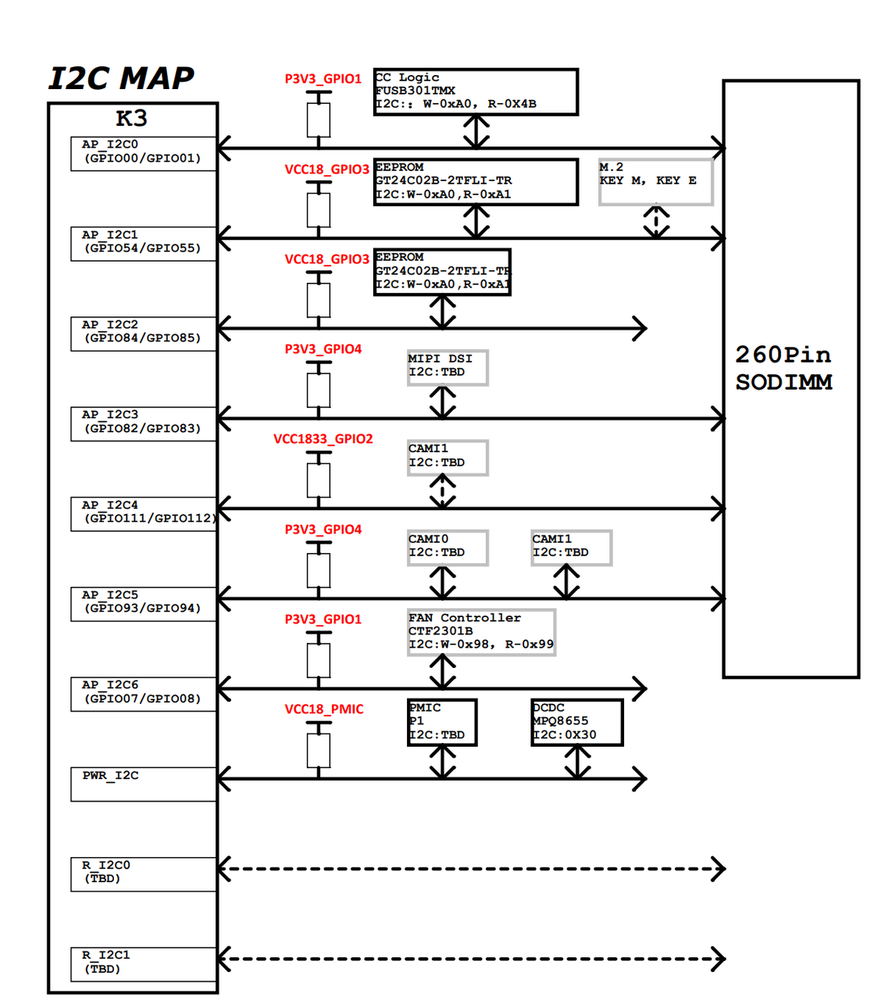

模块简述
--------

电源输入
~~~~~~~~

K3 CoM260 开发套件仅提供 DCIN 一种电源输入方式，板载 DC Jack 接口规格为外径 6.3 mm、内径 2.5 mm，需搭配支持 19 V/2.37 A 或 12 V/5 A 输出的 DC Jack 电源适配器。

存储器
~~~~~~

K3 CoM260 模组集成了以下 4 类存储器：

#. UFS2.2：模组板载 UFS 存储，默认容量为 128 GB。

#. SPI Flash：板载 SPI Flash。

#. DDR：采用 2 颗 LPDDR5 芯片，单颗容量可选 4 GB / 8 GB / 16 GB，对应模组总容量为 8 GB / 16 GB / 32 GB。

#. EEPROM：用于存储板卡信息。

按键输入
~~~~~~~~

K3 CoM260 开发套件提供多功能按键接口，包括电源按键、复位按键和下载按键。

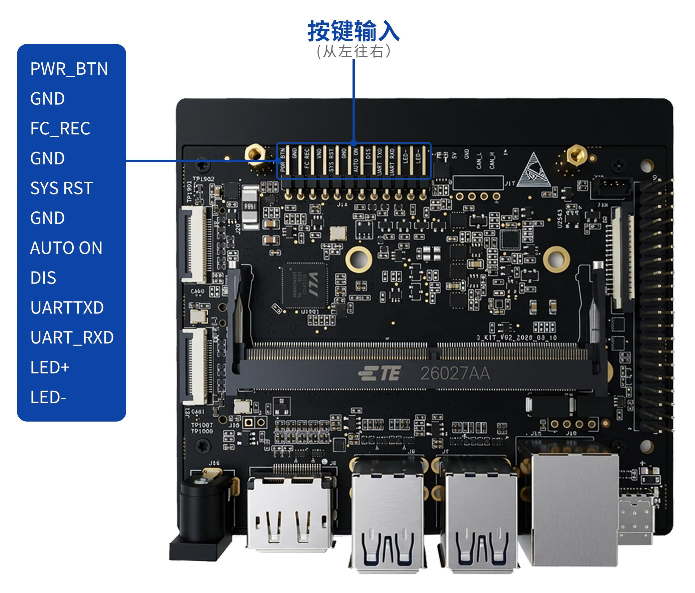

.. raw:: html

   

+------+-----------------+------------------------------------+
| Pin  | 信号名称        | Function                           |
+======+=================+====================================+
| 1    | PC\_LED-        | LED 负极                           |
+------+-----------------+------------------------------------+
| 2    | PC\_LED+        | LED 正极                           |
+------+-----------------+------------------------------------+
| 3    | UART0\_RXD      | DEBUG UART RX                      |
+------+-----------------+------------------------------------+
| 4    | UART0\_TXD      | DEBUG UART TX                      |
+------+-----------------+------------------------------------+
| 5    | BMCU\_ACOK      | 设置为按键开机                     |
+------+-----------------+------------------------------------+
| 6    | AUTO\_ON\_DIS   | 与 BMCU\_ACOK 短接，设置为按键开机 |
+------+-----------------+------------------------------------+
| 7    | GND             | 电源地                             |
+------+-----------------+------------------------------------+
| 8    | PMIC\_RST\_OUTn | 复位                               |
+------+-----------------+------------------------------------+
| 9    | Gnd             | 电源地                             |
+------+-----------------+------------------------------------+
| 10   | FORCE\_RECOVERY | Download                           |
+------+-----------------+------------------------------------+
| 11   | Gnd             | 电源地                             |
+------+-----------------+------------------------------------+
| 12   | SLEEP/WAKE      | 开机/关机                          |
+------+-----------------+------------------------------------+

MIPI CSI 高速连接器
~~~~~~~~~~~~~~~~~~~

K3-CoM260 不限定支持特定型号的摄像头模组。其高速连接器提供两组 4 Lane MIPI CSI 信号，并可通过模组上的电阻配置灵活选择不同的链路组合模式。

默认配置下，

#. CAM0 支持 2 lanes

#. CAM1 支持 2+2 lanes 或 4 lanes

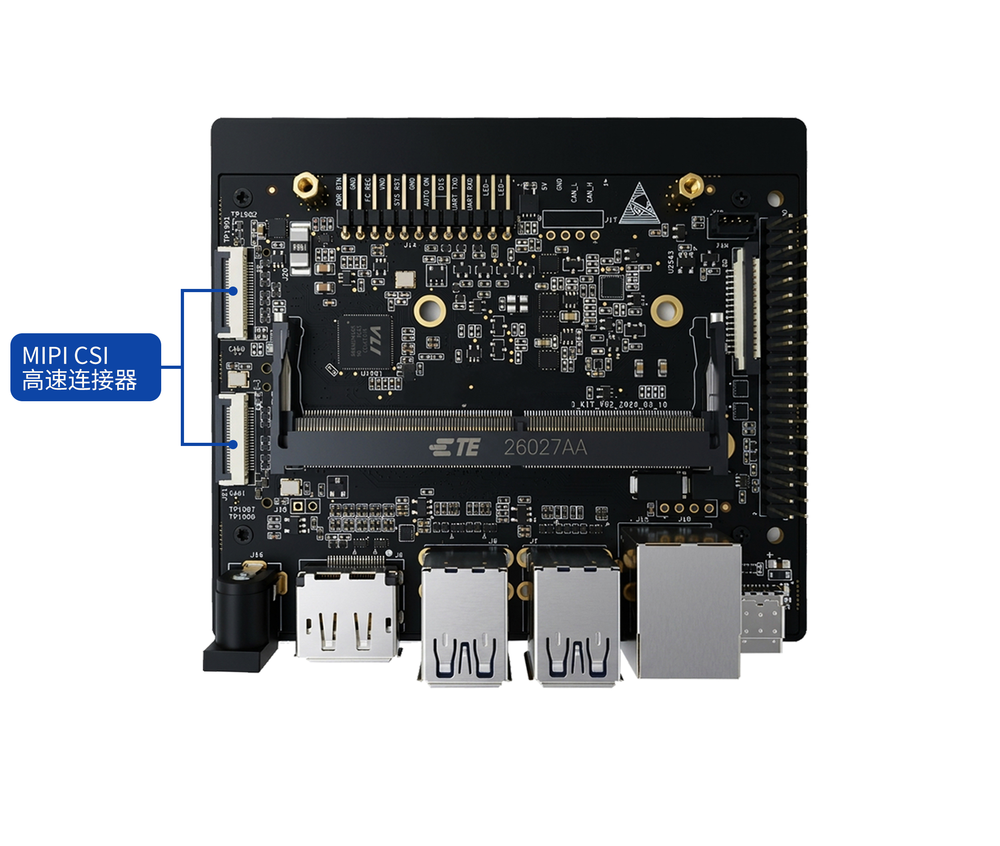

22 Pin 高速连接器接口线序如下：

CAM0

.. raw:: html

   

+------+------------------+
| Pin  | 信号名称         |
+======+==================+
| 1    | VDD\_3V3\_SYS    |
+------+------------------+
| 2    | I2C4\_SDA        |
+------+------------------+
| 3    | I2C4\_SCL        |
+------+------------------+
| 4    | GND              |
+------+------------------+
| 5    | CLK\_CAMCK       |
+------+------------------+
| 6    | CAM\_PWDN        |
+------+------------------+
| 7    | GND              |
+------+------------------+
| 8    | MIPI\_CSI0\_DP1  |
+------+------------------+
| 9    | MIPI\_CSI0\_DN1  |
+------+------------------+
| 10   | GND              |
+------+------------------+
| 11   | MIPI\_CSI0\_DP0  |
+------+------------------+
| 12   | MIPI\_CSI0\_DN0  |
+------+------------------+
| 13   | GND              |
+------+------------------+
| 14   | MIPI\_CSI1\_CLKP |
+------+------------------+
| 15   | MIPI\_CSI1\_CLKN |
+------+------------------+
| 16   | GND              |
+------+------------------+
| 17   | MIPI\_CSI1\_DP1  |
+------+------------------+
| 18   | MIPI\_CSI1\_DN1  |
+------+------------------+
| 19   | GND              |
+------+------------------+
| 20   | MIPI\_CSI1\_DP0  |
+------+------------------+
| 21   | MIPI\_CSI1\_DN0  |
+------+------------------+
| 22   | GND              |
+------+------------------+

CAM1

.. raw:: html

   

+------+------------------+
| Pin  | 信号名称         |
+======+==================+
| 1    | VDD\_3V3\_SYS    |
+------+------------------+
| 2    | I2C4\_SDA        |
+------+------------------+
| 3    | I2C4\_SCL        |
+------+------------------+
| 4    | GND              |
+------+------------------+
| 5    | CLK\_CAMCK       |
+------+------------------+
| 6    | CAM\_PWDN        |
+------+------------------+
| 7    | GND              |
+------+------------------+
| 8    | MIPI\_CSI3\_DP1  |
+------+------------------+
| 9    | MIPI\_CSI3\_DN1  |
+------+------------------+
| 10   | GND              |
+------+------------------+
| 11   | MIPI\_CSI3\_DP0  |
+------+------------------+
| 12   | MIPI\_CSI3\_DN0  |
+------+------------------+
| 13   | GND              |
+------+------------------+
| 14   | MIPI\_CSI2\_CLKP |
+------+------------------+
| 15   | MIPI\_CSI2\_CLKN |
+------+------------------+
| 16   | GND              |
+------+------------------+
| 17   | MIPI\_CSI2\_DP1  |
+------+------------------+
| 18   | MIPI\_CSI2\_DN1  |
+------+------------------+
| 19   | GND              |
+------+------------------+
| 20   | MIPI\_CSI2\_DP0  |
+------+------------------+
| 21   | MIPI\_CSI2\_DN0  |
+------+------------------+
| 22   | GND              |
+------+------------------+

MIPI DSI 屏连接器
~~~~~~~~~~~~~~~~~

K3 CoM260 支持树莓派 4.3 英寸电容触摸显示屏。

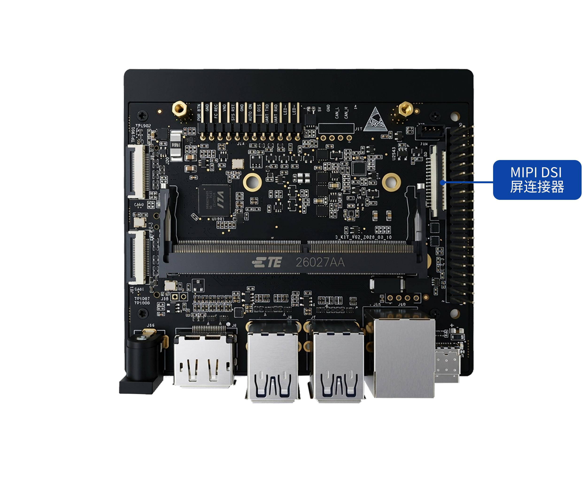

屏接口线序如下：

.. raw:: html

   

+------+-----------------------+-----------------------+------+
| Pin  | 信号名称              | 信号名称              | Pin  |
+======+=======================+=======================+======+
| 1    | GND                   | GND                   | 2    |
+------+-----------------------+-----------------------+------+
| 3    | MIPI\_DSI1\_LANE1\_DN | MIPI\_DSI1\_LANE1\_DN | 4    |
+------+-----------------------+-----------------------+------+
| 5    | MIPI\_DSI1\_LANE1\_DP | MIPI\_DSI1\_LANE1\_DP | 6    |
+------+-----------------------+-----------------------+------+
| 7    | GND                   | GND                   | 8    |
+------+-----------------------+-----------------------+------+
| 9    | MIPI\_DSI1\_CLK\_N    | MIPI\_DSI1\_CLK\_N    | 10   |
+------+-----------------------+-----------------------+------+
| 11   | MIPI\_DSI1\_CLK\_P    | MIPI\_DSI1\_CLK\_P    | 12   |
+------+-----------------------+-----------------------+------+
| 13   | GND                   | GND                   | 14   |
+------+-----------------------+-----------------------+------+
| 15   | MIPI\_DSI1\_LANE0\_DN | MIPI\_DSI1\_LANE0\_DN | 16   |
+------+-----------------------+-----------------------+------+
| 17   | MIPI\_DSI1\_LANE0\_DP | MIPI\_DSI1\_LANE0\_DP | 18   |
+------+-----------------------+-----------------------+------+
| 19   | GND                   | GND                   | 20   |
+------+-----------------------+-----------------------+------+
| 21   | I2C3\_SCL             | I2C3\_SCL             | 22   |
+------+-----------------------+-----------------------+------+
| 23   | I2C3\_SDA             | I2C3\_SDA             | 24   |
+------+-----------------------+-----------------------+------+
| 25   | GND                   | GND                   | 26   |
+------+-----------------------+-----------------------+------+
| 27   | LCD\_VCC33            | LCD\_VCC33            | 28   |
+------+-----------------------+-----------------------+------+
| 29   | LCD\_VCC33            | LCD\_VCC33            | 30   |
+------+-----------------------+-----------------------+------+

Type-C 连接器
~~~~~~~~~~~~~

K3 CoM260 开发套件的 Type-C 连接器仅支持 OTG 模式，不支持对内供电。

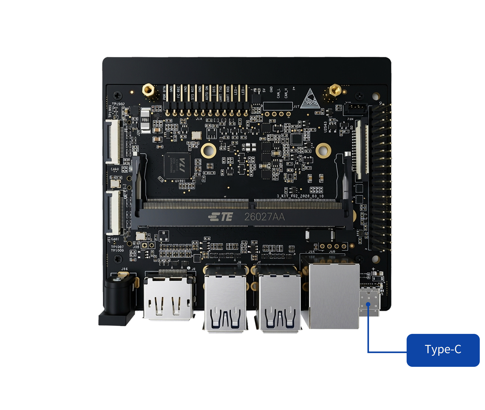

DP 输出接口
~~~~~~~~~~~

K3 CoM260 开发套件支持 1 路 DP Type-A 输出接口，最高支持 DP 1.2，最大支持 3840 × 2160 @ 60fps 视频输出。

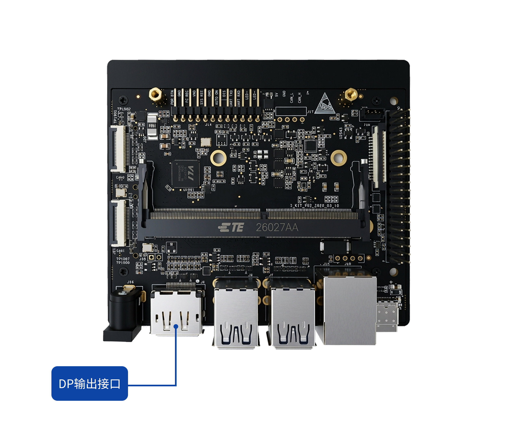

DP 显示使用说明：

#. K3 CoM260 开发套件仅支持 DP 显示输出（不支持 HDMI），请使用 DP 线缆连接支持 DP 输入的显示器，方可正常点亮屏幕。

#. 如需连接 HDMI 显示器，请选用主动式 DP 转 HDMI 转换器（内置 DP 转 HDMI 转换芯片）；被动式 DP 转 HDMI 转接线无转换芯片，无法使用。参考链接：DP 转 HDMI 主动式转换器

.. code-block:: text

   注意：其他开发平台随附的 DP 转 HDMI 线缆多为被动式，内部无协议转换芯片，与本套件的 DP 接口配合使用时无法正常出图。请勿直接复用其他平台随附的显示线缆，请按上述要求自行选配主动式转换器。

USB 接口
~~~~~~~~

K3 CoM260 开发套件提供 4 路 USB 3.0 Type-A 接口，便于连接各类 USB 外设。

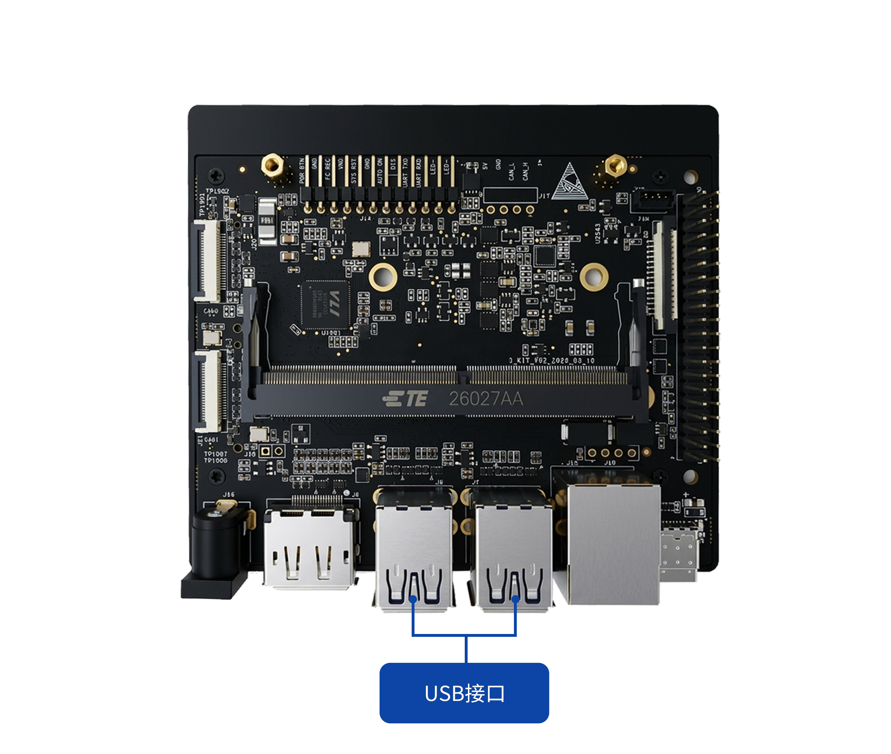

RJ45 接口
~~~~~~~~~

K3 CoM260 开发套件支持 1 个 RJ45 千兆网接口。

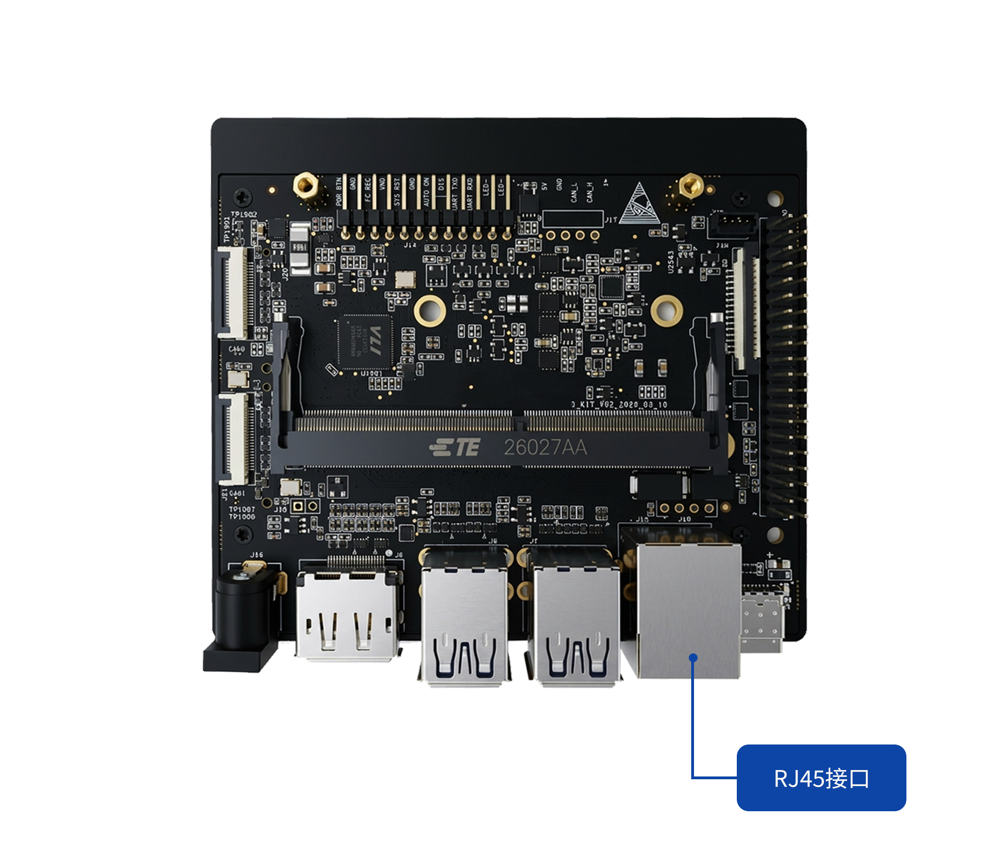

Wi-Fi/BT 模组
~~~~~~~~~~~~~

K3 CoM260 开发套件支持接入 M.2 2230 E-Key 模组，可实现无线网络和蓝牙功能。

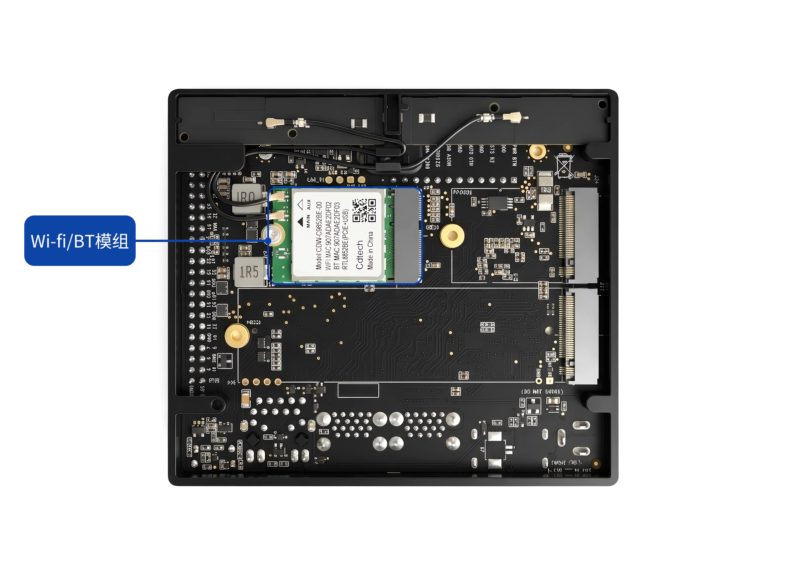

40 Pin 接口
~~~~~~~~~~~

K3 CoM260 开发套件提供 40 Pin 双排插针接口，线序如下：

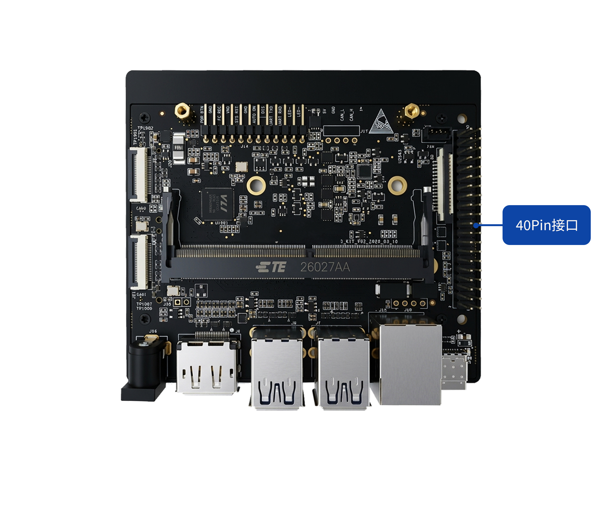

.. code-block:: text

   注：IO Function 可根据需求自行配置。

.. raw:: html

   

+------+------------------+------------------+------+
| Pin  | 信号名称         | 信号名称         | Pin  |
+======+==================+==================+======+
| 1    | VDD\_3V3\_SYS    | VDD\_5V\_GPIO    | 2    |
+------+------------------+------------------+------+
| 3    | I2C3\_SDA        | VDD\_5V\_GPIO    | 4    |
+------+------------------+------------------+------+
| 5    | I2C3\_SCL        | GND              | 6    |
+------+------------------+------------------+------+
| 7    | GPIO09           | UART1\_TXD\_LS   | 8    |
+------+------------------+------------------+------+
| 9    | GND              | UART1\_RXD\_LS   | 10   |
+------+------------------+------------------+------+
| 11   | UART1\_RTS\_LS   | I2S0\_SCLK\_LS   | 12   |
+------+------------------+------------------+------+
| 13   | R-SPI0\_SCK\_LS  | GND              | 14   |
+------+------------------+------------------+------+
| 15   | GPIO12\_LS       | R-SPI0\_CS1\_LS  | 16   |
+------+------------------+------------------+------+
| 17   | VDD\_3V3\_SYS    | R-SPI0\_CS\_LS   | 18   |
+------+------------------+------------------+------+
| 19   | SPI0\_MOSI\_LS   | GND              | 20   |
+------+------------------+------------------+------+
| 21   | SPI0\_MISO\_LS   | R-SPI0\_MISO\_LS | 22   |
+------+------------------+------------------+------+
| 23   | SPI0\_SCK\_LS    | SPI0\_CS0\_LS    | 24   |
+------+------------------+------------------+------+
| 25   | GND              | SPI0\_CS1\_LS    | 26   |
+------+------------------+------------------+------+
| 27   | I2C0\_SDA        | I2C0\_SCL        | 28   |
+------+------------------+------------------+------+
| 29   | GPIO01\_LS       | GND              | 30   |
+------+------------------+------------------+------+
| 31   | GPIO11\_LS       | GPIO07\_LS       | 32   |
+------+------------------+------------------+------+
| 33   | GPIO13\_LS       | GND              | 34   |
+------+------------------+------------------+------+
| 35   | I2S0\_LRCK\_LS   | UART1\_CTS\_LS   | 36   |
+------+------------------+------------------+------+
| 37   | R-SPI0\_MOSI\_LS | I2S0\_SDIN\_LS   | 38   |
+------+------------------+------------------+------+
| 39   | GND              | I2S0\_SDOUT\_LS  | 40   |
+------+------------------+------------------+------+

TF-Card 接口
~~~~~~~~~~~~

K3 CoM260 支持 TF 卡接入，便于扩展存储设备。同时支持 Debug 扩展卡，用于 JTAG 调试。

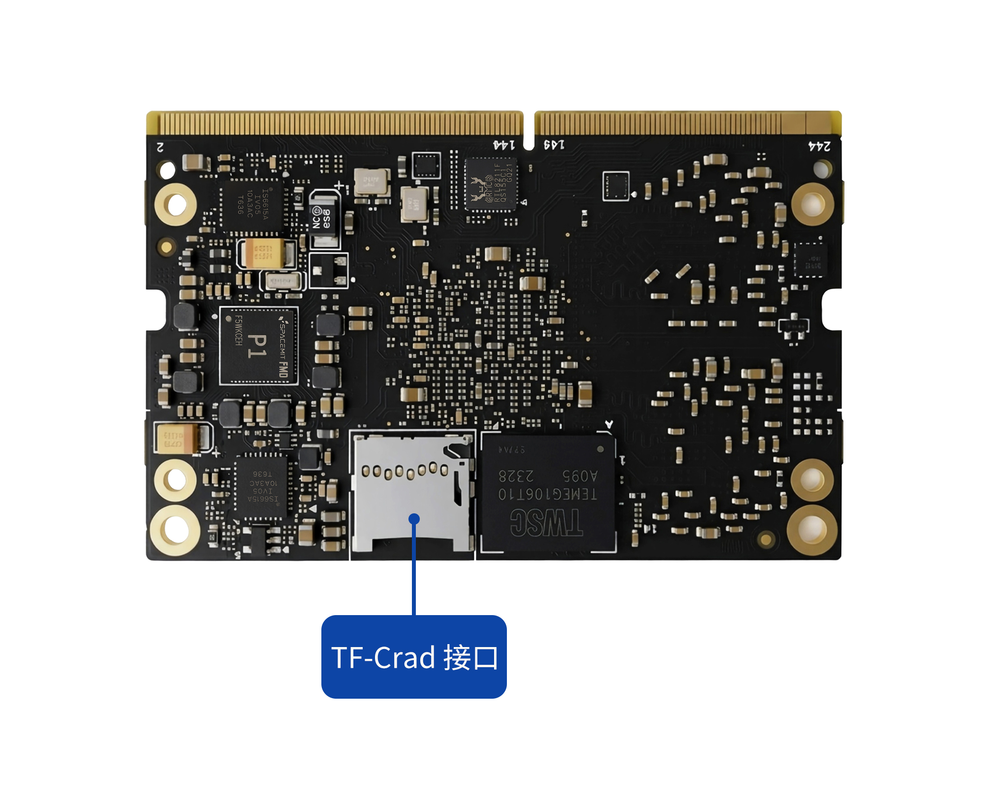

M.2 M-Key 接口
~~~~~~~~~~~~~~

K3 CoM260 开发套件提供 2 × M.2 M-Key 接口，分别支持 2280（图中较长 SSD）和 2230（图中较短 SSD）规格的 NVMe SSD，便于接入 SSD 及其他 M.2 M-Key 设备。

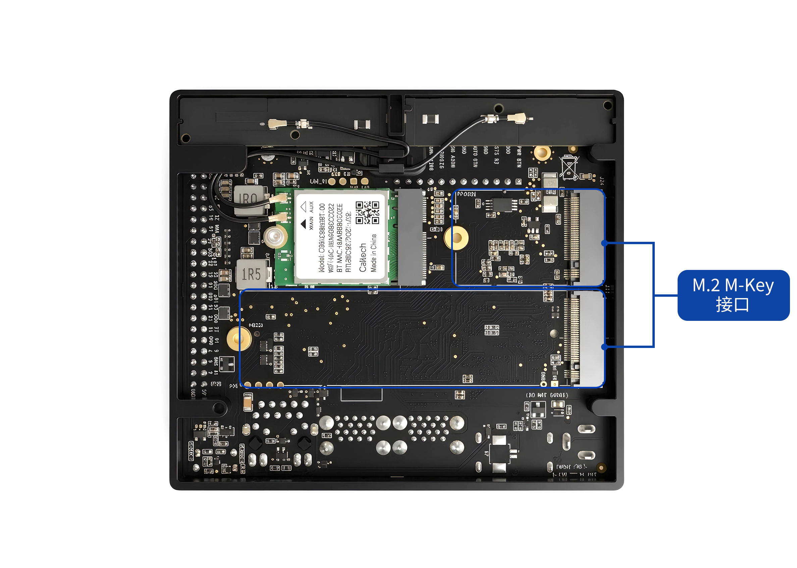

CAN FD 接口
~~~~~~~~~~~

K3 CoM260 开发套件板载 CAN 收发器，可直接连接 CAN 设备。

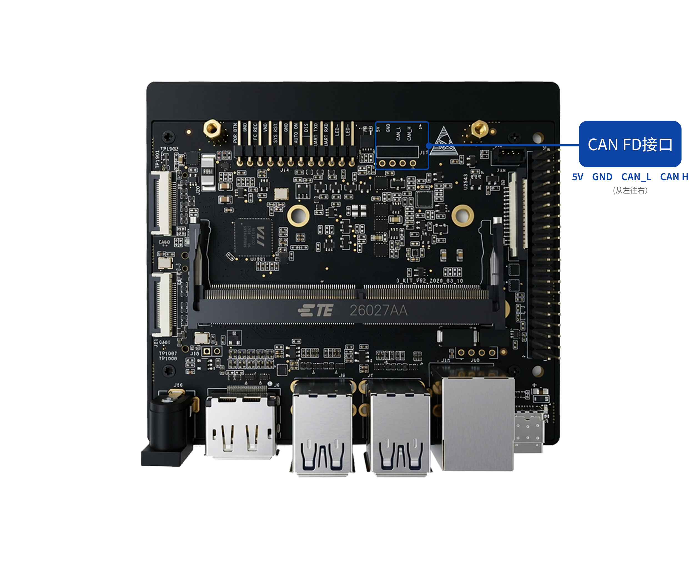
